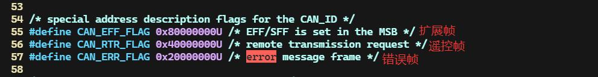
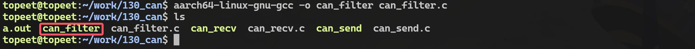
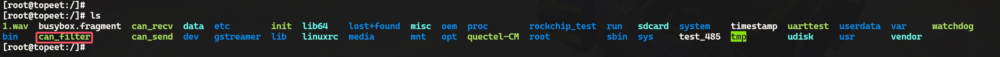
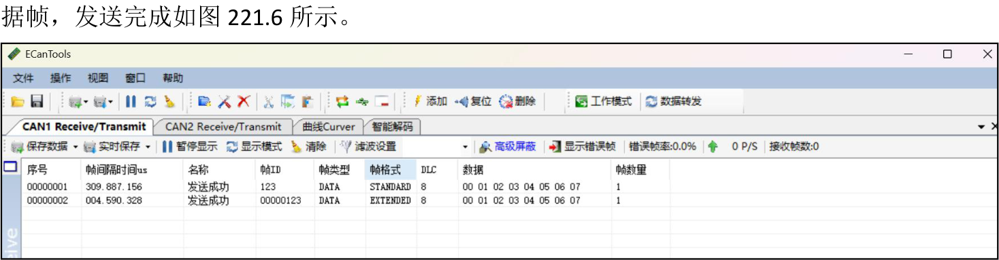
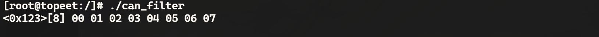

# 第221章 过滤规则的设置

在前文中，我们分别介绍了通过CAN 工具和应用程序收发CAN 帧的方法。实际应用中，通常需对接收的数据进行过滤处理，例如仅接收ID 为0x123 的帧。本章将详细讲解如何在工具及应用程序中设置CAN 过滤规则。
## 221.1 使用can 工具设置过滤规则
在Linux 中，可通过candump 工具设置过滤规则。语法支持两种形式：·匹配规则：<can id>:<can mask>·排除规则：<can id>~<can mask>含义分别如下：<can_id>:<can_mask>：表示当接收到的CAN ID 满足条件<received can_id> &mask == can_id &mask 时匹配。其中，mask 决定了哪些位需要参与匹配，只有对应位为1 的部分才会被检查，而can_id 则是期望匹配的目标ID。这种规则通常用于筛选符合特定ID 和格式的帧，例如只接收某个标准帧或扩展帧。<can_id>~<can_mask>：则与第一种相反，表示当接收到的CAN ID 满足条件<received can_id>& mask != can_id & mask 时匹配。它的作用是排除特定ID 的帧，即忽略满足条件的帧，而接收其他所有帧。这种规则适用于需要过滤掉某些特定帧的场景，例如屏蔽某个干扰源或排除不需要的远程帧。1.扩展知识标准帧与扩展帧的区分：标准帧的CAN ID 长度为11 位，帧ID 范围是0x000 到0x7FF。扩展帧的CAN ID 长度为29 位，帧ID 范围是0x00000000 到0x1FFFFFFF。CAN ID 特殊标志位说明：CAN ID 实际是一个32 位的值，在内核源码include/uapi/linux/can.h 头文件中，还有以下特殊标志位用于识别帧类型（对应的宏定义中不包含11 位或29 位ID，只有帧类型），如图221.1所示：


图221.1这些标志位位于高3 位，因此在写过滤规则时，高位掩码可以用来匹配帧类型。过滤规则示例：(1)只接收扩展帧，且CAN ID 精确匹配0x12345678
```c
candump can0,12345678:1FFFFFFF
```
其中mask = 0x1FFFFFFF 表示比较29 位ID。(2) 只接收标准帧和非遥控帧，且CAN ID 精确匹配0x123
```c
candump can0,123:C00007FF
```
其中mask = 0xC00007FF，0xC00007FF 的二进制为1100 0000 0000 0000 0000 0111 11111111，高2 位掩码分别对应CAN_EFF_FLAG 和CAN_RTR_FLAG，也就是说掩码指定“必须是标准帧（EFF=0）并且是数据帧（RTR=0）”，低11 位掩码0x7FF 匹配标准帧ID。(3) 只接收标准帧或遥控帧，且CAN ID 精确匹配0x123
```c
candump can0,123:800007FF
```
其中mask = 0x800007FF，掩码高位只匹配CAN_EFF_FLAG = 0，说明可以接收标准数据帧或标准遥控帧。(4) 排除扩展帧，且CAN ID 精确匹配0x12345678
```c
candump can0,12345678~1FFFFFFF
```
使用~表示排除匹配。其中mask = 0x1FFFFFFF，匹配所有29 位ID，所以该规则排除了指定的扩展帧，其他帧可接收。将candump 的过滤规则进行总结，如表221.1 所示。表221.1规则格式含义
```c
12345678:1FFFFFFF只接收扩展帧，且CAN ID 精确匹配0x12345678
  123:C00007FF只接收标准帧和非遥控帧，且CAN ID 精确匹配0x123
  123:800007FF只接受标准帧数据帧+标准遥控帧，且CAN ID 精确匹配0x123
12345678~1FFFFFFF排除扩展帧，且CAN ID 精确匹配0x12345678
     123:7FF接收标准帧ID 为0x123，扩展帧也可能匹配低11 位相同的
```

```c
123:FFFFFFFF完全匹配，包括标志位和ID，仅接收完全一致的帧
```
注：如果想要应用多条匹配规则，只需要通过逗号追加即可，例如使用candumpcan0,123:C00007FF,456:C00007FF 命令只接收标准帧，且CAN ID 精确匹配0x123 和0x456。
## 221.2 使用应用程序设置过滤规则
应用层设置过滤规则需使用setsockopt()函数配置CAN 套接字，核心结构为struct can_filter。函数原型：
```c
int setsockopt(int sockfd, int level, int optname, const void *optval, socklen_t optlen);
```
参数详解：（1）sockfd: 通过socket()函数创建的套接字描述符，指定要绑定的套接字。（2）level: 指定选项的协议级别。对于CAN 通信，通常设置为SOL_CAN_RAW，表示操作的是CAN 协议相关的选项。（3）optname: 指定要设置的具体选项名称。在CAN 通信中，常用选项包括：CAN_RAW_FILTER：设置CAN 数据帧的过滤规则。CAN_RAW_ERR_FILTER：设置是否接收错误帧。CAN_RAW_LOOPBACK：设置是否启用本地回环模式。（4）optval: 指向存储选项值的缓冲区。对于CAN_RAW_FILTER，它是一个指向structcan_filter 或struct can_filter[]的指针，表示过滤规则。如果需要设置多个过滤规则，可以传递一个struct can_filter 数组。（5）optlen: 表示optval 缓冲区的大小（以字节为单位）。对于单个过滤规则，通常使用sizeof(struct can_filter)；对于多个规则，则使用sizeof(struct can_filter) * 。返回值：成功时返回0，表示选项设置成功，失败时返回-1。过滤规则由struct can_filter 定义，其定义如代码清单221.1 所示。代码清单221.1
```c
struct can_filter {
       canid_t can_id;// CAN ID 和标志位
       canid_t can_mask; // 掩码，决定哪些位需要参与匹配
};
```
can_id：表示期望匹配的CAN ID，可以包含标准帧或扩展帧的ID，以及标志位（如EFF、

RTR 等）。can_mask：表示掩码，决定哪些位需要参与匹配，每一位为1 表示该位必须匹配，为0 表示忽略该位，而在Linux 源码中提供了一些掩码宏定义，整理好的掩码宏定义如表221.2 所示。表221.2掩码值含义实例代码及用途
```c
匹配标准帧的低11 位（0x7FF），can_id = 0x123, can_mask=CAN_SFF_MASK
CAN_SFF_MASK
      忽略扩展帧部分只接收标准帧，且ID 精确匹配0x123
                                  can_id = 0x12345678, can_mask =
  匹配扩展帧的所有29 位
CAN_EFF_MASKCAN_EFF_MASK
       (Ox1FFFFFFF）
                             只接收扩展帧，且ID 精确匹配0x12345678
                                     can_mask = CAN_EFF_FLAG
CAN_EFF_FLAG匹配扩展帧标志位（第30 位）
                             区分标准帧和扩展帧，仅关心是否为扩展帧
                                     can_mask = CAN_RTR_FLAG
CAN_RTR_MASK匹配遥控帧标志位（第31 位）
                             区分数据帧和遥控帧，仅关心是否为遥控帧
                              can_id = 0x123, can_mask = CAN_SFF_MASK
匹配标准帧的低11 位，并区分
CAN_SFF_MASK|CAN_EFF_FLAG|CAN_EFF_FLAG
       是否为扩展帧
                                     接收特定标准帧或扩展帧
                                   can_id= 0x12345678, can_mask =
匹配扩展帧的所有29 位，并区
CAN_EFF_MASK|CAN_RTR_FLAGCAN_EFF_MASK | CAN_RTR_FLAG
      分是否为遥控帧
                                     接收特定扩展帧或遥控帧
                              can_id = 0x123, can_mask = CAN_SFF_MASK
匹配标准帧的低11 位，并区分
CAN_SFF_MASK|CAN_RTR_FLAG|CAN_RTR_FLAG
       是否为遥控帧
                                     接收特定标准帧或遥控帧
                              can_id = 0x123, can_mask = CAN_SFF_MASK
CAN_SFF_MASK|CAN_EFF_FLAG匹配标准帧的低11 位，并区分
                                  | CAN_EFF_FLAG |CAN_RTR_FLAG
|CAN_RTR_FLAG是否为扩展帧和遥控帧
                                      只接收标准帧的数据帧
匹配所有32 位（包括标准帧、can_id = 0x123, can_mask = 0xFFFFFFFF
0xFFFFFFFF
 扩展帧、遥控帧标志位等）精确匹配某个完整的CANID 和帧类型
忽略所有位，匹配所有帧（即can_mask = 0x0
0x0
     不设置过滤规则）接收所有帧，无过滤规则
```
接下来编写应用程序通过设置过滤规则只接收标准帧的数据帧，且ID 精确匹配0x123 和只接收扩展帧的数据帧，且ID 精确匹配0x456。实验代码can_filter.c 如代码清单221.2 所示。本实验代码存放在网盘iTOP-RK3568 开发板\07_学习教程配套资料\03_Linux 驱动配套资料\04_Linux 驱动程序\130_can\04_filter 路径下。代码清单221.2
```c
#include <stdio.h>
#include <stdlib.h>
```

```c
#include <string.h>
#include <unistd.h>
#include <net/if.h>
#include <sys/ioctl.h>
#include <sys/socket.h>
#include <linux/can.h>
#include <linux/can/raw.h>
#define BUF_SIZE 128 //缓冲区大小
int main() {
    int sockfd; //套接字文件描述符
    struct sockaddr_can addr; //CAN 地址结构体
    struct ifreq ifr; //网络接口请求结构体
    struct can_frame frame; //CAN 帧结构体
    struct can_filter rfilter[2]; //过滤规则数组
    char buf[BUF_SIZE]; //格式化输出缓冲区
    int i, n;
    FILE *out = stdout; //输出文件流（标准输出）
    //创建CAN 套接字
    if ((sockfd = socket(PF_CAN, SOCK_RAW, CAN_RAW)) < 0) {
        perror("Socket creation failed");
        return -1;
    }
    //指定CAN 接口名称
    strcpy(ifr.ifr_name, "can0");
    if (ioctl(sockfd, SIOCGIFINDEX, &ifr) < 0) {
        perror("ioctl failed");
        close(sockfd);
        return -1;
    }
    //设置地址信息
    addr.can_family = AF_CAN;
    addr.can_ifindex = ifr.ifr_ifindex;
    //绑定CAN 接口
    if (bind(sockfd, (struct sockaddr *)&addr, sizeof(addr)) < 0) {
        perror("Bind failed");
        close(sockfd);
        return -1;
    }
```

```c
//设置过滤规则
//第一条规则：只接收标准帧的数据帧，且ID 精确匹配0x123
rfilter[0].can_id = 0x123; //目标CAN ID
rfilter[0].can_mask = CAN_SFF_MASK | CAN_EFF_FLAG | CAN_RTR_FLAG; //匹配标准帧，排除扩展帧和
遥控帧
//第二条规则：只接收扩展帧的数据帧，且ID 精确匹配0x456
rfilter[1].can_id = 0x456; //目标CAN ID
rfilter[1].can_mask = CAN_EFF_MASK | CAN_RTR_FLAG; //匹配扩展帧，排除遥控帧
//应用过滤规则
if (setsockopt(sockfd, SOL_CAN_RAW, CAN_RAW_FILTER, &rfilter, sizeof(rfilter)) < 0) {
    perror("setsockopt failed");
    close(sockfd);
    return -1;
}
//循环接收CAN 帧
while (1) {
    //接收CAN 帧
    if (read(sockfd, &frame, sizeof(frame)) < 0) {
        perror("Read failed");
        break;
    }
    //格式化输出CAN 帧信息
    if (frame.can_id & CAN_EFF_FLAG) {
        //扩展帧
        n = snprintf(buf, BUF_SIZE, "<0x%08x>", frame.can_id & CAN_EFF_MASK);
    } else {
        //标准帧
        n = snprintf(buf, BUF_SIZE, "<0x%03x>", frame.can_id & CAN_SFF_MASK);
    }
    //添加数据长度
    n += snprintf(buf + n, BUF_SIZE - n, "[%d]", frame.can_dlc);
    //添加数据内容
    for (i = 0; i < frame.can_dlc; i++) {
        n += snprintf(buf + n, BUF_SIZE - n, " %02x", frame.data[i]);
    }
    //如果遥控帧
```

```c
if (frame.can_id & CAN_RTR_FLAG) {
    n += snprintf(buf + n, BUF_SIZE - n, " remote request");
}
//输出到标准输出
fprintf(out, "%s\n", buf);
//刷新输出缓冲区
fflush(out);
}
//关闭套接字
close(sockfd);
return 0;
}
```
使用aarch64-linux-gnu-gcc -o can_filter can_filter.c 命令交叉应用程序，如图221.2 所示。

图221.2然后将编译完成的可执行程序拷贝到开发板上，拷贝完成如图221.3 所示。

图221.3然后使用以下命令设置CAN 接口波特率并启动。
```c
ip link set can0 type can bitrate 250000
ifconfig can0 up
```
如图221.4 所示。

图221.4然后使用./can_recv 命令运行程序等待数据的发送，运行之后如图221.5 所示。

图221.5然后使用USB 转CAN 设备向iTOP-RK3568 开发板发送帧ID 为123 的标准数据帧和扩展数


图221.6由图221.7 中开发板端的接收结果可以看出，仅接收到了标准数据帧，说明过滤规则生效，成功屏蔽了扩展帧。

图221.7继续测试帧ID 为0x456 的帧，使用USB 转CAN 设备分别向iTOP-RK3568 开发板发送标准数据帧、标准遥控帧、扩展数据帧和扩展遥控帧。如图221.8 可以看到，开发板只接收到了标准数据帧和扩展数据帧。虽然过滤规则设定的是仅接收扩展帧，但由于标准帧的11 位ID 与扩展帧的低11 位存在重叠，导致标准帧被匹配从而被接收。因此，测试结果与代码一致。

图221.8至此，关于如何在应用程序中设置过滤规则的应用程序就测试完成了。

