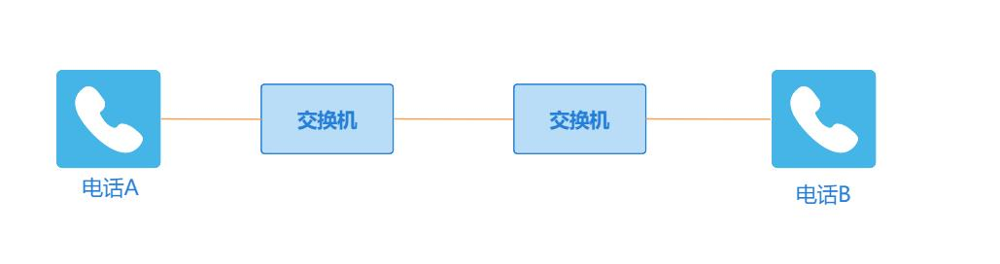
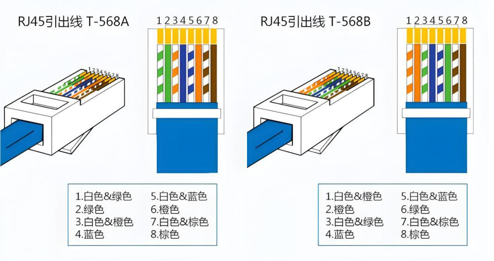
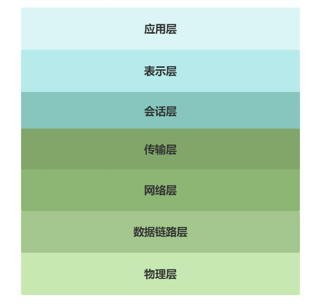
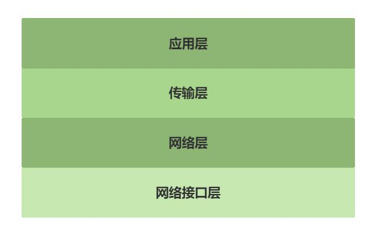
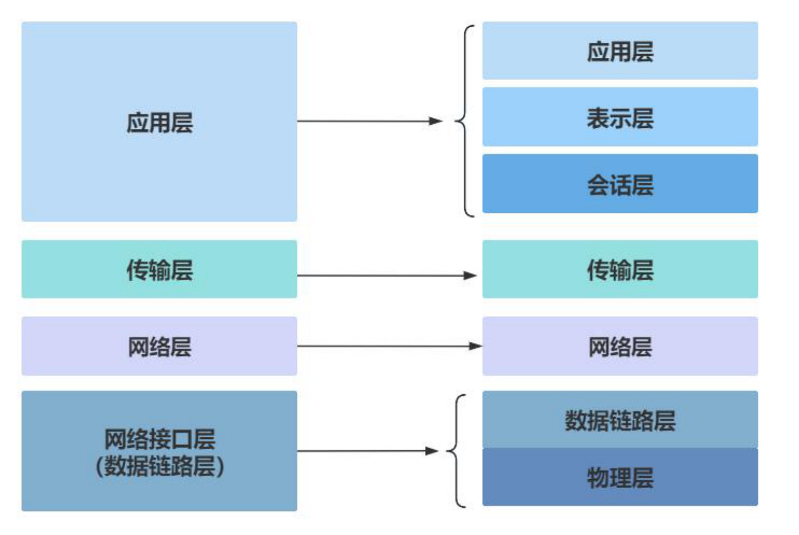

# 第222章 网络通信基础

## 222.1 诞生与发展
计算机网络的前身是电话网络，通信双方需通过物理线缆建立连接，连接示意图如图226.1所示。

图222.1随着技术演进，计算机网络逐渐形成以数据传输和信息交互为核心的通信系统，例如手机A 与手机B 的跨设备通信。随着应用场景拓展，网络需求从基础通信升级为多维度能力要求，具体包括：提升可靠性与稳定性、支持异构计算机互联、实现节点平等访问，以及通过冗余路由保障网络稳健性。计算机网络的发展历程如下所述：1969 年，ARPAnet 最初连接了美国四所大学的计算机，采用分组交换技术，实现计算机间数据传输。1972 年，首次实现与英国、挪威计算机的跨大西洋连接。1973 年开始研究传输控制协议（TCP）和网际协议（IP）。1984 年，TCP/IP 协议成为计算机网络通信标准。1986 年，美国国家科学基金会NSF 建立了广域网（因特网的前身）。1994 年，中国的NCFC 网络正式接入NSFnet, 中国加入到了因特网。
## 222.2 网络协议
网络协议是网络中设备进行通信的规则和约定，常见的网络协议如下所述：

TCP/IP 协议TCP/IP（Transmission Control Protocol/Internet Protocol）协议，即传输控制协议/网际协议，是用于互联网通信的基础协议族。1.特点面向连接：在传输数据前，TCP 协议会通过“三次握手”建立连接，以此确保通信双方的可靠性以及数据传输的有序性。可靠性强：TCP 借助序号、确认应答、重传机制以及流量控制等机制，保障数据的可靠性与完整性。若数据包在传输过程中丢失或损坏，TCP 会要求重新发送，直至数据准确无误地到达。基于字节流：TCP 将应用层数据视作无结构的字节流，不保留消息边界。这表明TCP 并不关注应用层数据的具体内容，仅将其当作一系列字节进行传输。1. 作用TCP/IP 协议采用分层工作方式，每个层级承担特定功能，提供了从网络硬件到应用程序的完整通信解决方案。让不同计算机和网络之间的数据交换得以实现。
UDP 协议UDP（User Datagram Protocol）即用户数据报协议。与TCP 不同，UDP 不提供面向连接的通信方式，也不确保数据的可靠性与完整性。1.特点无连接性：UDP 在发送数据前无需建立连接，每个数据包都独立发送，接收方也无需发送确认应答。这种特性使UDP 具备较低的延迟和较高的传输效率。不可靠性：UDP 无法保证数据包的顺序性、完整性以及可靠性。若数据包在传输过程中出现丢失或损坏的情况，UDP 不会要求重新发送。基于数据报：UDP 会将应用层的数据封装成一个个独立的数据报进行传输，每个数据报都包含完整的目的地址和源地址信息。2.作用UDP 适用于对实时性要求较高的场景，如视频流、音频流以及在线游戏等。在这些应用中，即便少量数据包丢失，也不会对整体体验造成严重影响。
DNS 协议DNS（Domain Name System，域名系统）是一种分布式数据库系统，主要功能是将域名（例如www.example.com）转换为对应的IP 地址（例如192.0.2.1）。借助DNS，用户能够通过易

于记忆的域名访问网站，而不必牢记复杂的IP 地址。
DHCP 协议DHCP（Dynamic Host Configuration Protocol，动态主机配置协议）是一种网络协议，其作用是自动为局域网内的客户端设备分配IP 地址、子网掩码、默认网关以及DNS 服务器地址等网络参数。FTP 协议FTP（File Transfer Protocol，文件传输协议）是用于网络文件传输的协议，可以用于在不同计算机之间实现文件共享，是互联网上进行文件传输的重要工具之一。http/https 协议HTTP（HyperText Transfer Protocol，超文本传输协议）是用于分布式、协作式、超媒体信息系统的应用层协议，是万维网（WWW）数据通信的基础。HTTPS（HyperText Transfer Protocol Secure，超文本传输安全协议）是HTTP 的安全版本，它通过SSL/TLS 协议对数据进行加密，从而保障数据传输的安全性。1.作用HTTP 协议使用户能够通过浏览器访问互联网上的各类资源，如网页、图片、视频等。HTTPS协议则致力于保护用户的数据安全，防止数据在传输过程中被窃取或篡改，广泛应用于网上银行、网上支付、电子商务等对数据安全要求较高的场景。
## 222.3 传输介质
传输介质是指网络中数据传输的物理载体，在嵌入式开发中有线传输中常见的传输介质有网线，电缆，光纤。这里不对无线传输进行讨论。（1）网线网线一般由几根导线组成，常见的是8 根铜导线，两两相互缠绕，形成4 对双绞线。外部包裹绝缘层和护套，起到保护内部导线，防止信息泄露和外界电磁干扰的作用。1.网线种类1 类线和2 类线1 类线与2 类线主要应用于早期的电话通信系统，并不支持数据传输或现代意义上的网络应用。随着网络技术的不断进步，这两类线已被淘汰，不再用于网络布线。3 类线（Category 3, Cat 3）

3 类线是早期以太网电缆标准之一，主要用于传输速率为10Mbps 的传统以太网。在现代网络环境中，3 类网线已很少被使用。4 类网线（Category 4, Cat 4）相较于3 类线，4 类线虽有所提升，但在实际应用中，因其性价比不高，未能得到广泛推广，很快便被更为先进的5 类线所取代。5 类线（Category 5, Cat 5）5 类线是计算机网络中常用的双绞式电缆，支持最高100Mbps 的数据传输速率（FastEthernet）。超5 类线（Category 5e, Cat 5e）超5 类线是5 类线的增强版本，主要用于千兆以太网（1000Mbps），同时向下兼容百兆以太网。6 类线（Category 6，Cat 6）相较于之前的线缆，6 类线在内部结构、材质以及外部保护等方面均有所改进，以此确保更高的传输质量和稳定性。6 类线也是用于千兆以太网（1000Mbps）的传输介质。超6 类线（Category 6A, Cat 6a）超6 类线是6 类线的进一步升级版本，支持10Gbps 的传输速率（万兆以太网）。7 类线（Category 7，Cat 7）7 类线属于屏蔽双绞线（STP），支持10Gbps 的传输速率，具有更高的带宽和更低的信号衰减率。2.网线制作标准网线制作有T568A 和T568B 俩种标准，如图222.2 所示。T568A 标准线序：绿白、绿、橙白、蓝、蓝白、橙、棕白、棕。T568B 标准线序：橙白、橙、绿白、蓝、蓝白、绿、棕白、棕。

图222 .2需要注意的是如果网线两端采用相同的线序标准，称为直连线，用于连接不同类型的设备，如电脑与路由器；若两端线序不同，如一端为T568A，另一端为T568B，则称为交叉线，常用于连接相同类型的设备，如电脑与电脑、交换机与交换机。（2）电缆电缆是一种电能或信号传输装置，通常是由几根或几组导线组成。电缆由导体，绝缘层，护套层组成。（3）光纤光纤是一种以光为信息载体，利用光在玻璃或塑料制成的纤维中全反射原理进行数据传输的线缆。它主要分为单模光纤和多模光纤。
## 222.4 网络模型
网络模型是对网络系统进行层次化划分和功能定义的一种抽象结构，目前，最具代表性的网络模型有OSI 七层网络模型和TCP/IP 四层模型，下面我们分别对它们进行详细介绍。1.OSI 七层网络模型OSI 七层网络模型是国际标准化组织（ISO）专门为实现不同系统之间的互连互通而制定的网络体系结构标准，OSI 七层网络模型示意图如图222.3 所示。

图222.3物理层物理层只需要考虑如何发送0 和1，以及接收端如何识别从而完成比特流的传输，并不需要关心比特流的具体含义。除此以外还规定了网络中的一些电气特性。数据链路层单纯的0 和1 没有意义，数据链路层要将物理层传来的原始比特流转化为一个个独立的帧。并负责链路连接的建立、维护以及终止，同时还具备帧同步、差错控制和流量控制等功能。网络层网络层主要处理数据包从源节点到目标节点的传输与路由问题。也就是建立主机到主机之间的通信。传输层传输层负责提供可靠的端口到端口的数据传输服务。确保数据能够准确无误地从发送端传输到接收端。会话层主要负责管理用户会话，对应用程序之间的对话进行控制，包括对话的开始、结束以及数据交换过程。表示层表示层负责数据格式的转换，如设备固有格式与网络标准格式之间的转换，可以理解是充

当“翻译官”的作用。应用层应用层是直接面向用户的一层，通过应用程序之间的交互完成特定的网络应用。
2.TCP/IP 四层模型TCP/IP 四层模型是对OSI 七层模型的简化，它将网络功能划分为网络接口层、网际层、传输层和应用层，TCP/IP 四层模型示意图如下图222.4 所示：

图222.4
应用层应用层直接与应用程序交互。常见的应用层协议有HTTP、FTP、SMTP、DNS 等，不同种类的应用程序会根据自己的需要来选择应用层中不同的协议，如邮件传输应用可以选择SMTP 协议。传输层提供可靠的端口到端口的数据传输服务，传输层中最重要的是TCP 和UDP 协议，TCP 提供面向连接的，可靠的服务。UDP 提供无连接的，不可靠但速度快的服务。网络层提供主机到主机之间的通信。网络层中最重要的是IP 协议，IP 协议会给每个数据包加上IP地址。网络接口层网络接口层包含了物理层和数据链路层，所以网络接口层既包括物理传输又包括链路的建立。
3.区别与联系

OSI（Open System Interconnection）七层模型由国际标准化组织（ISO）制定，是网络通信的理论框架。TCP/IP 模型则在其基础上简化为四层架构，通过合并相似功能层（如将OSI 的“会话层”“表示层”并入应用层）提升实用性。两种模型的对应关系如图226.5 所示。由于TCP/IP四层模型在实际应用中具有更高的传输效率和更低的部署成本，因此迅速取代OSI 成为互联网通信的事实标准。

图222.5

