# 第223章 硬件连接

## 223.1 RJ45 接口
RJ45 是Registered Jack 45 的缩写，在计算机网络中RJ45 是标准8 芯模块接口的简称，RJ45由插头和插座组成，这两种元器件之间用网线相连。RJ45 插头如下图223.1 所示。
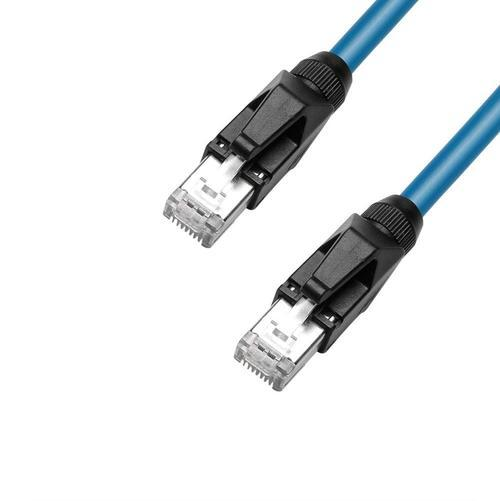
图223.1从外观上看，RJ45 插头呈矩形，外部是塑料外壳，内部中有8 个金属触点，金属触点用于与RJ45 插座进行电气连接。与RJ45 插头对应在RJ45 插座中同样有8 个金属接触片，用于与RJ45 插头相连。RJ45 插头前端的8 个金属触点在插入插座时会与插座内的金属片紧密接触，从而实现信号的传输。RJ45 插座如下图223.2 所示：
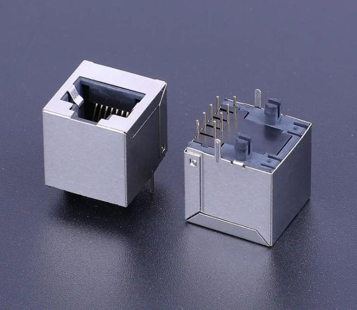
图223.2
RJ45 插座则通常安装在网络设备（如计算机网卡、路由器、交换机等）或墙壁面板上。在

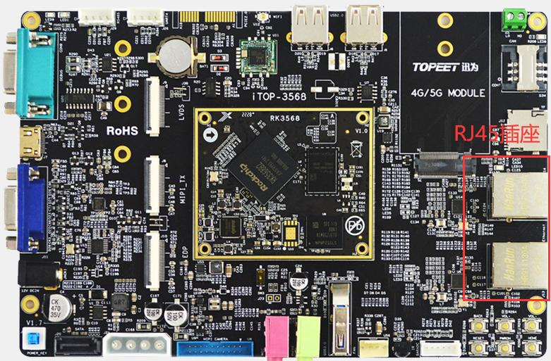
图223.3
为iTOP-4412 开发板肯定知道，在iTOP-4412 开发板上网口最高支持百兆网络，iTOP-4412 开发板上的RJ45 插座如图223.4 中红色方框所示。
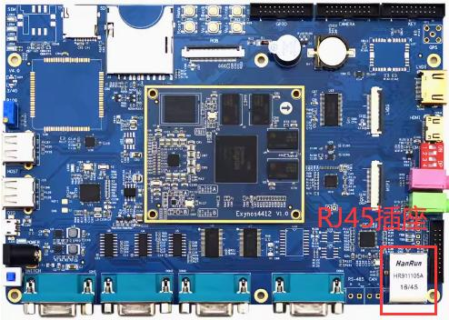
图223.4

由此可见百兆网口和千兆网口都采用RJ45 接口进行物理连接，不过，尽管外观看起来一模一样，但它们的传输能力却大不相同。对应的引脚使用情况也大不相同。百兆RJ45 接口有8 个引脚，这8 个引脚如下表223.1 所示：表223.1引脚编号名称功能说明TX+Tranceive Data+(发信号+)，用于发送数据TX-Tranceive Data-(发信号-)，用于发送数据RX+Receive Data+(收信号+)，用于接收数据NC空脚。NC空脚。RX-Receive Data-(收信号-)，用于接收数据NC空脚。NC空脚。千兆网口也有8 个引脚，各引脚功能如下表223.2 所示：表223.2引脚编号名称功能说明TX_D1+Tranceive Data1+(发信号+)，用于发送数据TX_D1-Tranceive Data1-(发信号-)，用于发送数据RX_D2+Receive Data2+(收信号+)，用于接收数据BI_D3+Bi-directional Data3+(双向信号传输)BI_D3-Bi-directional Data3-(双向信号传输)RX_D2-Receive Data2-(收信号-)，用于接收数据BI_D4+Bi-directional Data4+(双向信号传输)BI_D4-Bi-directional Data4-(双向信号传输)
## 223.2 连接方式
在网络通信的硬件连接中，除了前面提到的RJ45 接口，还包括处理器，MAC 控制器，PHY这些部分，所以我们先明确这几部分概念。1.MAC 控制器MAC 控制器主要功能是控制与PHY 芯片的连接，负责管理数据在数据链路层与物理层之间的传输。如RK3568 处理器中有两个MAC 控制器。2.PHY 芯片PHY 芯片主要任务是将数字信号转换为适合在物理介质（如网线）中传输的模拟信号，然后将接收到的模拟信号再转换回数字信号，以便计算机能够识别和处理。常见的PHY 芯片型

号有Realtek RTL8211E、YT8531C 等等，外观如图227.5 所示。
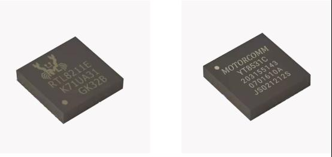
图223.53.网络变压器RJ45 插座和PHY 芯片连接在一起，中间需要一个网络变压器。网络变压器也叫以太网变压器，它主要起到信号耦合、电气隔离和阻抗匹配的作用。网络变压器可以选择独立芯片，如图227.6 所示是网络变压器芯片。也可以选择内部集成网络变压器的RJ45 插座，如iTOP-RK3568开发板使用的RJ45 插座型号为HR911130A，该型号RJ45 插座内置网络变压器。
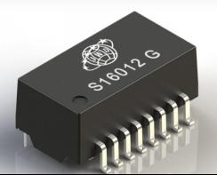
图223.6根据CPU、MAC 和PHY 的集成情况，网络设备的硬件连接方式可分为三种。方式1：CPU 内部集成了MAC 和PHYCPU 内部集成了MAC 和PHY。这种方式虽然可以减少外围硬件数量，但会显著提高CPU成本，并且由于全部集成在CPU 内部，灵活性较差，因此在实际应用中并不多见。
方式2：CPU 内部集成MAC，PHY 采用独立芯片

CPU 内部只集成MAC 控制器，PHY 采用独立的芯片，示意框图如图223.7，这种方式的优势是可以根据场景灵活选择PHY 芯片，也是目前主流的方式。
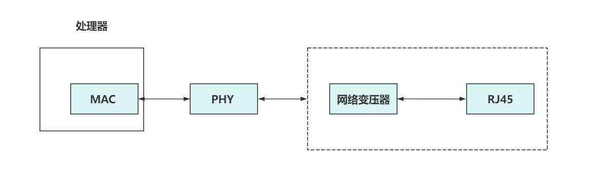
图223.7
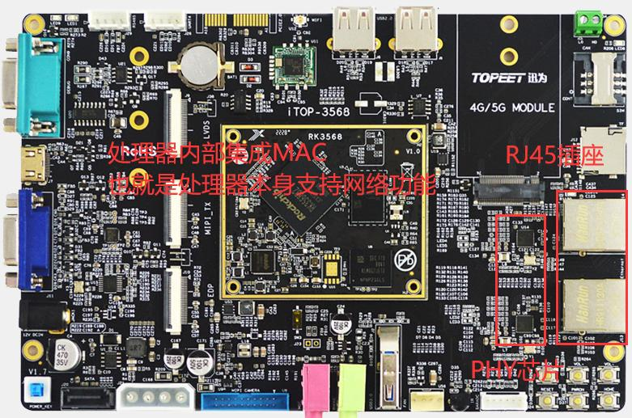
图223.8需要注意的是iTOP-RK3568 开发板上的RJ45 插座内部集成了网络变压器，如果使用的RJ45插座内部没有集成网络变压器，则需要使用单独网络变压器芯片。方式3：CPU 不集成MAC 和PHY，MAC 和PHY 采用独立芯片或者集成芯片在这种连接方式下，CPU 没有MAC 和PHY 的功能，也就是我们常说的CPU 本身不支持网络功能。如果使用网络功能就需要通过其他接口转接，示意框图如图227.9 所示。所以这种方式成本较高。

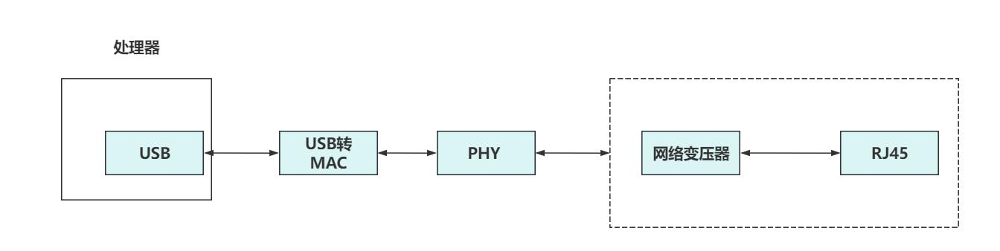
图223.9iTOP-4412 开发板上采用的是这种方式，如图223.10。
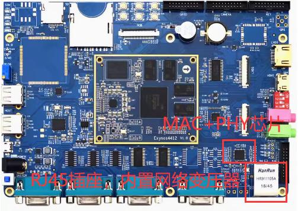
图223.10
## 223.3 PHY 接口
在嵌入式网络开发中，最主流的方案如图223.7 所示。PHY 芯片的左侧连接了MAC，右侧连接了RJ45 插座，由其可见PHY 芯片起到了一个桥梁作用。PHY 芯片与MAC 控制器可以通过MII、RMII、GMII、RGMII 和MIDO 接口相连。1.MII 接口MII 接口全称为Media Independent Interface，即“介质独立接口”。MII 接口的传输速率为10Mbps 或100Mbps，在100Mbps 下时钟为25M，在10Mbps 下钟为2.5M。硬件连接如下图223.11 所示：

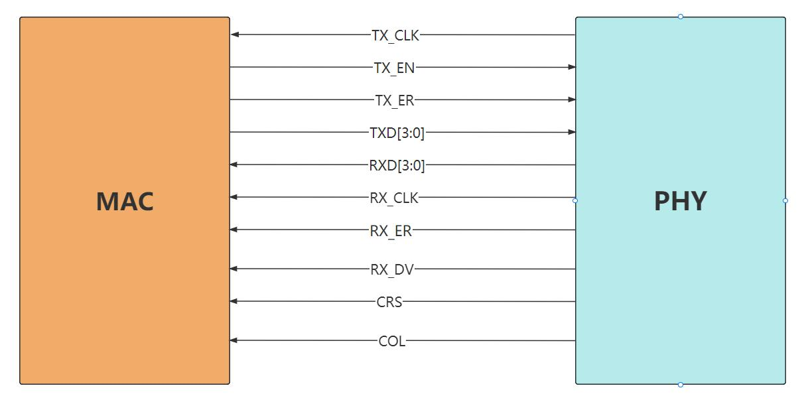
图223.11MII 接口一共需要16 根信号线，含义如表223.3 所示：表223.3信号线名称描述TX_ER发送错误，高电平有效TXD[3:0]发送数据（4 根）TX_EN发送使能TX_CLK发送时钟，有PHY 产生发给MACCOL冲突检测RXD[3:0]接收数据（4 根）RX_ER接收错误RX_CLK接收时钟，有PHY 产生发给MACCRS载波侦听RX_DV接收数据有效2.RMII 接口RMII 接口全称为Reduced Media Independent Interface，即“简化媒体独立接口”，它是MII接口的简化版本。所以相较于MII 接口，RMII 接口在数据的发送与接收方面减少了一半的信号线。硬件连接如下图223.12 所示：
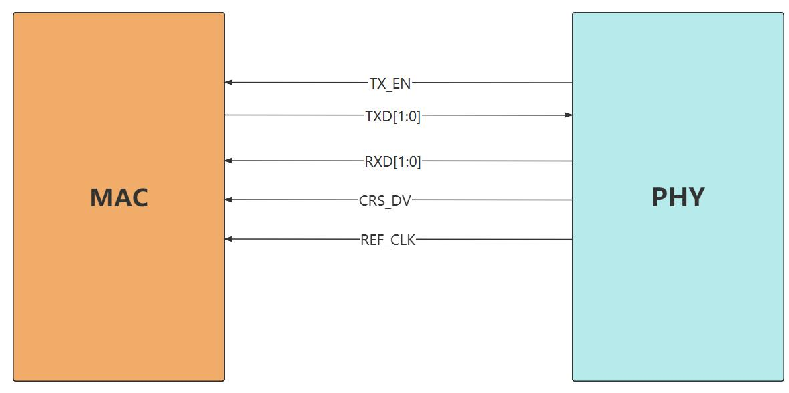
图223.12

RMII 接口一共需要7 根信号线，含义如下表所示：表223.4信号线名称描述TXD[1:0]发送数据（2 根）TX_EN发送使能CRS_DV载波侦听/接收数据有效RXD[1:0]接收数据（2 根）REF_CLK参考时钟（50MHz）,由外部时钟提供RX_ER属于可选引脚，高电平表示发送数据的错误，接收端不接受该数据
3.GMII 接口GMII 接口全称为Gigabit Media Independent Interface，即“千兆介质无关接口”，它是为了满足千兆以太网的高速数据传输需求而设计的接口。在10M/100M/1000M 下时钟分别是2.5M，25M 和125M。硬件连接如下图223.13 所示：
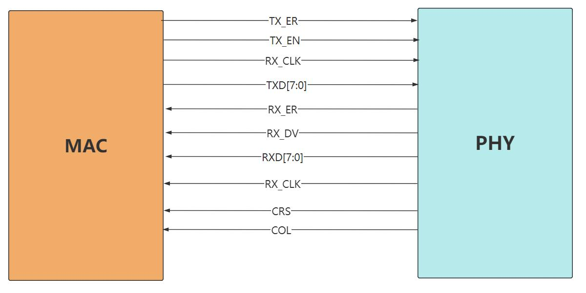
图223.13GMII 接口一共需要25 根信号线，含义如下表223.5 所示：表223.5信号名称描述方向GTX_CLK发送时钟（Gigabit Transmit Clock）,125MHzMAC->PHYTX_CLK10/100M 发送时钟（可选，在千兆速率下MAC->PHY不使用）TXD[7:0]发送数据，8 位MAC->PHYTX_EN发送使能信号MAC->PHYTX_ER发送数据错误信号MAC->PHYRX_CLK接收时钟，通常从接收数据中提取PHY->MACRXD[7:0]接收数据，8 位PHY->MACRX_DV接收数据有效指示PHY->MACRX_ER接收数据错误提示PHY->MACCRS载波侦听信号（仅用于半双工模式）PHY->MAC

COL冲突碰撞监测信号（仅用于半双工模式）PHY->MAC4.RGMII 接口RGMII 是GMII 的简化版本。将引脚数量从GMII 的25 个减少至RGMII 的14 个。在10M/100M/1000M 下时钟分别是2.5M，25M 和125M。硬件连接如下图223.14 所示：
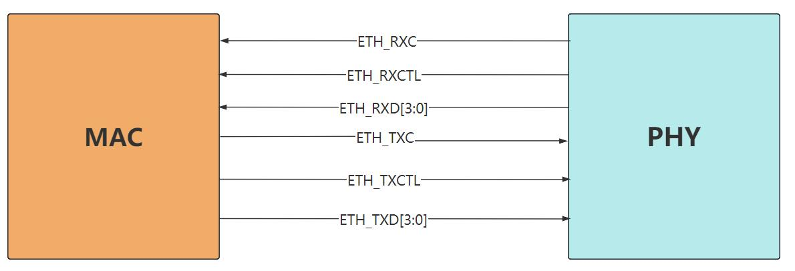
图223.14
RGMII 接口一共需要14 根信号线，含义如下表223.6 所示：表223.6信号名称描述方向TXC发送时钟信号，频率为125MHz (1000Mbps 速MAC->PHY率下)TX_CTL发送通道控制信号，用于控制发送数据和状态MAC->PHY（如TX_EN，TX_ER）TXD[3:0]发送通道数据信号，4 位并行数据，在时钟上MAC->PHY升沿和下降沿传输RXC接收时钟信号，频率为125MHz(1000Mbps 速PHY->MAC率下)RX_CTL接收通道控制信号，用于指示接收数据和状态PHY->MAC（如RX_DV,RX_ER）RXD[3:0]接收通道数据信号，4 位并行数据，在时钟上PHY->MAC升沿和下降沿传输
5.MDIO 接口MDIO 接口全称为Management Data Input/Output，即管理数据输入输出接口。主要功能是实现MAC 控制器对PHY 芯片的管理与控制，例如通过MDIO 接口对PHY 寄存器进行设置来配置工作速率；也能够通过读取PHY 芯片的状态寄存器从而获取网口的状态。MDIO 接口属于同步串行半双工接口，由两根信号线构成，如表223.7 所示。表223.7
```c
信号名称描述
 MDIO作为数据线，用于在MAC 层和PHY 层之间传输配置和管理数据。
```

```c
MDC作为时钟线，为数据传输提供时钟同步。
```
6.实践在实际应用中，具体选择哪种接口和MAC 控制器通信要依据对应的PHY 和处理器芯片决定，在iTOP-RK3568 开发板采用的是RTL8211 这款PHY 芯片。RTL8211 支持10Mbps、100Mbps和1000Mbps 的传输速率，并且具备自动协商功能，能够根据网络环境自动调整工作模式。通过RTL8211 芯片数据手册中电路连接示意图223.15 可知，RTL8211 芯片通过MDI 接口与RJ45 接口相连。MAC 控制器通过RGMII 接口和MDIO 接口与PHY 芯片连接。
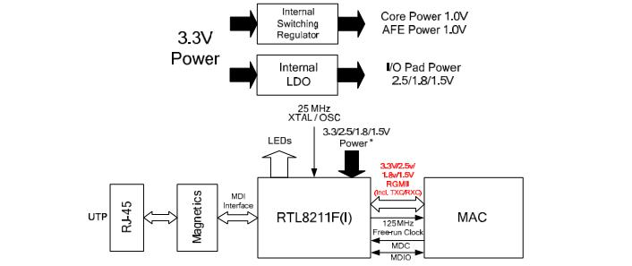
图223.15对图223.15 进行简化之后如图223.16 所示：
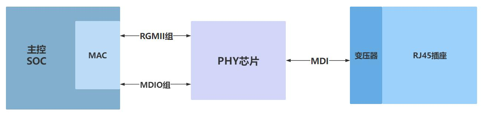
图223.16
图223.17 所示：

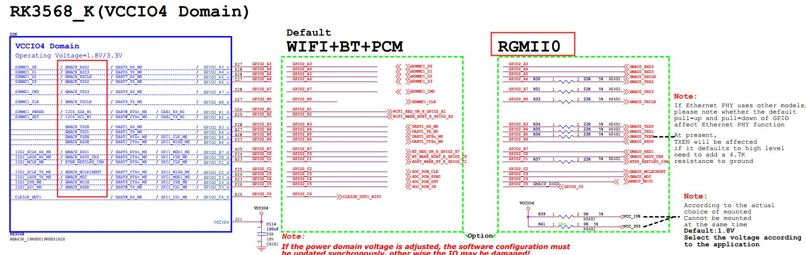
图223.17
原理图如下图223.18 所示：
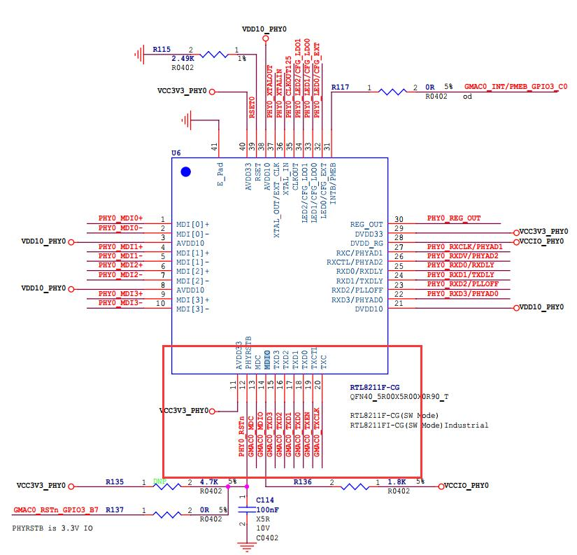
图223.18其中：第15，16，17，18 引脚分别对应TXD3，TXD2，TXD1，TXD0。是发送引脚，方向从MAC 到PHY。第22，23，24，25，26 分别对应RXD3，RXD2，RXD1，RXD0。是接收引脚，方向从PHY 到MAC。第20 脚为TXC 引脚，发送时钟信号引脚。第27 脚为RXC 引脚，接收时钟信号引脚。

第26 脚为RXCTL 引脚，接收控制信号引脚。第13 和14 脚为MDIO 引脚。第31 引脚为INTB/PMEB 引脚，如果不使用这样俩个功能，此引脚悬空。如果把Page 0xd40，REG.22 bit[5]寄存器设置成1，则为PMEB 功能，如果设置成0，为中断功能。
RTL8211 芯片通过MDI 接口与RJ45 插座相连，RTL8211 芯片和RJ45 插座原理图如图223.19 所示：
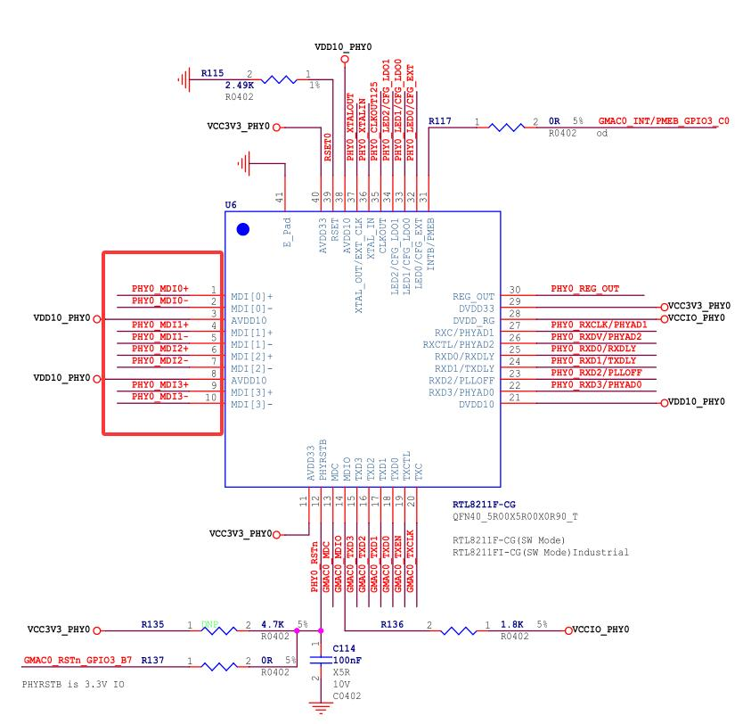
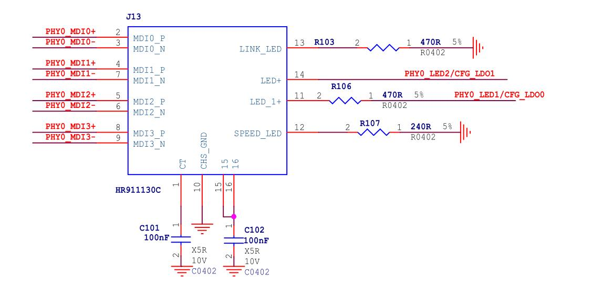
图223.19其中第1 到10 脚是分别对应MDI 接口的MDIP0，MDIN0，MDIP1，MDIN1，MDIP2，MDIN2，MDIP3，MDIN3 引脚。MDI 接口是用于PHY 芯片与网络变压器或者说是与RJ45 插座相连的接口。

