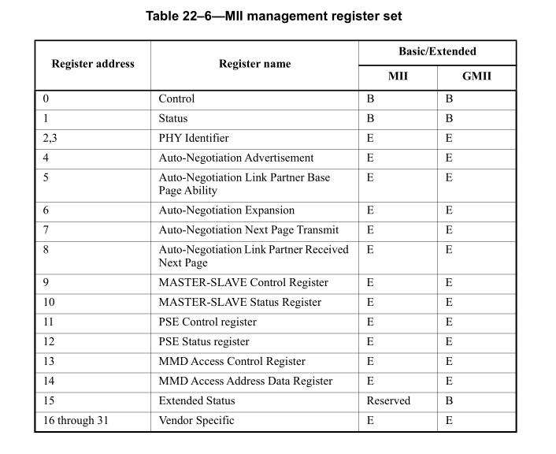
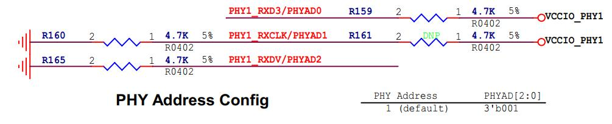
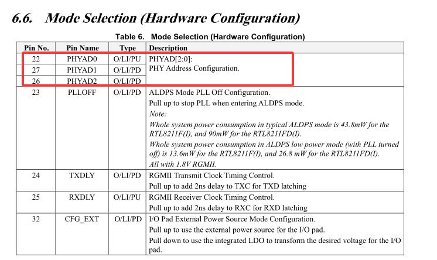
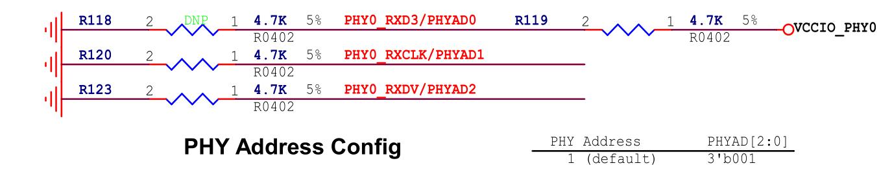
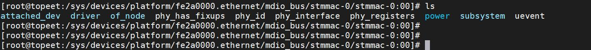
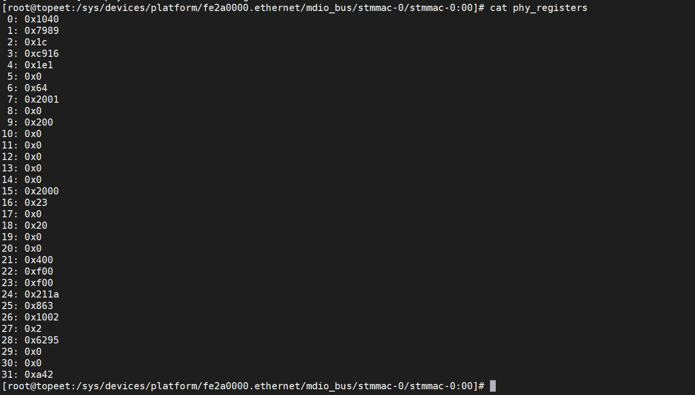
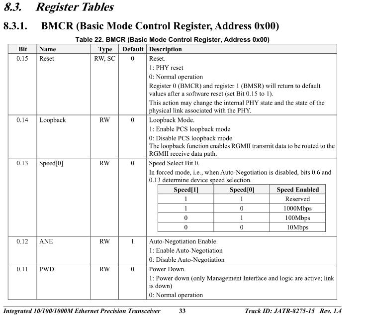
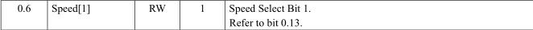
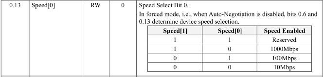
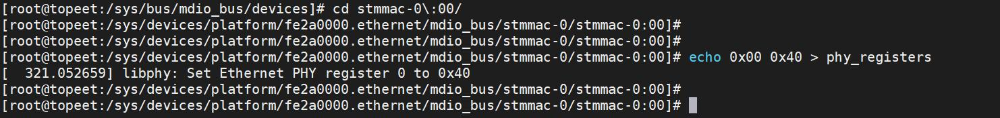

# 第224章PHY寄存器

## 224.1 PHY 寄存器介绍
在802.3 规范中，对PHY 芯片的前16 个寄存器进行了规定。寄存器如下图224.1 所示：

图224.1在开发中和我们打交道最多是寄存器0 和寄存器1。寄存器0 是控制寄存器：用于配置PHY 芯片的工作模式和参数。可以通过控制寄存器设置芯片的传输速率（10Mbps、100Mbps 或1000Mbps）、双工模式（全双工或半双工）以及自动协商功能的开启或关闭等。寄存器1 是状态寄存器：用于表示PHY 芯片当前的工作状态。比如，通过状态寄存器可以查看是否已经成功连接到网络、是否检测到链路故障、当前的传输速率和双工模式等信息等。寄存器0 到15 是IEEE 802.3 规定的寄存器，因此不论使用哪个厂家的PHY 芯片，寄存器0 到15 是一摸一样的，所以一般情况下，使用Linux 中通用的PHY 驱动即可驱动PHY 芯片。寄存器16 到31 是扩展寄存器，不同厂家的PHY 芯片可能有额外特性的功能，所以扩展寄存器就是给PHY 厂家自由发挥的寄存器。也就是说只有用到这些特性功能时，才会涉及到扩展寄存器。
PHY 地址每个PHY 寄存器都有唯一的地址，iTOP-RK3568 开发板中RTL8211 PHY 芯片的地址可以

通过22，27，26 脚来设置，原理图如下图224.2 所示。

图224.2这里刚入门的同学可能会把物理地址、IP 地址与PHY 地址这三个地址混淆。所以重点解释下这三个概念。（1）物理地址（MAC 地址）物理地址，也称为MAC 地址，是网络设备的唯一标识符。它由48 位二进制数组成，通常用12 位十六进制数表示，如00:11:22:33:44:55。（2）IP 地址IP 地址是网络层的地址，用于在网络中标识设备的逻辑位置。它分为IPv4 和IPv6 两种版本，IPv4 地址由32 位二进制数组成，通常用点分十进制表示，如192.168.1.1；IPv6 地址由128位二进制数组成。IP 地址的主要作用是实现不同网络之间的通信，通过IP 地址可以将数据包从源网络路由到目标网络。（3）PHY 地址PHY 地址是用于在一个网络中唯一标识PHY 芯片的地址。在一个系统中，可能会有多个PHY 芯片同时存在，通过PHY 地址可以区分不同的PHY 芯片，以便对它们进行单独的配置和管理。实践：PHY 芯片地址的确定以迅为iTOP-RK3568 开发板为例，其采用的RTL8211 PHY 芯片地址通过以下方式进行确定。打开RTL8211 PHY 芯片的数据手册，如下图224.3 所示，第22 26 27 引脚是配置PHY 芯片的地址。

图224.3接下来我们看看RK3568 底板原理图上PHY 芯片这三个引脚是如何连接的，如下图224.4所示：

图224.4由上图可知，PHY 芯片的地址是001，也就是1。RTL8211 PHY 芯片通过硬件引脚来设置地址。
## 224.2 PHY 寄存器操作实验
本章节我们通过实验来学习如何对PHY 寄存器进行操作。首先，打开iTOP-RK3568 开发板的调试串口，接着为开发板上电。待进入终端后，通过执行cd /sys/bus/mdio_bus/devices 命令进入开发板的/sys/bus/mdio_bus/devices 目录。随后，再执行cd stmmac - 0:00 命令，即可进入网卡0 的设备目录，如下图224.5 所示：

图224.5接下来，操作重点为phy_registers 属性文件。通过执行cat phy_registers 命令，即可查看

寄存器的值，具体操作效果如图224.6 所示。

图224.6从上图224.6 可知，0 号寄存器的值为0x1040 ，该寄存器对应控制寄存器，其具体描述如下图224.7 所示。

图224.7寄存器的值0x1040 也就是把bit6 和bit13 设置成了1，如下图224.8 所示：

图224.8可通过执行echo 0x00 0x40 > phy_registers 命令，对0 号寄存器的值进行修改，如下图224.9所示。

图224.9

