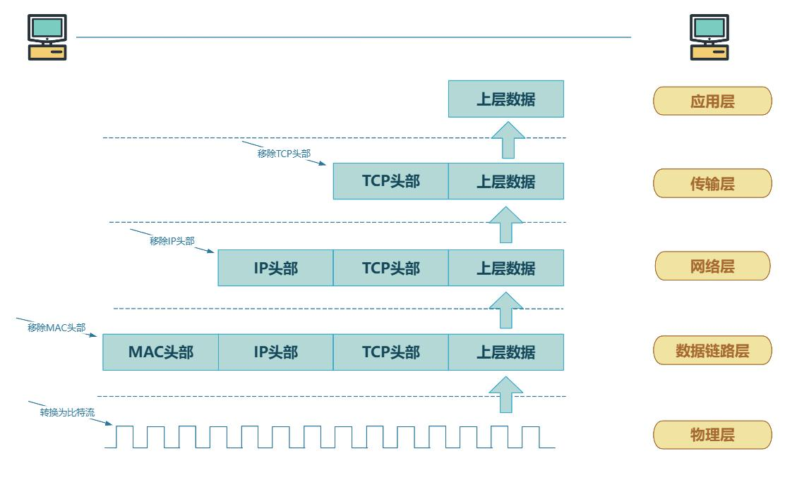
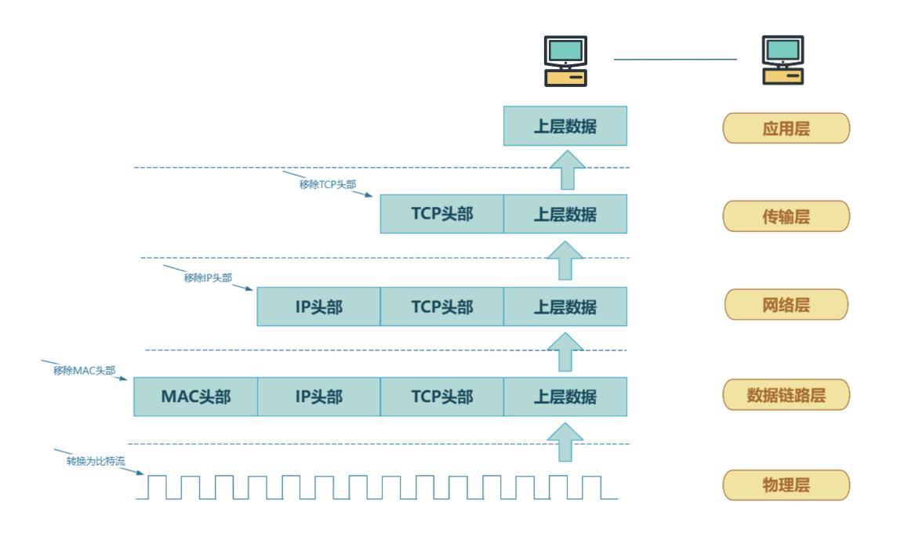

# 第225章 网络数据的封装和解封装

本章介绍网络数据的封装和解封装。
## 225.1 封装和解封装的基本概念
在网络通信中，数据并不是以原始的形式在网络中传输的，而是经过一系列封装和解封装的操作在网络中进行传输。封装是指将上层协议的数据加上本层的协议头和协议尾，形成一个新的数据单元，然后再传递给下一层进行处理，如图225.1 所示。

图225.1接下来对封装过程进行详细介绍。应用层封装：应用程序生成的数据，如HTTP 协议传输的网页数据、SMTP 协议传输的邮件数据等，此时数据被称为应用数据。应用层协议会根据自身需求对数据进行格式化，比如HTTP 会添加请求头或响应头，包含如请求方法、URL、响应状态码等信息。传输层封装：应用数据到达传输层（如TCP 或UDP）。以TCP 为例，TCP 会为数据添加

TCP 头部，包含源端口号、目的端口号、序列号、确认号、控制位等信息。端口号用于标识应用程序，使接收端能将数据正确交付给对应的应用。UDP 头部相对简单，同样有源端口号和目的端口号，用于多路复用和分用。此时数据加上TCP 或UDP 头部后称为段（Segment）。网络层封装：传输层的段到达网络层（如IPv4 或IPv6），网络层添加IP 头部。IP 头部包含源IP 地址、目的IP 地址等关键信息，用于在不同网络间进行路由选择。添加IP 头部后的数据称为数据包（Packet）。例如，当你访问网站时，你的设备会将TCP 段封装在IP 数据包中，目的IP 地址为网站服务器的IP。数据链路层封装：网络层的数据包到达数据链路层（如以太网），数据链路层添加帧头和帧尾。以太网帧头包含源MAC 地址、目的MAC 地址等，帧尾包含循环冗余校验（CRC）值用于差错检测。此时的数据称为数据帧（Frame）。数据帧通过物理层转化为电信号或光信号在物理介质上传输。解封装是封装的逆过程，也就是接收方接收到的数据单元去掉本层的协议头和协议尾，提取出上层协议的数据，然后传递给上层进行处理，如图225.2 所示。

图225.2接下来对解封装过程进行详细介绍。数据链路层解封装：物理层接收到电信号或光信号，转换为数据帧交给数据链路层。数据链路层检查帧头和帧尾，通过CRC 校验确保数据传输无误后，去除帧头和帧尾，将数据包交

