# 第226章 wireshark抓包工具的使用

给网络层。网络层解封装：网络层接收到数据包，检查IP 头部，根据目的IP 地址判断是否是发给本机的。如果是，去除IP 头部，将段交给传输层。传输层解封装：传输层接收到段，根据TCP 或UDP 头部中的端口号，将数据交付给对应的应用程序，并去除TCP 或UDP 头部。此时数据还原为应用层数据，应用层程序即可处理这些数据。
在前面的章节中，我们深入了解了网络数据的封装和解封装过程，知晓了数据在网络各层间的流转机制。然而，在实际的网络环境中，我们如何直观地观察和分析这些数据呢？这就需要借助专业的抓包工具，而wireshark 是一款广泛使用的开源网络抓包分析工具。本章节将介绍这款工具的安装和基础使用方法。
## 226.1 安装wireshark 软件
在使用Wireshark 之前，首先要完成软件的安装。访问Wireshark 官方网站（https://www.wireshark.org/download.html ），在下载页面找到适合Windows 系统的安装包，根据系统版本（32 位或64 位）选择下载，下载界面如图226.1 所示。
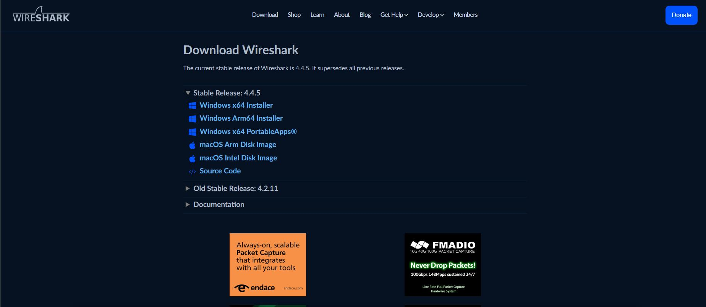
图226.1运行下载的安装包，在安装向导中，按照提示逐步操作。可选择安装路径、组件等，通常

保持默认设置即可。安装过程中可能会提示安装WinPcap 或Npcap，这是Wireshark 用于捕获网络数据包的驱动程序，务必全部安装以确保抓包功能正常。
## 226.2 wireshark 软件的使用
本实验程序存放在网盘iTOP-RK3568 开发板\07_学习教程配套资料\02_系统编程资料\01_Linux 系统编程配套程序。并将demo72_client 编译为arm64 可执行程序，demo72_server编译为x86 可执行程序。在开展实验前，请使用网线将iTOP-RK3568 开发板的网口1 连接至路由器。此时，虚拟机Ubuntu 设置为桥接模式，需确保iTOP-RK3568 开发板与虚拟机Ubuntu 之间网络连通，即二者能够互相ping 通。在作者的实验环境中，虚拟机Ubuntu 的IP 地址为192.168.1.19，具体情况如下图226.2 所示：
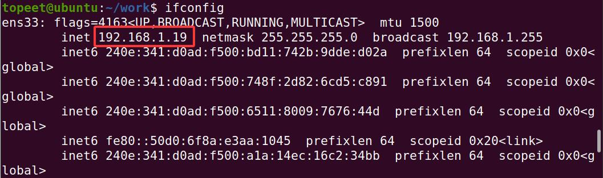
图226.2

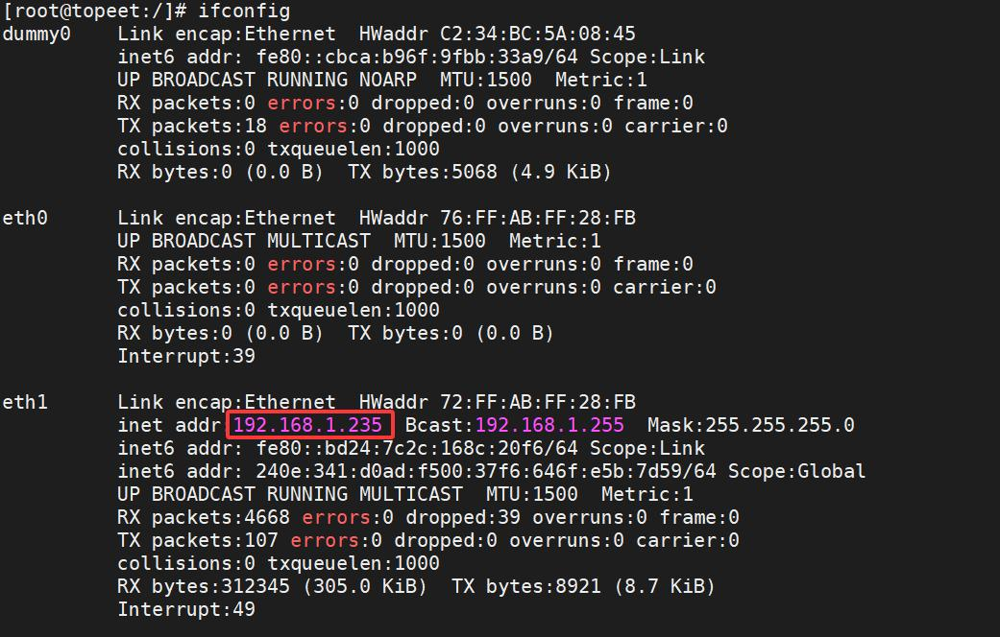
图226.3
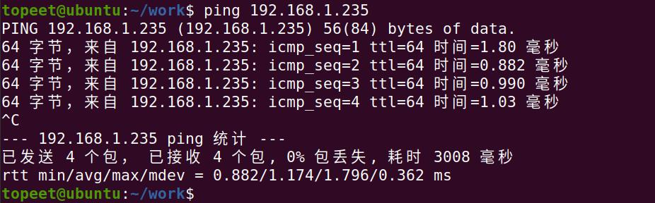
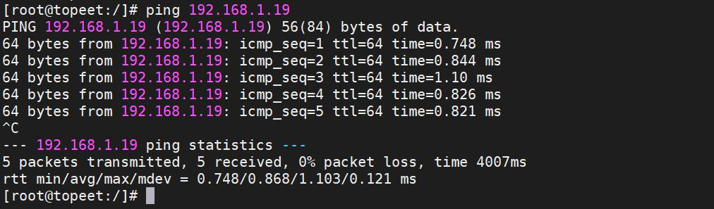
图226.4

然后将demo72_client 程序拷贝到iTOP-RK3568 开发板上，如下图226.5 所示：
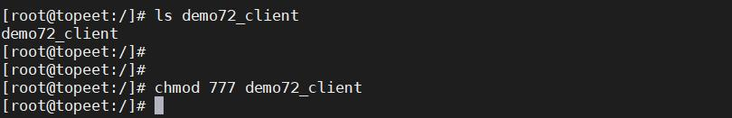
图226.5虚拟机Ubuntu 中存放demo72_server，如下图226.6 所示：
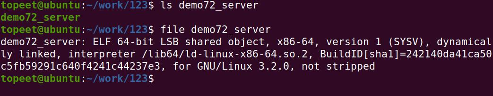
图226.6运行tcp 服务端程序，如下图226.7 所示：
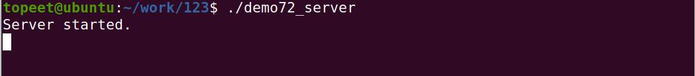
图226.7运行tcp 客户端程序，如下图226.8 所示：

图226.8在iTOP-RK3568 开发板的串口终端发送123456 给虚拟机ubuntu，如下图226.9 所示：
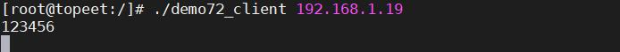
图226.9虚拟机ubuntu 接收到数据，如下图226.10 所示：
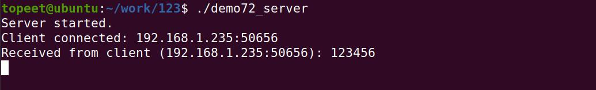
图226.10现在iTOP-RK3568 开发板和虚拟机ubuntu 的网络通信可以正常进行网络通信了，接下来

打开抓包工具，选择物理网卡，这里作者电脑的物理网卡对应的是以太网4，需根据自己电脑实际选择，如下图226.11 所示。
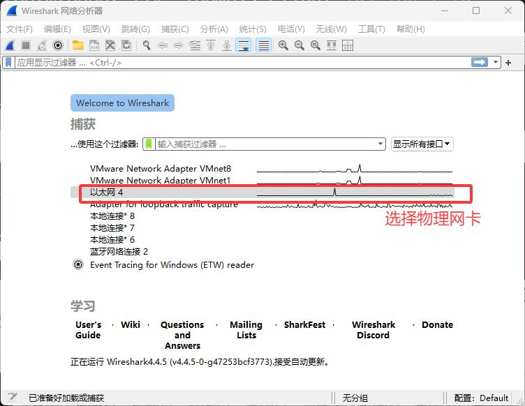
图226.11接着使用iTOP-RK3568 开发板的客户端发送数据12233444555 数据给虚拟机ubuntu 的服务器，如下图226.12 所示。
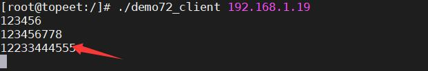
图226.12在抓包工具的搜索栏输入过滤条件ip.src==192.168.1.235 过滤来自iTOP-RK3568 开发板的消息。然后点击iTOP-RK3568 开发板发送的数据，在左下角即可显示抓到的数据，如下图226.13所示：

