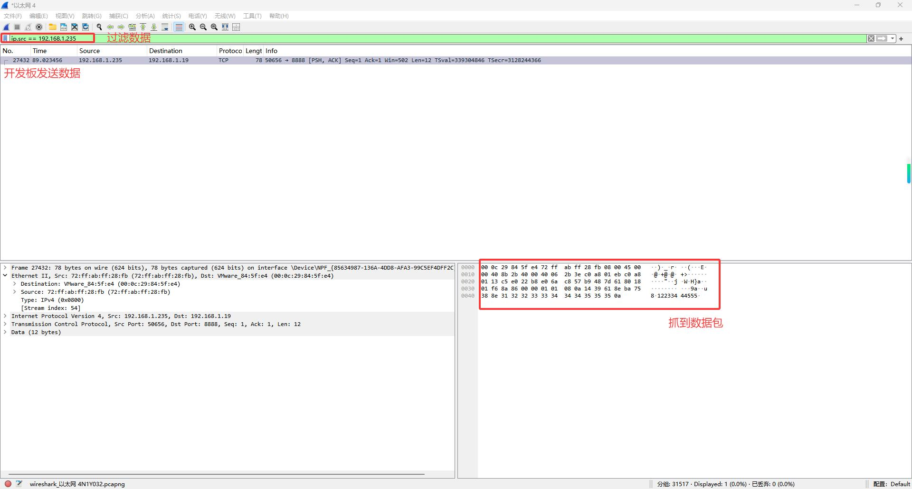
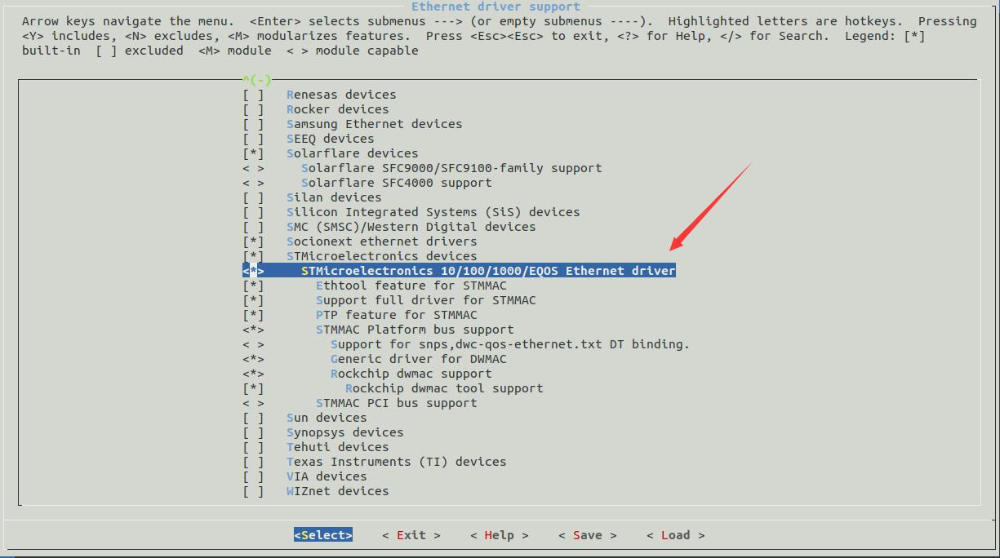
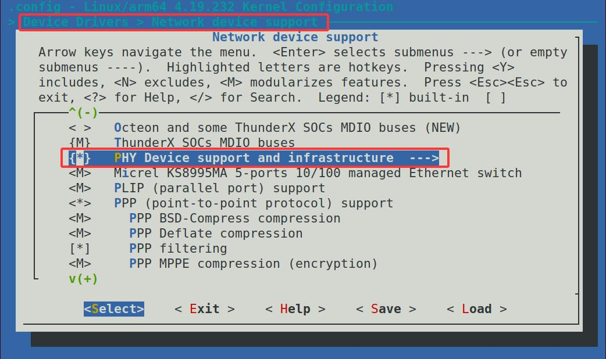

# 第227章 内核配置网卡


图226.13抓到数据之后，便可以根据需要对数据进行分析。
本章讲解如何在内核中配置网卡。根据IEEE 802.3 规范，即便PHY 芯片来自不同厂家，仍有部分寄存器的定义具有通用性。只要对这些通用寄存器进行配置，PHY 芯片基本就能正常工作。接下来在内核使能通用PHY驱动，首先在内核源码顶层目录下输入make menuconfig 命令打开图像化配置界面，如图227.1所示：

图227.1因为网卡是基于Synopsys 网络IP 核，所以这里需要选中STMicroelectronics10/100/1000/EQOS Ethernet driver 选项，路径如下所述。Device DriversNetwork device supportEthernet driver supportSTMicroelectronics devicesSTMicroelectronics 10/100/1000/EQOS Ethernet driver在图形化配置界面中此选项如下图227.2，默认已经选中该选项。


图227.2配置通用PHY 驱动，选中PHY Device support and infrastructure 选项，具体路径如下。Device DriversNetwork device supportPHY Device support and infrastructure在内核图形化配置界面中选中此选项后如下图227.3 所示：

图227.3接着打开内核源码下kernel/arch/arm64/boot/dts/rockchip/rk3568.dtsi 设备树文件，找到其中的gmac0 节点，如代码清单227.1 所示：

代码清单227.1
```c
gmac0: ethernet@fe2a0000 {
        compatible = "rockchip,rk3568-gmac", "snps,dwmac-4.20a";
        reg = <0x0 0xfe2a0000 0x0 0x10000>;
        interrupts = <GIC_SPI 27 IRQ_TYPE_LEVEL_HIGH>,
                  <GIC_SPI 24 IRQ_TYPE_LEVEL_HIGH>;
        interrupt-names = "macirq", "eth_wake_irq";
        rockchip,grf = <&grf>;
        clocks = <&cru SCLK_GMAC0>, <&cru SCLK_GMAC0_RX_TX>,
              <&cru SCLK_GMAC0_RX_TX>, <&cru CLK_MAC0_REFOUT>,
              <&cru ACLK_GMAC0>, <&cru PCLK_GMAC0>,
              <&cru SCLK_GMAC0_RX_TX>, <&cru CLK_GMAC0_PTP_REF>,
              <&cru PCLK_XPCS>;
        clock-names = "stmmaceth", "mac_clk_rx",
                   "mac_clk_tx", "clk_mac_refout",
                   "aclk_mac", "pclk_mac",
                   "clk_mac_speed", "ptp_ref",
                   "pclk_xpcs";
        resets = <&cru SRST_A_GMAC0>;
        reset-names = "stmmaceth";
        snps,mixed-burst;
        snps,tso;
        snps,axi-config = <&gmac0_stmmac_axi_setup>;
        snps,mtl-rx-config = <&gmac0_mtl_rx_setup>;
        snps,mtl-tx-config = <&gmac0_mtl_tx_setup>;
        status = "disabled";
        mdio0: mdio {
             compatible = "snps,dwmac-mdio";
             #address-cells = <0x1>;
             #size-cells = <0x0>;
        };
        gmac0_stmmac_axi_setup: stmmac-axi-config {
             snps,wr_osr_lmt = <4>;
             snps,rd_osr_lmt = <8>;
             snps,blen = <0 0 0 0 16 8 4>;
        };
        gmac0_mtl_rx_setup: rx-queues-config {
             snps,rx-queues-to-use = <1>;
```

```c
queue0 {};
};
gmac0_mtl_tx_setup: tx-queues-config {
snps,tx-queues-to-use = <1>;
queue0 {};
};
};
```
在代码清单227.1 中第27 行表示gmac0 节点的状态是disabled。如果要使用gmac0，需要将状态设置为okay。接着我们打开kernel/arch/arm64/boot/dts/rockchip/rk3568-evb1-ddr4-v10.dtsi设备树文件，对gmac0 节点中追加内容，追加的节点&gmac0 如代码清单227.2 所示：代码清单227.2
```c
&gmac0 {
    phy-mode = "rgmii";
    clock_in_out = "input";
    snps,reset-gpio = <&gpio3 RK_PB7 GPIO_ACTIVE_LOW>;
    snps,reset-active-low;
    /* Reset time is 20ms, 100ms for rtl8211f */
    snps,reset-delays-us = <0 20000 100000>;
    assigned-clocks = <&cru SCLK_GMAC0_RX_TX>, <&cru SCLK_GMAC0>;
    assigned-clock-parents = <&cru SCLK_GMAC0_RGMII_SPEED>, <&gmac0_clkin>;
    assigned-clock-rates = <0>, <125000000>;
    pinctrl-names = "default";
        pinctrl-0 = <&gmac0_miim
                    &gmac0_tx_bus2
                    &gmac0_rx_bus2
                    &gmac0_rgmii_clk
                    &gmac0_rgmii_bus
                    &gmac0_clkinout>;
    tx_delay = <0x3c>;
    rx_delay = <0x2f>;
    phy-handle = <&rgmii_phy0>;
    status = "okay";
};
```
在代码清单227.2 中的&gmac0 节点中，我们需要关注下面这几个属性。

