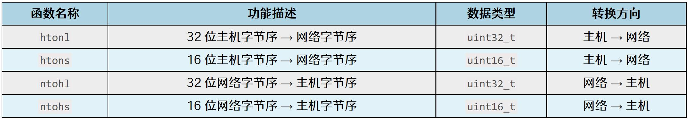
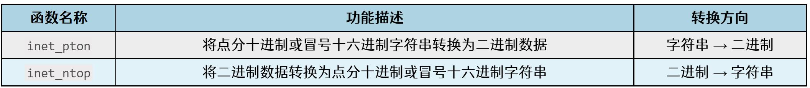
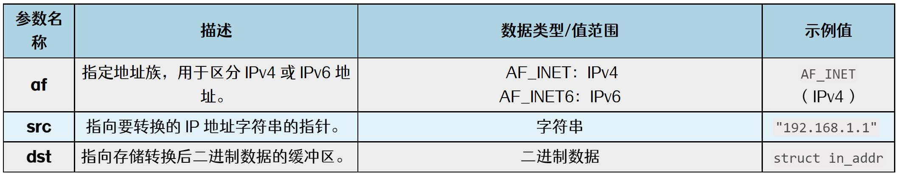
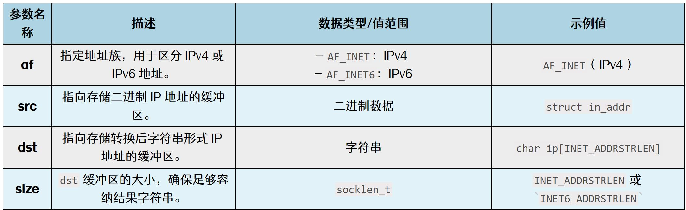

# 第233章 网络应用编程基础

```c
(SUPPORTED_Pause | SUPPORTED_Asym_Pause);
} else {
// 如果驱动不支持暂停或不对称暂停特性，
// 则将暂停和不对称暂停特性添加到设备支持的特性中
phydev->supported |= SUPPORTED_Pause | SUPPORTED_Asym_Pause;
}
// 默认将设备状态设置为READY
phydev->state = PHY_READY;
// 如果驱动提供了probe 函数，执行设备的具体初始化操作
if (phydev->drv->probe) {
// 取消PHY 设备的复位信号
phy_device_reset(phydev, 0);
// 调用驱动的probe 函数对设备进行初始化，并获取返回的错误码
err = phydev->drv->probe(phydev);
if (err) {
// 如果初始化出错，重新设置PHY 设备的复位信号
phy_device_reset(phydev, 1);
}
}
// 解锁互斥锁
mutex_unlock(&phydev->lock);
// 返回错误码，0 表示成功，非0 表示失败
return err;
}
```
在代码清单232.8 的probe 函数中对PHY 设备进行初始化设置，如配置PHY 寄存器，使能自动协商。
本章节我们学习网络应用编程。

## 233.1 小端模式和大端模式
在计算机系统中，数据以字节（Byte）为单位进行存储，而每个字节又由8 位bit 组成。所以对于多字节类型的数据如short、int、float、double 等，需要将多个字节按照一定的顺序存储到内存地址中。而这种存储顺序有两种常见的排列方式，分别是小端模式（Little Endian）和大端模式（BigEndian）。这两种模式决定了数据的高位字节和低位字节在内存中的排列顺序，两种模式的定义如下所示：小端模式：低位字节存在低地址，高位字节存在高地址。大端模式：高位字节存在低地址，低位字节存在高地址。接下来以一个实例对上面的定义进行讲解，假设有一个32 位整数0x12345678，在内存中以小端方式存储，每个地址存放的内容将会如下图233.1 所示：

图233.1而同样的整数0x12345678 如果以大端模式存放，每个地址存放的内容将会如下图233.2所示：

图233.2小端模式由于低位字节存储在低地址的特点，在硬件实现和性能优化方面具有优势，尤其是在处理低位数据时效率更高，所以现代主流的x86 架构以及部分ARM 架构默认采用小端模式。而大端模式因其高位字节存储在低地址的特性，更符合人类对数字的直观理解，因此在需要统一标准的场景中广泛应用。例如，在接下来要讲解的网络通信中，TCP/IP 协议默认使用大

端模式来传输数据，以确保不同系统之间的兼容性。在实际的编程中，有时需要判断当前系统采用的是大端模式还是小端模式。可以通过代码清单233.1 中的C 程序来判断系统是大端模式还是小端模式。代码清单233.1
```c
#include <stdio.h>
typedef union test
{
    unsigned short a;
    unsigned char b[2];
} TEST;
int main(void)
{
    TEST c;
    c.a = 0x1234;
    if (c.b[0] == 0x12)
    { //数组总是从低地址向高地址增长的
        printf("大端\n");
    }
    else
    {
        printf("小端\n");
    }
    return 0;
}
```
代码清单233.1 中重点在于第3-7 行union 类型变量，利用unsigned short 和unsignedchar 共享同一块内存的特性，将值0x1234 赋给unsigned short 类型的变量后，检查unsignedchar 数组的第一个字节来确定系统的字节序。如果b[0]的值为0x12，说明高位字节存储在低地址，系统为大端模式；如果b[0]的值为0x34，说明低位字节存储在低地址，系统为小端模式。在上面讲解大端模式和小端时提到，本地系统一般为小端模式（x86 架构的计算机），而网络通信要求为大端模式，两者存在差异。如果直接发送未经转换的数据，接收方可能因字节序不同而错误解析数据，例如发送方的小端模式存储整数0x12345678 为78 56 34 12，接收方可能误解为0x78563412，导致数据错乱，所以字节序的转换是必要的，在下个小节中将对字节序转换函数进行讲解。

## 233.2 字节序转换函数
常见的字节序转换函数有四个，分别为htonl、htons、ntohl、ntohs，每个函数的简要介绍如下表233.1 所示：表233.1

接下来对每个函数进行更详细的介绍。(1) uint32_t htonl(uint32_t hostlong)函数功能：用于将本地存储的32 位整数转换为适合在网络上传输的格式（大端模式）。函数参数：32 位主机字节序整数。函数返回值：返回一个32 位网络字节序整数。(2) uint16_t htons(uint16_t hostshort)函数功能：用于将本地存储的16 位整数（如端口号）转换为适合在网络上传输的格式。函数参数：16 位主机字节序整数。函数返回值：返回一个16 位网络字节序整数。(3) uint32_t ntohl(uint32_t netlong)函数功能：用于将从网络接收到的32 位数据（如IPv4 地址）转换为本地系统可以处理的格式。函数参数：32 位网络字节序整数。函数返回值：返回一个32 位主机字节序整数。(4) uint16_t ntohs(uint16_t netshort)函数功能：用于将从网络接收到的16 位数据（如端口号）转换为本地系统可以处理的格式。函数参数：16 位网络字节序整数。函数返回值：返回一个16 位主机字节序整数。例如在后面编写TCP 和UDP 代码的时候，需要用到端口号，例如8080，这时候就要用到

字节序的转换了，需要通过htons()函数将8080 从主机字节序转换为网络字节序，一个简单的示例程序如代码清单233.2 所示：代码清单233.2
```c
#include <stdio.h>
#include <arpa/inet.h>
int main(void)
{
    uint16_t host_port = 8080; // 主机端口号
    uint16_t net_port = htons(host_port); // 转换为网络字节序
    printf("Host Port: 0x%04X\n", host_port);
    printf("Network Port: 0x%04X\n", net_port);
    return 0;
}
```
至此，关于字节序转换函数就讲解完成了，而除了字节序需要转换之外IP 地址也需要转换，IP 地址通常是以点分十进制（如192.168.1.1）这一人类可读的形式下展示的，而在程序内部则需要以二进制形式进行存储和处理，所以在下一小节中将对地址转换函数进行讲解。
## 233.3 地址转换函数
在网络编程中，IP 地址转换函数有两个，分别是inet_pton()函数和inet_ntop()函数，它们支持IPv4 和IPv6 地址的转换，两个函数的简单介绍如下图233.2 所示：

图233.2接下来对两个函数进行详细的讲解。（1）inet_pton：将字符串地址转换为二进制数据将点分十进制（IPv4）或冒号十六进制（IPv6）的IP 地址字符串转换为网络字节序的二进制数据。inet_pton()函数原型如代码清单233.3 所示，成功时返回1，如果src 格式无效，返回0，如果af 不支持，返回-1。

代码清单233.3
```c
int inet_pton(int af, const char *src, void *dst);
```
具体的参数介绍如下图233.3 所示：

图233.3示例代码如代码清单233.4 所示。代码清单233.4
```c
#include <stdio.h>
#include <arpa/inet.h>
int main()
{
    const char *ipv4 = "192.168.1.1";
    struct in_addr addr;
    if (inet_pton(AF_INET, ipv4, &addr) <= 0)
    {
        printf("Invalid IPv4 address\n");
    }
    else
    {
        printf("Network byte order: 0x%x\n", addr.s_addr);
    }
    return 0;
}
```
（2）inet_ntop：将二进制数据转换为字符串地址inet_ntop()函数用于将网络字节序的二进制IP 地址转换为人类可读的字符串形式（点分十进制或冒号十六进制）。inet_ntop()的函数原型如代码清单233.5 所示，运行成功时返回指向dst 的指针，失败时返回NULL 并设置errno。代码清单233.5
```c
const char *inet_ntop(int af, const void *src, char *dst, socklen_t size);
```
具体的参数介绍如下图233.4 所示：


图233.4示例代码如代码清单233.6 所示：代码清单233.6
```c
#include <stdio.h>
#include <arpa/inet.h>
int main()
{
    struct in_addr addr;
    addr.s_addr = 0xC0A80101; // 网络字节序的192.168.1.1
    char ip[INET_ADDRSTRLEN];
    if (inet_ntop(AF_INET, &addr, ip, sizeof(ip)) == NULL)
    {
        printf("inet_ntop");
    } else
    {
        printf("Dotted decimal: %s\n", ip);
    }
    return 0;
}
```
至此关于网络应用编程的基础部分就讲解完成了，在接下来的两个章节中，将分别对UDP 和TCP 相关的内容进行讲解。

