# 第234章UDP实验

## 234.1 UDP 介绍
UDP 的英文全称为User Datagram Protocol，意为用户数据报协议，它是一种无连接的传输层协议，属于TCP/IP 协议栈的一部分。它提供了一种简单、轻量的数据传输方式，适用于对速度要求高但对可靠性要求较低的场景，例如如视频会议、在线游戏、语音通话等，这些场景对延迟敏感且能容忍偶尔的丢包。关于UDP 协议的优缺点如下表234.1、表234.2 所示：优点：表234.1
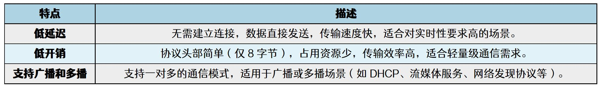
缺点：表234.2
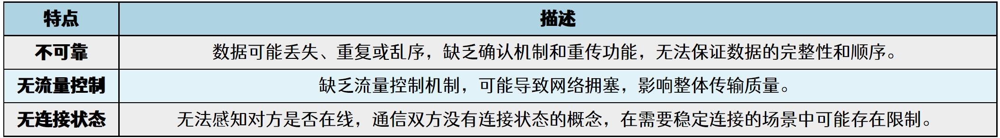
UDP 通信框架图如下图234.1 所示：

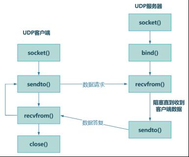
图234.1上图展示了一个UDP 客户端与UDP 服务器之间的通信流程，其中服务端是“被动等待”的一方，它的主要任务是提供服务，等待客户端的请求，并对请求作出响应。而客户端是“主动发起”的一方，向服务端发送请求，并接收服务端的响应。通过对上图观察可以得到，不管是服务端还是客户端在最开始的时候都需要通过socket()系统调用来初始化监听端口并创建套接字，以及使用sendto()和recvfrom()函数发送和接收数据，服务端和客户端的区别在于是否使用了bind()函数将其套接字绑定到一个具体的IP 地址和端口号。这是因为服务端的主要职责是被动地等待客户端的请求，并对请求作出响应。为了实现这一点，服务端必须有一个固定的的地址和端口号，以便客户端能够找到并与其通信。如果服务端不调用bind()，系统的默认行为可能不会让套接字绑定到指定的端口，导致客户端无法正确连接。至此，关于UDP 的简单介绍就完成了，会在下个小节对上面提到的一些函数进行讲解。
## 234.2 UDP 函数讲解
在上一小节的UDP 框图中总共有用到了四个函数，分别是socket()、bind()、sendto()以及recvfrom()函数，每个函数的功能描述以及使用场景如下图234.2 所示：

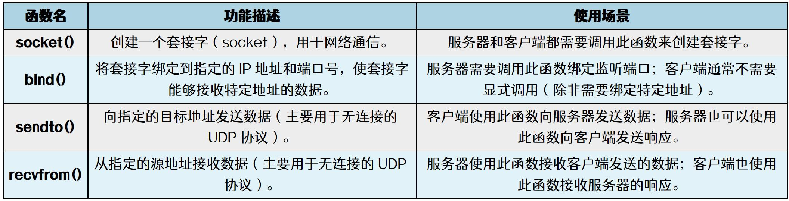
图234.2其中socket()、bind()这两个系统调用已经在前面CAN 应用编程的章节中讲解过了，所以本小节只会讲解sendto()和recvfrom()这两个函数。（1）sendto()函数详解sendto()是一个用于发送数据的系统调用，主要用于无连接的UDP 协议。它允许程序将数据发送到指定的目标地址（即目标IP 和端口）。与send()不同，sendto()需要显式指定目标地址，因此非常适合无连接的通信。函数原型如代码清单234.1 所示：代码清单234.1
```c
ssize_t sendto(int sockfd, const void *buf, size_t len, int flags,
                const struct sockaddr *dest_addr, socklen_t addrlen);
```
当该函数运行成功后，会返回实际发送的字节数，该函数的各个参数介绍如下图234.3 所示：
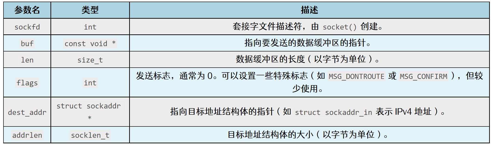
图234.3（2）recvfrom()函数讲解recvfrom()是一个用于接收数据的系统调用，主要用于无连接的UDP 协议。它允许程序从指定的源地址（即发送方的IP 和端口）接收数据包。与recv()不同，recvfrom()可以获取发送方的地址信息，因此非常适合无连接的通信。函数原型如代码清单234.2 所示：代码清单234.2

```c
ssize_t recvfrom(int sockfd, void *buf, size_t len, int flags,
            struct sockaddr *src_addr, socklen_t *addrlen);
```
函数运行成功之后会返回实际接收到的字节数，该函数的各个参数介绍如下图234.4 所示：
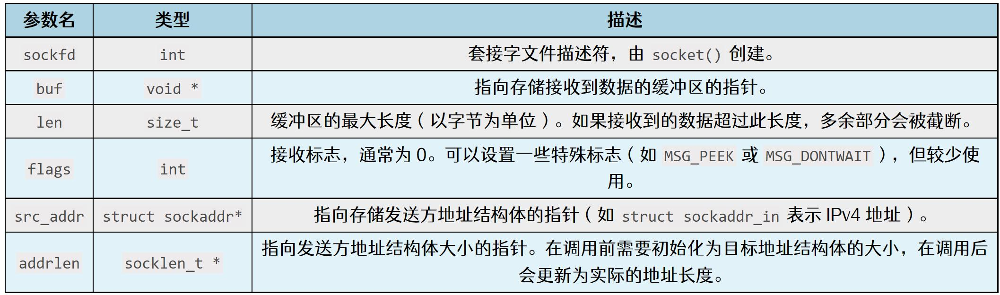
图234.4至此，关于UPD 网络编程要用到的发送和接收系统调用就讲解完成了，会在接下来的两个小节编写UDP 客户端和服务端的应用程序，以此来对前面学习到的内容进行巩固。
## 234.3 UDP 客户端实验
### 234.3.1 编写应用程序
本小节要编写的应用程序旨在实现了一个简单的UDP 客户端，它从命令行获取服务器的IP 地址和端口号，创建UDP 套接字，并在一个无限循环中从标准输入读取数据，然后将数据发送给指定的服务器。本实验程序存放在网盘iTOP-RK3568 开发板\07_学习教程配套资料\03_Linux 驱动配套资料\04_Linux 驱动程序\131_udp_client 路径下。实验代码如代码清单234.3 所示。实验代码234.3
```c
#include <stdio.h>
#include <stdlib.h>
#include <sys/types.h>
#include <sys/socket.h>
#include <string.h>
#include <arpa/inet.h>
int main(int argc, char *argv[])
{
    int port;// 存储端口号
```

```c
int fd;// 套接字描述符
char buf[1024];// 数据缓冲区
// 检查命令行参数是否正确
if (argc != 3)
 {
    printf("for example: ./app ip port\n");
    return -1;
}
port = atoi(argv[2]);// 将命令行参数中的端口号字符串转为整数
// 创建UDP 套接字
fd = socket(AF_INET, SOCK_DGRAM, 0);
if (fd == -1)
 {
    printf("socket fd error\n");
    return -1;
}
struct sockaddr_in addr = {0};// 定义并初始化服务器地址结构体
addr.sin_family = AF_INET;// 设置地址族为IPv4
addr.sin_port = htons(port);// 转换端口号为主机字节序
addr.sin_addr.s_addr = inet_addr(argv[1]);// 转换IP 地址为网络字节序
memset(buf, 0, sizeof(buf));
while (1)
{
    scanf("%s", buf);
    sendto(fd, buf, strlen(buf), 0, (struct sockaddr*)&addr, sizeof(addr));
    memset(buf, 0, sizeof(buf));
}
return 0;
}
```
### 234.3.2 编译应用程序
使用gcc udp_client.c -o udp_client 命令编译应用程序，编译完成以后会生成一个udp_client可执行程序，如下图234.5 所示：


图234.5
### 234.3.3 运行测试
在进行实验之前，首先需要下载网络调试助手，在网盘iTOP-RK3568 开发板\07_学习教程配套资料\03_Linux 驱动配套资料\04_Linux 驱动程序\131_udp_client 路径下。下载完成之后，打开网络调试助手，如下图234.6 所示：
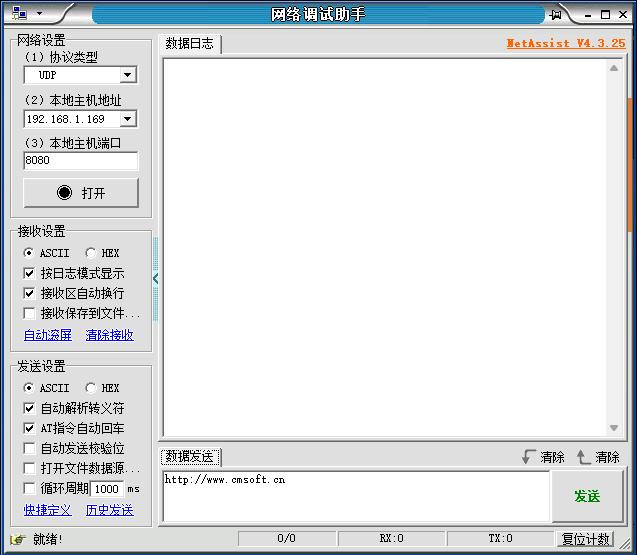
图234.6接下来要确保虚拟机ubuntu 和Windows 上ip 地址是可以互相ping 通的。作者虚拟机ubuntu 的IP 地址为192.168.1.79，如下图234.7 所示：

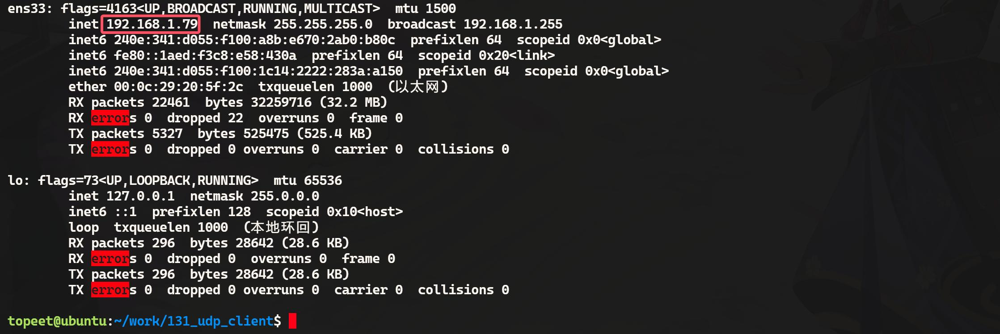
图234.7作者Windows 的IP 地址为192.168.1.169，如下图234.8 所示：
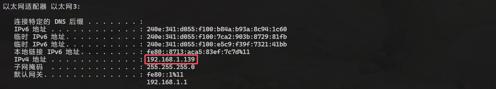
图234.8Windows 和虚拟机的ubuntu 是可以相互ping 通的，如下图234.9 所示：
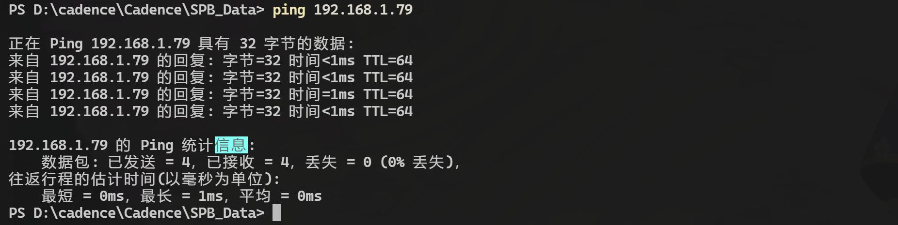
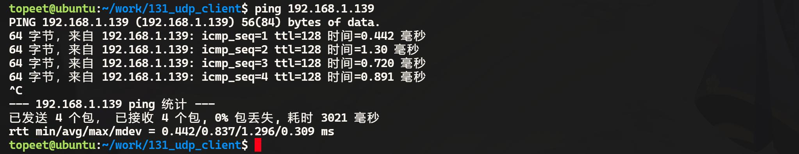
图234.9接下来设置网络调试助手，设置协议类型为UDP，设置Windows 主机地址和端口，然后点击打开，如下图234.10 所示：

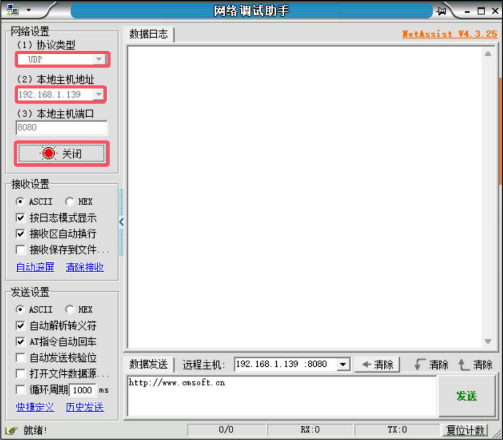
图234.10接下来运行刚刚编译的udp_client，第一个参数为windows 的IP 地址，第二个参数为网络调试助手打开的端口号8080，运行之后，输入要发送的内容，如下图234.11 所示：

图234.11然后在网络调试助手会会收到发送的数据1 和2。如下图234.12 所示：

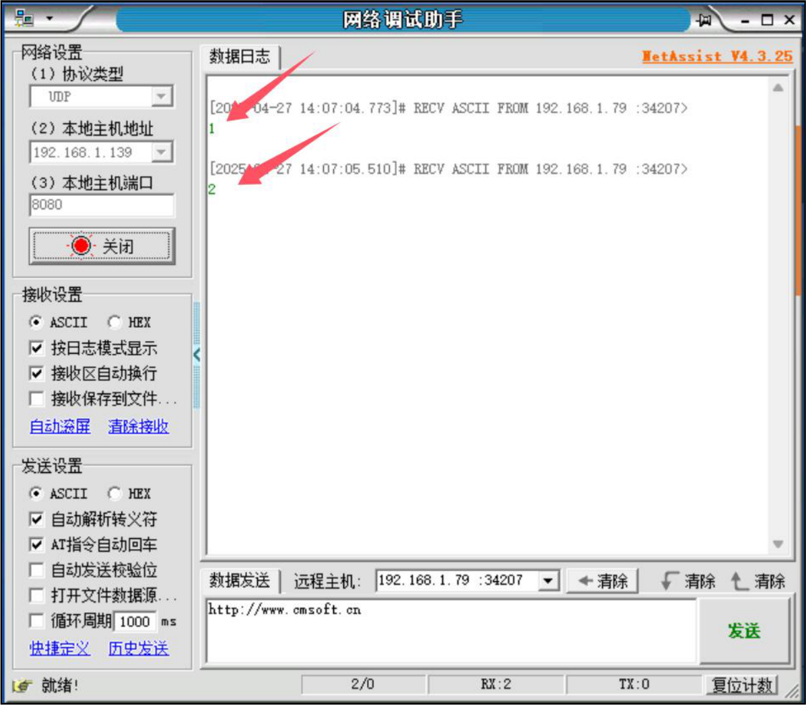
图234.12至此，UDP 客户端实验就测试完成了，然后在下个小节会编写UDP 服务端程序代码，从而实现自己编写的UDP 客户端和UDP 服务器端之间的通信。
## 234.4 UDP 服务器实验
### 234.4.1 编写应用程序
本小节旨在实现一个简单的UDP 服务器端，程序首先检查命令行参数，然后创建一个UDP套接字并将其绑定到指定的IP 地址和端口，然后不断接收来自其他UDP 客户端发送的数据，并打印出发送方的IP 地址、端口号以及接收到的数据内容。本实验代码存放在iTOP-RK3568 开发板\07_学习教程配套资料\03_Linux 驱动配套资料\04_Linux 驱动程序\132_udp_server 路径下。实验代码如代码清单234.4 所示。代码清单234.4
```c
#include <stdio.h>
```

```c
#include <stdlib.h>
#include <sys/types.h>
#include <sys/socket.h>
#include <string.h>
#include <arpa/inet.h>
int main(int argc, char *argv[])
{
    int port;// 端口号
    int fd;// 套接字描述符
    char buf[1024];// 接收数据缓冲区
    int ret;// 函数返回值
    int len;// 地址结构体长度
    // 检查命令行参数是否正确
    if (argc != 3)
     {
        printf("for example: ./app ip port\n");
        return -1;
    }
    port = atoi(argv[2]);// 转换端口号为整数
    // 创建UDP 套接字
    fd = socket(AF_INET, SOCK_DGRAM, 0);
    if (fd == -1)
    {
        printf("socket fd error\n");
        return -1;
    }
    struct sockaddr_in local_addr = {0};// 本地地址结构体
    struct sockaddr_in src_addr = {0};// 源地址结构体
    local_addr.sin_family = AF_INET;// 设置地址族为IPv4
    local_addr.sin_port = htons(port);// 设置端口号（网络字节序）
    local_addr.sin_addr.s_addr = inet_addr(argv[1]);// 设置IP 地址
    // 绑定套接字到本地地址
    ret = bind(fd, (struct sockaddr *)&local_addr, sizeof(local_addr));
    if (ret == -1)
    {
        printf("bind error\n");
        return -1;
    }
```

```c
len = sizeof(src_addr);// 设置源地址结构体长度
memset(buf, 0, sizeof(buf));// 清空接收缓冲区
// 循环接收数据
while (1)
{
    recvfrom(fd, buf, sizeof(buf), 0, (struct sockaddr *)&src_addr, &len);
    printf("ip:%s port:%d\n", inet_ntoa(src_addr.sin_addr), ntohs(src_addr.sin_port));
    printf("buf is %s\n", buf);
    memset(buf, 0, sizeof(buf));// 清空缓冲区，准备下一次接收
}
return 0;
}
```
### 234.4.2 编译应用程序
使用aarch64-linux-gnu-gcc udp_server.c -o udp_server 命令交叉编译应用程序，编译完成以后会生成一个udp_server 的可执行程序，如下图234.13 所示：
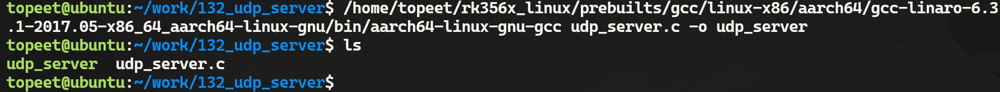
图234.13
### 234.4.3 运行测试
在开展实验前，请使用网线将开发板的网口1 连接至路由器。此时，虚拟机Ubuntu 设置为桥接模式，需确保开发板与虚拟机Ubuntu 之间网络连通，即二者能够互相ping 通。其中，虚拟机Ubuntu 的IP 地址为192.168.1.79，具体情况如下图234.14 所示：


图234.14开发板的ip 地址为192.168.1.208，如下图234.15 所示：
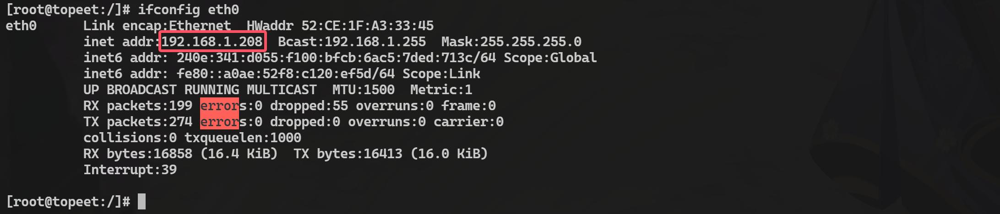
图234.15开发板和虚拟机的ubuntu 是可以相互ping 通的，如下图234.16 所示：
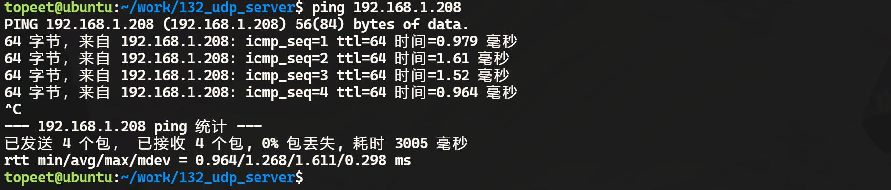
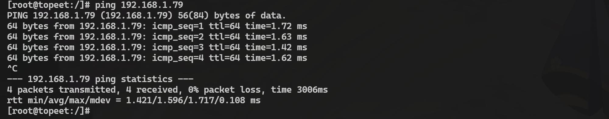
图234.16接下来将udp_server 程序拷贝到开发板上运行，第一个参数为本机的IP 地址，第二个参数为要打开的端口号，这里设置为8080，如下图234.17 所示：

图234.17虚拟机Ubuntu 上运行udp_client，第一个参数为运行服务器端程序的IP 地址192.168.1.208，第二个参数为要打开的端口号，这里设置为8080，运行之后，分别发送数据1、2、3，如下图234.18 所示：

图234.18在开发板端可以看到接收的数据，如下图234.19 所示：

