# 第235章 TCP实验

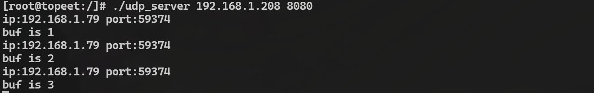
图234.19至此，编写完成的UDP 服务端程序就测试完成了，关于UDP 相关的实验到这里就结束了，在下一章节中将对TCP 相关的内容进行讲解。

## 235.1 TCP 介绍
TCP 的英文全称为Transmission Control Protocol，意为传输控制协议，它是一种面向连接的传输层协议，与UDP 一样，都属于TCP/IP 协议栈的核心部分。TCP 通过建立可靠的端到端连接，确保数据在传输过程中的完整性、顺序性和无丢失性。它使用三次握手建立连接，并通过确认机制、重传机制以及流量控制等功能来保障数据传输的可靠性。因此，TCP 适用于对数据准确性要求较高的场景，例如文件传输、电子邮件、网页浏览等，这些场景中数据的完整性和顺序性至关重要，而对延迟的容忍度相对较高。关于TCP 协议的优缺点如图235.1、图235.2 所示：优点：
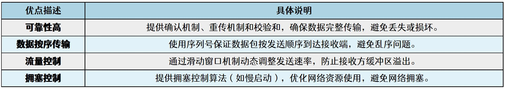
图235.1缺点：
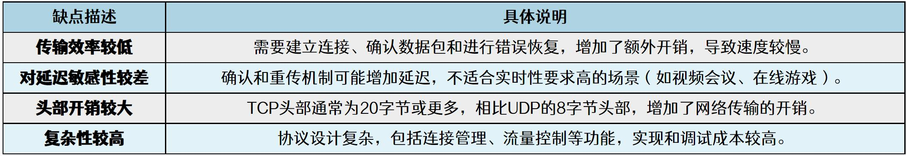
图235.2TCP 通信框架图如图235.3 所示：
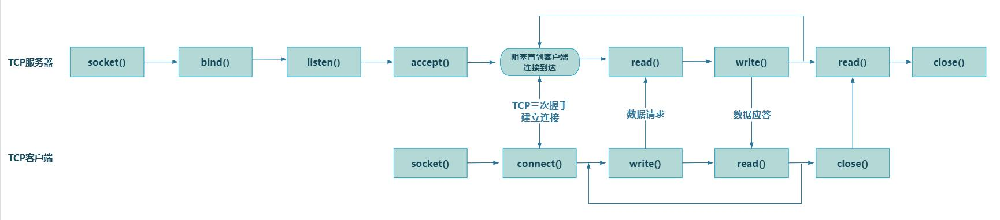

图235.3TCP 客户端与UDP 客户端相比，中间多了调用connect()发起连接请求的这一步骤，而TCP 服务器端与UDP 服务器端相比，中间多了调用listen()启动监听模式以及调用accept()阻塞并等待客户端的请求这两个步骤，其中listen()会将套接字设置为被动模式以等待客户端的连接请求，而当客户端发起连接时，accept()会阻塞并等待，直到接收到请求后返回一个新的套接字文件描述符，该描述符专门用于与该客户端进行通信。当客户端通过connect()发起连接请求后，会与服务器进行TCP 三次握手建立连接，连接建立后，客户端和服务器可以通过write()和read()进行数据的发送和接收。数据传输完成后，客户端和服务器分别通过close()关闭连接。在下一小节将对前面章节未讲解过的connect()、listen()和accept()系统调用进行讲解。
## 235.2 TCP 函数讲解
(1)connect()函数详解connect()是一个用于建立连接的系统调用，主要用于客户端。它通过指定服务器的地址（IP 地址和端口号），向服务器发起连接请求。对于TCP 协议，connect()会触发TCP 的三次握手过程；需要注意的是对于UDP 协议，connect()同样可以使用，但是并不会真正建立连接，而是将目标地址绑定到套接字上，以便后续的通信过程。函数原型如代码清单235.1 所示：代码清单235.1
```c
int connect(int sockfd, const struct sockaddr *addr, socklen_t addrlen);
```
当该函数运行成功后，会返回0，失败则返回-1，该函数的各个参数介绍如下图250.4 所示：
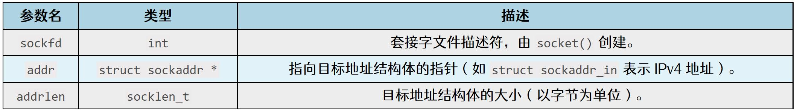
图235.4
(2)listen()函数详解listen()是一个用于将套接字设置为监听模式的系统调用，主要用于TCP 服务器。它将套接字从主动模式（用于发起连接）转换为被动模式（用于接收连接请求）。调用listen()后，套接

字会开始监听来自客户端的连接请求，并维护一个等待队列以管理这些请求。函数原型如代码清单235.2 所示：代码清单235.2
```c
int listen(int sockfd, int backlog);
```
当该函数运行成功后，会返回0，失败则返回-1，该函数的各个参数介绍如下图235.5 所示：
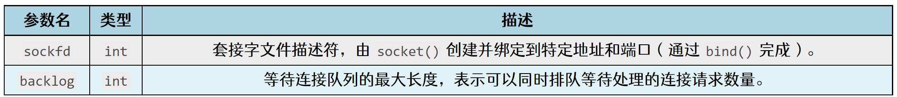
图235.5
(3)accept()函数详解accept()是一个用于接收客户端连接请求的系统调用，主要用于TCP 服务器。它从监听套接字的等待队列中取出一个连接请求，并创建一个新的套接字专门用于与该客户端通信。通过accept()函数，服务器能够处理多个客户端的连接请求。函数原型如代码清单235.3 所示：代码清单235.3
```c
int accept(int sockfd, struct sockaddr *addr, socklen_t *addrlen);
```
当该函数运行成功后，会返回0，失败则返回-1，该函数的各个参数介绍如下图235.6 所示：
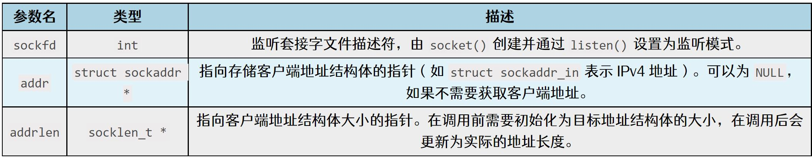
图235.6至此，关于TCP 应用编程要用到的函数就讲解完成了，在接下来的两个小节中将会分别编写TCP 客户端以及TCP 服务端的应用程序，从而巩固前面学习到的内容。

## 235.3 TCP 客户端实验
### 235.3.1 编写应用程序
本小节实验旨在实现了一个简单的TCP 客户端程序，通过该TCP 客户端程序与指定IP地址和端口的服务器建立联系，并向服务器发送用户从标准输入输入的数据。本实验代码存放在iTOP-RK3568 开发板\07_学习教程配套资料\03_Linux 驱动配套资料\04_Linux 驱动程序\133_tcp_client 路径下。实验代码如代码清单235.4 所示。代码清单235.4
```c
#include <stdio.h>
#include <stdlib.h>
#include <sys/types.h>
#include <sys/socket.h>
#include <string.h>
#include <arpa/inet.h>
int main(int argc, char *argv[])
{
    int port;// 存储端口号
    int fd;// 套接字描述符
    char buf[1024];// 数据缓冲区
    int ret;// 函数返回值
    // 检查命令行参数是否正确
    if (argc != 3)
    {
        printf("for example: ./app ip port\n");
        return -1;
    }
    port = atoi(argv[2]);// 转换端口号为整数
    // 创建TCP 套接字
    fd = socket(AF_INET, SOCK_STREAM, 0);
    if (fd == -1)
    {
        printf("socket fd error\n");
```

```c
return -1;
}
struct sockaddr_in addr = {0};// 初始化服务器地址结构体
addr.sin_family = AF_INET;// 设置地址族为IPv4
addr.sin_port = htons(port);// 设置端口号（网络字节序）
addr.sin_addr.s_addr = inet_addr(argv[1]);// 设置IP 地址
// 连接到服务器
ret = connect(fd, (struct sockaddr*)&addr, sizeof(addr));
if (ret < 0)
{
printf("connect error\n");
return -1;
}
memset(buf, 0, sizeof(buf));
// 循环发送数据
while (1)
{
scanf("%s", buf);// 从标准输入读取数据
sendto(fd, buf, strlen(buf), 0, (struct sockaddr*)&addr, sizeof(addr));
memset(buf, 0, sizeof(buf));
}
return 0;
}
```
### 235.3.2 编译应用程序
使用gcc tcp_client.c -o tcp_client 命令编译应用程序，编译完成以后会生成一个tcp_client的可执行程序，如下图235.7 所示：

图235.7
### 235.3.3 运行测试
在进行实验之前，首先需要下载网络调试助手，在网盘iTOP-RK3568 开发板\07_学习教程配套资料\03_Linux 驱动配套资料\04_Linux 驱动程序\133_tcp_client”目录下可以下载。下载

完成之后，打开网络调试助手，如下图235.8 所示：
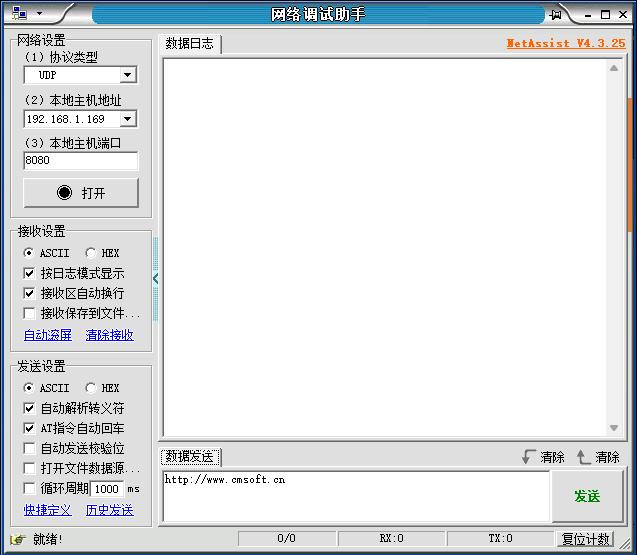
图235.8
接下来要确保虚拟机ubuntu 和Windows 上ip 地址是可以互相ping 通的。作者虚拟机ubuntu 的IP 地址为192.168.1.79，如下图235.9 所示：
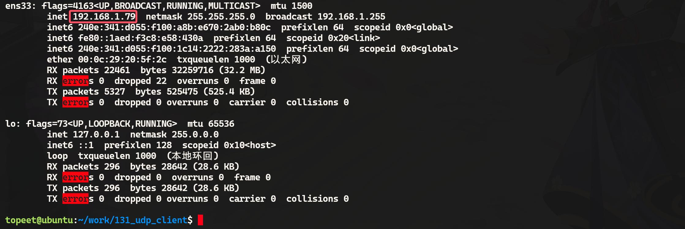
图235.9作者Windows 的IP 地址为192.168.1.169，如下图235.10 所示：

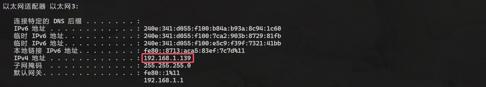
图235.10Windows 和虚拟机的ubuntu 是可以相互ping 通的，如下图235.11 所示：
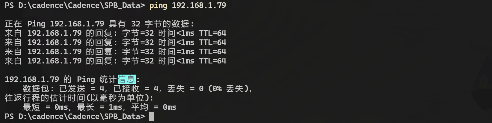
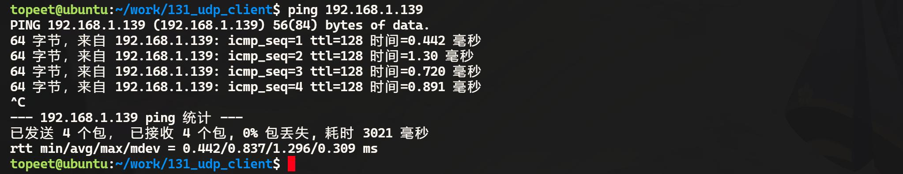
图235.11接下来设置网络调试助手，设置协议类型为TCP server，设置Windows 主机地址和端口，然后点击打开，如下图235.12 所示：

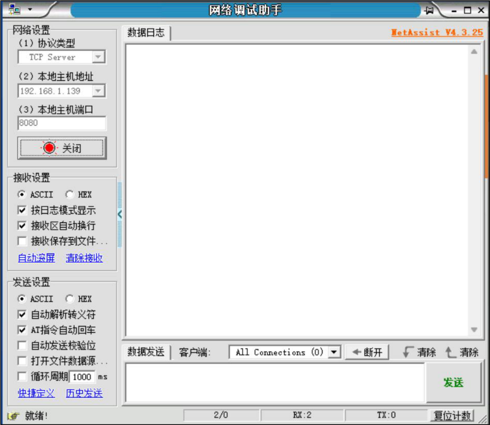
图235.12接下来运行刚刚编译的tcp_client，第一个参数为windows 电脑的IP 地址，192.168.1.139，第二个参数为网络调试助手打开的端口号8080，运行之后，输入要发送的数据12，34，45 如下图235.13 所示：

图235.13网络调试助手收到发送的数据12，34，45。如下图235.14 所示：

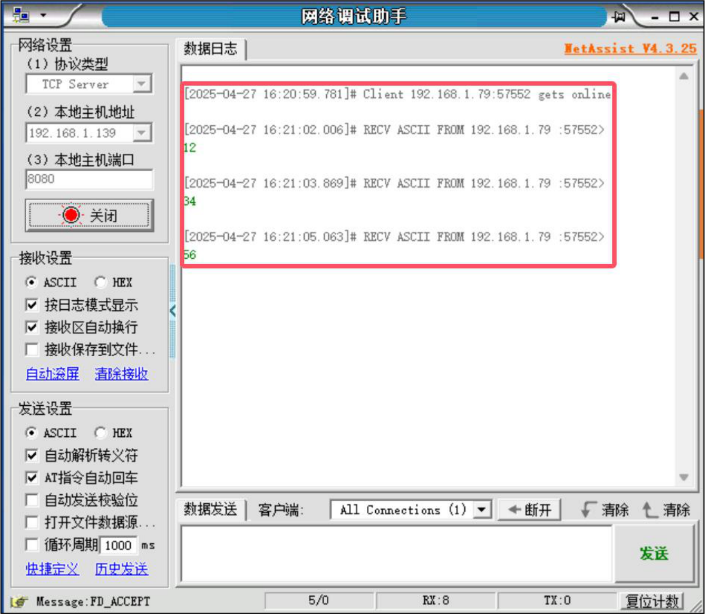
图235.14至此，关于TCP 客户端的应用程序就测试完成了，在下个小节中将会编写TCP 服务端的应用程序，从而实现自己编写的TCP 客户端和TCP 服务器端之间的通信。
## 235.4 TCP 服务器实验
### 235.4.1 编写应用程序
本小节应用程序旨在实现一个简单的TCP 服务器程序，程序从命令行获取IP 地址和端口号，创建TCP 套接字并绑定到指定地址和端口，然后监听客户端连接。一旦有客户端连接，程序会持续接收客户端发送的数据，并在接收到数据时打印客户端的IP 地址，端口号以及数据内容。如果客户端关闭连接或者接收数据时发生错误，程序将相应处理并结束。本实验代码存放在网盘iTOP-RK3568 开发板\07_学习教程配套资料\03_Linux 驱动配套资

料\04_Linux 驱动程序\134_tcp_server 路径下。实验代码如代码清单235.5 所示。代码清单235.5
```c
#include <stdio.h>
#include <stdlib.h>
#include <sys/types.h>
#include <sys/socket.h>
#include <string.h>
#include <arpa/inet.h>
#include <unistd.h>
int main(int argc, char *argv[])
{
    int port;// 端口号
    int fd;// 监听套接字描述符
    char buf[1024];// 数据缓冲区
    int acc_fd;// 客户端连接套接字描述符
    struct sockaddr_in local_addr = {0};// 本地地址结构体
    struct sockaddr_in src_addr = {0};// 客户端地址结构体
    socklen_t src_len = sizeof(src_addr); // 客户端地址长度
    // 检查命令行参数是否正确
    if (argc != 3)
    {
        printf("for example: ./app ip port\n");
        return -1;
    }
    port = atoi(argv[2]);// 转换端口号为整数
    // 创建TCP 套接字
    fd = socket(AF_INET, SOCK_STREAM, 0);
    if (fd == -1)
    {
        printf("socket fd error\n");
        return -1;
    }
    local_addr.sin_family = AF_INET;// 设置地址族为IPv4
    local_addr.sin_port = htons(port);// 设置端口号（网络字节序）
    local_addr.sin_addr.s_addr = inet_addr(argv[1]);// 设置IP 地址
```

```c
// 绑定套接字到本地地址
if (bind(fd, (struct sockaddr*)&local_addr, sizeof(local_addr)) == -1)
{
    printf("bind error\n");
    return -1;
}
listen(fd, 10);// 设置监听队列长度为10
// 接受客户端连接，返回新的套接字描述符
acc_fd = accept(fd, (struct sockaddr*)&src_addr, &src_len);
if (acc_fd < 0)
{
    printf("accept error\n");
    return -1;
}
memset(buf, 0, sizeof(buf));
// 循环接收客户端数据
while (1)
{
    int byte = recvfrom(acc_fd, buf, sizeof(buf), 0, (struct sockaddr*)&src_addr, &src_len);
    if (byte > 0)
    {
        printf("ip:%s port:%d\n", inet_ntoa(src_addr.sin_addr), ntohs(src_addr.sin_port));
        printf("buf is %s\n", buf);
    }
    else if (byte == 0)
    {
        printf("close\n");
        break;
    }
    else
    {
        printf("recvfrom error\n");
        return -1;
    }
    memset(buf, 0, sizeof(buf));
}
close(acc_fd);// 关闭客户端连接套接字
close(fd);// 关闭监听套接字
```

```c
return 0;
}
```
### 235.4.2 编译应用程序
使用aarch64-linux-gnu-gcc tcp_server.c -o tcp_server 命令交叉编译应用程序，编译完成以后会生成一个tcp_server 的可执行程序，如下图235.15 所示：
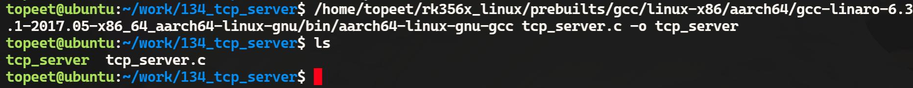
图235.15
### 235.4.3 运行测试
在开展实验前，请使用网线将开发板的网口1 连接至路由器。此时，虚拟机Ubuntu 设置为桥接模式，需确保开发板与虚拟机Ubuntu 之间网络连通，即二者能够互相ping 通。其中，虚拟机Ubuntu 的IP 地址为192.168.1.79，具体情况如下图235.16 所示：

图235.16
开发板的ip 地址为192.168.1.208，如下图235.17 所示：
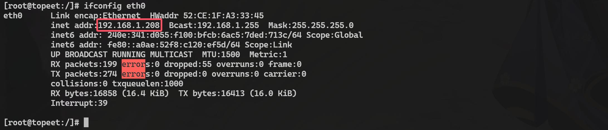

图235.17开发板和虚拟机的ubuntu 是可以相互ping 通的，如下图235.18 所示：
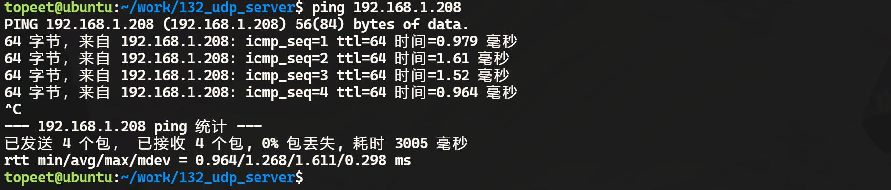
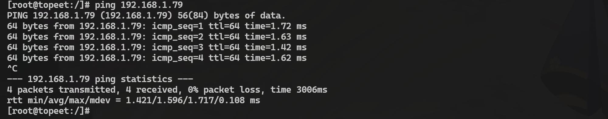
图235.18接下来将tcp_server 程序拷贝到开发板上运行，第一个参数为开发板的IP 地址192.168.1.208，第二个参数为要打开的端口号8080，运行之后，如下图235.19 所示：
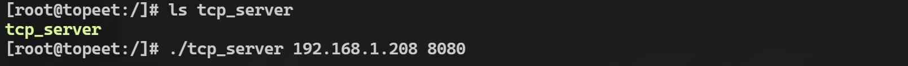
图235.19然后在虚拟机Ubuntu 上运行tcp_client，第一个参数为开发板的IP 地址192.168.1.208，第二个参数为打开的端口号8080，运行之后输入要发送的数据1 2 3，如下图235.20 所示：

图234.20在开发板端可以看到接收的数据，如下图235.21 所示：
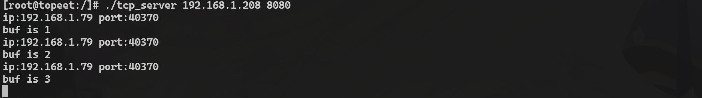
图235.21至此，编写完成的TCP 服务端程序就测试完成了。

