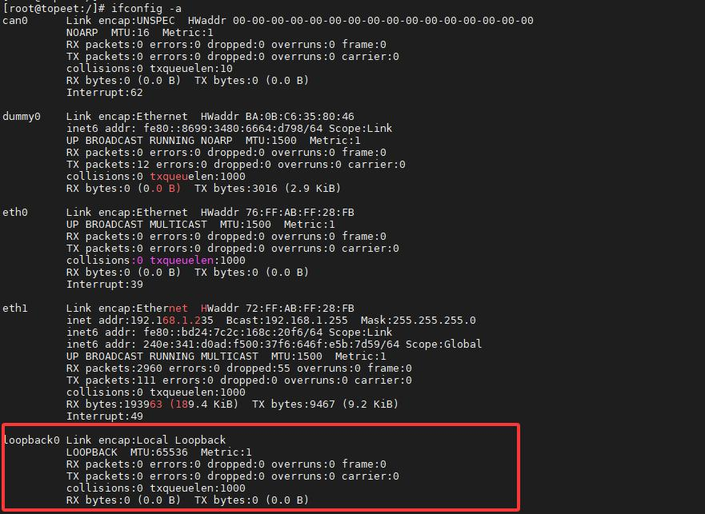
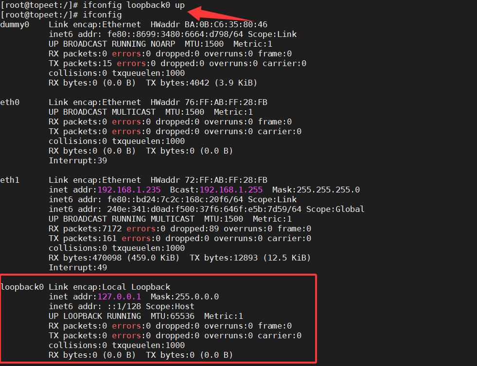

# 第236章 最小网络设备驱动实验

在之前的章节里，我们深入剖析了网络设备驱动程序，还通过UDP 与TCP 实验，切实体验了如何操作网络设备实现网络通信。本章节，我们将着手编写一个最小网络设备驱动程序，以此进一步深化对网络设备驱动的理解。此驱动程序并不针对特定网卡进行操作，而是着重实现自收自发的回环功能。别看它是最简形式，却涵盖了网络设备驱动的关键流程。编写最小网络设备驱动步骤如下所述：步骤一：声明核心数据结构。声明网络设备结构体指针（如struct net_device *virnet_netdevice），表示回环设备。步骤二：实现loopback_net_init()初始化函数。在初始化函数中使用alloc_netdev()函数分配网络设备结构体，并绑定设备初始化函数loopback_setup()。接着使用register_netdev()函数注册网络设备。步骤三：实现设备初始化函数loopback_setup()。在此函数中设置MTU、设备类型、标志、特性，并关联操作集loopback_ops。步骤四：实现操作集中的loopback_netdevice_xmit()发送函数和loopback_get_stats64()统计函数。步骤五：实现loopback_net_exit()退出函数。接下来，开始编写驱动程序。我们可借助Linux 源码中现有的驱动作为模板，该驱动路径为kernel/drivers/net/loopback.c。大家先将此路径下这个文件备份为loopback_yuan.c，然后新建一个loopback.c 文件，在其中编写最小网络设备驱动。
## 236.1 编写驱动程序
本实验程序存放在网盘iTOP-RK3568 开发板\07_学习教程配套资料\03_Linux 驱动配套资料\04_Linux 驱动程序\135_loopback.c 路径下，代码实现了一个简单的回环网络设备驱动程序。实验代码如代码清单236.1 所示。代码清单236.1
```c
#include <linux/kernel.h>
```

```c
#include <linux/jiffies.h>
#include <linux/module.h>
#include <linux/interrupt.h>
#include <linux/fs.h>
#include <linux/types.h>
#include <linux/string.h>
#include <linux/socket.h>
#include <linux/errno.h>
#include <linux/fcntl.h>
#include <linux/in.h>
#include <linux/uaccess.h>
#include <linux/io.h>
#include <linux/inet.h>
#include <linux/netdevice.h>
#include <linux/etherdevice.h>
#include <linux/skbuff.h>
#include <linux/ethtool.h>
#include <net/sock.h>
#include <net/checksum.h>
#include <linux/if_ether.h>
#include <linux/if_arp.h>
#include <linux/ip.h>
#include <linux/tcp.h>
#include <linux/percpu.h>
#include <linux/net_tstamp.h>
#include <net/net_namespace.h>
#include <linux/u64_stats_sync.h>
struct net_device *virnet_netdevice;
unsigned long bytes = 0;
```

```c
unsigned long packets = 0;
// 定义网络设备的发送函数，负责处理网络设备的数据发送
netdev_tx_t loopback_netdevice_xmit(struct sk_buff *skb, struct net_device *dev) {
        // 停止网络设备的发送队列，防止新的数据被发送
        netif_stop_queue(dev);
        // 更新发送的字节数，增加当前skb 的长度
        bytes += skb->len;
        // 更新发送的数据包数，增加1
        packets++;
        // 根据设备类型设置skb 的协议类型
        skb->protocol = eth_type_trans(skb, dev);
        // 将接收到的skb 传递给网络设备的接收函数处理
        if (netif_rx(skb) == NET_RX_SUCCESS) {
            // 如果接收成功，打印成功信息
            printk("NET_RX_SUCCESS\n");
        }
        // 唤醒网络设备的发送队列，允许继续发送数据
        netif_wake_queue(dev);
        // 返回发送成功的标志
        return NETDEV_TX_OK;
}
// 定义获取网络设备统计信息的函数
void loopback_get_stats64(struct net_device *dev, struct rtnl_link_stats64 *stats) {
        // 设置发送的字节数统计信息
        stats->tx_bytes = bytes;
        // 设置接收的字节数统计信息，这里回环设备发送和接收字节数相同
        stats->rx_bytes = bytes;
        // 设置发送的数据包数统计信息
        stats->tx_packets = packets;
```

```c
// 设置接收的数据包数统计信息，这里回环设备发送和接收数据包数相同
stats->rx_packets = packets;
}
// 定义网络设备操作集结构体，包含网络设备的各种操作函数指针
struct net_device_ops loopback_ops = {
.ndo_start_xmit = loopback_netdevice_xmit,// 指向数据发送函数
.ndo_get_stats64 = loopback_get_stats64,// 指向获取统计信息函数
};
struct header_ops loopback_header_ops = {
.create = eth_header,
};
// 定义网络设备的设置函数，用于初始化网络设备的属性
void loopback_setup(struct net_device *dev) {
dev->mtu = 64 * 1024;// 设置网络设备的最大传输单元（MTU）为64KB
dev->type = ARPHRD_LOOPBACK;// 设置网络设备的类型为回环设备
dev->flags |= IFF_LOOPBACK;// 设置网络设备的标志，添加回环设备标志
// 清除一些特定的私有标志
dev->priv_flags &= ~(IFF_XMIT_DST_RELEASE | IFF_XMIT_DST_RELEASE_PERM);
// 设置网络设备的特性，添加回环特性
dev->features = NETIF_F_LOOPBACK;
// 设置网络设备的头部操作集
dev->header_ops = &loopback_header_ops;
// 设置网络设备的操作集
dev->netdev_ops = &loopback_ops;
}
// 定义网络设备初始化函数，在网络命名空间初始化时被调用
int loopback_net_init(struct net *net) {
int ret;
// 分配一个网络设备结构体，指定设备名称格式和初始化函数
```

```c
virnet_netdevice = alloc_netdev(0, "loopback%d", NET_NAME_UNKNOWN, loopback_setup);
// 将分配的网络设备设置为网络命名空间的回环设备
net->loopback_dev = virnet_netdevice;
// 注册网络设备
ret = register_netdev(virnet_netdevice);
if (ret < 0) {
 printk("register_netdev error\n");
     free_netdev(virnet_netdevice);
     return ret;
}
return 0;
}
// 定义网络设备退出函数，在网络命名空间退出时被调用
void loopback_net_exit(struct net *net) {
struct net_device *dev = net->loopback_dev;// 获取网络命名空间中的回环设备
unregister_netdev(dev); // 注销网络设备
free_netdev(virnet_netdevice);// 释放分配的网络设备结构体
}
// 定义网络命名空间操作结构体，包含网络命名空间初始化和退出函数指针
struct pernet_operations loopback_net_ops = {
.init = loopback_net_init,// 指向网络命名空间初始化函数
.exit = loopback_net_exit, // 指向网络命名空间退出函数
};
```
## 236.2 编译测试
使用./build.sh kernel 命令编译内核，然后烧写编译好的内核镜像。将之前章节编译好的udp_client 程序和udp_server 程序拷贝到开发板上。开发板启动之后，输入ifconfig -a 命令，如下图236.1 所示：


图236.1然后使用ifconfig loopback0 up 命令使能loopback0 网卡，如236.2 图所示：


