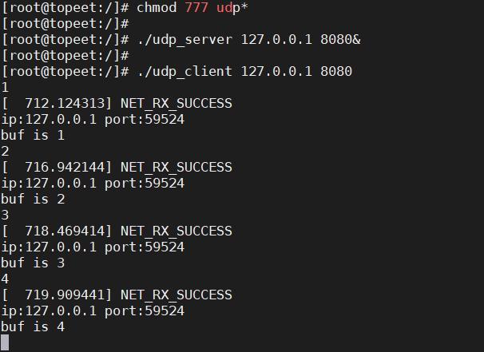
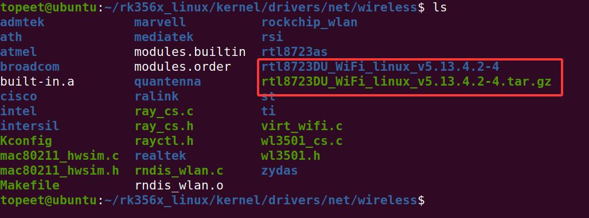
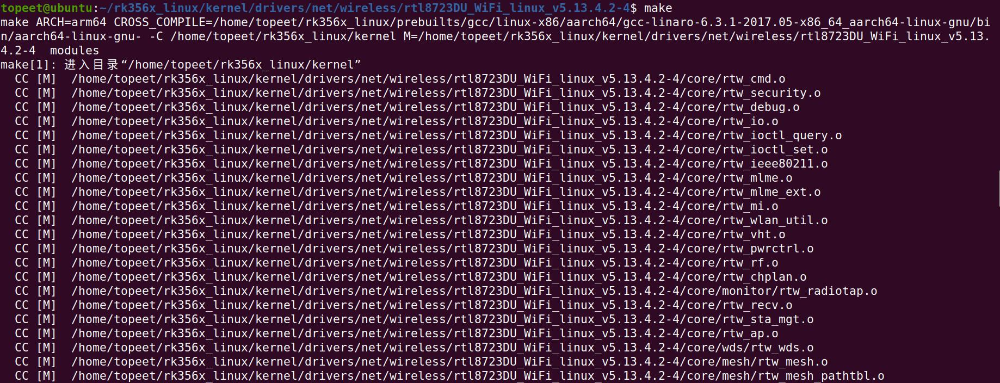
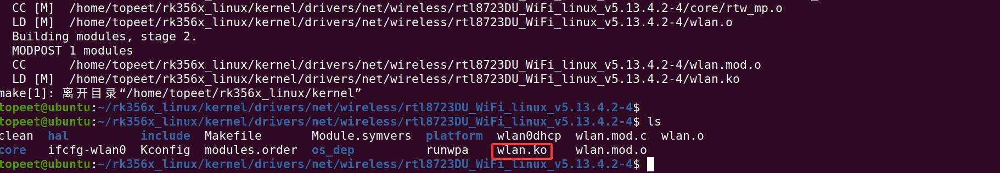
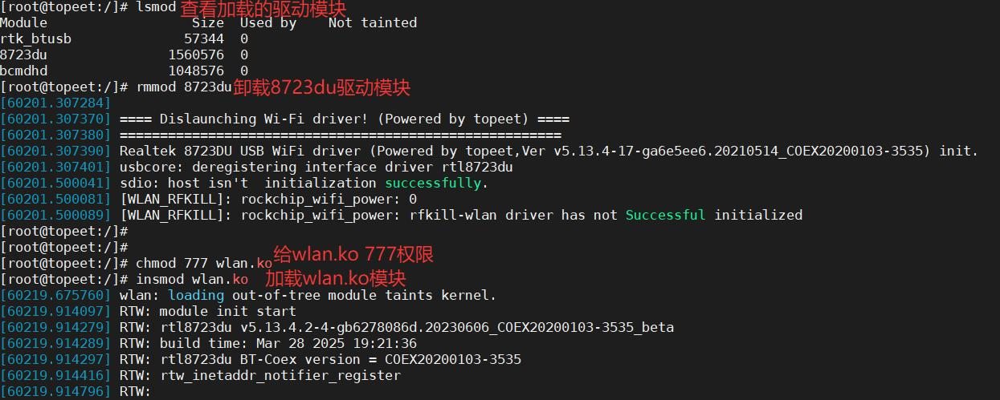
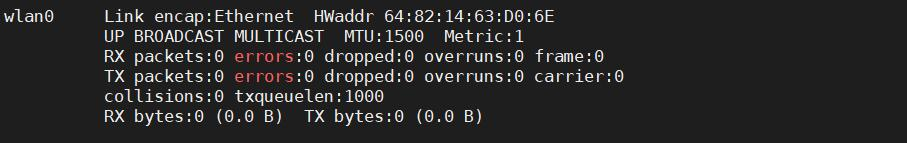

# 第237章 移植RTL8723DU(wifi)驱动

图236.2输入下图236.3 中的命令运行udp_server 和udp_client。

图236.3在上图236.3 中，后台运行udp_server 程序，然后运行udp_client，输入数据1,2,3,4，可以看到接收到的数据为1,2,3,4。至此，最小网络设备驱动实验完成！
本章学习wifi RTL8723DU 模组移植驱动。将wifi 厂家提供的驱动资料包拷贝到Linux 源码的kernel/drivers/net/wireless 目录下，然后解压缩，如图237.1 所示。驱动资料包在网盘资料“iTOP-RK3568 开发板\07_学习教程配套资料\03_Linux 驱动配套资料\06_软件包”路径下。


图237.1进入到解压的文件夹中，修改Makefile 文件，如代码清单237.1 所示：代码清单237.1
```c
CONFIG_MULTIDRV = n
CONFIG_RTL8188E = n
CONFIG_RTL8812A = n
CONFIG_RTL8821A = n
CONFIG_RTL8192E = n
CONFIG_RTL8723B = n
CONFIG_RTL8814A = n
CONFIG_RTL8723C = n
CONFIG_RTL8188F = n
CONFIG_RTL8188GTV = n
CONFIG_RTL8822B = n
CONFIG_RTL8723D = y //因为适配的模块是RTL8723du，所以此选项为y
CONFIG_RTL8821C = n
CONFIG_RTL8710B = n
CONFIG_RTL8192F = n
CONFIG_RTL8822C = n
CONFIG_RTL8814B = n
CONFIG_RTL8723F = n
######################### Interface ###########################
CONFIG_USB_HCI = y//模块为usb 接口设置为y
CONFIG_PCI_HCI = n
CONFIG_SDIO_HCI = n
CONFIG_GSPI_HCI = n
CONFIG_PLATFORM_I386_PC = n//此选项修改为n
CONFIG_PLATFORM_ANDROID_X86 = n
CONFIG_PLATFORM_ANDROID_INTEL_X86 = n
CONFIG_PLATFORM_JB_X86 = n
CONFIG_PLATFORM_ARM_S3C2K4 = n
```

```c
CONFIG_PLATFORM_ARM_PXA2XX = n
CONFIG_PLATFORM_ARM_S3C6K4 = n
CONFIG_PLATFORM_MIPS_RMI = n
CONFIG_PLATFORM_RTD2880B = n
CONFIG_PLATFORM_MIPS_AR9132 = n
CONFIG_PLATFORM_RTK_DMP = n
CONFIG_PLATFORM_MIPS_PLM = n
CONFIG_PLATFORM_MSTAR389 = n
CONFIG_PLATFORM_MT53XX = n
CONFIG_PLATFORM_ARM_MX58_241H = n
CONFIG_PLATFORM_FS_MX61 = n
CONFIG_PLATFORM_ACTIONS_ATJ227X = n
CONFIG_PLATFORM_TEGRA3_CARDHU = n
CONFIG_PLATFORM_TEGRA4_DALMORE = n
CONFIG_PLATFORM_ARM_TCC8900 = n
CONFIG_PLATFORM_ARM_TCC8920 = n
CONFIG_PLATFORM_ARM_TCC8920_JB42 = n
CONFIG_PLATFORM_ARM_TCC8930_JB42 = n
CONFIG_PLATFORM_ARM_RK2818 = n
CONFIG_PLATFORM_ARM_RK3066 = n
CONFIG_PLATFORM_ARM_RK3568 = y //新增此选项设置为y
//将下面的3188 改成3568
CONFIG_PLATFORM_ARM_RK3188 = nifeq ($(CONFIG_PLATFORM_ARM_RK3568), y)
EXTRA_CFLAGS += -DCONFIG_LITTLE_ENDIAN -DCONFIG_PLATFORM_ANDROID
-DCONFIG_PLATFORM_ROCKCHIPS
# default setting for Android 4.1, 4.2, 4.3, 4.4
EXTRA_CFLAGS += -DCONFIG_IOCTL_CFG80211 -DRTW_USE_CFG80211_STA_EVENT
EXTRA_CFLAGS += -DCONFIG_CONCURRENT_MODE
# default setting for Power control
#EXTRA_CFLAGS += -DRTW_ENABLE_WIFI_CONTROL_FUNC
ifeq ($(CONFIG_SDIO_HCI), y)
EXTRA_CFLAGS += -DRTW_SUPPORT_PLATFORM_SHUTDOWN
endif
# default setting for Special function
ARCH := arm64 //修改为arm64
CROSS_COMPILE :=
/home/topeet/rk356x_linux/prebuilts/gcc/linux-x86/aarch64/gcc-linaro-6.3.1-2017.05-x86_64_aarch64-linux-
gnu/bin/aarch64-linux-gnu-
    KSRC := /home/topeet/rk356x_linux/kernel
    MODULE_NAME := wlan //模块名称
endif
```
然后输入make 命令进行编译，如图237.2 所示：


图237.2编译完成之后生成wlan.ko 驱动模块，如图237.3 所示。

图237.3将编译好的wlan.ko 拷贝到开发板上，加载wlan.ko 模块如图237.4 所示：

图237.4加载完成之后，生成wlan 的wifi 网卡，如图237.5 所示：

图237.5至此，移植RTL8723DU（wifi 驱动）实验完成！

