# 第238章 初识ADC

本章将会对ADC 进行概述，包括ADC 的基本概念、ADC 分辨率的相关知识，然后对
## 238.1 什么是ADC?
ADC 是Analog-to-Digital Converter 的缩写，可以翻译为模数转换器，它是一种电子设备或电路模块，用于将连续变化的模拟信号转换为离散的数字信号。模拟信号是一种连续变化的信号，其值可以在一定范围内取任意值，它在时间上和幅度上都是连续的，能够精确地反映自然界中的物理量变化。而数字信号是一种离散的信号，其值只能在有限的范围内取特定的数值，通常以二进制形式表示，它在时间上和幅度上都是离散的。两种信号的对比如表238.1 所示：表238.1
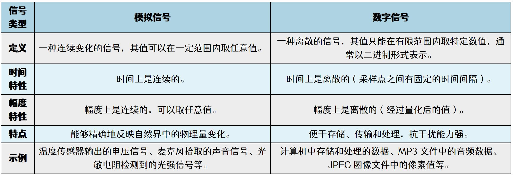
ADC 应用领域（1）传感器信号采集：温度传感器、压力传感器、光敏传感器等采集到的环境数据通常以模拟信号形式存在。（2）音频处理：麦克风拾取的声音信号是模拟信号。（3）图像处理：摄像头捕捉的光信号本质上是模拟信号。（4）工业自动化：各种物理量（如速度、位置、压力等）的测量通常依赖于传感器输出的模拟信号。（5）医疗设备：许多生物信号（如心电图、脑电图等）是以模拟信号形式采集的。

## 238.2 ADC 分辨率
ADC 分辨率指的是模数转换器能够区分的最小信号变化的能力，可以将其类比为一把尺子上的最小刻度，如果尺子的最小刻度是厘米，则它的分辨率较低，如果尺子的最小刻度是毫米，则它的分辨率较高。在ADC 中，分辨率越高，意味着可以更精确地表示输入的模拟信号。ADC 的分辨率通常用位数来表示，位数决定了ADC 输出的离散数值数量，n 位ADC 可以表示2^n 个不同的数值。例如，8 位ADC 可以表示2^8=256 个不同的数值，位数越高，分辨率越高，能够区分的信号变化越小。分辨率可以通过以下公式计算：
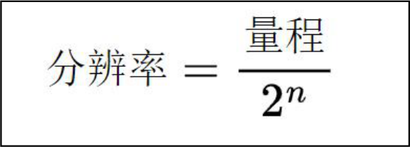
（1）量程是指ADC 输入信号的最大范围；（2）n 是ADC 的位数；（3）2^n 表示ADC 能够区分的离散数值总数。假设一个3 位ADC 的参考电压（量程）为2V，计算他的分辨率是多少？（1）题干1：量程= 2V（2）题干2：位数为3，2^n = 2^3 = 8；代入分辨率计算公式可得2V/8= 0.25V。这意味着该ADC 能够将输入信号分成8 个离散的等级，每个等级之间的步长为0.25V。除了分辨率之外，ADC 还有另外几个重要的参数，分别为采样时间、转换时间、采样频率以及精度，具体内容如表238.2 所示：表238.2
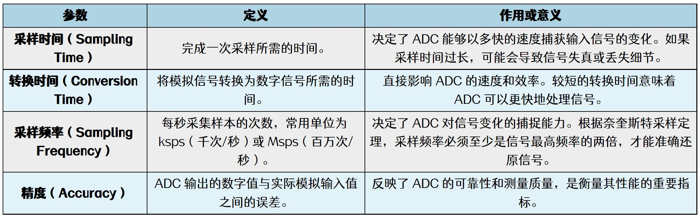

## 238.3 iTOP-RK3568 开发板ADC 接口介绍
根据RK3568 数据手册中的外设资源框图(图238.1)可以得到，RK3568 总共有8 路SARADC:
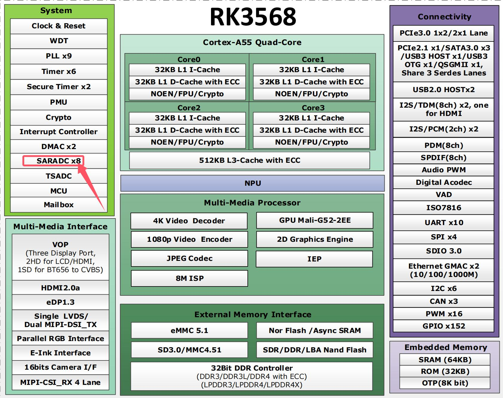
图238.1SARADC 的中文名称为逐次逼近型ADC,RK3568 处理器除了SARADC 之外，还有两路TS-ADC(用于测量CPU 和GPU 的温度)，如果在一段时间内检测到温度过高，两路TS-ADC 会向处理器发出中断信号以采取降温措施。由于TS-ADC 只负责检测CPU 和GPU 的温度所以处理器并未引出，因此接下来介绍在
按键连接到同一个SARADC 引脚上，并通过不同的分压电阻产生不同的电压，通过ADC 测量该电压，并与预设的电压范围进行比对，从而判断哪个按键被按下。ADC 按键原理图如图238.2所示：

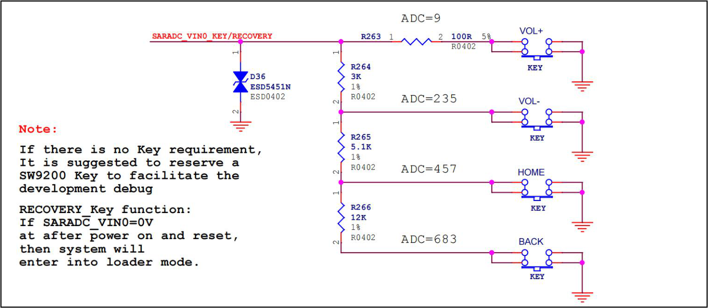
图238.2HW_ID 和BOM_ID 引脚也使用了两路SARADC，相应原理图如图238.3 所示，这俩个引脚用于不同电子设备的硬件识别，但由于迅为的外设都是通用的，所以这两路SARADC 并没有被
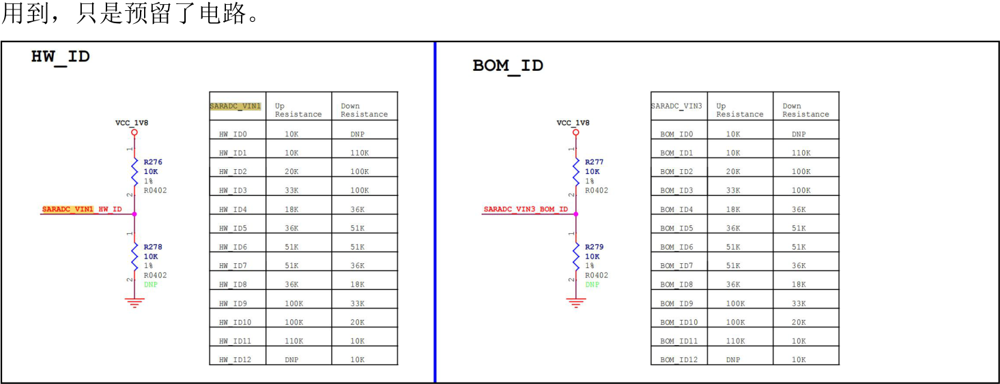
图238.3
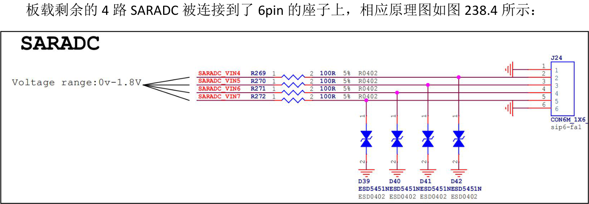

图238.4整理好的ADC 引脚复用功能如表238.3 所示：表238.3
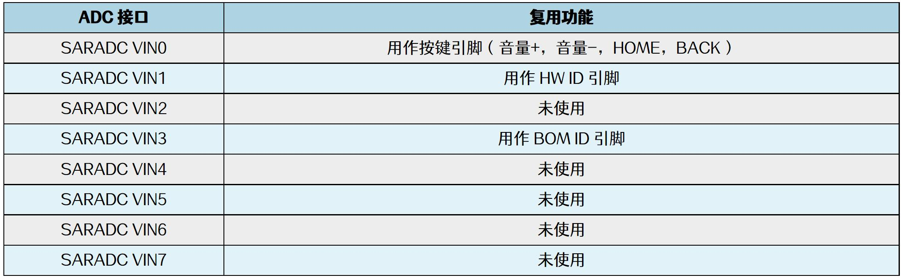
## 238.4 SARADC 工作原理
SARADC 全称为逐次逼近型ADC（Successive Approximation Register ADC），是一种常见的模数转换器，其工作原理通过逐步比较输入模拟信号与内部生成的参考电压，最终确定一个接
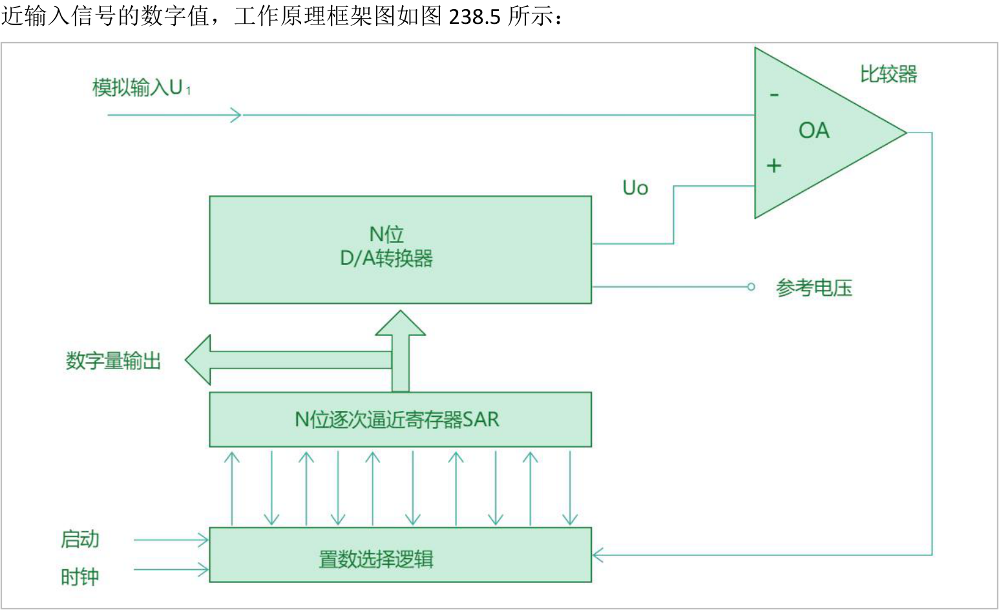
图238.5

工作原理框架图主要由以下几个部分组成：（1）比较器（Comparator）：用于比较输入模拟信号U1 和D/A 转换器输出的参考电压U0，并产生反馈信号。（2）N 位D/A 转换器（DAC）：将数字值转换为模拟电压，与输入信号进行比较，以逐步逼近目标值。（3）N 位逐次逼近寄存器（SAR）：用于存储当前的比较结果，并根据比较器的反馈调整数值，最终确定数字输出。（4）置数选择逻辑：控制逐次逼近寄存器的位选择过程，按二分法调整DAC 的输出电压。SARADC 工作流程如表238.4 所示：表238.4
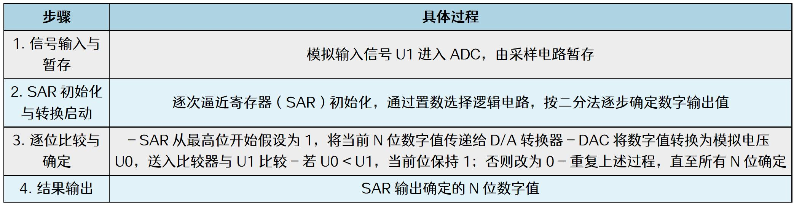
然后详细分析一个5 位逐次逼近型ADC 在参考电压为32mV、待测电压为21.5mV 情况下的转换过程，转换步骤如图238.6 所示
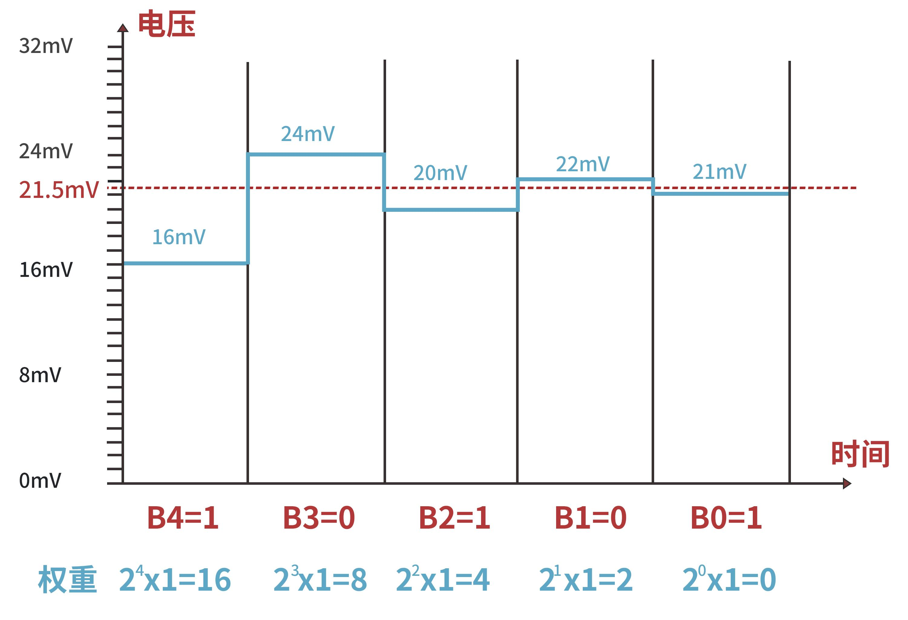

