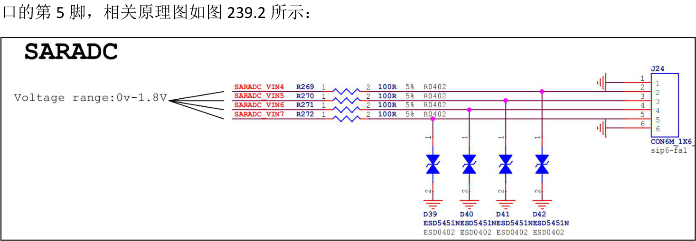

# 第239章 操作ADC

图238.6(1) 设置最高位：SAR 寄存器将最高位（第5 位）设置为1，其余位为0，当前SAR 值为10000（二进制），即16（十进制）。DAC 根据SAR 值生成参考电压U0=16×1mV=16 mV。其中参考电压为32mV，ADC 为5 位ADC，所以量程为1mV。接下来比较器比较U1=21.5 mV 和U0=16，由于U1>U0，因此保留当前位为1。(2)设置次高位：SAR 寄存器保持最高位为1，并将次高位（第4 位）设置为1，此时SAR值为11000（二进制），即24（十进制）。DAC 生成参考电压U0=24×1 mV=24 mV。比较器比较U1=21.5 m 和U0=24 mV，由于U1<U0，因此将当前位重置为0。(3)设置第三位：SAR 寄存器保持前两位为10，并将第三位（第3 位）设置为1，此时SAR值为10100（二进制），即20（十进制）。DAC 生成参考电压U0=20×1 mV=20 mV。比较器比较U1=21.5 mV 和U0=20 mV，由于U1>U0，因此保留当前位为1。(4)设置第四位：SAR 寄存器保持前三位为101，并将第四位（第2 位）设置为1，此时SAR 值为10110（二进制），即22（十进制）。DAC 生成参考电压U0=22×1 mV=22 mV。比较器比较U1=21.5 mV 和U0=22 mV，由于U1<U0，因此将当前位重置为0。(5)设置最低位：SAR 寄存器保持前四位为1010，并将最低位（第1 位）设置为1，此时SAR 值为10101（二进制），即21（十进制）。DAC 生成参考电压U0=21×1 mV=21 mV。比较器比较U1=21.5 mV 和U0=21 mV，由于U1>U0，因此保留当前位为1。(6)结果：经过逐次逼近后，SAR 寄存器的值为10101（二进制），即测量结果为21（十进制）。

IIO 子系统是管理ADC、陀螺仪、加速度计等模拟设备的核心框架。ADC 操作依托于IIO 提供的机制，用户能够通过sysfs 接口或用户空间API 访问ADC 数据。本章将对通过sysfs 接口操作ADC 的具体步骤进行讲解。
## 239.1 通过sysfs 接口操作ADC
首先进入到iTOP-RK3568 开发板/sys/bus/iio/devices/iio:device0 目录下，目录内容如图239.1所示：

图239.1在图239.1 中的一系列属性文件中，需要关注的是in_voltageX_raw 属性和in_voltage_scale属性。（1）in_voltageX_raw 属性表示ADC 某个通道的原始采样值，其中X 是通道编号（如0, 1,2, ..., 7）。它以整数形式存储ADC 转换后的原始采样值。（2）in_voltage_scale 属性表示将ADC 原始采样值转换为实际电压值的缩放因子，以浮点数形式表示，单位可以是毫伏（mV）或伏特（V），具体取决于硬件实现。将in_voltageX_raw属性原始值乘以in_voltage_scale 属性值，即可得到对应ADC 通道的实际电压值。这里以SARADC 的通道7 为例进行演示，对应的硬件为iTOP-RK3568 开发板底板的J24 接


图239.2ADC 的通道7 对应的原始采样值属性为in_voltage7_raw，使用cat 命令读取该属性，读取到的值如图239.3 所示：

图239.3这里读取到的是未经缩放的原始数据，然后继续使用cat 命令读取缩放因子in_voltage_scale 属性的值，具体如图239.4 所示：

图239.4最后将获取到的原始采样值与缩放因子相乘即可得到实际电压值1017x1.757812500=1787.6953125mv=1.787V。然后使用杜邦线将ADC 的通道7 接到GND 上，重新使用cat 命令读取in_voltage7_raw 属性，读取结果如图239.5 所示，可以看到采集的原始数据为15，计算得到实际电压值为0.02V,趋近于0V，因为是把ADC 连接到了GND 上，所以趋近于0 说明ADC 采样的值正确。

图239.5除了SARADC 之外，还有用来测量CPU 和GPU 温度的TSADC，可以在开发板上使用cat/sys/class/thermal/thermal_zone0/temp 命令查看CPU 的温度，查询结果如图239.6 所示：

图239.6该命令会返回CPU 的温度值，通常以毫摄氏度（m°C）为单位，所以从上图可以得到CPU的温度为43.1 摄氏度，然后在开发板上使用cat /sys/class/thermal/thermal_zone1/temp 命令来查看GPU 的温度，查询结果如图239.7 所示：

图239.7可以得到现在GPU 的温度为41.8 摄氏度。

## 239.2 通过C 系统编程操作ADC
本小节将会通过C 系统编程来实现获取并打印SARADC 通道7 采集到的电压，核心原理为使用C 代码通过sysfs 接口读取ADC 的值，编写完成的源码存放在网盘iTOP-RK3568 开发板\07_学习教程配套资料\03_Linux 驱动配套资料\04_Linux 驱动程序\136_adc_01\路径下，具体内容如代码清单239.1 所示：代码清单239.1
```c
#include <stdio.h>
#include <stdlib.h>
#include <math.h>
int main(int argc, char *argv[]) {
    int scale = 0;// 用于存储从文件中读取的原始ADC 值
    FILE *fp = NULL;// 文件指针，用于打开和读取文件
    float value = 0.0;// 用于存储计算后的实际电压值
    // 打开ADC 原始值文件
    fp = fopen("/sys/bus/iio/devices/iio:device0/in_voltage7_raw", "r");
    if (fp == NULL) {// 检查文件是否成功打开
        printf("fopen error\n");
        return -1;
    }
    // 从文件中读取ADC 原始值
    fscanf(fp, "%d", &scale);
    // 计算实际电压值
    // 假设参考电压为1.8V，ADC 分辨率为10 位（2^10 = 1024）
    value = (1.8 / 1024) * (float)scale;
    // 输出计算结果，保留两位小数
    printf("ADC value is %.2fV\n", value);
    fclose(fp);
    return 0;// 程序正常结束
}
```
这里的重点在第22 行，scale 是读取到的原始值，而(1.8/1024)是缩放因子，缩放因子可以通过计算的方式得到也可以直接获取in_voltage_scale 的值，然后使用aarch64-linux-gnu-gcc -o

