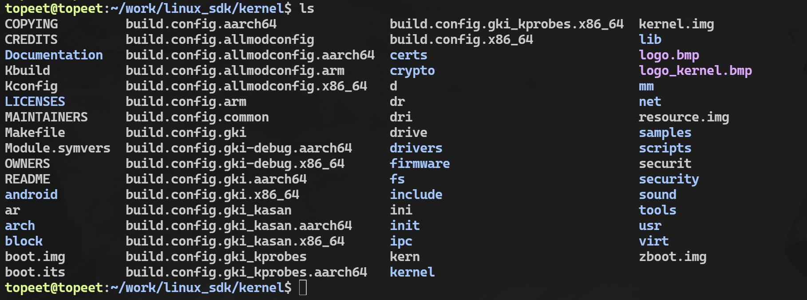
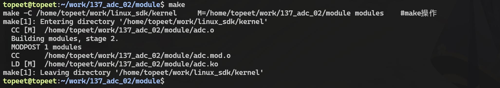
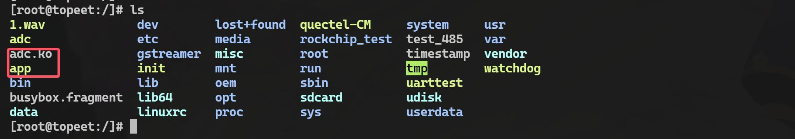
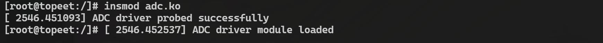

# 第240章 ADC驱动程序编写

adc adc.c 命令进行编译，编译完成如图239.8 所示：

图239.8然后将编译完成的可执行程序拷贝到开发板上，并使用./adc 命令运行可执行程序，运行结果如图239.9 所示：

图239.9根据打印结果可以得到ADC 第7 通道默认情况下的电压是1.79V，然后通过杜邦线与GND相连，重新运行该程序，运行结果如图239.10 所示：

图239.10可以看到采集到的电压为0.03V 接近0V，证明采集到的电压是正确的。至此，关于编写的ADC 应用程序就测试完成了。

本章节通过杂项设备创建一个ADC 设备节点，并通过该节点读取对应通道的ADC 值。
## 240.1 函数讲解
在编写驱动程序之前，需要先对iio_channel_get()函数和iio_read_channel_raw()函数进行学习，它们分别用于获取IIO 通道对象和读取该通道的原始ADC 值。这两个函数是IIO 子系统的核心接口，用于在内核驱动程序中与硬件传感器进行交互。（1）iio_channel_get()函数iio_channel_get()函数用于获取IIO 通道对象。函数原型：struct iio_channel *iio_channel_get(const char *name, const char *channel_name);参数说明：name：表示IIO 设备的名称或ID。如果为NULL，则表示默认设备。channel_name：表示要获取的通道名称。返回值：成功时返回一个指向struct iio_channel 的指针，表示获取到的IIO 通道对象。返回值struct iio_channel 结构体用于描述IIO 通道，其定义如代码清单240.1 所示：代码清单240.1
```c
struct iio_channel {
    struct iio_device *indio_dev;// 关联的IIO 设备
    const char *channel_name;// 通道名称
    int channel_index;// 通道索引
    bool is_output;// 是否为输出通道
};
```
当获取的通道对象不再被需要时，需要使用iio_channel_release()函数释放相关资源。（2）iio_read_channel_raw()函数iio_read_channel_raw()函数用于从指定的IIO 通道读取原始数据。函数原型：int iio_read_channel_raw(struct iio_channel *channel, int *val);参数说明：channel:指通过iio_channel_get()函数获取的IIO 通道对象，该参数描述了要读取的设备和通道。

val:用于存储从通道读取的原始值。
## 240.2 修改设备树
在编写驱动程序之前，需要先对设备树进行修改，添加要读取的ADC 通道设备节点，首先来到的内核目录下，目录内容如图240.1 所示：

图240.1然后进入arch/arm64/boot/dts/rockchip/rk3568-evb.dtsi 设备树文件中，添加内容如代码清单240.2 所示：代码清单240.2
```c
adc7: adc-test {
    compatible = "myadc";
    io-channels = <&saradc 7>;
};
```
该节点的重点在io-channels 属性，io-channels 属性表示要使用ADC 的第7 个通道，然后重新编译内核源码，编译完成之后烧写到开发板即可。编译完成的内核镜像存放路径为iTOP-3568 开发板\03【iTOP-RK3568 开发板】指南教程\02_Linux 驱动配套资料\04_Linux 驱动程序\137_adc_02\01 编译好的内核镜像。
## 240.3 实验程序的编写
本实验存放路径为iTOP-3568 开发板\03【iTOP-RK3568 开发板】指南教程\02_Linux 驱动配套资料\04_Linux 驱动程序\137_adc_02。

### 240.3.1 驱动程序的编写
本实验将注册一个杂项设备,在dev 目录下生成一个名为adc 的设备节点，通过对该节点进行操作可以得到ADC 通道采集到的电压值，对应的驱动源码如代码清单240.3 所示：代码清单240.3
```c
#include <linux/module.h>
#include <linux/fs.h>
#include <linux/uaccess.h>
#include <linux/ioctl.h>
#include <linux/platform_device.h>
#include <linux/iio/consumer.h>
#include <linux/miscdevice.h>
#include <linux/of.h>// 添加对设备树的支持
#define CMD_READ_SCALE _IOR('A', 0x1, int)// 定义ioctl 命令
static struct iio_channel *adc_chan;// IIO 通道指针
// 文件操作：ioctl 实现
static long adc_dev_ioctl(struct file *file, unsigned int cmd, unsigned long arg) {
    int scale = 0;
    switch (cmd) {
        case CMD_READ_SCALE:
            // 从ADC 通道读取原始值
            if (iio_read_channel_raw(adc_chan, &scale) < 0) {
                pr_err("Failed to read ADC channel raw value\n");
                return -EIO;
            }
            // 将数据复制到用户空间
            if (copy_to_user((int *)arg, &scale, sizeof(scale))) {
                pr_err("Failed to copy data to user space\n");
                return -EFAULT;
            }
            break;
        default:
            pr_err("Invalid ioctl command\n");
            return -EINVAL;
    }
    return 0;
}
```

```c
// 文件操作结构体
static const struct file_operations adc_dev_fops = {
    .owner = THIS_MODULE,
    .unlocked_ioctl = adc_dev_ioctl,
};
// 杂项设备结构体
static struct miscdevice adc_dev = {
    .minor = MISC_DYNAMIC_MINOR,// 动态分配次设备号
    .name = "adc",// 设备名称
    .fops = &adc_dev_fops,// 文件操作接口
};
// 设备树匹配表
static const struct of_device_id adc_driver_match[] = {
    { .compatible = "myadc" },
    { }
};
MODULE_DEVICE_TABLE(of, adc_driver_match);
static int adc_driver_probe(struct platform_device *pdev) {
    // 获取IIO 通道
    adc_chan = iio_channel_get(&pdev->dev, NULL);
    if (IS_ERR(adc_chan)) {
        pr_err("Failed to get IIO channel\n");
        return PTR_ERR(adc_chan);
    }
    // 注册杂项设备
    if (misc_register(&adc_dev)) {
        pr_err("Failed to register misc device\n");
        iio_channel_release(adc_chan);// 释放IIO 通道
        return -ENODEV;
    }
    pr_info("ADC driver probe successfully\n");
    return 0;
}
// 平台设备移除函数
static int adc_driver_remove(struct platform_device *pdev) {
    // 注销杂项设备
    misc_deregister(&adc_dev);
```

```c
// 释放IIO 通道
iio_channel_release(adc_chan);
pr_info("ADC driver removed successfully\n");
return 0;
}
// 平台设备驱动结构体
static struct platform_driver adc_driver = {
.probe = adc_driver_probe,
.remove = adc_driver_remove,
.driver = {
    .name = "myadc",// 驱动名称
    .owner = THIS_MODULE,
    .of_match_table = adc_driver_match,
},
};
// 模块初始化函数
static int __init adc_driver_init(void) {
int ret;
// 注册平台设备驱动
ret = platform_driver_register(&adc_driver);
if (ret) {
    pr_err("Failed to register platform driver\n");
    return ret;
}
pr_info("ADC driver module loaded\n");
return 0;
}
// 模块退出函数
static void __exit adc_driver_exit(void) {
// 注销平台设备驱动
platform_driver_unregister(&adc_driver);
pr_info("ADC driver module unloaded\n");
}
```

```c
module_init(adc_driver_init);
module_exit(adc_driver_exit);
MODULE_LICENSE("GPL");
MODULE_AUTHOR("topeet");
```
首先利用杂项驱动框架注册了一个字符设备(设备节点为/dev/adc)，用户空间可通过该设备节点与驱动交互，在probe 函数中通过iio_channel_get()函数获取ADC 通道，并使用iio_read_channel_raw()函数读取ADC 原始值，除此之外定义了一个ioctl 接口命令CMD_READ_SCALE，用于在用户空间触发ADC 数据读取操作，在ioctl 实现中调用IIO API 获取数据并通过copy_to_user 将结果传递给用户空间，从而实现简单的ADC 数据采集功能。
### 240.3.2 应用程序的编写
本小节将编写与驱动程序匹配的应用程序，该应用程序通过/dev/adc 设备节点读取ADC 值，编写完成的应用程序如代码清单240.4 所示：代码清单240.4
```c
#include <stdio.h>
#include <stdlib.h>
#include <unistd.h>
#include <sys/types.h>
#include <sys/stat.h>
#include <fcntl.h>
#include <sys/ioctl.h>
#define CMD_READ_SCALE _IOR('A', 1, int)
int main(int argc, char *argv[]) {
    int scale = 0;
    int fd;
    float value = 0.0;// 用于存储计算后的实际电压值
    // 打开设备文件
    fd = open("/dev/adc", O_RDWR);
    if (fd < 0) {
        printf("open error\n");
        return -1;
    }
    // 使用ioctl 读取scale 值
    if (ioctl(fd, CMD_READ_SCALE, &scale) < 0) {
```

```c
printf("ioctl error\n");
close(fd);
return -1;
}
value = (1.8 / 1024) * (float)scale;
// 打印读取到的scale 值
printf("val is %lf\n", value);
// 关闭设备文件
close(fd);
return 0;
}
```
该程序的重点在于ioctl 函数的使用，应该程序可以通过ioctl 系统调用向ADC 驱动发送自定义命令CMD_READ_SCALE 触发驱动读取ADC 数据，并将结果存储到用户空间变量scale 中。
## 240.4 运行测试
### 240.4.1 编译驱动程序
在上一小节中的adc.c 代码同一目录下创建Makefile 文件，Makefile 文件内容如代码清单240.5 所示：代码清单240.5
```c
export ARCH=arm64#设置平台架构
export CROSS_COMPILE=aarch64-linux-gnu-#交叉编译器前缀
obj-m += adc.o#此处要和你的驱动源文件同名
KDIR :=/home/topeet/work/linux_sdk/kernel#这里是你的内核目录
PWD ?= $(shell pwd)
all:
    make -C $(KDIR) M=$(PWD) modules#make 操作
clean:
    make -C $(KDIR) M=$(PWD) clean#make clean 操作
```
然后使用make 命令进行驱动的编译，编译完成如图240.2 所示：


图240.2编译完生成adc.ko 目标文件如图240.3 所示：

图240.3
### 240.4.2 编译应用程序
首先来到应用程序app.c 文件的存放路径如图240.4 所示：

图240.4然后使用aarch64-linux-gnu-gcc -o app app.c命令对app.c进行交叉编译，编译完成如图240.5所示：

图240.5生成的app 文件就是之后放在开发板上运行的可执行文件。
### 240.4.3 运行测试
首先确保开发板烧写的内核镜像是本章编译出来的boot.img，然后启动开发板，将前两个小节编译出来的驱动程序和应用程序拷贝到开发板上，拷贝完成如图240.6 所示：

图240.6然后使用以下命令进行驱动模块的加载。
```c
insmod adc.ko
```
加载完成如图240.7 所示。


图240.7驱动成功加载之后会在/dev 目录下生成一个名为adc 的设备节点如图240.8 所示：

图240.8然后使用./app 运行测试程序，运行之后如图240.9 所示：

图240.9可以看到默认情况下adc 引脚的电压是1.8V，然后通过杜邦线将ADC 第7 通道的引脚接到GND 上，然后重新运行该程序，运行结果如图240.10 所示：

图240.10获取到的结果趋近于0V，证明测试结果是准确的。

