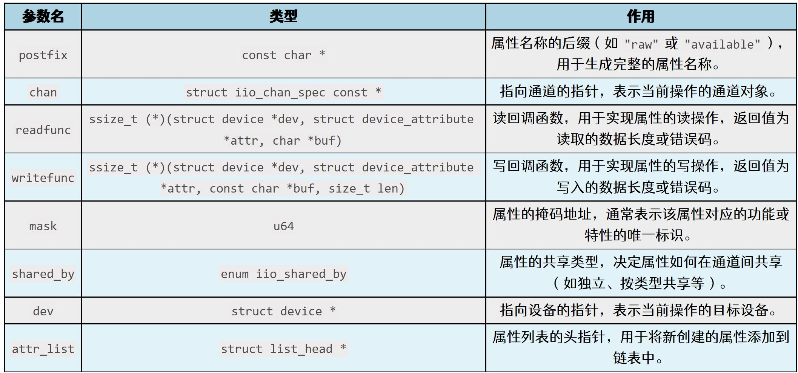

# 第243章IIO设备驱动分析

根据该结构体变量的成员可以推断出，IIO 子系统利用FIFO 队列缓存检测到的事件数据，通过等待队列唤醒监听者，通过链表维护事件属性并通过sysfs 供用户配置和监控，而互斥锁确保了多线程环境下的并发访问安全，凭标志位记录接口状态，从而高效完成事件的检测、配置、存储、通知和处理。然后继续分析iio_device_register_eventset()函数18 行之后的代码，后续代码的主要作用是为IIO 设备初始化事件接口，先初始化事件接口的设备属性链表和中断处理函数，然后统计预定义事件属性的数量并尝试添加动态事件属性，接着分配内存存储所有事件属性并将它们整合到事件组中，最后将事件组添加到设备的属性组列表中，从而完成事件接口的注册和配置。至此，关于devm_iio_device_register()函数就分析完成了。

本章将会对IIO 设备工作流程相关的驱动代码进行分析。
## 243.1 iio 文件操作集函数分析
在__iio_device_register()函数的第60 行通过cdev_init(&indio_dev->chrdev,&iio_buffer_fileops)代码对iio 设备进行初始化，cdev_init()函数的第二个参数为iio 设备的文件操作集iio_buffer_fileops，具体内容如代码清单243.1 所示：代码清单243.1
```c
static const struct file_operations iio_buffer_fileops = {
    .read = iio_buffer_read_first_n_outer_addr,
    .release = iio_chrdev_release,
    .open = iio_chrdev_open,
    .poll = iio_buffer_poll_addr,
    .owner = THIS_MODULE,
    .llseek = noop_llseek,
    .unlocked_ioctl = iio_ioctl,
    .compat_ioctl = iio_ioctl,
};
```
在本小节将对该文件操作集中的函数进行讲解。
### 243.1.1 iio_ioctl 函数分析
iio_ioctl 函数内容如代码清单243.2 所示：代码清单243.2
```c
static long iio_ioctl(struct file *filp, unsigned int cmd, unsigned long arg)
{
    struct iio_dev *indio_dev = filp->private_data; // 从文件结构中获取IIO 设备实例
    int __user *ip = (int __user *)arg;
    int fd;
    if (!indio_dev->info)
        return -ENODEV;
    if (cmd == IIO_GET_EVENT_FD_IOCTL) {
        fd = iio_event_getfd(indio_dev); // 调用函数获取事件文件描述符
        if (fd < 0)
```

```c
return fd;
// 将获取到的文件描述符复制到用户空间
if (copy_to_user(ip, &fd, sizeof(fd)))
return -EFAULT;
return 0;
}
return -EINVAL;
}
```
可以看到在ioctl 函数中只有一个IOCTL 命令，那就是IIO_GET_EVENT_FD_IOCTL，然后来对这个命令的作用进行分析，在第11 行调用了iio_event_getfd()函数获取了事件的文件描述符，并在第16 行通过copy_to_user()函数将获取到的文件描述符复制到了用户空间，iio_event_getfd()函数的具体内容如代码清单243.3 所示：代码清单243.3
```c
int iio_event_getfd(struct iio_dev *indio_dev)
{
    struct iio_event_interface *ev_int = indio_dev->event_interface; // 获取设备的事件接口
    int fd;
    if (ev_int == NULL)
        return -ENODEV;
    // 尝试获取互斥锁，确保对设备操作的互斥访问
    fd = mutex_lock_interruptible(&indio_dev->mlock);
    if (fd)
        return fd;
    // 检查事件接口是否已经被占用
    if (test_and_set_bit(IIO_BUSY_BIT_POS, &ev_int->flags)) {
        fd = -EBUSY;
        goto unlock;
    }
    // 增加设备的引用计数，防止设备在使用过程中被释放
    iio_device_get(indio_dev);
    // 创建匿名inode 文件
    fd = anon_inode_getfd("iio:event", &iio_event_chrdev_fileops,
                  indio_dev, O_RDONLY | O_CLOEXEC);
```

```c
if (fd < 0) {
    clear_bit(IIO_BUSY_BIT_POS, &ev_int->flags);
    iio_device_put(indio_dev);
} else {
    kfifo_reset_out(&ev_int->det_events); // 如果成功，重置FIFO 队列的输出指针
}
unlock:
mutex_unlock(&indio_dev->mlock);
return fd;
}
```
该函数的返回值为文件描述符fd，由第24 行通过anon_inode_getfd()函数创建并返回，该函数的作用是生成匿名文件描述符fd---这种特殊的fd 不与实际文件系统路径或设备节点关联，而是内核动态创建的虚拟文件。匿名fd 拥有独立的文件操作集，通过ioctl 可借助它创建虚拟接口，即可与内核进行交互。匿名fd 对应的文件操作集为anon_inode_getfd()函数的第二个参数iio_event_chrdev_fileops，对应的具体内容如代码清单243.4 所示：代码清单243.4
```c
static const struct file_operations iio_event_chrdev_fileops = {
    .read = iio_event_chrdev_read,// 处理read() 系统调用，读取事件数据
    .poll = iio_event_poll,// 处理poll() 或select() 调用，监听事件是否可用
    .release = iio_event_chrdev_release, // 处理close() 调用，释放资源
    .owner = THIS_MODULE,
    .llseek = noop_llseek,
};
```
读函数iio_event_chrdev_read()的具体内容如代码清单243.5 所示：代码清单243.5
```c
static ssize_t iio_event_chrdev_read(struct file *filep,
                     char __user *buf,
                     size_t count,
                     loff_t *f_ps)
{
    struct iio_dev *indio_dev = filep->private_data; // 获取IIO 设备实例
    struct iio_event_interface *ev_int = indio_dev->event_interface; // 获取事件接口
    unsigned int copied; // 记录实际复制到用户空间的数据量
    int ret;
    if (!indio_dev->info) // 检查设备是否已初始化
        return -ENODEV;
```

```c
if (count < sizeof(struct iio_event_data)) // 确保缓冲区足够大以容纳事件数据
    return -EINVAL;
do {
    if (kfifo_is_empty(&ev_int->det_events)) { // 检查事件队列是否为空
        if (filep->f_flags & O_NONBLOCK) // 如果是非阻塞模式，直接返回-EAGAIN
            return -EAGAIN;
        // 阻塞等待事件队列中有数据或设备被移除
        ret = wait_event_interruptible(ev_int->wait,
                !kfifo_is_empty(&ev_int->det_events) ||
                indio_dev->info == NULL);
        if (ret)
            return ret;
        if (indio_dev->info == NULL)
            return -ENODEV;
    }
    // 加锁保护对事件队列的访问
    if (mutex_lock_interruptible(&ev_int->read_lock))
        return -ERESTARTSYS;
    // 将事件数据从内核FIFO 队列复制到用户空间
    ret = kfifo_to_user(&ev_int->det_events, buf, count, &copied);
    mutex_unlock(&ev_int->read_lock); // 解锁
    if (ret)
        return ret;
    // 如果未读取到任何数据且是非阻塞模式，返回-EAGAIN
    if (copied == 0 && (filep->f_flags & O_NONBLOCK))
        return -EAGAIN;
} while (copied == 0); // 如果未读取到数据，继续循环等待
return copied; // 返回实际读取的字节数
}
```
该函数的重点在第17 行-第47 行的do while 循环，它通过检查内核FIFO 事件队列是否为空来决定是否需要等待事件数据；在非阻塞模式下直接返回-EAGAIN，而在阻塞模式下通过等待队列挂起进程直到有数据或设备被移除；接下来使用互斥锁保护对FIFO 队列的并发访问，确保线程安全；最后将事件数据从内核空间复制到用户空间，并根据读取结果处理非阻塞模式

下的特殊情况，如果未读取到数据则继续循环等待，直至成功读取并返回实际读取的字节数或错误码。接下来对文件操作集中的iio_event_poll 函数进行分析，该函数具体内容如代码清单243.6所示：代码清单243.6
```c
static __poll_t iio_event_poll(struct file *filep,
                 struct poll_table_struct *wait)
{
    struct iio_dev *indio_dev = filep->private_data;
    // 获取该设备的事件接口结构体
    struct iio_event_interface *ev_int = indio_dev->event_interface;
        __poll_t events = 0;
    if (!indio_dev->info)
        return events;
    poll_wait(filep, &ev_int->wait, wait);
    if (!kfifo_is_empty(&ev_int->det_events))
        // 如果有事件待处理，设置POLLIN 和POLLRDNORM 标志
        events = EPOLLIN | EPOLLRDNORM;
    return events;
}
```
该函数的重点在13-18 行，通过poll_wait()函数将当前文件描述符加入等待队列以便在事件到达时被唤醒。接着检查事件FIFO 队列是否非空，如果有事件待处理，则设置EPOLLIN |EPOLLRDNORM 标志表示数据可读，最后返回检测到的事件。接下来对文件操作集中的iio_event_chrdev_release()函数进行介绍，该函数的具体内容如代码清单243.7 所示：代码清单243.7
```c
static int iio_event_chrdev_release(struct inode *inode, struct file *filep)
{
    struct iio_dev *indio_dev = filep->private_data;// 从文件结构体中获取与设备关联的IIO 设备结构体
    // 获取该设备的事件接口结构体
    struct iio_event_interface *ev_int = indio_dev->event_interfac
    clear_bit(IIO_BUSY_BIT_POS, &ev_int->flags);// 清除事件接口标志中的BUSY 状态位
    iio_device_put(indio_dev);//释放对设备的占用
    return 0;
```

```c
}
```
iio_event_chrdev_release()函数用于在用户空间关闭设备文件时执行清理操作，它通过清除事件接口中的BUSY 状态标志来标记设备为可用状态，并减少IIO 设备的引用计数以释放资源，确保设备可以被其他进程安全使用或在不再需要时进行进一步清理。至此，对虚拟fd 的文件操作集函数就讲解完成了。虚拟fd 的作用是，如果需要支持多个系统调用，可通过ioctl 函数创建一个匿名文件描述符，并为其绑定独立的文件操作集。这种方式既能扩展功能，又因匿名文件描述符不会在文件系统留下痕迹，可避免污染文件系统，从而保持系统的整洁与高效。
### 243.1.2 iio_chrdev_open 函数分析
接下来回到文件操作集iio_buffer_fileops，对打开IIO 字符设备的iio_chrdev_open()函数进行分析，该函数具体内容如代码清单243.8 所示：代码清单243.8
```c
static int iio_chrdev_open(struct inode *inode, struct file *filp)
{
    // 从inode 中获取对应的IIO 设备结构体
    struct iio_dev *indio_dev = container_of(inode->i_cdev,struct iio_dev, chrdev);
    // 检查设备是否已被占用
    if (test_and_set_bit(IIO_BUSY_BIT_POS, &indio_dev->flags))
        return -EBUSY;
    iio_device_get(indio_dev);// 增加设备引用计数，防止设备被释放
    filp->private_data = indio_dev;// 将设备结构体指针存储到文件的私有数据中
    return 0;
}
```
首先通过container_of 宏从inode 中获取对应的IIO 设备结构体，然后检查设备是否已被占用，如果设备忙则返回-EBUSY。接着调用iio_device_get()函数增加设备的引用计数以防止设备在使用过程中被释放，并将设备结构体指针存储到文件的私有数据中以便后续操作使用。iio_device_get()函数的具体内容如代码清单243.9 所示：代码清单243.9
```c
static inline struct iio_dev *iio_device_get(struct iio_dev *indio_dev)
{
    return indio_dev ? dev_to_iio_dev(get_device(&indio_dev->dev)) : NULL;
}
```

它首先检查传入的indio_dev 是否为空，如果非空，则通过get_device()函数增加设备的引用计数，并将设备指针从dev 转换回iio_dev 类型返回；如果为空，则直接返回NULL。这种实现既保证了设备的有效性，又避免了对空指针的操作。
### 243.1.3 iio_buffer_read_first_n_outer 函数分析
接下来对文件操作集中的read 函数iio_buffer_read_first_n_outer_addr()进行分析，它定义在drivers/iio/iio_core.h 头文件当中，具体内容如代码清单243.10 所示：代码清单243.10
```c
#define iio_buffer_read_first_n_outer_addr (&iio_buffer_read_first_n_outer)
```
iio_buffer_read_first_n_outer_addr 实际上是一个宏，他的实际值是iio_buffer_read_first_n_outer()函数，iio_buffer_read_first_n_outer()函数定义在drivers/iio/industrialio-buffer.c 文件中，具体内容如代码清单243.11 所示：代码清单243.11
```c
ssize_t iio_buffer_read_first_n_outer(struct file *filp, char __user *buf,
                      size_t n, loff_t *f_ps)
{
    // 从文件结构体中获取与设备关联的IIO 设备结构体
    struct iio_dev *indio_dev = filp->private_data;
    struct iio_buffer *rb = indio_dev->buffer;
    DEFINE_WAIT_FUNC(wait, woken_wake_function);
    size_t datum_size;
    size_t to_wait;
    int ret = 0;
    if (!indio_dev->info)
        return -ENODEV;
    if (!rb || !rb->access->read_first_n)
        return -EINVAL;
    datum_size = rb->bytes_per_datum;// 获取每个数据单元的大小
    if (!datum_size)
        return 0;
    // 如果文件以非阻塞模式打开，则不需要等待数据
    if (filp->f_flags & O_NONBLOCK)
        to_wait = 0;
```

```c
else
    to_wait = min_t(size_t, n / datum_size, rb->watermark);
// 将当前任务加入到缓冲区的等待队列中
add_wait_queue(&rb->pollq, &wait);
do {
    if (!indio_dev->info) {
        ret = -ENODEV;
        break;
    }
    // 检查缓冲区是否有足够的数据可供读取
    if (!iio_buffer_ready(indio_dev, rb, to_wait, n / datum_size)) {
        if (signal_pending(current)) {
            ret = -ERESTARTSYS;
            break;
        }
        // 进入等待状态，直到被唤醒或超时
        wait_woken(&wait, TASK_INTERRUPTIBLE, MAX_SCHEDULE_TIMEOUT);
        continue;
    }
    // 调用缓冲区的访问方法读取数据
    ret = rb->access->read_first_n(rb, n, buf);
    if (ret == 0 && (filp->f_flags & O_NONBLOCK))
        ret = -EAGAIN;
} while (ret == 0);// 如果读取失败（ret == 0），继续尝试
// 从等待队列中移除当前任务
remove_wait_queue(&rb->pollq, &wait);
return ret;
}
```
首先在18 行将struct iio_buffer 结构体类型的变量rb(每个数据单元的大小)赋值给datum_size，struct iio_buffer 结构体定义在include/linux/iio/buffer_impl.h 文件中，具体内容如代码清单243.12 所示：代码清单243.12
```c
struct iio_buffer {
    unsigned int length;// 缓冲区中数据单元的数量
    size_t bytes_per_datum;// 单个数据单元的大小
```

```c
const struct iio_buffer_access_funcs *access;// 缓冲区访问函数，提供读取、写入等操作方法
long *scan_mask;
struct list_head demux_list;
wait_queue_head_t pollq;// 等待队列，用于支持对缓冲区的轮询操作
unsigned int watermark;
struct attribute_group *scan_el_attrs;
bool scan_timestamp;
struct list_head scan_el_dev_attr_list;
struct attribute_group buffer_group;// 缓冲区组的属性
struct attribute_group scan_el_group;// 属性组，用于那些未从iio_chan_info 数组创建的属性
bool stufftoread;// 标志位，指示是否有新数据可供读取
const struct attribute **attrs;
void *demux_bounce;
struct list_head buffer_list;
struct kref ref;// 缓冲区的引用计数，用于管理资源释放
};
```
该结构体定义了一个IIO 缓冲区的核心数据结构，涵盖了缓冲区的容量、数据格式、访问方法、扫描模式、同步机制以及内部管理信息。接下来继续分析iio_buffer_read_first_n_outer()函数。在第24-30 行代码根据文件的打开模式及缓冲区的状态，动态确定需要等待的数据量。非阻塞模式下，to_wait 直接设为0(不等待，立即返回)；阻塞模式下，则取用户请求读取的字节数对应的单元数量与缓冲区rb->watermark 的较小值，确保等待的数据既满足需求又不超过缓冲区的性能限制。32-55 行的do，while 循环流程如下：先检查设备有效性，再判断缓冲区数据是否充足；如果数据不足，在阻塞模式下会进入等待状态,在等待中，可响应信号并处理中断请求，且通过循环保证条件满足时重新尝试读取。当缓冲区数据充足时，调用rb->access->read_first_n(rb, n,buf)按照用户请求的字节数n 从缓冲区rb 读取数据至用户空间缓冲区buf，并返回实际读取的字节数。这里的access 实际上也是struct iio_buffer 结构体中的一个成员，具体定义为const structiio_buffer_access_funcs *access，该成员同样也是一个结构体变量，对应的类型为struct iio_buffer_access_funcs，具体内容如代码清单243.13 所示：代码清单243.13
```c
struct iio_buffer_access_funcs {
    int (*store_to)(struct iio_buffer *buffer, const void *data);
    int (*read_first_n)(struct iio_buffer *buffer,size_t n,char __user *buf);
    size_t (*data_available)(struct iio_buffer *buffer);
```

```c
int (*request_update)(struct iio_buffer *buffer);
int (*set_bytes_per_datum)(struct iio_buffer *buffer, size_t bpd);
int (*set_length)(struct iio_buffer *buffer, unsigned int length);
int (*enable)(struct iio_buffer *buffer, struct iio_dev *indio_dev);
int (*disable)(struct iio_buffer *buffer, struct iio_dev *indio_dev);
void (*release)(struct iio_buffer *buffer);
unsigned int modes;
unsigned int flags;
};
```
该结构体定义了一组函数指针和标志位，用于实现对IIO 缓冲区的操作接口，在iio_buffer_read_first_n_outer()函数中实际调用的就是读函数read_first_n。
### 243.1.4 iio_chrdev_release 函数分析
接下来我们回到文件操作集iio_buffer_fileops，对里面的iio_chrdev_release()函数进行分析，iio_chrdev_release()函数具体内容如代码清单243.14 所示：代码清单243.14
```c
static int iio_chrdev_release(struct inode *inode, struct file *filp)
{
    // 通过container_of 宏从inode 中获取与字符设备关联的IIO 设备结构体
    struct iio_dev *indio_dev = container_of(inode->i_cdev,struct iio_dev, chrdev);
    // 清除IIO 设备的BUSY 状态标志位，表示设备不再被占用
    clear_bit(IIO_BUSY_BIT_POS, &indio_dev->flags);
    iio_device_put(indio_dev);// 减少IIO 设备的引用计数，释放对设备的占用
    return 0;
}
```
该函数的核心作用是在用户空间关闭设备文件时，清理设备的状态并释放相关资源。在第6 行通过clear_bit 函数清除了设备的BUSY 状态标志，并减少了设备的引用计数，从而确保设备可以被其他进程安全地使用。
### 243.1.5 iio_buffer_poll_addr 函数分析
接下来对文件操作集中的poll 函数iio_buffer_poll_addr()进行分析，iio_buffer_poll_addr()函数定义在drivers/iio/iio_core.h 头文件当中，具体代码为#define iio_buffer_poll_addr (&iio_buffer_poll)，可以看到iio_buffer_poll_addr 是一个宏，实际上为iio_buffer_poll 函数，iio_buffer_poll 函数定义在drivers/iio/industrialio-buffer.c 文件中，具体内容如代码清单243.15 所示：代码清单243.15
```c
__poll_t iio_buffer_poll(struct file *filp,struct poll_table_struct *wait)
```

```c
{
    struct iio_dev *indio_dev = filp->private_data;// 获取与设备关联的IIO 设备结构体
    struct iio_buffer *rb = indio_dev->buffer;// 获取该设备的缓冲区结构体
    if (!indio_dev->info || rb == NULL)
        return 0;
    // 将当前文件描述符加入到缓冲区的等待队列中，以便在事件到达时被唤醒
    poll_wait(filp, &rb->pollq, wait);
    // 检查缓冲区是否已经有足够的数据可供读取
    if (iio_buffer_ready(indio_dev, rb, rb->watermark, 0))
        return EPOLLIN | EPOLLRDNORM;
    return 0;
}
```
该函数首先会获取设备和缓冲区信息，并验证其有效性；然后通过poll_wait()函数将当前文件描述符加入等待队列（确保数据到达时被唤醒）；最后调用iio_buffer_ready()函数检查缓冲区是否满足读取条件，如果满足则返回EPOLLIN | EPOLLRDNORM 表示数据可读。这种机制支持高效的异步I/O 操作，允许用户空间程序在数据可用时及时响应。
## 243.2 iio_device_register_sysfs 函数分析
在讲解IIO 设备注册流程的时候对__iio_device_register()函数进行了简要的分析，在该函数中又调用了iio_device_register_sysfs()函数来注册IIO 设备的sysfs 接口，iio_device_register_sysfs()函数具体内容如代码清单243.16 所示：代码清单243.16
```c
static int iio_device_register_sysfs(struct iio_dev *indio_dev)
{
    int i, ret = 0, attrcount, attrn, attrcount_orig = 0;
    struct iio_dev_attr *p;
    struct attribute **attr, *clk = NULL;
    /* 首先统计现有属性组中的元素数量*/
    if (indio_dev->info->attrs) {
        attr = indio_dev->info->attrs->attrs;
        while (*attr++ != NULL)
            attrcount_orig++;
    }
    attrcount = attrcount_orig;
    if (indio_dev->channels)
        for (i = 0; i < indio_dev->num_channels; i++) { // 遍历所有通道
```

```c
const struct iio_chan_spec *chan = &indio_dev->channels[i];
if (chan->type == IIO_TIMESTAMP)
    clk = &dev_attr_current_timestamp_clock.attr;
// 将通道的sysfs 属性添加到系统中
ret = iio_device_add_channel_sysfs(indio_dev, chan);
if (ret < 0)
    goto error_clear_attrs;
attrcount += ret;
}
// 如果设备支持事件接口，记录时间戳时钟属性
if (indio_dev->event_interface)
clk = &dev_attr_current_timestamp_clock.attr;
// 如果设备有名称，增加属性计数
if (indio_dev->name)
attrcount++;
if (clk)
attrcount++;
// 分配内存以存储所有属性指针
indio_dev->chan_attr_group.attrs = kcalloc(attrcount + 1,
 sizeof(indio_dev->chan_attr_group.attrs[0]),
  GFP_KERNEL);
if (indio_dev->chan_attr_group.attrs == NULL) {
ret = -ENOMEM;
goto error_clear_attrs;
}
// 复制原有的属性到新的属性数组中
if (indio_dev->info->attrs)
memcpy(indio_dev->chan_attr_group.attrs,
   indio_dev->info->attrs->attrs,
   sizeof(indio_dev->chan_attr_group.attrs[0]) * attrcount_orig);
attrn = attrcount_orig; // 记录当前属性数组的索引
// 将通道属性列表中的所有属性添加到属性数组中
list_for_each_entry(p, &indio_dev->channel_attr_list, l)
indio_dev->chan_attr_group.attrs[attrn++] = &p->dev_attr.attr;
// 如果设备有名称，将名称属性添加到属性数组中
```

```c
if (indio_dev->name)
    indio_dev->chan_attr_group.attrs[attrn++] = &dev_attr_name.attr;
// 如果存在时间戳时钟属性，将其添加到属性数组中
if (clk)
    indio_dev->chan_attr_group.attrs[attrn++] = clk;
// 将属性组添加到设备的属性组列表中
indio_dev->groups[indio_dev->groupcounter++] =
    &indio_dev->chan_attr_group;
return 0;
error_clear_attrs:
iio_free_chan_devattr_list(&indio_dev->channel_attr_list);
return ret;
}
```
这个函数的核心操作在于第22 行的iio_device_add_channel_sysfs()函数，通过该函数可以将通道的sysfs 属性添加到系统中，该函数的具体内容如代码清单243.17 所示：代码清单243.17
```c
static int iio_device_add_channel_sysfs(struct iio_dev *indio_dev,
                    struct iio_chan_spec const *chan)
{
    int ret, attrcount = 0; // 定义返回值和属性计数器
    const struct iio_chan_spec_ext_info *ext_info; // 扩展信息指针
    // 如果通道编号小于0，则直接返回
    if (chan->channel < 0)
        return 0;
    // 添加独立类型的信息掩码属性（IIO_SEPARATE）
    ret = iio_device_add_info_mask_type(indio_dev, chan,
                         IIO_SEPARATE,
                         &chan->info_mask_separate);
    if (ret < 0)
        return ret;
    attrcount += ret; // 累加新增的属性数量
    // 添加独立类型可用信息掩码属性（IIO_SEPARATE_AVAILABLE）
    ret = iio_device_add_info_mask_type_avail(indio_dev, chan,
                           IIO_SEPARATE,
```

```c
&chan->
info_mask_separate_available);
if (ret < 0)
return ret;
attrcount += ret; // 累加新增的属性数量
// 添加按类型共享的信息掩码属性（IIO_SHARED_BY_TYPE）
ret = iio_device_add_info_mask_type(indio_dev, chan,
IIO_SHARED_BY_TYPE,
&chan->info_mask_shared_by_type);
if (ret < 0)
return ret;
attrcount += ret; // 累加新增的属性数量
// 添加按类型共享的可用信息掩码属性（IIO_SHARED_BY_TYPE_AVAILABLE）
ret = iio_device_add_info_mask_type_avail(indio_dev, chan,
IIO_SHARED_BY_TYPE,
&chan->
info_mask_shared_by_type_available);
if (ret < 0)
return ret;
attrcount += ret; // 累加新增的属性数量
// 添加按方向共享的信息掩码属性（IIO_SHARED_BY_DIR）
ret = iio_device_add_info_mask_type(indio_dev, chan,
IIO_SHARED_BY_DIR,
&chan->info_mask_shared_by_dir);
if (ret < 0)
return ret;
attrcount += ret; // 累加新增的属性数量
// 添加按方向共享的可用信息掩码属性（IIO_SHARED_BY_DIR_AVAILABLE）
ret = iio_device_add_info_mask_type_avail(indio_dev, chan,
IIO_SHARED_BY_DIR,
&chan->info_mask_shared_by_dir_available);
if (ret < 0)
return ret;
attrcount += ret; // 累加新增的属性数量
// 添加全局共享的信息掩码属性（IIO_SHARED_BY_ALL）
ret = iio_device_add_info_mask_type(indio_dev, chan,
IIO_SHARED_BY_ALL,
&chan->info_mask_shared_by_all);
if (ret < 0)
```

```c
return ret;
attrcount += ret; // 累加新增的属性数量
// 添加全局共享的可用信息掩码属性（IIO_SHARED_BY_ALL_AVAILABLE）
ret = iio_device_add_info_mask_type_avail(indio_dev, chan,
                  IIO_SHARED_BY_ALL,
                  &chan->info_mask_shared_by_all_available);
if (ret < 0)
return ret;
attrcount += ret; // 累加新增的属性数量
// 处理扩展信息（ext_info）
if (chan->ext_info) {
unsigned int i = 0; // 记录扩展信息的索引
for (ext_info = chan->ext_info; ext_info->name; ext_info++) { // 遍历扩展信息
    ret = __iio_add_chan_devattr(ext_info->name, // 属性名称
            chan, // 通道指针
            ext_info->read ? // 是否有读回调
                &iio_read_channel_ext_info : NULL,
            ext_info->write ? // 是否有写回调
                &iio_write_channel_ext_info : NULL,
            i, // 扩展信息索引
            ext_info->shared, // 是否共享
            &indio_dev->dev, // 设备指针
            &indio_dev->channel_attr_list); // 属性列表
    i++; // 增加索引
    if (ret == -EBUSY && ext_info->shared)
        continue;
    if (ret)
        return ret;
    attrcount++; // 成功添加一个属性，累加计数
}
}
return attrcount; // 返回成功添加的属性总数
}
```
第12 行到第75 行代码的格式和逻辑非常相似，通过调用iio_device_add_info_mask_type()和iio_device_add_info_mask_type_avail()函数，按照不同的共享类型逐一添加通道的属性及其可用属性，并在每次操作后检查返回值以确保错误能够被及时捕获和处理，同时通过累加返回值记录成功添加的属性总数，从而实现对硬件功能的灵活分类管理与动态扩展。接下来对刚刚提到的两个函数进行讲解，函数原型如代码清单243.18 所示：

代码清单243.18
```c
static int iio_device_add_info_mask_type(struct iio_dev *indio_dev,struct iio_chan_spec const *chan,enum
iio_shared_by shared_by,const long *infomask)
static int iio_device_add_info_mask_type_avail(struct iio_dev *indio_dev,struct iio_chan_spec const
*chan,enum iio_shared_by shared_by,const long *infomask)
```
两个函数的参数是相同的，但他们的功能略微有些不同，iio_device_add_info_mask_type()函数用于添加与通道相关的信息掩码属性，iio_device_add_info_mask_type_avail()函数用于添加可用信息掩码属性，参数说明如下所示：(1) indio_dev：指向IIO 设备的指针，表示当前操作的设备。它包含了设备的所有信息(2) chan：指向通道的指针，表示当前要操作的具体通道。(3) shared_by：指定属性的共享类型，决定属性如何在通道间共享。在上面代码中使用的类型包括：IIO_SEPARATE：独立属性，仅属于某个特定通道。IIO_SHARED_BY_TYPE：按类型共享，相同类型的通道共享属性。IIO_SHARED_BY_DIR：按方向共享，相同方向的通道共享属性。IIO_SHARED_BY_ALL：全局共享，整个设备的所有通道共享属性。(4) infomask：指向信息掩码的地址，定义需要暴露的属性集合。每个比特位对应一个具体的功能或特性，在iio_device_add_info_mask_type()函数中，infomask 用来描述通道的基本功能（如读取、写入等）。在iio_device_add_info_mask_type_avail()函数中，infomask 用来描述动态可用的功能（如某些模式下启用的额外功能）。上述代码只是对属性信息进行了添加，那属性的设置是在什么时候完成的呢？在前面讲解rockchip_saradc_probe()函数的时候提到过，RK3568 ADC 通道的定义调用的是ADC_CHANNEL宏，该宏的具体内容如代码清单243.19 所示：代码清单243.19
```c
#define ADC_CHANNEL(_index, _id) {\
    .type = IIO_VOLTAGE,/* 通道类型：电压测量*/\
    .indexed = 1,/* 启用索引模式，表示使用channel 字段作为索引*/ \
    .channel = _index,/* 主通道编号，由宏参数_index 指定*/ \
    .info_mask_separate = BIT(IIO_CHAN_INFO_RAW),/* 单独支持的属性：原始值（RAW）*/ \
    .info_mask_shared_by_type = BIT(IIO_CHAN_INFO_SCALE), /* 按类型共享的属性：缩放比例（SCALE）*/
\
    .datasheet_name = _id,/* 数据手册中的名称，由宏参数_id 指定*/ \
}
```
可以看到结构体成员info_mask_separate 和info_mask_shared_by_type 就是用来指定单独

支持的属性以及共享的属性。至此，关于属性相关的内容就讲解完成了，然后我们继续向下分析iio_device_add_channel_sysfs()函数。78-100 行的这部分代码用于处理通道的扩展信息，通过遍历扩展信息列表，将每个扩展信息作为属性添加到sysfs 接口中。对于每个扩展信息，根据其定义的名称、读写回调函数、共享标志等参数，调用__iio_add_chan_devattr()函数完成属性的注册。成功添加的属性会累加到attrcount 中，最终统计所有成功注册的扩展信息属性数量。
## 243.3 IIO 通道属性添加函数讲解
在上个小节中对iio_device_register_sysfs()函数进行了分析，调用了iio_device_add_info_mask_type()函数和iio_device_add_info_mask_type_avail()函数按照不同的共享类型逐一添加通道的属性及其可用属性，在本小节将会对这两个函数进行详细的讲解。iio_device_add_info_mask_type()函数的具体内容如代码清单243.20 所示：代码清单243.20
```c
static int iio_device_add_info_mask_type(struct iio_dev *indio_dev,
                     struct iio_chan_spec const *chan,
                     enum iio_shared_by shared_by,
                     const long *infomask)
{
    int i, ret, attrcount = 0;
    // 遍历信息掩码中的每个有效比特位
    for_each_set_bit(i, infomask, sizeof(*infomask) * 8) {
        if (i >= ARRAY_SIZE(iio_chan_info_postfix))
            return -EINVAL;
        // 调用函数将属性添加到sysfs 接口中
        ret = __iio_add_chan_devattr(iio_chan_info_postfix[i], // 属性名称后缀
                          chan,// 通道指针
                          &iio_read_channel_info, // 读回调函数
                          &iio_write_channel_info, // 写回调函数
                          i,// 属性索引
                          shared_by,// 共享类型
                          &indio_dev->dev,// 设备指针
                          &indio_dev->channel_attr_list); // 属性列表
        if ((ret == -EBUSY) && (shared_by != IIO_SEPARATE))
            continue;
```

```c
else if (ret < 0)
    return ret;
// 成功添加一个属性，累加计数
attrcount++;
}
return attrcount;
}
```
iio_device_add_info_mask_type_avail()函数的具体内容如代码清单243.21 所示：代码清单243.21
```c
static int iio_device_add_info_mask_type_avail(struct iio_dev *indio_dev,
                            struct iio_chan_spec const *chan,
                            enum iio_shared_by shared_by,
                            const long *infomask)
{
    int i, ret, attrcount = 0;
    char *avail_postfix;
    for_each_set_bit(i, infomask, sizeof(*infomask) * 8) {
        // 动态生成属性名称后缀，格式为"属性名_available"
        avail_postfix = kasprintf(GFP_KERNEL,
                      "%s_available",
                      iio_chan_info_postfix[i]);
        if (!avail_postfix)
            return -ENOMEM;
        // 调用函数将可用属性添加到sysfs 接口中
        ret = __iio_add_chan_devattr(avail_postfix, // 属性名称后缀
                          chan,// 通道指针
                          &iio_read_channel_info_avail, // 读回调函数
                          NULL,// 写回调函数（不可写）
                          i,// 属性索引
                          shared_by,// 共享类型
                          &indio_dev->dev, // 设备指针
                          &indio_dev->channel_attr_list); // 属性列表
        kfree(avail_postfix);
        if ((ret == -EBUSY) && (shared_by != IIO_SEPARATE))
            continue;
```

```c
else if (ret < 0)
    return ret;
// 成功添加一个属性，累加计数
attrcount++;
}
return attrcount;
}
```
这两个函数的实现逻辑是相同的，核心内容都是在for_each_set_bit 循环中实现的，通过for 循环遍历掩码中每个有效比特位，解析对应的功能，并将其注册为sysfs 属性，这里将可用属性添加到sysfs 接口使用的是__iio_add_chan_devattr()函数，该函数的具体内容如代码清单243.22 所示：代码清单243.22
```c
int __iio_add_chan_devattr(const char *postfix,
               struct iio_chan_spec const *chan,
               ssize_t (*readfunc)(struct device *dev,
                            struct device_attribute *attr,
                            char *buf),
               ssize_t (*writefunc)(struct device *dev,
                         struct device_attribute *attr,
                         const char *buf,
                         size_t len),
               u64 mask,
               enum iio_shared_by shared_by,
               struct device *dev,
               struct list_head *attr_list)
{
    int ret;
    struct iio_dev_attr *iio_attr, *t;
    // 分配内存以创建一个新的iio_dev_attr 对象
    iio_attr = kzalloc(sizeof(*iio_attr), GFP_KERNEL);
    if (iio_attr == NULL)
        return -ENOMEM;
    // 初始化设备属性（包括名称、读写回调函数等）
    ret = __iio_device_attr_init(&iio_attr->dev_attr,
                     postfix, chan,
                     readfunc, writefunc, shared_by);
    if (ret)
```

```c
goto error_iio_dev_attr_free;
// 设置通道指针和掩码地址
iio_attr->c = chan;
iio_attr->address = mask;
// 遍历属性列表，检查是否已存在相同名称的属性
list_for_each_entry(t, attr_list, l) {
if (strcmp(t->dev_attr.attr.name,
       iio_attr->dev_attr.attr.name) == 0) {
    if (shared_by == IIO_SEPARATE)
        dev_err(dev, "tried to double register : %s\n",
            t->dev_attr.attr.name);
    ret = -EBUSY;
    goto error_device_attr_deinit;
}
}
// 将新创建的属性添加到属性列表中
list_add(&iio_attr->l, attr_list);
return 0;
error_device_attr_deinit:
__iio_device_attr_deinit(&iio_attr->dev_attr);
error_iio_dev_attr_free:
kfree(iio_attr);
return ret;
}
```
该函数有着多个参数，参数的介绍如表243.1 所示：表243.1


然后对该函数进行分析，首先在19-21 行分配内存并创建一个新的iio_dev_attr 对象，对应的结构体内容如代码清单243.23 所示：代码清单243.23
```c
struct iio_dev_attr {
    struct device_attribute dev_attr; // 设备属性，包含名称和读写回调函数
    u64 address;// 属性的地址或掩码值，用于标识功能
    struct list_head l;// 链表节点，用于链接到属性链表中
    struct iio_chan_spec const *c;// 指向所属通道的指针
};
```
该结构体用来描述IIO 设备的属性（如名称、读写回调函数）、属性的功能标识、以及所属的通道信息。然后我们继续向下分析__iio_add_chan_devattr 函数，在第24-28 行调用了__iio_device_attr_init()函数初始化IIO 设备属性，关于该函数的具体介绍如代码清单243.24 所示：代码清单243.24
```c
int __iio_device_attr_init(struct device_attribute *dev_attr,
               const char *postfix,
               struct iio_chan_spec const *chan,
               ssize_t (*readfunc)(struct device *dev,
                            struct device_attribute *attr,
                            char *buf),
               ssize_t (*writefunc)(struct device *dev,
                         struct device_attribute *attr,
                         const char *buf,
                         size_t len),
               enum iio_shared_by shared_by)
```

```c
{
    int ret = 0;
    char *name = NULL; // 属性名称
    char *full_postfix; // 完整后缀字符串
    sysfs_attr_init(&dev_attr->attr); // 初始化设备属性结构体
    /* 构造后缀：格式为<extend_name>_<modifier>_postfix */
    if (chan->modified && (shared_by == IIO_SEPARATE)) {
        if (chan->extend_name) {
            full_postfix = kasprintf(GFP_KERNEL, "%s_%s_%s",
                          iio_modifier_names[chan->channel2],
                          chan->extend_name,
                          postfix);
        } else {
            full_postfix = kasprintf(GFP_KERNEL, "%s_%s",
                          iio_modifier_names[chan->channel2],
                          postfix);
        }
    } else {
        if (chan->extend_name == NULL || shared_by != IIO_SEPARATE) {
            full_postfix = kstrdup(postfix, GFP_KERNEL);
        } else {
            full_postfix = kasprintf(GFP_KERNEL,
                          "%s_%s",
                          chan->extend_name,
                          postfix);
        }
    }
    // 检查后缀是否分配成功
    if (full_postfix == NULL)
        return -ENOMEM;
    if (chan->differential) {
        switch (shared_by) {
        case IIO_SHARED_BY_ALL:
            name = kasprintf(GFP_KERNEL, "%s", full_postfix);
            break;
        case IIO_SHARED_BY_DIR:
            name = kasprintf(GFP_KERNEL, "%s_%s",
                         iio_direction[chan->output],
                         full_postfix);
            break;
```

```c
case IIO_SHARED_BY_TYPE:
    name = kasprintf(GFP_KERNEL, "%s_%s-%s_%s",
                iio_direction[chan->output],
                iio_chan_type_name_spec[chan->type],
                iio_chan_type_name_spec[chan->type],
                full_postfix);
    break;
case IIO_SEPARATE:
    if (!chan->indexed) {
        WARN(1, "Differential channels must be indexed\n");
        ret = -EINVAL;
        goto error_free_full_postfix;
    }
    name = kasprintf(GFP_KERNEL,
                "%s_%s%d-%s%d_%s",
                iio_direction[chan->output],
                iio_chan_type_name_spec[chan->type],
                chan->channel,
                iio_chan_type_name_spec[chan->type],
                chan->channel2,
                full_postfix);
    break;
}
} else {
switch (shared_by) {
case IIO_SHARED_BY_ALL:
    name = kasprintf(GFP_KERNEL, "%s", full_postfix);
    break;
case IIO_SHARED_BY_DIR:
    name = kasprintf(GFP_KERNEL, "%s_%s",
                iio_direction[chan->output],
                full_postfix);
    break;
case IIO_SHARED_BY_TYPE:
    name = kasprintf(GFP_KERNEL, "%s_%s_%s",
                iio_direction[chan->output],
                iio_chan_type_name_spec[chan->type],
                full_postfix);
    break;
case IIO_SEPARATE:
    if (chan->indexed)
        name = kasprintf(GFP_KERNEL, "%s_%s%d_%s",
                    iio_direction[chan->output],
                    iio_chan_type_name_spec[chan->type],
```

```c
chan->channel,
full_postfix);
else
name = kasprintf(GFP_KERNEL, "%s_%s_%s",
iio_direction[chan->output],
iio_chan_type_name_spec[chan->type],
full_postfix);
break;
}
}
// 检查属性名称是否分配成功
if (name == NULL) {
ret = -ENOMEM;
goto error_free_full_postfix;
}
dev_attr->attr.name = name; // 设置属性名称
// 设置读回调函数和权限
if (readfunc) {
dev_attr->attr.mode |= S_IRUGO; // 设置可读权限
dev_attr->show = readfunc;// 绑定读回调函数
}
// 设置写回调函数和权限
if (writefunc) {
dev_attr->attr.mode |= S_IWUSR; // 设置可写权限
dev_attr->store = writefunc;// 绑定写回调函数
}
error_free_full_postfix:
kfree(full_postfix);
return ret;
}
```
该函数的主要功能是根据通道类型、共享类型和其他参数动态构造一个sysfs 属性名称，属性名称的设置在117 行进行的实现，而在此之前可以将程序根据if 判断分为3 部分，分别对应构造后缀字符串、差分通道属性名称、单端通道属性名称的逻辑，接下来对这三部分进行讲解。第20-40 行用于构造后缀字符串full_postfix，根据通道是否被修改(chan->modified)和共享类型(shared_by)动态生成后缀字符串full_postfix。如果通道被修改且共享类型为独立(IIO_SEPA

RATE)，则根据是否有扩展名称(chan->extend_name)决定是否包含修饰符和扩展名称；否则，根据是否有扩展名称或共享类型直接构造后缀。第56-79 行针对差分通道，根据共享类型(shared_by)构造属性名称。对于全局共享(IIO_SHARED_BY_ALL)，仅使用后缀；对于按方向共享(IIO_SHARED_BY_DIR)，添加方向前缀；对于按类型共享(IIO_SHARED_BY_TYPE)，进一步添加方向和类型信息；对于独立共享(IIO_SEPARATE)，要求通道必须索引化(chan->indexed)，并在名称中包含方向、类型和通道索引等详细信息。第80-109 行针对单端通道，根据共享类型(shared_by)构造属性名称。对于全局共享(IIO_SHARED_BY_ALL)，仅使用后缀；对于按方向共享(IIO_SHARED_BY_DIR)，添加方向前缀；对于按类型共享(IIO_SHARED_BY_TYPE)，添加方向和类型信息；对于独立共享(IIO_SEPARATE)，根据是否索引化决定是否在名称中包含通道索引，未索引化时则省略索引部分。至此，关于__iio_device_attr_init 函数的讲解就完成了，接下来以RK3568 的ADC 通道3 为例讲解一下sysfs 属性名称是如何创建的，关于RK3568 通道的具体描述如代码清单243.25 所示：代码清单243.25
```c
static const struct iio_chan_spec rockchip_rk3568_saradc_iio_channels[] = {
    ADC_CHANNEL(0, "adc0"),
    ADC_CHANNEL(1, "adc1"),
    ADC_CHANNEL(2, "adc2"),
    ADC_CHANNEL(3, "adc3"),
    ADC_CHANNEL(4, "adc4"),
    ADC_CHANNEL(5, "adc5"),
    ADC_CHANNEL(6, "adc6"),
    ADC_CHANNEL(7, "adc7"),
};
```
ADC_CHANNEL 宏定义如代码清单243.26 所示：代码清单243.26
```c
#define ADC_CHANNEL(_index, _id) {\
    .type = IIO_VOLTAGE,\
    .indexed = 1,\
    .channel = _index,\
    .info_mask_separate = BIT(IIO_CHAN_INFO_RAW),\
    .info_mask_shared_by_type = BIT(IIO_CHAN_INFO_SCALE),\
    .datasheet_name = _id,\
}
```
代入ADC3 之后的内容如代码清单243.27 所示：

代码清单243.27
```c
ADC_CHANNEL(3, "adc3"){
    .type = IIO_VOLTAGE,
    .indexed = 1,
    .channel = 3,
    .info_mask_separate = BIT(IIO_CHAN_INFO_RAW),
    .info_mask_shared_by_type = BIT(IIO_CHAN_INFO_SCALE),
    .datasheet_name = "adc3",
}
```
在第5 行和第6 行分别设置了separate 和shared_by_type 属性，所以在iio_device_add_channel_sysfs)_函数中会执行代码清单243.28 中的内容：代码清单243.28
```c
// 添加独立类型的信息掩码属性（IIO_SEPARATE）
ret = iio_device_add_info_mask_type(indio_dev, chan,
                    IIO_SEPARATE,
                    &chan->info_mask_separate);
if (ret < 0)
    return ret;
attrcount += ret; // 累加新增的属性数量
// 添加按类型共享的信息掩码属性（IIO_SHARED_BY_TYPE）
ret = iio_device_add_info_mask_type(indio_dev, chan,
                    IIO_SHARED_BY_TYPE,
                    &chan->info_mask_shared_by_type);
if (ret < 0)
    return ret;
attrcount += ret; // 累加新增的属性数量
```
这里先来分析独立类型信息掩码属性的添加，ADC3 的info_mask_separate 属性被设置为了BIT(IIO_CHAN_INFO_RAW),而IIO_CHAN_INFO_RAW 的值为0，所以__iio_add_chan_devattr()函数的第一个参数就能确定了，从而确定该属性的后缀为iio_chan_info_postfix[0]即raw。然后进入iio_device_attr_init()函数，先来对构造后缀进行判断，由于在ADC3 的定义中并没有modified 属性，且extend_name 没有被定义，所以会直接复制后缀，也就是上面确定的raw。然后对下面的条件进行判断，由于ADC3 并没有differential 属性，所以进入的是单端通道的条件分支，然后ADC3 的shared_by 属性为IIO_SEPARATE 且indexed 为1，所以最终的名称由代码清单243.29 决定：代码清单243.29

```c
name = kasprintf(GFP_KERNEL, "%s_%s%d_%s",
            iio_direction[chan->output],
            iio_chan_type_name_spec[chan->type],
            chan->channel,
        full_postfix);
```
chan->output 没有设置，所以iio_direction 取0，得到的值为in，chan->type 为IIO_VOLTAGE，代入iio_chan_type_name_spec 可以得到值为voltage，chan->channel 为3，full_postfix 为后缀值raw，所以ADC3 的第一个属性名称为in_voltage3_raw。然后可以用同样的方式来分析第二个属性名称，这里就不再赘述，可以得到第二个属性名为in_voltage_scale。至此，关于ADC3 属性名称的分析就完成了，然后回退到上一小节讲解的iio_device_register_sysfs()函数，具体内容如代码清单243.30 所示：代码清单243.30
```c
static int iio_device_register_sysfs(struct iio_dev *indio_dev)
{
    int i, ret = 0, attrcount, attrn, attrcount_orig = 0;
    struct iio_dev_attr *p;
    struct attribute **attr, *clk = NULL;
    /* 首先统计现有属性组中的元素数量*/
    if (indio_dev->info->attrs) {
        attr = indio_dev->info->attrs->attrs;
        while (*attr++ != NULL)
            attrcount_orig++;
    }
    attrcount = attrcount_orig;
    if (indio_dev->channels)
        for (i = 0; i < indio_dev->num_channels; i++) { // 遍历所有通道
            const struct iio_chan_spec *chan = &indio_dev->channels[i];
            if (chan->type == IIO_TIMESTAMP)
                clk = &dev_attr_current_timestamp_clock.attr;
            // 将通道的sysfs 属性添加到系统中
            ret = iio_device_add_channel_sysfs(indio_dev, chan);
            if (ret < 0)
                goto error_clear_attrs;
            attrcount += ret; // 累加新增的属性数量
        }
```

```c
// 如果设备支持事件接口，记录时间戳时钟属性
if (indio_dev->event_interface)
    clk = &dev_attr_current_timestamp_clock.attr;
if (indio_dev->name)
    attrcount++;
if (clk)
    attrcount++;
// 分配内存以存储所有属性指针
indio_dev->chan_attr_group.attrs = kcalloc(attrcount + 1,
            sizeof(indio_dev->chan_attr_group.attrs[0]),
            GFP_KERNEL);
if (indio_dev->chan_attr_group.attrs == NULL) {
    ret = -ENOMEM;
    goto error_clear_attrs;
}
// 复制原有的属性到新的属性数组中
if (indio_dev->info->attrs)
    memcpy(indio_dev->chan_attr_group.attrs,
           indio_dev->info->attrs->attrs,
           sizeof(indio_dev->chan_attr_group.attrs[0]) * attrcount_orig);
attrn = attrcount_orig; // 记录当前属性数组的索引
list_for_each_entry(p, &indio_dev->channel_attr_list, l)
    indio_dev->chan_attr_group.attrs[attrn++] = &p->dev_attr.attr;
if (indio_dev->name)
    indio_dev->chan_attr_group.attrs[attrn++] = &dev_attr_name.attr;
if (clk)
    indio_dev->chan_attr_group.attrs[attrn++] = clk;
// 将属性组添加到设备的属性组列表中
indio_dev->groups[indio_dev->groupcounter++] =
    &indio_dev->chan_attr_group;
return 0;
error_clear_attrs:
iio_free_chan_devattr_list(&indio_dev->channel_attr_list);
return ret;
}
```
在第23 行通过iio_device_add_channel_sysfs()函数确定了ADC 通道的属性名称，然后在52行-57 行将设备的通道属性、设备名称、时间戳属性进行收集，与indio_dev 设备进行绑定，最

终在sysfs 中创建相应的节点，使用户可以在/sys/bus/iio/devices/iio:device0 目录下访问这些属性。
## 243.4 IIO sys 属性文件创建解析
在__iio_device_register()函数中调用了iio_device_register_sysfs 函数()确定了IIO 设备的属性名称，然后将设备的通道属性、设备名称、时间戳属性进行了收集，但并没有在sys 目录下创建对应的属性文件，那这些属性文件是如何创建的呢？我们继续向下分析__iio_device_register()函数。在该函数的最后调用了cdev_device_add()函数，用于注册字符设备并创建设备节点，该函数的具体内容如代码清单243.31 所示：代码清单243.31
```c
int cdev_device_add(struct cdev *cdev, struct device *dev)
{
    int rc = 0;
    if (dev->devt) {
        cdev_set_parent(cdev, &dev->kobj);
        // 注册字符设备，将cdev 关联到设备号dev->devt
        rc = cdev_add(cdev, dev->devt, 1);
        if (rc)
            return rc;
    }
    // 注册设备对象dev，使其在sysfs 中可见，并创建/dev 设备节点
    rc = device_add(dev);
    if (rc)
        cdev_del(cdev);
    return rc;
}
```
通过第8 行的cdev_add()函数可以注册字符设备，通过第17 行的device_add()函数可以注册设备对象，device_add()函数的具体内容如代码清单243.32 所示：代码清单243.32
```c
int device_add(struct device *dev)
{
    struct device *parent;
```

```c
struct kobject *kobj;
struct class_interface *class_intf;
int error = -EINVAL;
struct kobject *glue_dir = NULL;
dev = get_device(dev); // 获取设备引用计数
if (!dev)
    goto done;
if (!dev->p) {
    error = device_private_init(dev);
    if (error)
        goto done;
}
if (dev->init_name) {
    dev_set_name(dev, "%s", dev->init_name); // 设置设备名称
    dev->init_name = NULL;
}
if (!dev_name(dev) && dev->bus && dev->bus->dev_name)
    dev_set_name(dev, "%s%u", dev->bus->dev_name, dev->id); // 设置设备名称
if (!dev_name(dev)) { // 如果设备名称仍然为空
    error = -EINVAL;
    goto name_error;
}
pr_debug("device: '%s': %s\n", dev_name(dev), __func__);
parent = get_device(dev->parent); // 获取父设备引用
kobj = get_device_parent(dev, parent); // 获取设备的父对象
if (IS_ERR(kobj)) {
    error = PTR_ERR(kobj);
    goto parent_error;
}
if (kobj)
    dev->kobj.parent = kobj; // 设置设备的父对象
/* 使用父设备的NUMA 节点*/
if (parent && (dev_to_node(dev) == NUMA_NO_NODE))
    set_dev_node(dev, dev_to_node(parent));
/* 首先，注册到通用层*/
```

```c
error = kobject_add(&dev->kobj, dev->kobj.parent, NULL);
if (error) {
    glue_dir = get_glue_dir(dev);
    goto Error;
}
/* 通知平台设备已添加*/
if (platform_notify)
    platform_notify(dev);
error = device_create_file(dev, &dev_attr_uevent); // 创建uevent 属性文件
if (error)
    goto attrError;
error = device_add_class_symlinks(dev); // 添加类符号链接
if (error)
    goto SymlinkError;
error = device_add_attrs(dev); // 添加设备属性
if (error)
    goto AttrsError;
error = bus_add_device(dev); // 将设备添加到总线
if (error)
    goto BusError;
error = dpm_sysfs_add(dev); // 添加电源管理相关sysfs 文件
if (error)
    goto DPMError;
device_pm_add(dev); // 添加设备到电源管理系统
if (MAJOR(dev->devt)) {
    error = device_create_file(dev, &dev_attr_dev); // 创建设备属性文件
    if (error)
        goto DevAttrError;
    error = device_create_sys_dev_entry(dev); // 创建设备的sysfs 条目
    if (error)
        goto SysEntryError;
    devtmpfs_create_node(dev); // 在devtmpfs 中创建设备节点
}
/* 通知客户端设备已添加*/
if (dev->bus)
    blocking_notifier_call_chain(&dev->bus->p->bus_notifier,
                     BUS_NOTIFY_ADD_DEVICE, dev);
```

```c
kobject_uevent(&dev->kobj, KOBJ_ADD); // 发送设备添加事件
if (dev->fwnode && !dev->fwnode->dev) {
    dev->fwnode->dev = dev; // 设置固件节点的设备指针
    fw_devlink_link_device(dev); // 创建固件设备链接
}
bus_probe_device(dev);
if (parent)
    klist_add_tail(&dev->p->knode_parent,
               &parent->p->klist_children);
if (dev->class) {
    mutex_lock(&dev->class->p->mutex);
    klist_add_tail(&dev->knode_class,
               &dev->class->p->klist_devices);
    /* 通知任何接口设备已添加*/
    list_for_each_entry(class_intf,
                &dev->class->p->interfaces, node)
        if (class_intf->add_dev)
            class_intf->add_dev(dev, class_intf);
    mutex_unlock(&dev->class->p->mutex);
}
done:
put_device(dev);
return error;
SysEntryError:
if (MAJOR(dev->devt))
    device_remove_file(dev, &dev_attr_dev);
DevAttrError:
device_pm_remove(dev);
dpm_sysfs_remove(dev);
DPMError:
bus_remove_device(dev);
BusError:
device_remove_attrs(dev);
AttrsError:
device_remove_class_symlinks(dev);
SymlinkError:
device_remove_file(dev, &dev_attr_uevent);
attrError:
```

```c
kobject_uevent(&dev->kobj, KOBJ_REMOVE);
glue_dir = get_glue_dir(dev);
kobject_del(&dev->kobj);
Error:
cleanup_glue_dir(dev, glue_dir);
parent_error:
put_device(parent);
name_error:
kfree(dev->p);
dev->p = NULL;
goto done;
}
```
关于该函数的具体内容就不再详细分析，这里只讲解关于属性文件创建相关的内容，在第65 行通过device_add_attrs()函数对属性文件进行了创建，该函数的具体内容如代码清单243.33所示：代码清单243.33
```c
static int device_add_attrs(struct device *dev)
{
    struct class *class = dev->class;
    const struct device_type *type = dev->type;
    int error;
    /* 如果设备属于某个类，添加类的属性组*/
    if (class) {
        error = device_add_groups(dev, class->dev_groups);
        if (error)
            return error;
    }
    /* 如果设备有类型，添加类型的属性组*/
    if (type) {
        error = device_add_groups(dev, type->groups);
        if (error)
            goto err_remove_class_groups;
    }
    /* 添加设备自身的属性组*/
    error = device_add_groups(dev, dev->groups);
    if (error)
        goto err_remove_type_groups;
    /* 如果设备支持离线功能且未禁用离线功能，添加在线状态属性文件*/
```

```c
if (device_supports_offline(dev) && !dev->offline_disabled) {
    error = device_create_file(dev, &dev_attr_online);
    if (error)
        goto err_remove_dev_groups;
}
return 0; // 成功返回
err_remove_dev_groups:
device_remove_groups(dev, dev->groups);
err_remove_type_groups:
if (type)
    device_remove_groups(dev, type->groups);
err_remove_class_groups:
if (class)
    device_remove_groups(dev, class->dev_groups);
return error;
}
```
在第15-19 行会对类型进行判断，如果有设备类型就通过device_add_groups()函数添加类型的属性组，这里的设备类型在rockchip_saradc.c 的probe 函数中进行了设置，具体可以追一下probe 函数中的devm_iio_device_alloc()内存申请函数，设置的device_type 结构体变量如代码清单243.34 所示：代码清单243.34
```c
struct device_type iio_device_type = {
    .name = "iio_device",
    .release = iio_dev_release,
};
```
但由于该变量的成员中并没有groups，所以第16 行的device_add_groups()函数返回值为0，接下来我们继续向下分析函数，在第22 行同样调用了device_add_groups()函数进行设备属性组的添加，但参数有所不同，它的参数为dev->groups，这正是在上个小节中通过iio_device_register_sysfs()函数收集到的属性组，通过该函数对设备的属性组进行批量添加，从而通过sysfs 文件系统将设备的属性暴露给用户空间。至此，关于创建iio 设备的sys 属性文件就讲解完成了。

## 243.5 IIO 设备节点创建分析
在上一个小节中讲解了iio 设备对应的属性是如何在sysfs 子系统中创建的，而在本小节将对/dev/iio:device0 设备节点的创建进行讲解。先来回顾一下“创建设备节点”相关的知识，创建设备节点有两种方式，分别为通过mknod 命令手动创建设备节点和调用device_create()等函数自动创建设备节点，iio 设备节点的创建使用的是第二种方法，device_create()函数内容如代码清单243.35 所示：代码清单243.35
```c
struct device *device_create(struct class *class, struct device *parent,
                 dev_t devt, void *drvdata, const char *fmt, ...)
{
    va_list vargs;
    struct device *dev;
    va_start(vargs, fmt);
    // 该函数会根据传入的参数创建一个设备对象，并返回指向该对象的指针
    dev = device_create_vargs(class, parent, devt, drvdata, fmt, vargs);
    va_end(vargs);
    return dev;
}
```
它的重点在第8 行的device_create_vargs()函数，该函数的具体内容如代码清单243.36 所示：代码清单243.36
```c
struct device *device_create_vargs(struct class *class, struct device *parent,
                    dev_t devt, void *drvdata, const char *fmt,
                    va_list args)
{
    return device_create_groups_vargs(class, parent, devt, drvdata, NULL,
                       fmt, args);
}
```
该函数又调用了device_create_groups_vargs()函数进行嵌套，该函数内容如代码清单243.37所示：代码清单243.37
```c
static __printf(6, 0) struct device *
device_create_groups_vargs(struct class *class, struct device *parent,
               dev_t devt, void *drvdata,
               const struct attribute_group **groups,
               const char *fmt, va_list args)
```

```c
{
    struct device *dev = NULL;
    int retval = -ENODEV;
    if (class == NULL || IS_ERR(class))
        goto error;
    // 分配内存以创建一个新的设备对象
    dev = kzalloc(sizeof(*dev), GFP_KERNEL);
    if (!dev) {
        retval = -ENOMEM;
        goto error;
    }
    // 初始化设备对象
    device_initialize(dev);
    // 设置设备对象的属性
    dev->devt = devt; // 设置设备号
    dev->class = class; // 设置设备所属的类
    dev->parent = parent; // 设置父设备
    dev->groups = groups; // 设置设备的属性组
    dev->release = device_create_release; // 设置设备释放时的回调函数
    dev_set_drvdata(dev, drvdata); // 设置驱动程序私有数据
    // 使用可变参数args 设置设备的名称（通过格式化字符串fmt）
    retval = kobject_set_name_vargs(&dev->kobj, fmt, args);
    if (retval)
        goto error;
    // 将设备添加到系统中
    retval = device_add(dev);
    if (retval)
        goto error;
    return dev;
error:
    put_device(dev);
    return ERR_PTR(retval);
}
```
最终在该函数的第21 行通过device_initialize()函数对设备进行了初始化，然后在第38 行调用device_add()函数将设备添加到了系统中，并创建对应的设备节点，device_add()函数具体

内容如代码清单243.38 所示：代码清单243.38
```c
int device_add(struct device *dev)
{
    struct device *parent;
    struct kobject *kobj;
    struct class_interface *class_intf;
    int error = -EINVAL;
    struct kobject *glue_dir = NULL;
    // 获取设备引用，确保设备有效
    dev = get_device(dev);
    if (!dev)
        goto done;
    // 初始化设备私有数据
    if (!dev->p) {
        error = device_private_init(dev);
        if (error)
            goto done;
    }
    // 设置设备名称
    if (dev->init_name) {
        dev_set_name(dev, "%s", dev->init_name);
        dev->init_name = NULL;
    }
    if (!dev_name(dev) && dev->bus && dev->bus->dev_name)
        dev_set_name(dev, "%s%u", dev->bus->dev_name, dev->id);
    if (!dev_name(dev)) {
        error = -EINVAL;
        goto name_error;
    }
    pr_debug("device: '%s': %s\n", dev_name(dev), __func__);
    // 获取父设备和kobject 父对象
    parent = get_device(dev->parent);
    kobj = get_device_parent(dev, parent);
    if (IS_ERR(kobj)) {
        error = PTR_ERR(kobj);
        goto parent_error;
    }
```

```c
if (kobj)
    dev->kobj.parent = kobj;
if (parent && (dev_to_node(dev) == NUMA_NO_NODE))
    set_dev_node(dev, dev_to_node(parent));
// 注册设备到通用层
error = kobject_add(&dev->kobj, dev->kobj.parent, NULL);
if (error) {
    glue_dir = get_glue_dir(dev);
    goto Error;
}
// 通知平台设备已添加
if (platform_notify)
    platform_notify(dev);
// 创建设备属性文件和符号链接
error = device_create_file(dev, &dev_attr_uevent);
if (error)
    goto attrError;
error = device_add_class_symlinks(dev);
if (error)
    goto SymlinkError;
error = device_add_attrs(dev);
if (error)
    goto AttrsError;
// 将设备添加到总线和电源管理子系统
error = bus_add_device(dev);
if (error)
    goto BusError;
error = dpm_sysfs_add(dev);
if (error)
    goto DPMError;
device_pm_add(dev);
// 如果设备号有效，创建相关文件和节点
if (MAJOR(dev->devt)) {
    error = device_create_file(dev, &dev_attr_dev);
    if (error)
        goto DevAttrError;
    error = device_create_sys_dev_entry(dev);
    if (error)
```

```c
goto SysEntryError;
devtmpfs_create_node(dev);
}
// 通知客户端设备已添加
if (dev->bus)
blocking_notifier_call_chain(&dev->bus->p->bus_notifier,
             BUS_NOTIFY_ADD_DEVICE, dev);
// 发送KOBJ_ADD uevent 事件
kobject_uevent(&dev->kobj, KOBJ_ADD);
// 处理设备链接（消费者-供应商关系）
if (dev->fwnode && !dev->fwnode->dev) {
dev->fwnode->dev = dev;
fw_devlink_link_device(dev);
}
bus_probe_device(dev);
if (parent)
klist_add_tail(&dev->p->knode_parent, &parent->p->klist_children);
// 如果设备属于某个类，将设备添加到类中
if (dev->class) {
mutex_lock(&dev->class->p->mutex);
klist_add_tail(&dev->knode_class, &dev->class->p->klist_devices);
list_for_each_entry(class_intf, &dev->class->p->interfaces, node)
if (class_intf->add_dev)
    class_intf->add_dev(dev, class_intf);
mutex_unlock(&dev->class->p->mutex);
}
done:
put_device(dev);
return error;
SysEntryError:
if (MAJOR(dev->devt))
device_remove_file(dev, &dev_attr_dev);
DevAttrError:
device_pm_remove(dev);
dpm_sysfs_remove(dev);
DPMError:
bus_remove_device(dev);
BusError:
```

```c
device_remove_attrs(dev);
AttrsError:
device_remove_class_symlinks(dev);
SymlinkError:
device_remove_file(dev, &dev_attr_uevent);
attrError:
kobject_uevent(&dev->kobj, KOBJ_REMOVE);
glue_dir = get_glue_dir(dev);
kobject_del(&dev->kobj);
Error:
cleanup_glue_dir(dev, glue_dir);
parent_error:
put_device(parent);
name_error:
kfree(dev->p);
dev->p = NULL;
goto done;
}
```
第80-88 行是一个条件判断，如果有设备号就执行devtmpfs_create_node()函数来创建设备节点，如果没有设备号，会调用第97 行的kobject_uevent()函数通过udev 来进行创建设备节点，至此，设备节点创建的相关内容就讲解完成了，需要注意的是，设备节点的最终创建是通过device_add()函数实现的，那iio 设备是在何处调用该函数的呢？首先回到drivers/iio/adc/rockchip_saradc.c 文件的probe 函数，在probe 函数的开头会使用devm_iio_device_alloc()函数来申请内存，该函数的具体内容如代码清单243.39 所示：代码清单243.39
```c
struct iio_dev *devm_iio_device_alloc(struct device *dev, int sizeof_priv)
{
    struct iio_dev **ptr, *iio_dev;
    // 分配一个用于管理设备资源的指
    ptr = devres_alloc(devm_iio_device_release, sizeof(*ptr), GFP_KERNEL);
    if (!ptr)
        return NULL;
    // 分配IIO 设备结构体，并预留私有数据空间
    iio_dev = iio_device_alloc(sizeof_priv);
    if (iio_dev) {
        *ptr = iio_dev;
        devres_add(dev, ptr);
    } else {
```

```c
devres_free(ptr);
}
return iio_dev;
}
```
在该函数的第11 行会调用iio_device_alloc()函数来分配IIO 设备结构体，该函数的具体内容如代码清单243.40 所示：代码清单243.40
```c
struct iio_dev *iio_device_alloc(int sizeof_priv)
{
    struct iio_dev *dev;
    size_t alloc_size;
    // 计算需要分配的总内存大小
    alloc_size = sizeof(struct iio_dev);
    if (sizeof_priv) {
        alloc_size = ALIGN(alloc_size, IIO_ALIGN);
        alloc_size += sizeof_priv;
    }
    alloc_size += IIO_ALIGN - 1;
    // 分配内存
    dev = kzalloc(alloc_size, GFP_KERNEL);
    if (dev) {
        dev->dev.groups = dev->groups; //设置设备的默认属性组
        dev->dev.type = &iio_device_type;
        dev->dev.bus = &iio_bus_type;
        device_initialize(&dev->dev);
        dev_set_drvdata(&dev->dev, (void *)dev);
        mutex_init(&dev->mlock);
        mutex_init(&dev->info_exist_lock);
        INIT_LIST_HEAD(&dev->channel_attr_list);
        // 分配设备ID
        dev->id = ida_simple_get(&iio_ida, 0, 0, GFP_KERNEL);
        if (dev->id < 0) {
            pr_err("failed to get device id\n");
            kfree(dev);
            return NULL;
        }
```

```c
// 设置设备名称
dev_set_name(&dev->dev, "iio:device%d", dev->id);
INIT_LIST_HEAD(&dev->buffer_list);
}
return dev; // 返回分配的iio_dev 指针
}
```
在该函数的第36 行通过dev_set_name()函数来设置iio 的设备名称，也就是dev 目录下的iio\:device0 节点名，而在前面第21 行通过device_initialize()函数对iio 设备进行了初始化，至此，关于创建设备节点前的一系列操作就完成了，然后重新回到rockchip_saradc.c 文件的probe函数，在该函数的最后通过devm_iio_device_register()函数来注册iio 设备，在该函数的最后调用了cdev_device_add()函数用于注册字符设备并同时创建设备节点，该函数的具体内容如代码清单243.41 所示：代码清单243.41
```c
int cdev_device_add(struct cdev *cdev, struct device *dev)
{
    int rc = 0; // 存储返回值
    // 如果设备dev 具有有效的设备号(devt)
    if (dev->devt) {
        cdev_set_parent(cdev, &dev->kobj);
        rc = cdev_add(cdev, dev->devt, 1);
        if (rc)
            return rc;
    }
    // 注册设备对象dev，使其在sysfs 中可见，并创建/dev 设备节点
    rc = device_add(dev);
    if (rc)
        cdev_del(cdev);
    return rc;
}
```
可以看到在该函数的第14 行调用了device_add()函数，通过该函数对iio 设备节点进行了创建，至此，关于iio 设备节点的创建就分析完成了。

