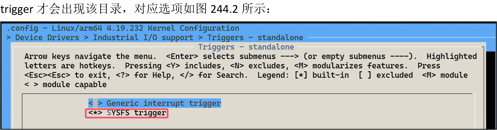
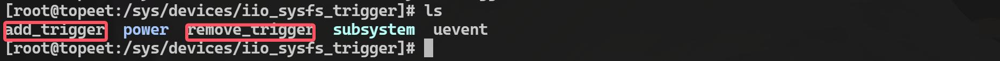
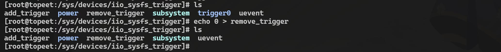

# 第244章IIO触发器讲解

首先在串口终端进入到/sys/bus/iio/devices 目录下，目录内容如图244.1 所示：

图244.1在上一个章节中对sysfs 目录下iio:device0 文件夹的创建进行了讲解，那相同目录下的iio_sysfs_trigger 文件夹又是做什么的呢？它实际上是iio 的触发器，在内核中需要勾选SYSFS

图244.2对应的驱动源码为drivers/iio/trigger/iio-trig-sysfs.c，这里先来看它的驱动入口函数，具体内容如代码清单244.1 所示：代码清单244.1
```c
static int __init iio_sysfs_trig_init(void)
{
    device_initialize(&iio_sysfs_trig_dev);// 初始化设备结构体
    dev_set_name(&iio_sysfs_trig_dev, "iio_sysfs_trigger");// 设置设备名称为"iio_sysfs_trigger"
    return device_add(&iio_sysfs_trig_dev);// 将设备添加到内核中
}
```
包含的三个函数都有一个共同的参数iio_sysfs_trig_dev，它是一个struct device 类型的结构体变量，具体内容如代码清单244.2 所示：代码清单244.2
```c
static struct device iio_sysfs_trig_dev = {
```

```c
.bus = &iio_bus_type,// 指定设备所属的总线类型为IIO 总线
.groups = iio_sysfs_trig_groups,// 定义设备的属性组，用于在sysfs 中暴露设备属性
.release = &iio_trigger_sysfs_release,// 指定设备释放时的回调函数，用于清理资源
};
```
该结构体中的groups 成员用来存放一些iio 设备相关的属性信息，具体内容如代码清单244.3 所示：代码清单244.3
```c
static const struct attribute_group *iio_sysfs_trig_groups[] = {
    &iio_sysfs_trig_group,
    NULL
};
static const struct attribute_group iio_sysfs_trig_group = {
    .attrs = iio_sysfs_trig_attrs,
};
static struct attribute *iio_sysfs_trig_attrs[] = {
    &dev_attr_add_trigger.attr,
    &dev_attr_remove_trigger.attr,
    NULL,
};
```
经过一系列的调用可以确定最终要创建的属性为dev_attr_add_trigger.attr 和dev_attr_remove_trigger.attr，这两个属性分别对应sysfs 目录下的add_trigger 和remove_trigger 如图244.3 所示：

图244.3两个属性最终对应的宏定义及函数，如代码清单244.4 所示：代码清单244.4
```c
// 定义一个设备属性文件"add_trigger"，仅允许用户写入（S_IWUSR），写入时会调用iio_sysfs_trig_add
函数处理
static DEVICE_ATTR(add_trigger, S_IWUSR, NULL, &iio_sysfs_trig_add);
static ssize_t iio_sysfs_trig_add(struct device *dev,
                  struct device_attribute *attr,
                  const char *buf,
                  size_t len)
{
    int ret;
    unsigned long input;
```

```c
// 将用户输入的字符串转换为无符号长整型数字
ret = kstrtoul(buf, 10, &input);
if (ret)
    return ret;
// 调用触发器探测函数，尝试添加指定编号的触发器
ret = iio_sysfs_trigger_probe(input);
if (ret)
    return ret;
return len;
}
// 定义一个设备属性文件"remove_trigger"，仅允许用户写入（S_IWUSR），写入时会调用
iio_sysfs_trig_remove 函数处理
static DEVICE_ATTR(remove_trigger, S_IWUSR, NULL, &iio_sysfs_trig_remove);
static ssize_t iio_sysfs_trig_remove(struct device *dev,
                 struct device_attribute *attr,
                 const char *buf,
                 size_t len)
{
int ret;
unsigned long input;
// 将用户输入的字符串转换为无符号长整型数字
ret = kstrtoul(buf, 10, &input);
if (ret)
    return ret;
// 调用触发器移除函数，尝试移除指定编号的触发器
ret = iio_sysfs_trigger_remove(input);
if (ret)
    return ret;
return len;
}
```
然后来到/sys/bus/iio/devices/iio_sysfs_trigger 目录下，向add_trigger 写入0，就会生成一个名为trigger0 的文件夹，运行结果如图244.4 所示：

图244.4如果想要删掉刚刚创建的触发器，只需要向remove_trigger 写入0 即可，运行结果如图244.5

所示：

图244.5那上面的现象是如何实现的呢，这里先来讲解添加触发文件的iio_sysfs_trig_add()函数，该函数的核心内容在iio_sysfs_trigger_probe()函数，具体内容如代码清单244.5 所示：代码清单244.5
```c
static int iio_sysfs_trigger_probe(int id)
{
    struct iio_sysfs_trig *t;
    int ret;
    bool foundit = false; // 标志变量，用于判断是否找到重复的触发器ID
    // 加锁
    mutex_lock(&iio_sysfs_trig_list_mut);
    // 遍历iio_sysfs_trig_list 链表，检查是否存在相同的ID
    list_for_each_entry(t, &iio_sysfs_trig_list, l) {
        if (id == t->id) {
            foundit = true;
            break;
        }
    }
    if (foundit) {
        ret = -EINVAL;
        goto out1;
    }
    // 分配内存以创建一个新的iio_sysfs_trig 结构
    t = kmalloc(sizeof(*t), GFP_KERNEL);
    if (t == NULL) {
        ret = -ENOMEM;
        goto out1;
    }
    // 初始化新触发器的ID
    t->id = id;
```

```c
// 分配一个新的IIO 触发器，并命名为"sysfstrig%d"，其中%d 是传入的ID
t->trig = iio_trigger_alloc("sysfstrig%d", id);
if (!t->trig) {
    ret = -ENOMEM;
    goto free_t;
}
t->trig->dev.groups = iio_sysfs_trigger_attr_groups;
t->trig->ops = &iio_sysfs_trigger_ops;
t->trig->dev.parent = &iio_sysfs_trig_dev;
iio_trigger_set_drvdata(t->trig, t);
init_irq_work(&t->work, iio_sysfs_trigger_work);
// 注册触发器到IIO 子系统
ret = iio_trigger_register(t->trig);
if (ret)
    goto out2;
list_add(&t->l, &iio_sysfs_trig_list);// 将新触发器添加到全局链表iio_sysfs_trig_list 中
__module_get(THIS_MODULE);
mutex_unlock(&iio_sysfs_trig_list_mut); // 解锁互斥锁，允许其他线程访问共享资源
return 0;
out2:
iio_trigger_free(t->trig);
free_t:
kfree(t);
out1:
mutex_unlock(&iio_sysfs_trig_list_mut);
return ret;
}
```
该函数的重点在第47 行的iio_trigger_register()函数，将触发器注册到IIO 子系统，该函数定义在include/linux/iio/trigger.h 中，具体内容如代码清单244.6 所示：代码清单244.6
```c
#define iio_trigger_register(trig_info) \
    __iio_trigger_register((trig_info), THIS_MODULE)
int __iio_trigger_register(struct iio_trigger *trig_info,
                struct module *this_mod);
```

通过宏定义可以得到最终调用的是__iio_trigger_register()函数，具体内容如代码清单244.7所示：代码清单244.7
```c
int __iio_trigger_register(struct iio_trigger *trig_info,
               struct module *this_mod)
{
    int ret;
    trig_info->owner = this_mod;
    // 为触发器分配一个唯一的ID
    trig_info->id = ida_simple_get(&iio_trigger_ida, 0, 0, GFP_KERNEL);
    if (trig_info->id < 0)
        return trig_info->id;
    // 设置触发器设备的名称，用于sysfs 目录等，格式为"trigger%ld"
    dev_set_name(&trig_info->dev, "trigger%ld",
             (unsigned long) trig_info->id);
    ret = device_add(&trig_info->dev);
    if (ret)
        goto error_unregister_id;
    mutex_lock(&iio_trigger_list_lock);
    if (__iio_trigger_find_by_name(trig_info->name)) {
        pr_err("Duplicate trigger name '%s'\n", trig_info->name);
        ret = -EEXIST;
        goto error_device_del;
    }
    list_add_tail(&trig_info->list, &iio_trigger_list);
    mutex_unlock(&iio_trigger_list_lock);
    return 0;
error_device_del:
    mutex_unlock(&iio_trigger_list_lock);
    device_del(&trig_info->dev);
error_unregister_id:
    ida_simple_remove(&iio_trigger_ida, trig_info->id);
    return ret;
}
```
该函数的主要功能是将一个IIO 触发器注册到系统中，首先在第8-14 行为触发器分配唯一ID 并设置设备名称，然后在第16 行将触发器设备添加到设备模型中，最后在第26 行将触发

器加入IIO 核心维护的全局触发器链表中。至此，对iio_trigger_register()函数的讲解就完成了，然后继续回到iio_sysfs_trigger_probe()函数，对第36 行的iio_trigger_alloc()函数进行讲解，该函数定义在drivers/iio/industrialio-trigger.c 文件中，具体内容如代码清单244.8 所示：代码清单244.8
```c
struct iio_trigger *iio_trigger_alloc(const char *fmt, ...)
{
    struct iio_trigger *trig;
    va_list vargs;
    va_start(vargs, fmt);
    // 调用viio_trigger_alloc 函数，传入格式化字符串和可变参数，分配并初始化触发器
    trig = viio_trigger_alloc(fmt, vargs);
    va_end(vargs); // 结束可变参数列表的使用
    return trig;
}
```
该函数的核心在第7 行的viio_trigger_alloc()函数，用于传入格式化字符串和可变参数，分配并初始化触发器，viio_trigger_alloc()函数的具体内容如代码清单244.9 所示：代码清单244.9
```c
static struct iio_trigger *viio_trigger_alloc(const char *fmt, va_list vargs)
{
    struct iio_trigger *trig;
    int i;
    // 分配一个iio_trigger 结构体的内存
    trig = kzalloc(sizeof *trig, GFP_KERNEL);
    if (!trig)
        return NULL;
    // 设置触发器设备的类型和总线类型
    trig->dev.type = &iio_trig_type;
    trig->dev.bus = &iio_bus_type;
    device_initialize(&trig->dev); // 初始化设备结构体
    mutex_init(&trig->pool_lock); // 初始化触发器的互斥锁
    // 分配中断描述符，用于触发器的子中断
    trig->subirq_base = irq_alloc_descs(-1, 0,
                         CONFIG_IIO_CONSUMERS_PER_TRIGGER,
                         0);
    if (trig->subirq_base < 0)
        goto free_trig;
```

```c
// 根据格式化字符串生成触发器名称
trig->name = kvasprintf(GFP_KERNEL, fmt, vargs);
if (trig->name == NULL)
    goto free_descs;
// 配置子中断芯片的相关信息
trig->subirq_chip.name = trig->name;
trig->subirq_chip.irq_mask = &iio_trig_subirqmask;
trig->subirq_chip.irq_unmask = &iio_trig_subirqunmask;
// 配置每个子中断的行为
for (i = 0; i < CONFIG_IIO_CONSUMERS_PER_TRIGGER; i++) {
    irq_set_chip(trig->subirq_base + i, &trig->subirq_chip);
    irq_set_handler(trig->subirq_base + i, &handle_simple_irq);
    irq_modify_status(trig->subirq_base + i,
              IRQ_NOREQUEST | IRQ_NOAUTOEN, IRQ_NOprobe);
}
return trig;
free_descs:
irq_free_descs(trig->subirq_base, CONFIG_IIO_CONSUMERS_PER_TRIGGER);
free_trig:
kfree(trig);
return NULL;
}
```
viio_trigger_alloc()函数的作用是动态分配并初始化一个IIO 触发器（iio_trigger 结构体），为其设置设备类型、总线类型、名称、中断描述符以及子中断的相关配置，那这里完善的trig->subirq_chip 成员用在了哪个地方呢？在前面讲解IIO 设备注册函数时，在__iio_device_register()函数的55-56 行也涉及到了IIO 触发器的代码，如代码清单244.10 所示：代码清单244.10
```c
// 如果设备支持所有触发模式，则注册触发消费者
if (indio_dev->modes & INDIO_ALL_TRIGGERED_MODES)
  iio_device_register_trigger_consumer(indio_dev);
```
iio_device_register_trigger_consumer()函数用来注册触发消费者，该函数定义在drivers/iio/industrialio-trigger.c 文件中，具体内容如代码清单244.11 所示：代码清单244.11

```c
void iio_device_register_trigger_consumer(struct iio_dev *indio_dev)
{
    // 将触发器消费者属性组添加到IIO 设备的属性组列表中
    indio_dev->groups[indio_dev->groupcounter++] =
        &iio_trigger_consumer_attr_group;
}
```
该函数要创建的属性为iio_trigger_consumer_attr_group，该结构体变量内容如代码清单244.12 所示：代码清单244.12
```c
static const struct attribute_group iio_trigger_consumer_attr_group = {
    .name = "trigger",
    .attrs = iio_trigger_consumer_attrs,
};
static struct attribute *iio_trigger_consumer_attrs[] = {
    &dev_attr_current_trigger.attr,
    NULL,
};
static DEVICE_ATTR(current_trigger, S_IRUGO | S_IWUSR,
           iio_trigger_read_current,
           iio_trigger_write_current);
```
经过一系列追踪，最终可以确定会在sysfs 目录下创建名为current_trigger 的属性，并且该属性有iio_trigger_read_current()读函数和iio_trigger_write_current()写函数，这里先来讲解读函数iio_trigger_read_current()，具体内容如代码清单244.13 所示：代码清单244.13
```c
static ssize_t iio_trigger_read_current(struct device *dev,
                         struct device_attribute *attr,
                         char *buf)
{
    struct iio_dev *indio_dev = dev_to_iio_dev(dev);// 将设备结构体转换为IIO 设备结构体
        if (indio_dev->trig)
            return sprintf(buf, "%s\n", indio_dev->trig->name);
        return 0;
}
```
读函数较为简单，只是会打印绑定的触发器名称，然后来看写函数iio_trigger_write_current()，具体内容如代码清单244.14 所示：代码清单244.14

```c
static ssize_t iio_trigger_write_current(struct device *dev,struct device_attribute *attr,const char *buf,size_t
len)
{
    struct iio_dev *indio_dev = dev_to_iio_dev(dev); // 将设备转换为IIO 设备结构体
    struct iio_trigger *oldtrig = indio_dev->trig;
    struct iio_trigger *trig;
    int ret;
    mutex_lock(&indio_dev->mlock);
    if (indio_dev->currentmode == INDIO_BUFFER_TRIGGERED) { // 如果设备处于触发缓冲模式
        mutex_unlock(&indio_dev->mlock
        return -EBUSY;
    }
    if (indio_dev->trig_readonly) {
        mutex_unlock(&indio_dev->mlock); //
        return -EPERM;
    }
    mutex_unlock(&indio_dev->mlock);
    trig = iio_trigger_acquire_by_name(buf); // 根据输入名称获取新触发器
    if (oldtrig == trig) {
        ret = len;
        goto out_trigger_put;
    }
    if (trig && indio_dev->info->validate_trigger) { // 验证新触发器是否兼容设备
        ret = indio_dev->info->validate_trigger(indio_dev, trig);
        if (ret)
            goto out_trigger_put;
    }
    if (trig && trig->ops && trig->ops->validate_device) { // 验证设备是否兼容触发器
        ret = trig->ops->validate_device(trig, indio_dev);
        if (ret)
            goto out_trigger_put;
    }
    indio_dev->trig = trig; // 更新设备的触发器为新触发器
    if (oldtrig)
        if (indio_dev->modes & INDIO_EVENT_TRIGGERED)
            iio_trigger_detach_poll_func(oldtrig,
                              indio_dev->pollfunc_event);
        iio_trigger_put(oldtrig);
```

```c
}
if (indio_dev->trig) { // 如果新触发器存在，将其与设备关联
    if (indio_dev->modes & INDIO_EVENT_TRIGGERED)
        iio_trigger_attach_poll_func(indio_dev->trig,
                          indio_dev->pollfunc_event);
}
return len; /
out_trigger_put:
if (trig)
    iio_trigger_put(trig);
return ret;
}
```
该函数的重点在第48 行的iio_trigger_attach_poll_func 函数，负责与设备进行关联，确保设备能够正确响应新触发器的事件，该函数的具体内容如下所示：代码清单244.15
```c
static int iio_trigger_attach_poll_func(struct iio_trigger *trig,
                    struct iio_poll_func *pf)
{
    int ret = 0;
    bool notinuse = bitmap_empty(trig->pool, CONFIG_IIO_CONSUMERS_PER_TRIGGER);
    /* 防止在触发器被使用时模块被卸载*/
    __module_get(pf->indio_dev->driver_module);
    /* 获取触发器的中断号*/
    pf->irq = iio_trigger_get_irq(trig);
    if (pf->irq < 0)
        goto out_put_module;
    /* 请求线程化中断*/
    ret = request_threaded_irq(pf->irq, pf->h, pf->thread,
                   pf->type, pf->name, pf);
    if (ret < 0)
        goto out_put_irq;
    /* 如果触发器支持设置状态且未被使用，则启用触发器*/
    if (trig->ops && trig->ops->set_trigger_state && notinuse) {
        ret = trig->ops->set_trigger_state(trig, true);
        if (ret < 0)
            goto out_free_irq;
```

