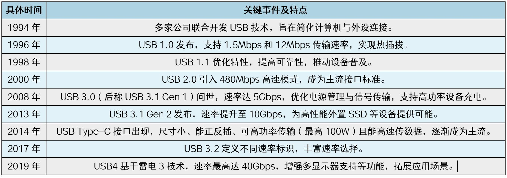
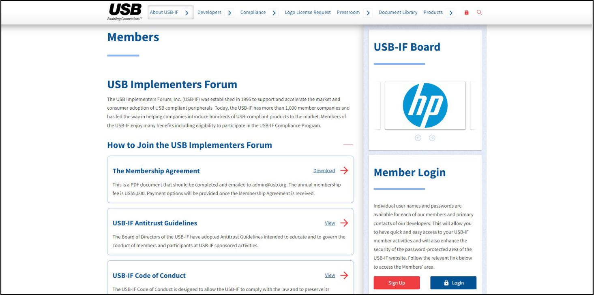
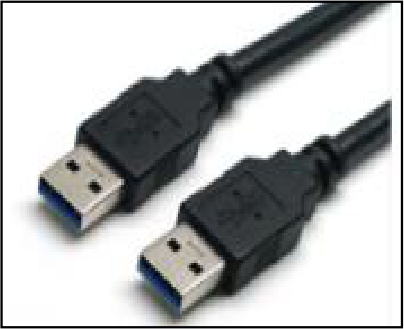
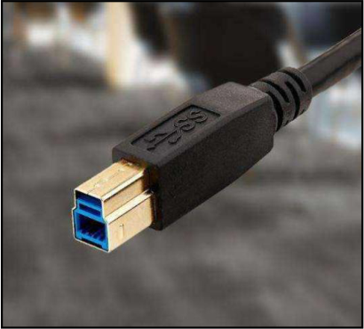
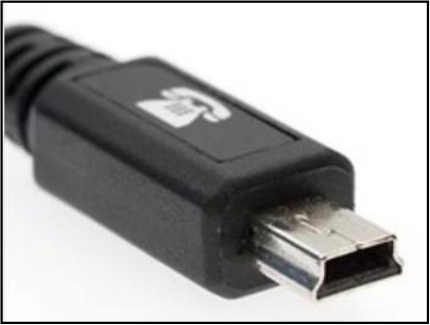
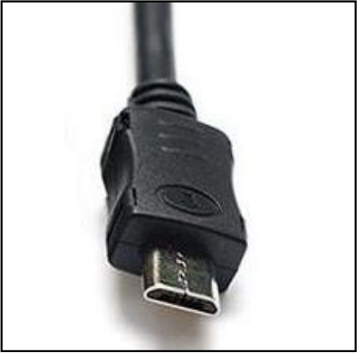
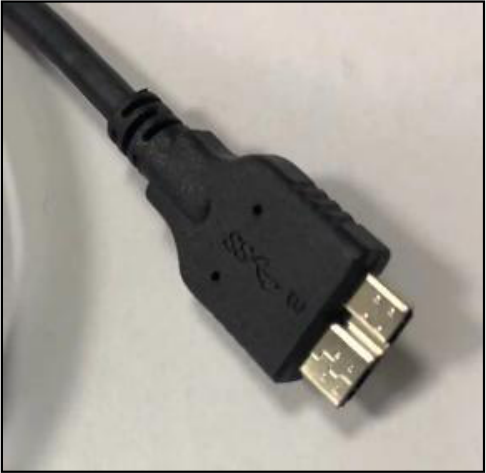
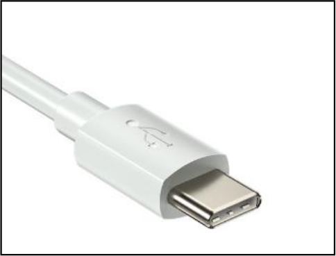
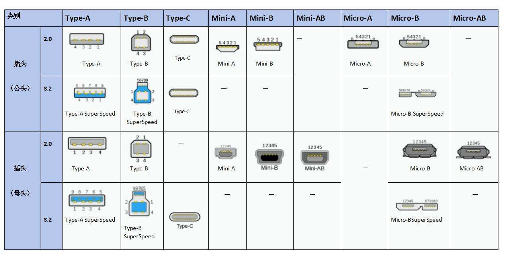
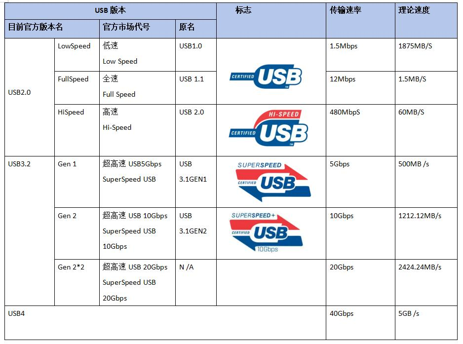

# 第247章 USB技术概述

本章将会对USB 技术进行概述，包括其诞生背景和发展历程、USB 接口的相关介绍、USB版本的命名规则，以及对USB 的角色模型等内容。
## 247.1 USB 诞生背景和发展历史
USB（通用串行总线：Universal Serial Bus）是计算机和电子设备间广泛使用的通用接口标准，能传输数据与供电。而在USB 出现之前，计算机连接外部设备堪称一大难题，鼠标、键盘、打印机各有专属接口，形状、特性和协议都不一样，像串口、并口、PS/2 接口等都是如此，每种接口都需要配备专用电缆和驱动程序，而且主板上的接口数量又十分有限，这使得连接设备既繁琐又受限于种类。为解决这些难题，USB 应运而生，它带来通用、便捷且可扩展的连接方式，真正实现了设备即插即用。USB 发展历程如表247.1 所示：表247.1

USB 技术的不断发展，在数据传输、设备兼容、供电能力等方面持续提升，成为了现代电子设备必不可少的连接方式。

## 247.2 USB 接口介绍
为了满足各种设备的不同需求，USB 标准使用了多种不同类型的接口，尽管接口的种类很多，但它们均遵循统一的技术标准。接口标准可以参考Members | USB-IF 官网，官网界面如图247.1 所示：

图247.1
USB 接口可以粗略地分成六种，分别是Type-A 接口、Type-B 接口、Mini-USB 接口、Micro-USB接口、Micro-B SuperSpeed 接口、Type-C 接口。接下来对这几种接口进行介绍。Type-A 接口如图247.2 所示，是长方形接口，广泛应用于电脑，充电器等主机设备以及U盘，鼠标，键盘等传统外设。

图247.2Type-B 接口如图247.3 所示，是方正接口，多用于打印机、麦克风、扫描仪等设备。

247.3Mini-B 接口如图247.4 所示，多用于行车记录仪设备。

图247.4Micro-USB 接口如图247.5 所示，小型接口，曾用于老款手机、移动电源等便携设备。

图247.5Micro-B SuperSpeed 接口如图247.6 所示，常用于移动硬盘。

图247.6

Type-C 接口如图247.7 所示，正反可插，目前Typec 接口是手机、笔记本电脑、耳机等现代设备的主流接口。

图247.7接下来我们用一张表来总结USB 接口类型，如表247.2 所示：表247.2

图中各类USB 接口尽管外观形态和适用场景各不相同，但都遵循统一的USB 标准协议，确保了设备之间的兼容性和互操作性。需要注意的是，不能仅因设备采用Type - C 接口就判定其具备高速数据传输能力。Type - C 本质上只是一种接口物理规格，而实际数据传输速度的高低，取决于设备所搭载的USB 协议版本。例如，即便采用Type - C 接口，若搭配的是USB2.0 协议，其仍会速度受到限制，只有搭载USB 3.0 及更高版本协议时，才能实现高速传输。
## 247.3 USB 版本命名规则
在了解USB 接口的多样性后，我们还需掌握USB 版本命名规则，这样才能更清晰的理解

不同USB 版本的性能与特点。USB 版本具体信息如表247.3 所示：表247.3

早期的USB 1.0 和USB 1.1 版本，命名较为简单直接，版本号直观地反映了其发展顺序。USB 2.0 时代由于传输速率上有了显著提升，该版本成为重要的发展节点，被称为“高速USB”，在市场中得到了广泛应用，极大地推动了USB 技术的普及。随着技术的进一步发展，USB 3.0 系列版本出现。最初，USB 3.0 被命名为SuperSpeed USB，强调其高速传输的特性。后来USB 3.1 版本发布，在传输速率上进一步提升。然而，为了简化命名，USB3.0 改名为USB3.1 Gen 1，USB3.1 改名为USB3.1 Gen2。此后，USB-IF 推出了最新的USB 命名规范，USB 3.1Gen 1 又改名为USB3.2 Gen1，USB 3.1 Gen2 又改名为USB3.2 Gen2，而USB 3.2 Gen 2*2 为USB3.2，也就是经历过两次命名更改，USB3.0至USB3.2 分别被叫做USB 3.2 Gen 1、USB 3.2 Gen 2、USB 3.2 Gen 2x2 。尽管USB 的命名规则在发展中有所变化，但总是围绕传输速率这一关键性能指标展开，能帮助用户快速了解不同版本USB 的性能差异，从而在选择设备和进行连接时做出合适决策。

## 247.4 USB 角色模型
随着USB 传输速度越来越快，不同USB 设备之间需要处理的数据量越来越大。为了让这些USB 设备更好地分工合作，USB 协议对每个设备在连接时的角色做出了规定，接下来学习一下相关内容。根据物理上的逻辑结构可以将USB 设备分为主机HOST 和设备Slave，两者如同合作伙伴，共同完成数据传输任务。USB HOST 即USB 主机端，是控制和管理USB 总线的设备，相当于领导者，它能够掌控整个数据传输过程，例如常用的电脑、平板，多数时间就扮演这个角色。它能主动发起和其他设备的沟通，下达指令，比如读取数据或者发送指令。而且，它还负责给连接的设备供电，确保它们正常运行。USB Slave 即USB 设备端，属于被控设备。像U 盘、鼠标、打印机这些设备就属于Slave。它们需要听从HOST 的指挥，按照HOST 的指令行动。例如当HOST 要求U 盘传输数据时，U盘会按照指令提供数据。Slave 依赖HOST 的指令行事，根据HOST 的要求提供或接收数据。USB OTG 全称是USB On-The-Go（即插即用），它同时具备USB 主机和USB 设备的功能，既可以做USB HOST 也可以做USB Slave，一般通过ID 信号来控制主、从切换（如何控制主从切换，我们在后面的章节再进行详细讲解）。举个例子，若你的手机支持OTG 功能，当你把U盘插入手机时，手机此时就会成为HOST，能够读取U 盘中的数据；而当把手机连接到电脑时，手机又可以切换为SLAVE，听从电脑的指令，比如将手机里的照片传输到电脑。OTG 让设备之间的连接和数据交互变得更加灵活，打破了传统HOST 与SLAVE 角色固定的限制。

