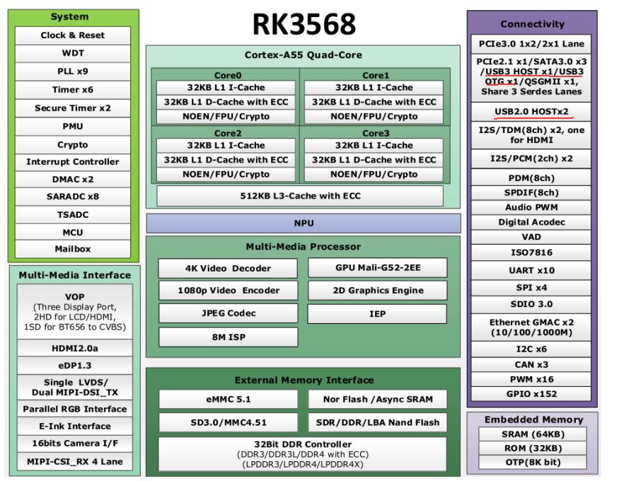
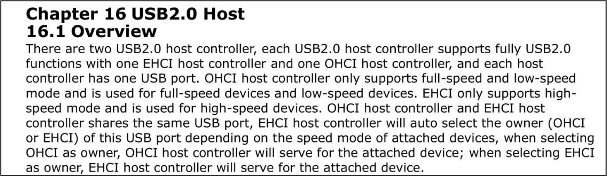
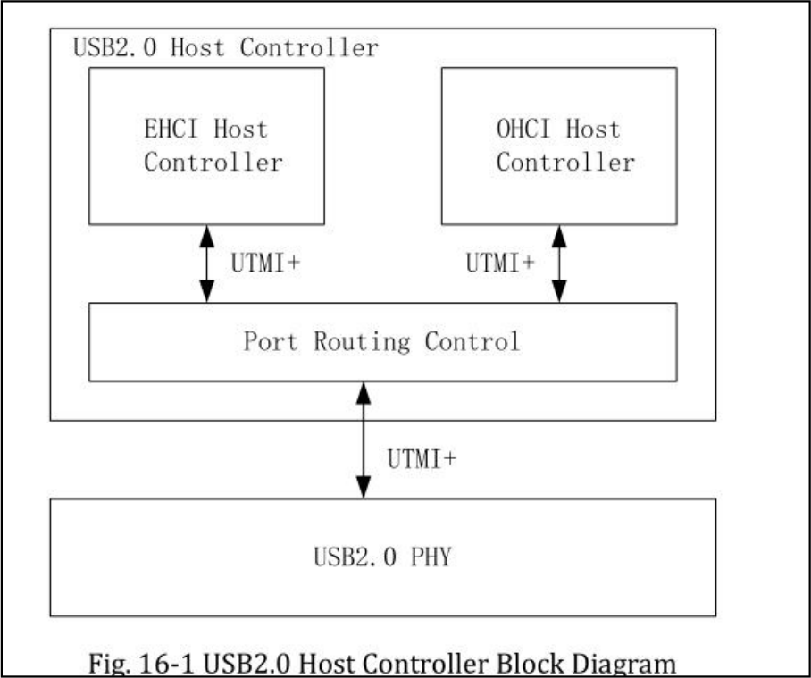
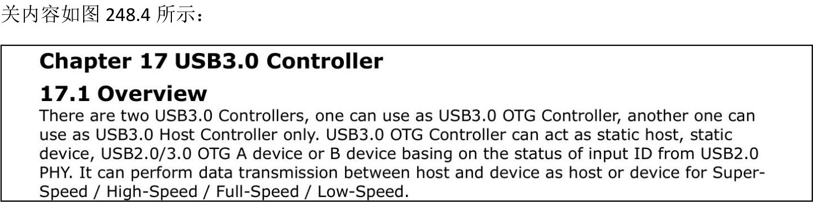
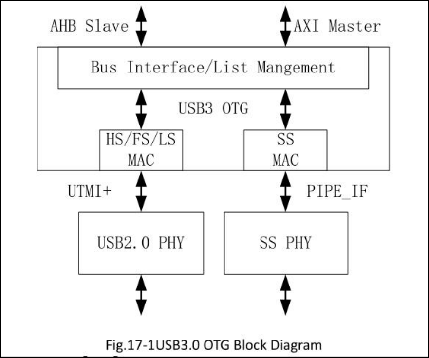
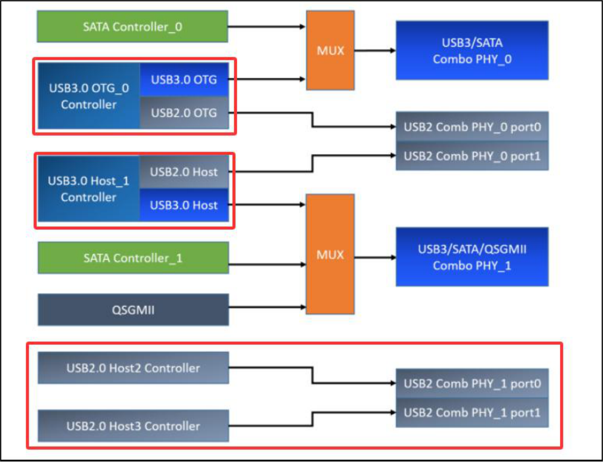
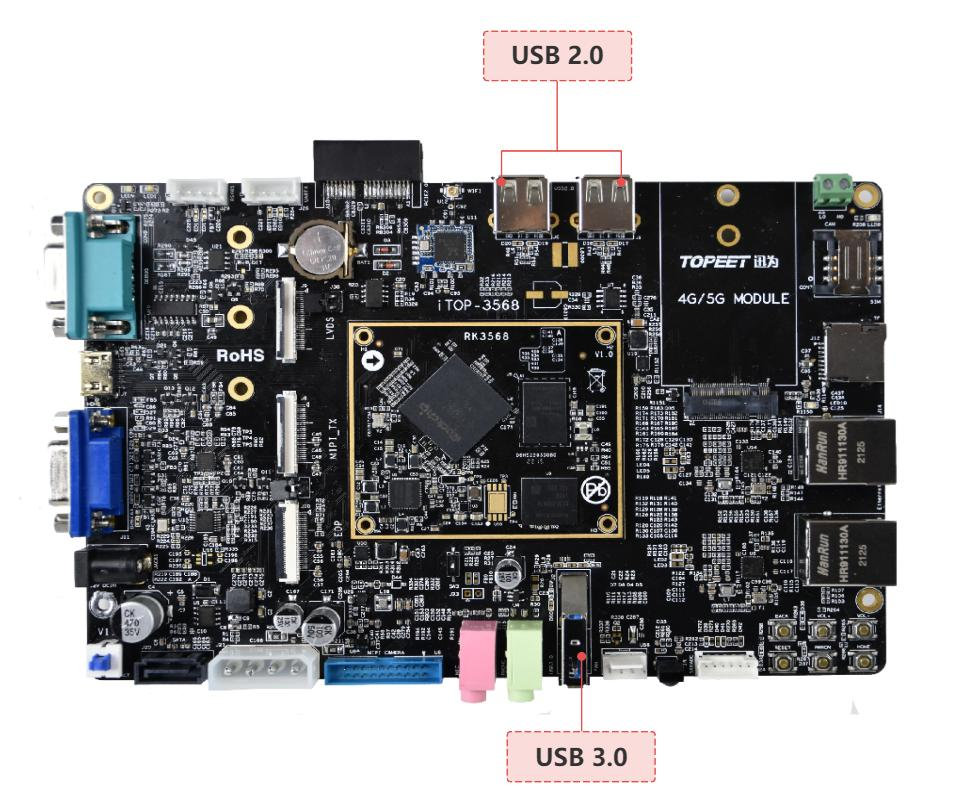
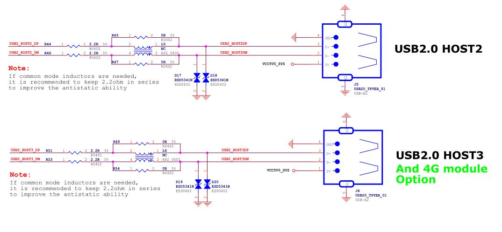
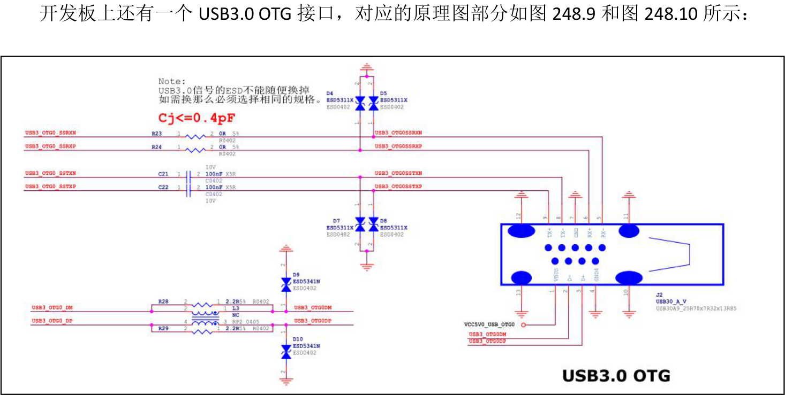
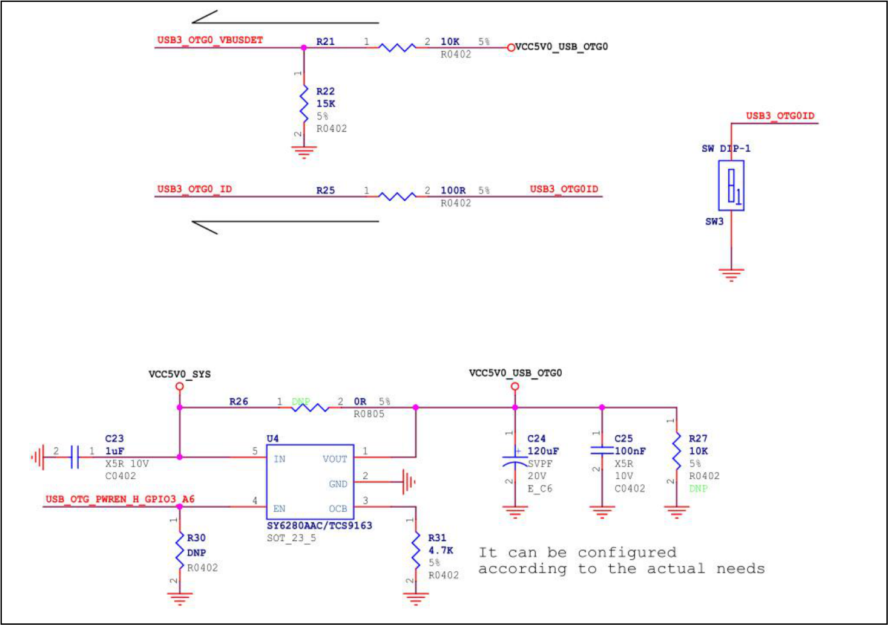

# 第248章 USB硬件基础

本章节来对iTOP-RK3568 开发板上的USB 接口硬件部分进行讲解。
## 248.1 RK3568 芯片USB 接口设计
不同类型的开发板可能配备不同的USB 接口，以满足不同的开发需求。本章以iTOP-RK3568 开发板为例带大家认识一下开发板上的USB 接口。先来看一下RK3568 芯片数据手册中关于USB 的介绍，RK3568 SOC 外设功能如图248.1 所示：

图248.1在上图中，可以得到RK3568 处理器有两个USB2.0 HOST、一个USB3.0 HOST 和一个USB3.0

OTG。然后对USB2.0 和USB3.0 进行介绍。首先打开RK3568 TRM 手册Part2 的第十六章节——USB2.0 Host,具体内容如图248.2 所示：

图248.2上图中英文的意思为:RK3568 芯片有两个USB2.0 主机控制器，每个USB2.0 主机控制器都通过一个增强型主机控制器接口（EHCI）主机控制器和一个开放式主机控制器接口（OHCI）主机控制器完全支持USB2.0功能，并且每个主机控制器都有一个USB 端口。OHCI 主机控制器仅支持全速和低速模式，用于连接全速设备和低速设备。EHCI 主机控制器仅支持高速模式，用于连接高速设备。OHCI 主机控制器和EHCI 主机控制器共享同一个USB 端口。EHCI 主机控制器会根据所连接设备的速度模式自动选择该USB 端口的控制权归属（OHCI 或EHCI）。当选择OHCI 为主控时，OHCI 主机控制器将为所连接的设备提供服务；当选择EHCI 为主控时，EHCI 主机控制器将为所连接的设备提供服务。上段文字中提到的EHCI 和OHCI 具体是什么呢？它们是两种不同的USB 控制器标准。EHCI 是Intel 开发的USB 2.0 高速控制器，专门处理移动硬盘、数码相机等需要高速传输的设备；而OHCI 是USB 1.1 控制器，负责管理鼠标、键盘这些低速设备。在实际使用中，电脑主板通常会同时集成EHCI 和OHCI 两种控制器（标记为EHCI/OHCI），这样既能支持高速设备，也能兼容低速设备。然后回到RK3568 芯片参考手册，USB2.0 主控制器框图如图248.3 所示：

图248.3从上图中可以看出USB2.0 主机控制器（USB2.0 Host Controller）包括EHCI Host Controller、OHCI Host Controller 和Port Routing Control。EHCI 主机控制器负责执行高速（High-speed）事务处理。OHCI 主机控制器负责执行全速/低速（Full-speed/Low-speed）事务处理。EHCI 主机控制器和OHCI 主机控制器都通过UTMI+接口连接到Port Routing Control。Port Routing Control 再通过UTMI+接口连接到USB2.0 物理层（USB2.0 PHY）。接下来打开RK3568 TRM 手册Part2 的第十七章节——USB3.0Controller，USB3.0 控制器相

图248.4上图中英文的意思为:RK3568 芯片有两个USB3.0 控制器，其中一种可以用作USB3.0 OTG（On-The-Go）控制器，另一种只能用作USB3.0 主机控制器。USB3.0 OTG 控制器可以根据USB2.0 物理层（PHY）的输入ID 状态，充当静态主机、静态设备、USB2.0/3.0 OTG A 设备或B 设备。它能够在主机和设备之间以主机或设备的身份进行SuperSpeed（超高速）、High-Speed(高速)、Full-Speed(全速)或

Low-Speed(低速)的数据传输。USB3.0 OTG 功能框架如图248.5 所示：

图248.5USB3 OTG 模块通过HS/FS/LS MAC（高速/全速/低速MAC）接口连接到下方的USB2.0 PHY模块。USB2.0 PHY 模块负责USB2.0 的物理层功能。USB3 OTG 模块通过SS MAC（超高速MAC）接口连接到右侧的SS PHY 模块。SS PHY 模块负责超高速（SuperSpeed）的物理层功能。RK3568 芯片USB 控制器和PHY 的连接示意图如图248.6 所示：

图248.6从上图可知，RK3568 芯片配备两个USB2.0 HOST，其USB2.0 HOST 引脚不存在复用情况，USB 2.0 Host_2 控制器与USB 2.0 Host_3 控制器分别使用USB 2.0 Comb PHY_1 的port0 和port1。同时，该芯片设有一个USB3.0 OTG，它能向下兼容USB2.0 OTG，且此USB 3.0 OTG 控制器与SATA_0 控制器复用USB3/SATA Combo PHY_0。另外，RK3568 芯片还有一个USB3.0 HOST，它向下兼容USB2.0 HOST，USB 3.0 Host_1 控制器与SATA_1/QSGMII 控制器复用USB3/SATA/QSGMII Combo PHY_1。USB 3.0 OTG 控制器与USB 3.0 Host_1 控制器中的USB2.0 OTG 分别使用USB 2.0 Comb PHY_0的port0 和port1。
## 248.2 开发板USB 原理图分析
在上一小节中，我们已经了解了RK3568 芯片的USB 接口相关内容，接下来对迅为iTOP-RK3568 开发板上的USB 接口部分进行讲解，USB 接口位置如图248.7 所示：

图248.7
可以看到开发板有俩个USB2.0 接口，其中右边的USB2.0 接口和RTL8723DU WIFI 模块是复用的，对应的原理图部分如图248.8 所示：

图248.8

图248.9

图248.10其中USB3_OTG0_VBUSDET 是一个高电平有效的检测信号，用于OTG 和Device 模式识别。

