# 第249章 USB总线架构与设备交互机制

USB3.0 otg 支持三种模式，分别是otg 模式、device 模式、host 模式，接下来对三种模式进行说明。OTG 模式下，通过检测ID 引脚电平自动切换工作模式（高电平为Device 模式，低电平为Host 模式），同时需要VBUSDET 为高电平才会拉高USB3_OTG0DP 开始枚举；Device 模式下，只需VBUSDET 为高电平即可触发枚举，无需检测ID 引脚；Host 模式下则完全忽略ID 和VBUSDET 状态。需要注意的是，虽然某些产品可能仅需Host模式，但由于USB3_OTG0_DP/DM 接口同时承担系统固件烧写和ADB 调试功能，在调试和生产时必须切换为Device 模式，因此必须保留VBUSDET 信号连接。系统默认在uboot 启动前为Device 模式，进入uboot 后可根据实际需求配置这三种工作模式。在上一节了解到RK3568 芯片除了上述USB3.0 接口之外还有着另一个USB3.0 HOST 接口。那么这个接口具体用在哪里呢？USB3.0 原理图如图252.11 所示，这个USB3.0 HOST 接口是专门为5G 模块（RM500U-CN 模块）预留的。在iTOP-RK3568 开发板上，4G 和5G 模块共用同一个接口底座，通过硬件设计实现了兼容。
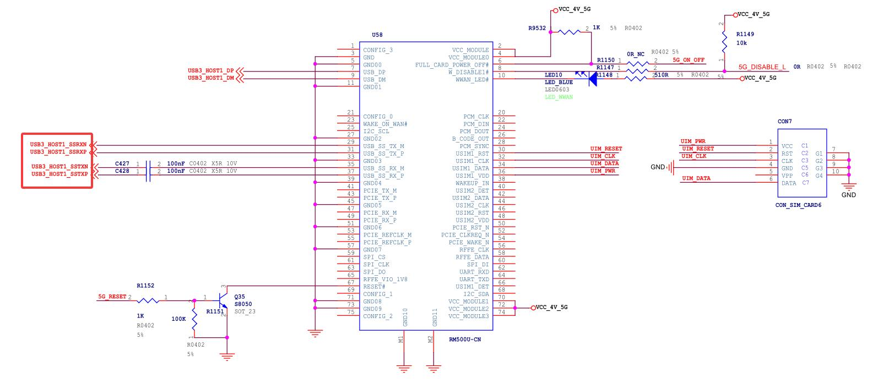
图248.11

在本章节将会对USB 总线架构与相关设备知识进行讲解，包括USB 的拓扑结构，USB 设备的迁移状态，USB 设备的硬件识别方式，以及对OTG 双角色切换的原理进行介绍。
## 249.1 USB 拓扑结构
首先打开Windows 系统设备管理器中的“USB 根集线器”如图所249.1 所示：
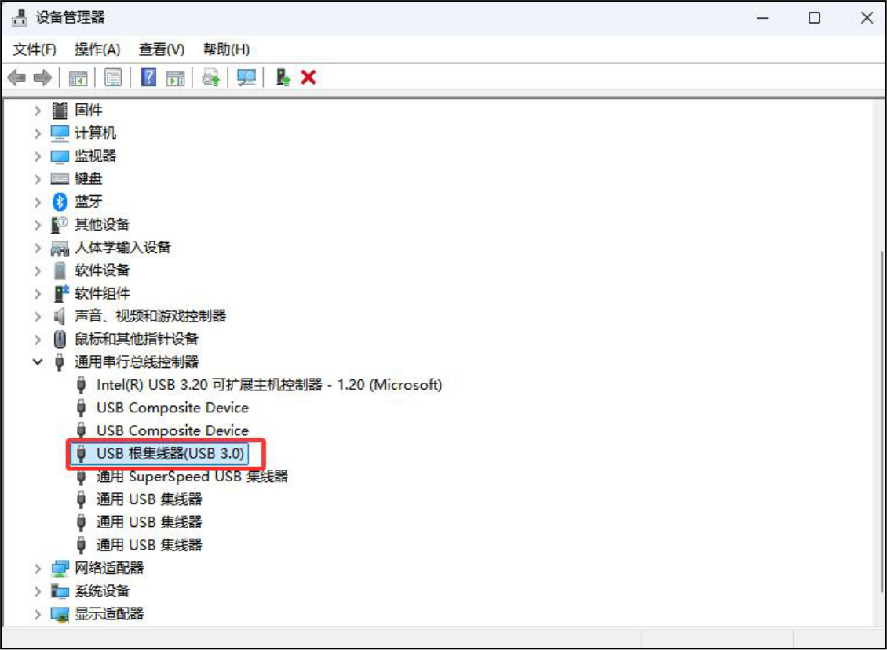
图249.1在上图中，与主机直接相连接的集线器叫做根集线器，它是主机控制器内置的集线器，而用户额外连接的集线器则称为普通集线器，当需要扩展USB 接口数量时，用户可以通过外接USB 集线器来扩展电脑的USB 接口，USB 集线器也叫做USB HUB，其典型外观结构如图249.2所示：

图249.2USB 采用的是树形拓扑结构，这是一种主从结构，即所有设备通过集线器（hub）连接到主机（host），形成树状结构如图249.3 所示，在这种结构下，USB 数据通信只能在主机与设备之间进行，设备与设备之间无法直接通信。
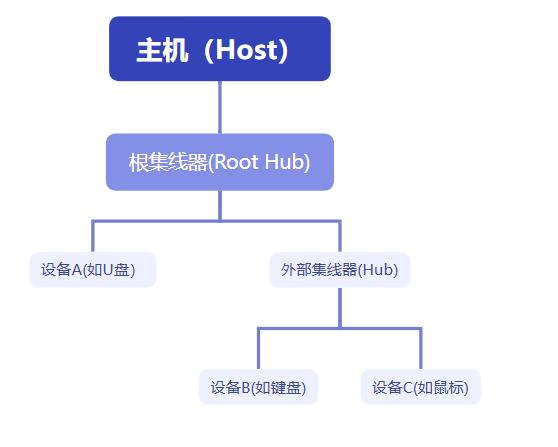
图249.3USB 集线器虽然能够扩展接口数量，但其扩展能力受到严格限制。根据USB2.0 协议规范，整个系统最多支持7 层级联扩展（从根集线器开始计算），且所有连接的设备总数（包括集线器本身）不得超过127 个。这种金字塔形的拓扑结构设计（如图249.4）在保证接口扩展灵活性的同时，通过层级限制避免了信号衰减和系统过载的问题。

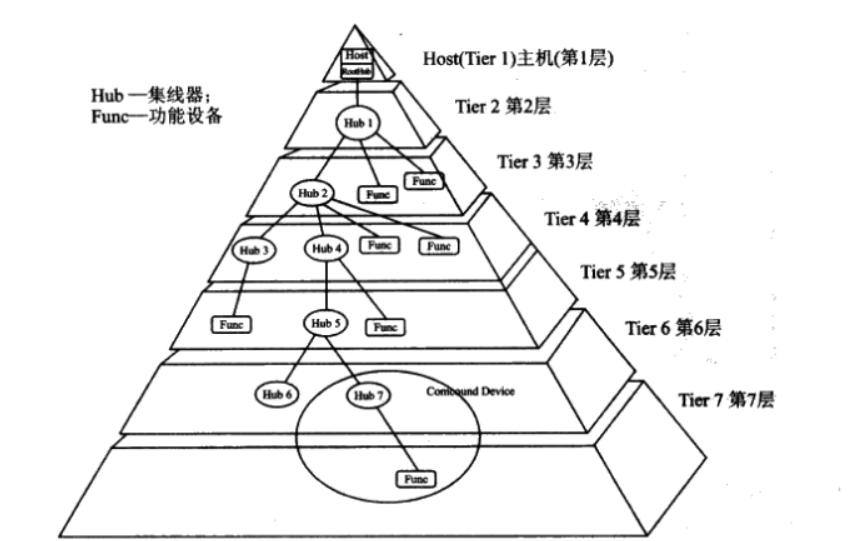
图249.4
## 249.2 USB 设备迁移状态
USB 设备在通信过程中会经历多种状态迁移，这些状态确保了数据的安全和可靠传输。在USB2.0 协议中定义了设备的6 种状态，分别是上电状态（powered）、默认状态（Default）、地址状态（Address）、配置状态（Configured）、连接状态（Attached）和挂起状态（Suspend），六种状态的关系如图249.5 所示：

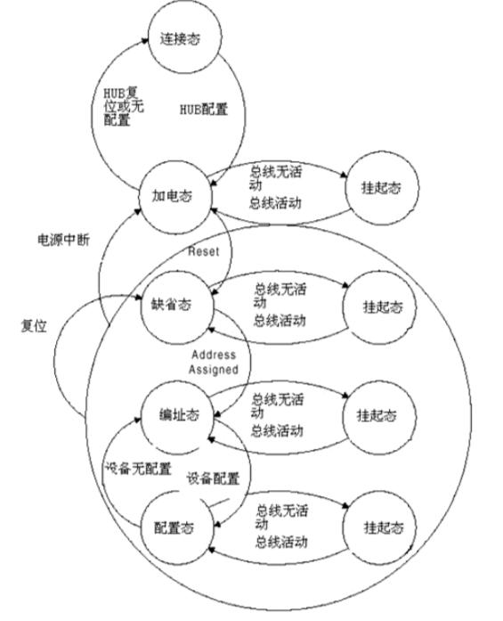
图249.5从USB 设备尚未接入到被USB Host 完全识别并确保其功能正常，USB 设备会依次历经以下阶段。（1）连接状态(Attached):这是设备物理连接到USB 主机但还没有通电的阶段。这个阶段主要由硬件来保证。（2）上电状态(powered):这是第二阶段，对应连接到USB 主机并刚刚通电的设备。这个阶段主要由硬件来保证。（3）默认状态(Default):当USB 设备首次连接到主机时，它进入默认状态，在默认状态下，设备等待主机发送复位信号。（4）地址状态(Address): 在接收到复位信号之后，设备进入地址状态。在此状态下，主机为设备分配一个唯一的地址。（5）配置状态(Configured): 一旦设备接收到其地址，它就进入配置状态。在此状态下，设备可以选择其配置描述符，这决定了它如何与主机通信。（6）挂起状态(Suspend): 当USB 设备不活动或主机进入低功耗模式时，设备可以进入挂起状态。在挂起状态下，设备不消耗或消耗极少的电力。

## 249.3 USB 设备硬件识别
USB2.0 向下兼容USB1.0 和USB1.1，分为低速、全速、高速三种模式，接下来学习一下低速(Low-speed)设备、全速(Full-speed)和高速(High-speed)设备的识别机制。全速设备连接方式如图249.6 所示，左侧是USB 主机端，右侧是USB 设备端。
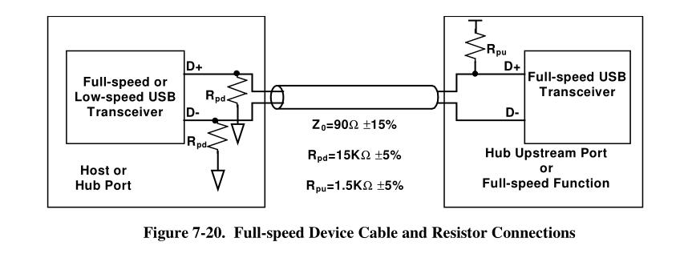
图249.6在左边一侧，数据线D+和D-都有15k 阻值的下拉电阻Rpd(Pull-down Resistors)，在右边设备端一侧，数据线D+上有一个1.5k 阻值的上拉电阻Rpu(Pull-up Resistors)。当D+信号线由低电平变成高电平，USB 主机端就能判断有全速设备被插入了。低速设备的连接方式如图249.7 所示，左侧是USB 主机端，右侧是USB 设备端。
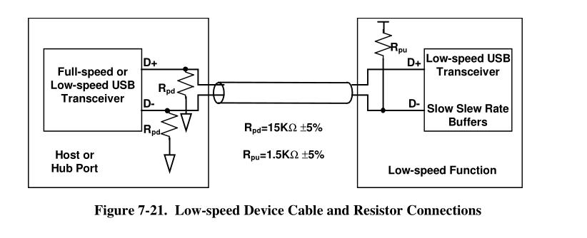
图249.7在左边一侧，数据线D+和D-都有15k 阻值的下拉电阻Rpd(Pull-down Resistors)，在右边设备端一侧，数据线D-上有一个1.5k 阻值的上拉电阻Rpu(Pull-up Resistors)。当D-信号线由低电

平变成高电平，USB 主机端就能判断有低速设备被插入了。高速设备插入和断开的描述内容如图249.8 所示：
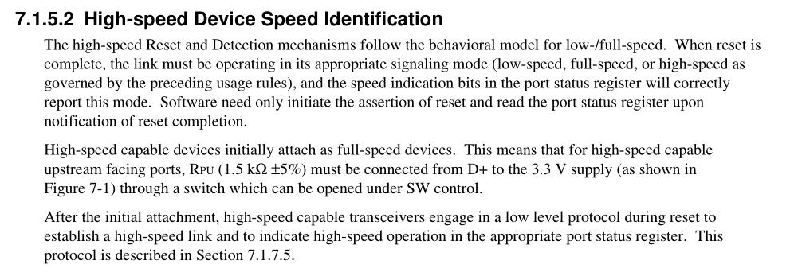
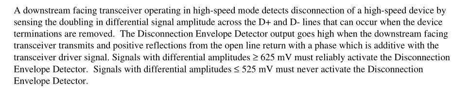
图249.8上图中英文的意思是高速设备接入系统时，起初会被识别为全速设备。随后，HOST 会对DEVICE 进行检测，判断其是否为高速设备，在此过程中，HOST 与DEVICE 需相互确认，确认完成后，系统才会切换到高速模式。在高速模式下采用电流传输模式，此时需要将上拉电阻从D+连接到3.3V 电源。当设备断开连接时，其差分终端电阻随即消失，然而高速数据包仍会继续从原本设备所连端口传输。当这些数据包抵达无负载的路径端点，会产生强烈反射，反射信号返回集线器接口，致使集线器连接端口的差分电压升高，当高速设备D+与D-上的差分信号电平大于625mV 时，便可判定USB 设备已断开。最后来学习下USB3.0 的hub 插入USB 设备是如何被识别的。USB3.0 原理架构如图249.9所示：

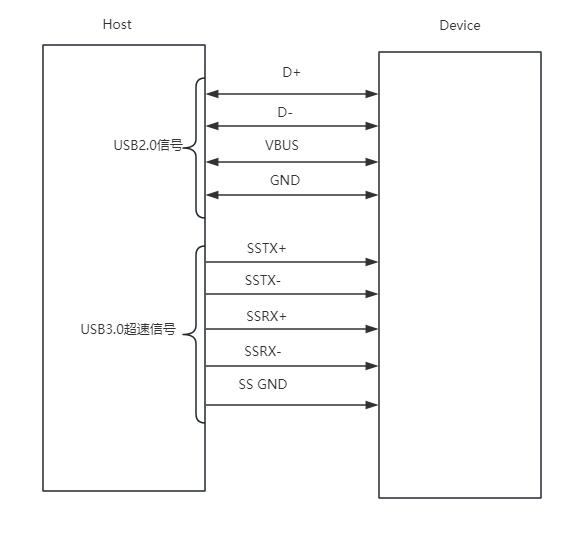
图249.9当USB 主机和USB 设备连接之后，会在USB 主机和设备的SSRX+/-上产生一个等效下拉电阻R_Term，其范围在18~30 欧姆，由SSRX+/-上各一个50 欧姆的等效下拉电阻并联组成。图249.10 中的左边电路为不接设备时的等效电路，右边电路为接入usb 设备时的等效电路。
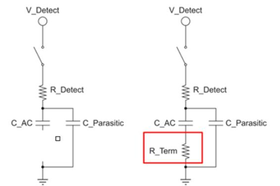
图249.10由上图可知，当不接设备时，电路模型实际为RC 串联电路，充放电时间常数T = R_Detect * C_Parasitic。当设备接入后，此时R_term 存在，充放电时间常数T=(R_Detect+R_Term)(C_AC+C_Parasitic)。显然，后者远远大于前者，因此可通过时间常数的差异来判断设备是否已连接。

## 249.4 OTG 双角色切换原理
本小节将对OTG 切换电路进行讲解，分别以iTOP-imx6ull 开发板、iTOP-RK3399 开发板为例进行讲解。迅为iTOP-imx6ull 开发板上的OTG 接口硬件如图249.11 所示：
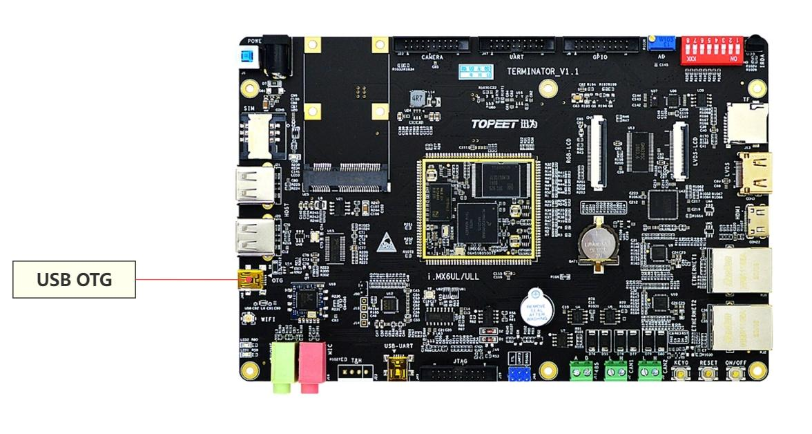
图249.11对应的OTG 接口电路原理图如图249.12 所示：

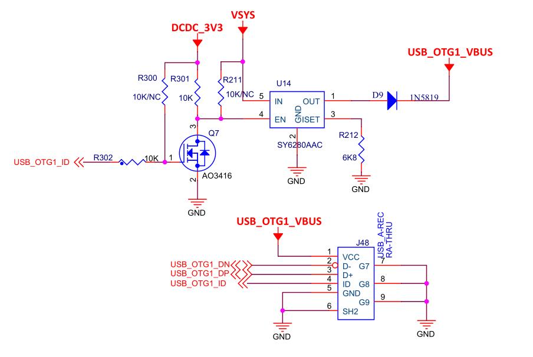
图249.12其中J48 为USB 底座，D+、D-这一对差分信号线用来传送数据、ID 线用于实现OTG 功能，可以通过ID 线来判断当前连接的是主设备(HOST)还是从设备(SLAVE)。当开发板的USB 设备连接从设备（如U 盘）时，开发板作为主设备，其ID 引脚会被拉低。此时，USB_OTG1_ID 引脚为低电平（即开发板处于主设备模式），Q7 截止，U14 的EN 引脚为高电平，USB_OTG1_VBUS 会输出5V 电压，为从设备供电。而当开发板的USB 设备连接主设备（如电脑）时，开发板作为从设备，其ID 引脚保持高电平。此时，USB_OTG1_ID 引脚为高电平（即开发板处于从设备模式），Q7 导通，U14 的EN引脚为低电平，U14 停止工作，USB_OTG1_VBUS 不会输出5V 电压。然后来对迅为iTOP-RK3399 的OTG 切换进行讲解，iTOP-RK3399 底板上的TYPEC 接口如图249.13 所示：

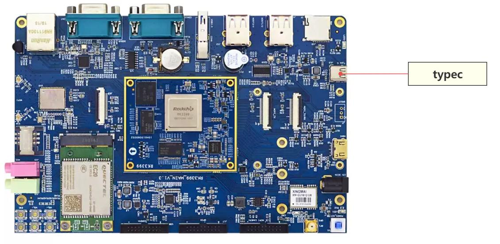
图249.13typec 接口对应的原理图部分如图249.14 和图249.15 所示：
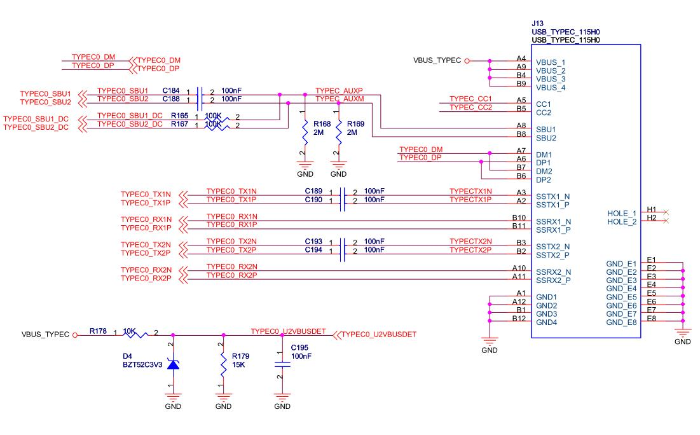
图249.14

