# 第250章 USB协议介绍

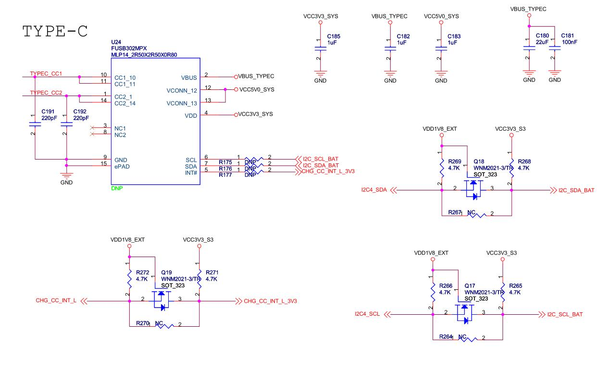
图249.15其中Type-C 的CC1 和CC2 引脚作为ID 引脚来使用，其工作原理和前文所述相似。U24 芯片在检测到CC1 和CC2 的状态后，会向主控发出中断信号，并通过I2C 引脚读取芯片寄存器的值。随后，主控根据这些信息来控制供电引脚。
在本章节将会对USB 协议相关知识进行讲解，包括USB 描述符、USB 通信数据格式（含域、包、事务、传输）、USB 枚举，以及对USB 波形实例分析。
## 250.1 USB 描述符
USB 描述符是描述USB 设备信息的结构体。主机通过读取这些描述符来识别设备类型、功能、配置等信息，从而正确加载驱动程序并进行通信。USB 描述符主要有设备描述符（DeviceDescriptor）、配置描述符（Configuration Descriptor）、接口描述符（Interface Descriptor）、端点描述符（Endpoint Descriptor）。接下来依次对这几种描述符进行学习。

（1）设备描述符包含了设备的基本信息，比如设备的厂商ID，产品ID 等。设备描述符是设备连接到主机时第一个被请求和返回的信息，提供了设备的基本特征。在Linux 内核中，USB设备用usb_device 结构体来描述，USB 设备描述符定义为usb_device_descriptor 结构体，位于include/uapi/linux/usb/ch9.h 文件中，该结构体内容如代码清单250.1 所示：代码清单250.1
```c
struct usb_device_descriptor {
    __u8bLength; //描述符长度
    __u8bDescriptorType;//描述符类型
    __u16 bcdUSB;//USB 版本号
    __u8bDeviceClass;//设备类
    __u8bDeviceSubClass;//设备子类
    __u8bDeviceProtocol;//设备协议
    __u8bMaxPacketSize0;//端点0 的最大包长度
    __u16 idVendor;//厂商ID
    __u16 idProduct;//产品ID
    __u16 bcdDevice;//设备版本号
    __u8iManufacturer;//厂商信息字符串描述符索引值
    __u8iProduct;//产品信息字符串描述符索引值
    __u8iSerialNumber;
    __u8bNumConfigurations;
} __attribute__ ((packed));
```
（2）配置描述符描述了设备支持的不同配置，包括接口数量、配置编号、供电信息等等。每个USB 设备都必须有一个配置描述符。另外一个USB 设备还可以有多个配置，但是每次传输过程仅使用其中的一个配置信息来完成。USB 配置在内核中使用usb_host_config 结构体描述，而USB 配置描述符定义为结构体usb_config_descriptor，该结构体内容如代码清单250.2所示：代码清单250.2
```c
struct usb_config_descriptor{
        __u8bLength;
        __u8bDescriptorType;
        __le16 wTotalLength;
        __u8bNumInterfaces;
        __u8bConfigurationValue;
        __u8iConfiguration;
        __u8bmAttributes;
        __u8bMaxPower;
} __attribute__ ((packed));
```

（3）接口描述符描述了配置中一个接口的特性，包括接口的端点个数，所属的设备类和子类等。一个USB 配置有1 个或多个接口描述符。USB 接口在内核中使用usb_interface 结构体描述，而USB 接口描述符定义为结构体usb_interface_descriptor，该结构体内容如代码清单250.3所示：代码清单250.3
```c
struct usb_interface_descriptor{
        __u8bLength;/* 描述符长度*/
    __u8bDescriptorType;/* 描述符类型*/
        __u8bInterfaceNumber;
        __u8bAlternateSetting;
        __u8bNumEndpoints;
        __u8bInterfaceClass;/* 接口类型*/
        __u8bInterfaceSubClass;
        __u8bInterfaceProtocol;
        __u8iInterface;
} __attribute__ ((packed));
```
（3）端点描述符描述了接口中的一个端点，端点是数据在设备和主机之间传输的终点。一个具体的端点只能属于四种传输模式中的一种。一个USB 接口有0 个或多个端点描述符（不包括端点0）。在Linux 内核中，USB 端点使用usb_host_endpoint 结构体来描述，而USB 端点描述符定义为usb_endpoint_descriptor 结构体，该结构体内容如代码清单250.4 所示：代码清单250.4
```c
struct usb_endpoint_descriptor {
    __u8bLength;//描述符长度
    __u8bDescriptorType; //描述符类型
    __u8bEndpointAddress;
    __u8bmAttributes;
    __le16 wMaxPacketSize;
    __u8bInterval;
    __u8bRefresh;
    __u8bSynchAddress;
} __attribute__ ((packed));
```
一个USB 设备包含一个设备描述符，该描述符决定了设备支持的配置数量，每种配置对应一个配置描述符；配置描述符中定义了该配置包含的接口数量，每个接口对应一个接口描述符；接口描述符则进一步定义了所属接口的端点数，每个端点对应一个端点描述符，而端点描述符会明确端点的大小、类型等属性。由此可见，USB 描述符呈现层级嵌套关系：最顶层为设备描述符，其下依次为配置描述符、

接口描述符和端点描述符，具体关系如图250.1 所示：
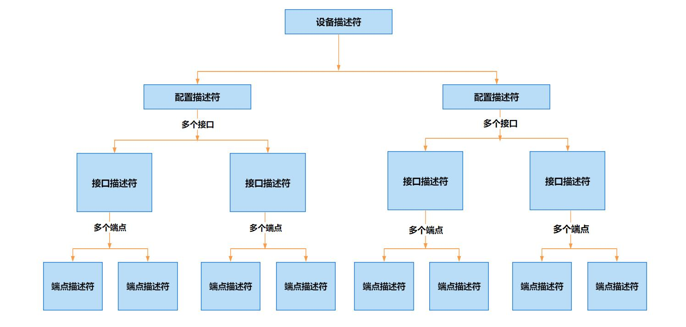
图250.1例如，作者打开虚拟机ubuntu，通过lsusb 命令得到USB 相关的描述符，如图250.2 所示。由图可以得到root hub 包含了一个设备描述符、一个配置描述符、一个接口描述符、一个端点描述符。图中的信息内容直接对应usb_device_descriptor、usb_config_descriptor、usb_interface_descriptor、usb_endpoint_descriptor 这四个结构体。

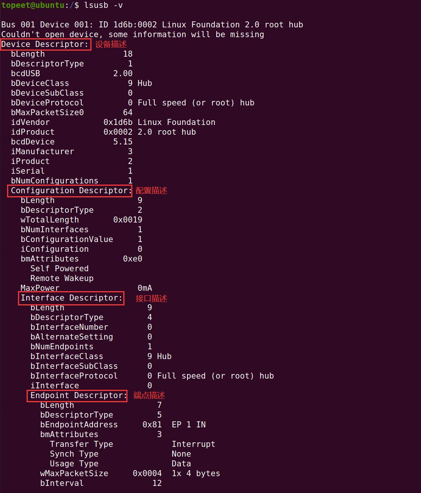
图250.2
## 250.2 USB 通信数据格式
本小节我们来探讨USB 通信中数据的具体组织形式。USB 通信数据格式以包(Packet)为基本单位，通过分层结构(域->包->事务->传输)实现设备与主机间的可靠通信。接下来我们对各层结构做详细介绍。
### 250.2.1 域
域是USB 数据的最小单位，由不同功能的二进制位组成，共7 种类型，不同域的具体介绍如表250.1 所示：表250.1

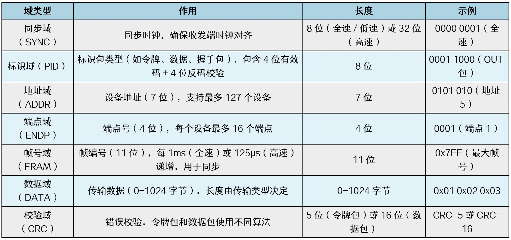
### 250.2.2 包
USB 的通信方式就像一条按序传送的快递传送带——数据必须以串行方式逐比特排队传输。为了确保数据准确送达，USB 会先将数据打包成一个个小包裹（数据包），再用四种不同形状的“快递盒”（包结构）来区分用途：比如像“取件单”一样的令牌(Token)包、装实际内容的数据(Data)包、表示“已收到”的握手(Handshake)包，以及处理特殊情况的特殊(Special)包。这些不同类型的“盒子”各司其职，让每个数据包都能精准抵达目标位置。这四种包结构通过标识符PID 来区分，在USB 包中，PID 域使用8 位来表示，具体格式如图250.3 所示：
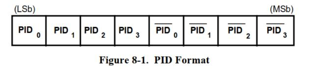
图250.3
前4 位表示PID，后4 位是对前4 位的取反。前4 位PID 中使用bit1、bit0 确定分类，使用bit3，bit2 进一步细分，具体描述如表250.2 所示：表250.2

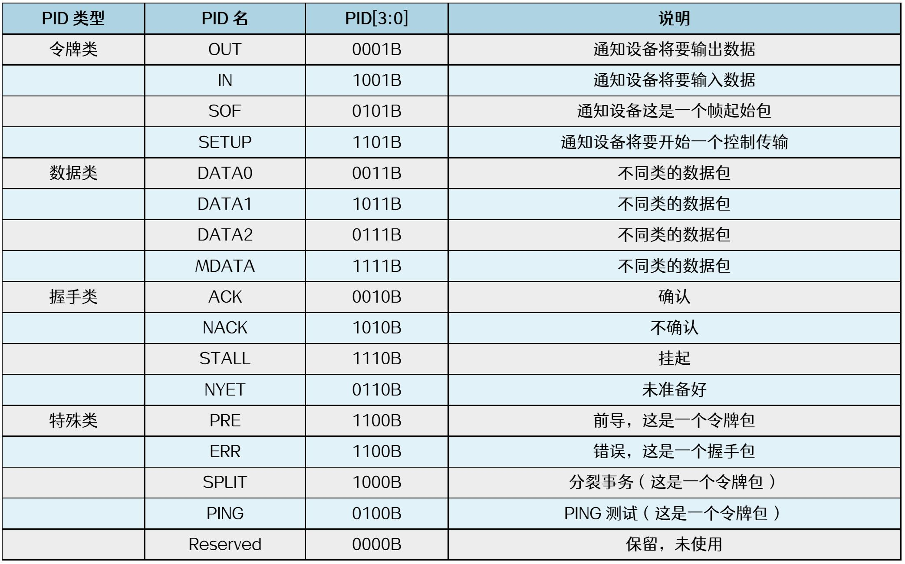
一个完整的数据包由多个不同的域构成，其基础结构具有统一性：所有数据包均以同步域（SYNC）作为起始，紧接着是包标识符（PID），最后以包结束（EOP）信号收尾。不同类型的数据包，中间的位域各有不同，常见的有包目标地址（ADDR）、包目标端点（ENDP）、数据、帧索引以及CRC 等。具体每个数据包的结构，需要根据实际情况来分析。
### 250.2.3 事务
USB 传输的基本单位是包(Packet)，包的类型由PID 表示。但单个包无法完成完整的数据传输，例如要实现数据输出时，需要先发送OUT 令牌包以指定传输目的地。之后还需发送DATA0或DATA1 数据包来传递实际数据，而设备收到数据后，还需回复ACK 握手包以确定接收。因此，完整的数据传输需要结合令牌包、数据包、握手包等多个包共同完成，这一完整传输过程被称为事务(Transaction)。事务存在不同类型，有些事务需要握手包，有些事务不需要握手包；有些事务能够传输大量数据，而有些事务只能传输少量数据。根据特性可以将事物可以分为四类，各自的功能和特点如表250.3 所示：表250.3

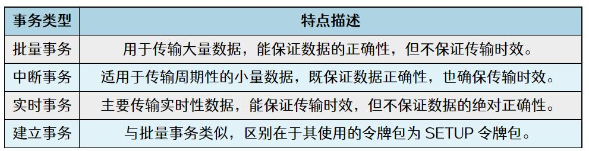
### 250.2.4 传输
上面几个小节中，我们讲解了域、包、事务的知识。多个事务又组成了传输，因此本小节学习传输的知识点，不同类型的事务组成了不同类型的传输，传输的类型有控制传输、同步传输、中断传输、批量传输，不同传输类型的具体介绍如表250.4 所示：表250.4
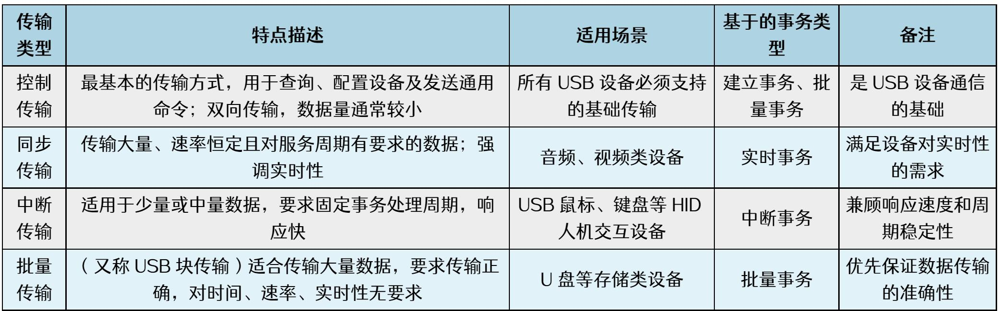
域、包、事务和传输的关系为：Bit 组成域(Field)，域组成包(Packet)，包组成事务(Transaction)，事务组成传输(Transfer)。
## 250.3 USB 枚举
当USB 设备连接到USB 主机后，主机需通过总线枚举过程对其进行识别和管理。USB 枚举的本质是主机Host 与设备Device 之间的信息交互过程：Device 向Host 报告自身参数，Host依据这些参数获取关键信息，从而明确设备的具体类型以及与之通信的方式。最终加载适配该设备的驱动程序。USB 设备的枚举步骤如表250.5 所述：表250.5

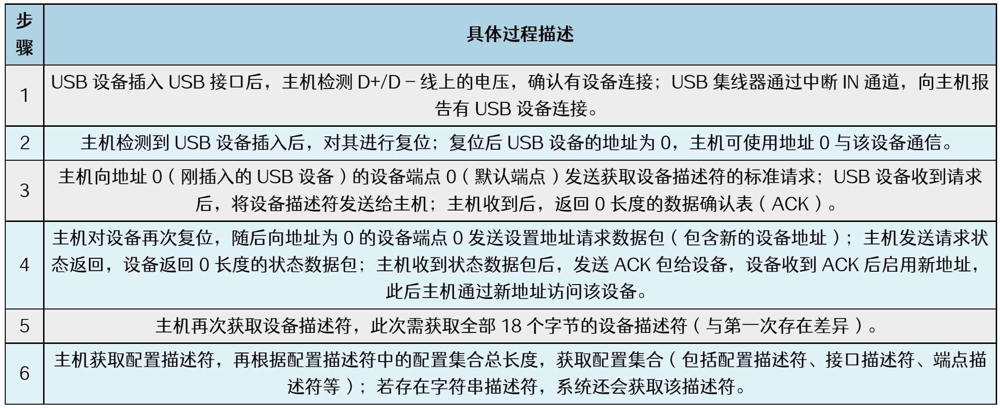
## 250.4 USB 波形实例分析
LeCroy（力科）于1964 年创立，是一家专注于示波器生产的专业厂商。其产品线丰富，包括数字示波器、SDA 系列数字示波器、混合信号示波器，以及模块化仪器和任意波形发生器。在对USB 波形的分析研究中可借助力科USB 分析仪实现，而该分析仪的核心优势在于其配套的强大分析软件usbprotocolsuite，该软件可以在网盘资料iTOP-RK3568 开发板\07_学习教程配套资料\03_Linux 驱动配套资料\06_软件包目录下获取。USB 分析仪外观如图250.4 所示：
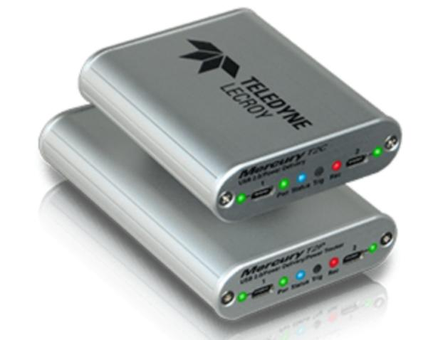
图250.4除了使用USB 分析仪之外，还可以使用逻辑分析仪对USB 波形进行采样。接下来对逻辑分析仪采集的几个USB 波形进行分析。波形1 如图250.5 所示：

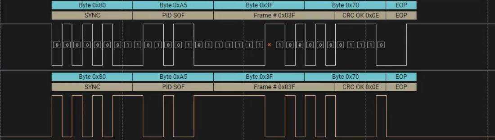
图250.5这是一个帧起始包，SYNC 域以0x80（10000000）开头，用于表示时钟同步。PID 域值为0xA5，图中标记为SOF，表示这是一个帧起始包。波形2 如图250.6 所示：
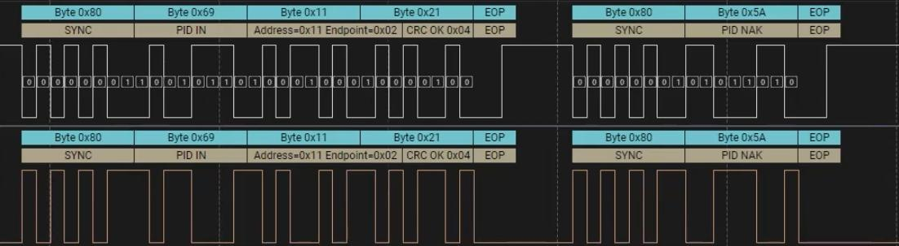
图250.6在上图中，左侧是一个令牌包。SYNC 域以0x80（10000000）开头，用于表示时钟同步。PID 域值为0x69，图中标记为IN，表示通知设备将要输入数据。接下来主机请求端点2 的数据。在上图中，右侧是一个握手包，SYNC 域以0x80（10000000）开头，用于表示时钟同步。PID域值为0x5A，图中标记为NAK，表示设备暂时无法响应。波形3 如图250.7 所示：
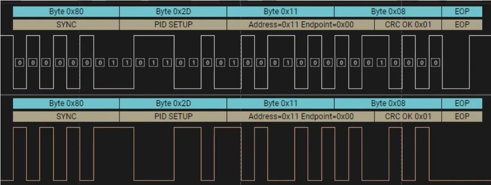

