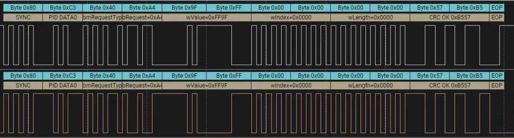
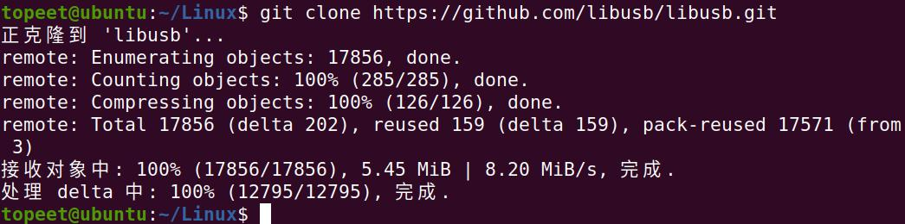
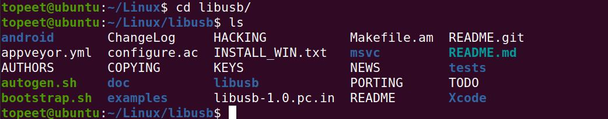
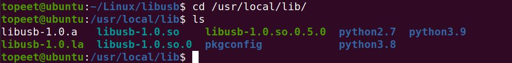
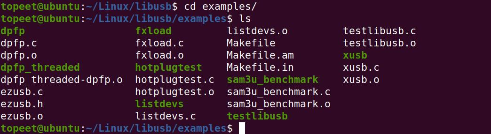
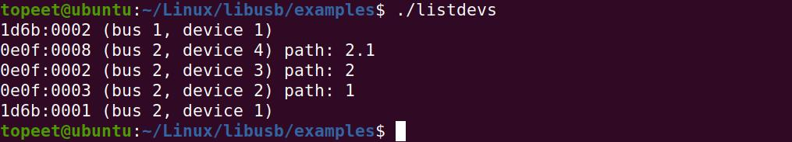
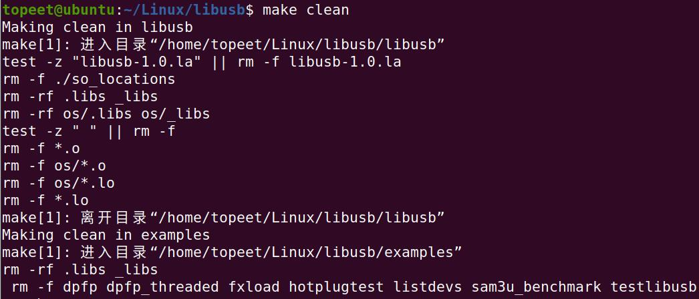
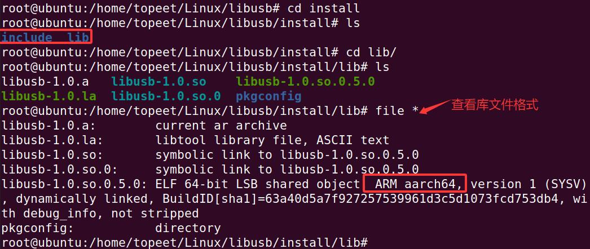
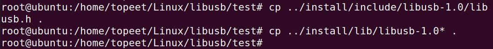
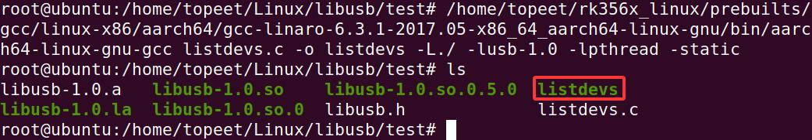

# 第251章 应用编程基础

图250.7在上图中，此波形为枚举阶段的控制传输请求。SYNC 域以0x80（10000000）开头，用于表示时钟同步。PID 域为SETUP，表示通知设备将要开始一个控制传输。接下来是地址域Address=0x11 和端点域Endpoint=0x00，表示主机向端点0 发送控制请求。最后是校验域（CRC），包以EOP 结束。波形图4 如图250.8 所示：

图250.8在上图中，SYNC 域以0x80（10000000）开头，用于表示时钟同步。PID 域为DATA0，表示用于控制传输的数据阶段。
与I2C、SPI 等总线操作外设的方式不同，通过USB 总线实现对USB 外设的操作，依赖的是名为libusb 的工具库。接下来学习如何借助这一工具库完成对USB 外设的操作。
## 251.1 libusb 库简介
libusb 是一个使用C 语言编写的库，它提供了访问USB 设备的通用方法。通过该库应用程序可以便捷地与USB 设备进行交互，无需另外编写USB 设备驱动程序。其主要特点如下：（1）可移植性好，支持Linux，macOS，Windows 系统。（2）简单易用，APP 不需要特权模式，也不需要提升自己权限即可访问USB 设备（3）支持所有的USB 协议，从USB1.0 到USB3.1，并且API 接口保持不变，方便开发。

## 251.2 libusb 编译测试
可以从官网或者git 下载libusb 库，官网地址是https://libusb.info，git 下载地址是https://github.com/libusb/libusb.git。接着打开虚拟机Ubuntu 终端，输入图251.1 中命令通过github 下载libusb 库，下载过程如图251.1 所示：

图251.1下载完成之后，进入到libusb 文件夹中，文件夹内容如图251.2 所示：

图251.2然后输入sudo apt install autoconf automake libtool libudev-dev m4 命令安装依赖包，接着输入以下命令进行编译并安装。./bootstrap.sh./autogen.shmakemake install编译之后的产物在/usr/local/lib 目录下，目录内容如图251.3 所示：

图251.3在libusb 源码的examples 目录下，libusb 提供了一些官方案例，如图251.4 所示：

图251.4其中需要重点关注的hotplugtest.c 用于监听系统中USB 设备的插入和拔出。listdevs.c 用于获取并显示系统当前的USB 设备信息，包含：VID、PID、bus 编号、设备地址、端口号。testlibusb.c用于打印usb 设备列表的详细信息：包括设备描述符、配置、接口、端点描述符。如运行listdevs 程序如图251.5 所示：

图251.5如运行testlibusb 程序如图251.6 所示：

图251.6在虚拟机Ubuntu 上运行成功之后，如果将这些usb 应用在开发板上运行，需要交叉编译libusb 库，具体方法如下：首先使用make clean 命令清除之前的编译结果，运行结果如图251.7 所示：

图251.7然后执行autogen.sh 脚本，执行完之后，会生成configure 脚本文件，然后运行configure脚本用于配置编译环境。对于交叉编译，需要指定--host 参数来设置目标平台的架构，指定CC（C 编译器）及CXX（C++编译器）。例如，如果目标平台是aarch64（ARM64）架构，需要使用以下命令进行配置：mkdir install//新建安装目录./configure --host=aarch64-linux-gnu --disable-udev --prefix=$PWD/install \CC=/home/topeet/rk356x_linux/prebuilts/gcc/linux-x86/aarch64/gcc-linaro-6.3.1-2017.05-x86_64_aarch64-linux-gnu/bin/aarch64-linux-gnu-gcc \CXX=/home/topeet/rk356x_linux/prebuilts/gcc/linux-x86/aarch64/gcc-linaro-6.3.1-2017.05-x86_64_aarch64-linux-gnu/bin/aarch64-linux-gnu-g++注意命令中交叉编译器的路径需要根据自己的开发环境中交叉编译器所在路径实际编写。配置完成之后，使用make 命令编译libusb，编译成功之后，使用make install 命令将libusb安装到指定的目录，在install 目录下会生成libusb 的头文件和库文件如图251.8 所示：

图251.8接下来交叉编译example 中的例子，首先使用make clean 命令清除之前的编译结果，然后使用mkdir test 命令新建一个文件夹，将example 文件夹中的listdevs.c 文件拷贝到test 目录下，拷贝过程如图251.9 所示：

图251.9然后将库和头文件拷贝到test 目录下，拷贝过程如图251.10 所示:

图251.10最后使用以下命令编译listdevs.c 文件，编译成功之后，如图251.11 所示：/home/topeet/rk356x_linux/prebuilts/gcc/linux-x86/aarch64/gcc-linaro-6.3.1-2017.05-x86_64_aarch64-linux-gnu/bin/aarch64-linux-gnu-gcc listdevs.c -o listdevs -L./ -lusb-1.0 -lpthread -static

图251.11注意命令中交叉编译器的路径需要根据自己的开发环境中交叉编译器所在路径实际编写。然后将编译好的程序拷贝到开发板上运行，运行结果如图251.12 所示：

