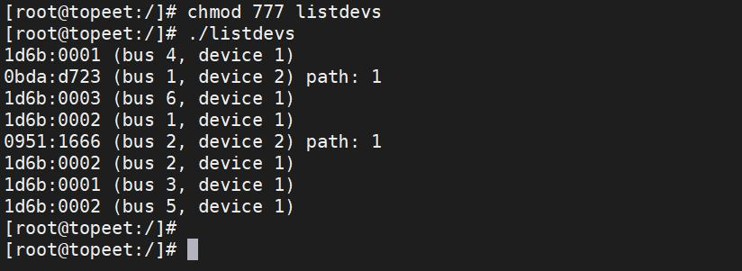

# 第252章 libusb库应用程序编写


图251.12
本章将会对libusb 库中的一系列API 函数进行讲解，然后编写USB 实验程序对学习到的内容进行巩固。
## 252.1 libusb 库API 讲解
### 252.1.1 libusb_init 函数
（1）函数原型:
```c
int libusb_init(libusb_context **ctx);
```
（2）函数作用:libusb_init()函数用于初始化libusb 库。（3）函数参数:libusb_context **ctx：上下文指针，可为NULL 使用默认上下文。（4）返回值:成功时返回0。失败时返回负数，表示具体的错误码。
### 252.1.2 libusb_get_device_list 函数
（1）函数原型:
```c
ssize_t libusb_get_device_list(libusb_context *ctx, libusb_device ***list)
```
（2）函数作用:

libusb_get_device_list()函数用于获取当前连接的USB 设备列表（3）函数参数:libusb_context *ctx：上下文。libusb_device ***list：输出设备指针数组。（4）返回值:成功时返回设备数量，负值表示错误。
### 252.1.3 libusb_open_device_with_vid_pid 函数
（1）函数原型:
```c
libusb_device_handle *libusb_open_device_with_vid_pid(libusb_context *ctx, uint16_t vid, uint16_t pid)
```
（2）函数作用:libusb_open_device_with_vid_pid()函数用来根据idVendor 和idProduct 的值打开对应USB设备。（3）函数参数:libusb_context *ctx：上下文。libusb_device ***list：输出设备指针数组。uint16_t vid：要搜索的idVendor 值uint16_t pid：要搜索的idProduct 值（4）返回值:成功返回设备句柄（libusb_device_handle *），失败返回NULL。
### 252.1.4 libusb_open 函数
（1）函数原型:
```c
int LIBUSB_CALL libusb_open(libusb_device *dev, libusb_device_handle **dev_handle);
```
（2）函数作用:libusb_open()函数通过libusb_device 指针打开一个USB 设备，并返回一个libusb_device_handle 句柄。（3）函数参数:libusb_device *dev：要打开的USB 设备指针。libusb_device_handle **dev_handle：指向设备句柄的指针。（4）返回值:

成功时返回0，失败时返回负数，表示具体的错误码。
### 252.1.5 libusb_bulk_transfer 函数
（1）函数原型:
```c
int libusb_bulk_transfer(
    libusb_device_handle *dev_handle,
    unsigned char endpoint,
    unsigned char *data,
    int length,
    int *actual_length,
    unsigned int timeout
);
```
（2）函数作用:libusb_bulk_transfer()函数用于USB 批量传输。（3）函数参数:libusb_device_handle **dev_handle：指向设备句柄的指针。unsigned char endpoint：端点地址，最高位为1 表示输入。unsigned char *data：发送或接收缓冲区指针。int length：缓冲区长度。int *actual_length：实际传输长度。unsigned int timeout：超时的毫秒数，0 表示永不超时
（4）返回值:成功时返回0，失败时返回负数，表示具体的错误码。
### 252.1.6 libusb_interrupt_transfer 函数
（1）函数原型:
```c
int libusb_interrupt_transfer(
    libusb_device_handle *dev_handle,
    unsigned char endpoint,
    unsigned char *data,
    int length,
    int *actual_length,
    unsigned int timeout
);
```

（2）函数作用:libusb_interrupt_transfer()函数用于USB 中断传输。（3）函数参数:libusb_device_handle **dev_handle：指向设备句柄的指针。unsigned char endpoint：端点地址，最高位为1 表示输入。unsigned char *data：发送或接收缓冲区指针。int length：缓冲区长度。int *actual_length：实际传输长度。unsigned int timeout：超时的毫秒数，0 表示永不超时。（4）返回值:成功时返回0，失败时返回负数，表示具体的错误码。
### 252.1.7 libusb_get_config_descriptor 函数
（1）函数原型:
```c
int libusb_get_config_descriptor(
    libusb_device *dev,
    uint8_t config_index,
    struct libusb_config_descriptor **config
);
```
（2）函数作用:libusb_get_config_descriptor()函数用于根据索引值获取配置描述符。（3）函数参数:libusb_device *dev：要读取的设备。uint8_t config_index：配置描述符的索引(一个USB 设备可能有多个配置)。struct libusb_config_descriptor **config：获取到的配置描述符（4）返回值:成功时返回0，失败时返回负数，表示具体的错误码。
### 252.1.8 libusb_get_device_descriptor 函数
（1）函数原型:
```c
int libusb_get_device_descriptor(
    libusb_device *dev,
```

```c
struct libusb_device_descriptor *desc
);
```
（2）函数作用:libusb_get_device_descriptor()函数用于获取USB 设备描述符。（3）函数参数:libusb_device *dev：要获取设备描述符的设备。struct libusb_device_descriptor *desc：获取到的设备描述符。（4）返回值:成功时返回0，失败时返回负数，表示具体的错误码。
### 252.1.9 libusb_free_device_list 函数
（1）函数原型:
```c
void libusb_free_device_list(
    libusb_device **list,
    int unref_devices
);
```
（2）函数作用:libusb_free_device_list()函数用于释放设备列表。（3）函数参数:libusb_device **list：要释放的列表。int unref_devices：如果设置成1，则设备的引用计数-1。（4）返回值:成功时返回0，失败时返回负数，表示具体的错误码。
### 252.1.10 libusb_free_config_descriptor 函数
（1）函数原型:
```c
void libusb_free_config_descriptor(
        struct libusb_config_descriptor *config
);
```
（2）函数作用:libusb_free_config_descriptor()函数用于释放配置描述符。（3）函数参数:struct libusb_config_descriptor *config：要释放的配置描述符。

（4）返回值:成功时返回0，失败时返回负数，表示具体的错误码。
### 252.1.11 libusb_set_auto_detach_kernel_driver 函数
（1）函数原型:
```c
int libusb_set_auto_detach_kernel_driver(
        libusb_device_handle *dev_handle,
        int enable
);
```
（2）函数作用:libusb_set_auto_detach_kernel_driver()函数用于设置自动卸载内核驱动。（3）函数参数:libusb_device_handle *dev_handle：已打开的USB 设备句柄。int enable：启用(1)或禁用(0)自动分离功能。（4）返回值:成功时返回0，失败时返回负数，表示具体的错误码。
### 252.1.12 libusb_claim_interface 函数
（1）函数原型:
```c
int libusb_claim_interface(
    libusb_device_handle *dev_handle,
    int interface_number
);
```
（2）函数作用:libusb_claim_interface()函数用于给设备申请接口。（3）函数参数:libusb_device_handle *dev_handle：已打开的USB 设备句柄。int interface_number：要声明的接口编号（从0 开始），对应接口描述符的bInterfaceNumber 成员。（4）返回值:成功时返回0，失败时返回负数，表示具体的错误码。

### 252.1.13 libusb_alloc_transfer 函数
（1）函数原型:
```c
struct libusb_transfer *libusb_alloc_transfer( int iso_packets);
```
（2）函数作用:libusb_alloc_transfer()函数用于分配一个用于异步传输的结构体，即libusb_transfer 结构体。（3）函数参数:int iso_packets：等时传输包数量（非等时传输设为0）。（4）返回值:成功时返回struct libusb_transfer *结构体指针，失败时返回负数，表示具体的错误码。
### 252.1.14 libusb_fill_interrupt_transfer 函数
（1）函数原型:
```c
void libusb_fill_interrupt_transfer(
    struct libusb_transfer *transfer,
    libusb_device_handle *dev_handle,
    unsigned char endpoint,
    unsigned char *buffer,
    int length,
    libusb_transfer_cb_fn callback,
    void *user_data,
    unsigned int timeout
);
```
（2）函数作用:libusb_fill_interrupt_transfer()函数用于配置一个异步中断传输对象。（3）函数参数:struct libusb_transfer *transfer：已分配的传输对象（需先通过libusb_alloc_transfer 分配）。libusb_device_handle *dev_handle: 已打开的USB 设备句柄。unsigned char endpoint：端点地址。unsigned char *buffer：数据缓冲区指针。int length：缓冲区长度（字节数）libusb_transfer_cb_fn callback：传输完成时的回调函数。void *user_data：用户自定义数据（会传递给回调函数）。unsigned int timeout：超时时间（毫秒，0 表示不超时），单位ms。

（4）返回值:无返回值。
### 252.1.15 libusb_submit_transfer 函数
（1）函数原型:
```c
int libusb_submit_transfer(struct libusb_transfer *transfer);
```
（2）函数作用:libusb_submit_transfer()函数用于提交一个异步传输请求，传输完成或者出错时候调用回调函数进行处理。（3）函数参数:struct libusb_transfer *transfer：已通过libusb_fill_*_transfer 配置的传输对象。（4）返回值:成功返回0，失败返回负数。
### 252.1.16 libusb_cancel_transfer 函数
（1）函数原型:
```c
int libusb_cancel_transfer(struct libusb_transfer *transfer);
```
（2）函数作用:libusb_cancel_transfer()函数用于取消已提交但未完成的异步USB 传输。（3）函数参数:struct libusb_transfer *transfer：要取消的传输对象指针。（4）返回值:成功返回0，失败返回负数。
### 252.1.17 libusb_free_transfer 函数
（1）函数原型:
```c
void libusb_free_transfer(struct libusb_transfer *transfer);
```
（2）函数作用:libusb_free_transfer()函数用于释放传输结构。（3）函数参数:struct libusb_transfer *transfer：要取消的传输对象指针。

（4）返回值:成功返回0，失败返回负数。
### 252.1.18 libusb_handle_events 函数
（1）函数原型:
```c
int libusb_handle_events(libusb_context *ctx);
```
（2）函数作用:libusb_handle_events()函数用于在阻塞模式下处理任何待处理事件。（3）函数参数:libusb_context *ctx：libusb_context *ctx。（4）返回值:成功返回0，失败返回负数。
## 252.2 实验一
### 252.2.1 应用程序编写
本小节实验旨在实现一个基于libusb 库的USB 设备枚举程序，其核心功能为扫描并列出当前系统中所有已连接的USB 设备的基本信息。程序的执行流程如下：首先初始化libusb 库，接着获取USB 设备列表，遍历每个设备并读取其设备描述符，最终以"厂商ID:产品ID"的格式（如1234:5678）输出每个设备的标识信息。编写完成的测试例程存放路径为iTOP-RK3568开发板\07_学习教程配套资料\03_Linux 驱动配套资料\04_Linux 驱动程序\138_libusb_app，具体内容如代码清单252.1 所示：代码清单252.1
```c
#include <stdio.h>
#include "libusb.h"
int main(void)
{
       int ret;
       int cnt;
       libusb_device **device = NULL;
       libusb_device *dev;
       int i = 0;
```

```c
// 初始化libusb 库
ret = libusb_init(NULL);
if (ret < 0) {
    printf("libusb_init error \n");
    return ret;
}
// 获取USB 设备列表
cnt = libusb_get_device_list(NULL, &device);
if (cnt < 0) {
    printf("libusb_get_device_list error \n");
    return cnt;
}
// 遍历设备列表
while (dev = device[i++]) {
    struct libusb_device_descriptor desc; // 设备描述符
    // 获取设备描述符
    ret = libusb_get_device_descriptor(dev, &desc);
    if (ret < 0) {
         printf("libusb_get_device_descriptor error \n");
         return ret;
    }
    // 打印厂商ID 和产品ID
    printf("%04x : %04x\n", desc.idVendor, desc.idProduct);
 }
// 释放设备列表
libusb_free_device_list(device, 1);
libusb_exit(NULL);
 return 0;
}
```
### 252.2.2 编译应用程序
输入aarch64-linux-gnu-gcc usb.c -o usb -L./ -lusb-1.0 -lpthread -static 命令进行编译，编译完成以后会生成一个usb 的可执行程序，如图252.1 所示：

图252.1
### 252.2.3 运行测试
开发板启动之后，运行编译得到的测试应用程序，运行结果如图252.2 所示：


图252.2根据打印信息可以看到扫描并列出当前系统中所有已连接的USB 设备的基本信息。
## 252.3 实验二
### 252.3.1 应用程序编写
本小节实验旨在实现了一个USB HID 键盘设备的监控程序，核心功能是检测并读取USB键盘的输入数据。程序执行流程如下：程序首先初始化libusb 库并枚举所有USB 设备，然后通过检查接口类(Class=3)和协议(Protocol=1)来识别HID 键盘设备；找到目标设备后，程序会打开设备并声明接口，进入一个无限循环，通过中断传输方式持续读取键盘数据。每次读取到数据时，程序会将接收到的16 字节键盘数据以十六进制格式打印输出。编写完成的测试例程存放路径为iTOP-RK3568 开发板\07_学习教程配套资料\03_Linux 驱动配套资料\04_Linux 驱动程序\139_libusb_app，具体内容如代码清单252.2 所示：代码清单252.2
```c
#include <stdio.h>
#include "libusb.h"
int main(void)
{
    // 变量声明区
    int ret;
    int cnt;
    libusb_device **device = NULL;
    libusb_device *dev;
    int i = 0, k = 0, j = 0;
    int endpoint;
    int flag = 0;
```

```c
struct libusb_config_descriptor *config_desc = NULL; // USB 配置描述符
const struct libusb_interface_descriptor *interface_descriptor = NULL; // 接口描述符
libusb_device_handle *dev_handle = NULL;// USB 设备句柄
unsigned char buffer[16];
int transferred;
// 初始化libusb 库
ret = libusb_init(NULL);
if (ret < 0) {
    printf("libusb 初始化失败\n");
    return ret;
}
// 获取USB 设备列表
cnt = libusb_get_device_list(NULL, &device);
if (cnt < 0) {
    printf("获取设备列表失败\n");
    return cnt;
}
// 遍历设备列表查找HID 设备
while (dev = device[i++]) {
    // 获取设备配置描述符
    ret = libusb_get_config_descriptor(dev, 0, &config_desc);
    if (ret < 0) {
           printf("获取配置描述符失败\n");
        return ret;
    }
    // 遍历所有接口
    for (k = 0; k < config_desc->bNumInterfaces; k++) {
        interface_descriptor = &config_desc->interface[k].altsetting[0];
        // 查找HID 类设备(Class=3)且协议为键盘(Protocol=1)
        if (interface_descriptor->bInterfaceClass == 3 &&
            interface_descriptor->bInterfaceProtocol == 1) {
            // 遍历端点查找中断输入端点
            for (j = 0; j < interface_descriptor->bNumEndpoints; j++) {
                if ((interface_descriptor->endpoint[j].bmAttributes & 3) ==
LIBUSB_TRANSFER_TYPE_INTERRUPT ||
                    (interface_descriptor->endpoint[j].bmAttributes & 0x80) ==
LIBUSB_ENDPOINT_IN) {
                       endpoint = interface_descriptor->endpoint[j].bEndpointAddress;
                        flag = 1;// 找到目标设备
                        break;
                    }
                }
            }
            if (flag) break;
```

```c
}
if (flag) break;
}
ret = libusb_open(dev, &dev_handle);
if (ret < 0) {
printf("打开设备失败\n");
return ret;
}
libusb_set_auto_detach_kernel_driver(dev_handle, 1);
libusb_claim_interface(dev_handle, interface_descriptor->bInterfaceNumber);
while (1) {
// 中断传输读取键盘数据
ret = libusb_interrupt_transfer(dev_handle, endpoint, buffer, 16, &transferred, 5000);
if (ret >= 0) {// 读取成功
    // 打印接收到的键盘数据
    for (i = 0; i < transferred; i++) {
   printf("%02x ", buffer[i]);
}
printf("\n");
}
}
// 资源释放
libusb_free_config_descriptor(config_desc);
libusb_free_device_list(device, 1);
libusb_exit(NULL);
return 0;
}
```
### 252.3.2 编译应用程序
输入aarch64-linux-gnu-gcc usb.c -o usb -L./ -lusb-1.0 -lpthread -static 命令进行编译，编译完成以后会生成一个名为usb 的可执行程序，编译完成如图252.3 所示：

图252.3
### 252.3.3 运行测试
开发板启动之后，将USB 键盘插入iTOP-RK3568 开发板的usb 接口（注意不要使用和wifi），然后运行上节课编译得到的测试应用程序，然后点击数字键盘1-6，运行结果如图252.4 所示：


图252.4根据打印信息可以看到检测并读取到了USB 键盘，每次按键时会在终端打印16 进制的键盘数据。
## 252.4 实验三
### 252.4.1 应用程序编写
本小节实验借助libusb 库实现了对HID 键盘设备的异步数据监听。程序执行流程如下：首先初始化libusb 库并获取USB 设备列表，遍历查找HID 键盘设备及其中断输入端点；找到目标设备后，打开设备并设置自动卸载内核驱动，同时声明使用该接口；随后配置异步传输，在回调函数中处理接收到的数据，并重新提交传输请求以实现持续监听；最后通过while 事件循环处理USB 事件，达成对键盘数据的实时获取。编写完成的测试例程存放于路径iTOP-RK3568 开发板\07_学习教程配套资料\03_Linux 驱动配套资料\04_Linux 驱动程序\140_libusb_app 下，具体内容如代码清单252.3 所示：代码清单252.3
```c
#include <stdio.h>
#include "libusb.h"
struct libusb_transfer *keyboard_transfer = NULL;// 异步传输控制块
unsigned char buffer[16];// 键盘数据接收缓冲区
int ret;// 函数返回值存储
// 异步传输回调函数
void callback_recv(struct libusb_transfer *transfer) {
  int k;
  if (keyboard_transfer->status == LIBUSB_TRANSFER_COMPLETED) {
            if (transfer->actual_length > 0) {
                // 打印接收到的键盘数据(16 进制)
                for (k = 0; k < transfer->actual_length; k++) {
                    printf("%02x ", buffer[k]);
```

```c
}
printf("\n");
}
}
// 重新提交传输请求(实现持续监听)
ret = libusb_submit_transfer(keyboard_transfer);
if (ret < 0) {
libusb_cancel_transfer(keyboard_transfer);
libusb_free_transfer(keyboard_transfer);
}
}
int main(void) {
int cnt;
libusb_device **device = NULL;
libusb_device *dev = NULL;
int i = 0, k = 0, j = 0;
int endpoint;
int flag = 0;
struct libusb_config_descriptor *config_desc = NULL;
const struct libusb_interface_descriptor *interface_descriptor = NULL;
libusb_device_handle *dev_handle = NULL;
// 初始化libusb 库
ret = libusb_init(NULL);
if (ret < 0) {
printf("libusb 初始化失败\n");
return ret;
}
// 获取USB 设备列表
cnt = libusb_get_device_list(NULL, &device);
if (cnt < 0) {
printf("获取设备列表失败\n");
return cnt;
}
// 遍历设备查找HID 键盘
while ((dev = device[i++])) {
ret = libusb_get_config_descriptor(dev, 0, &config_desc);
if (ret < 0) {
printf("获取配置描述符失败\n");
return ret;
}
// 遍历所有接口
for (k = 0; k < config_desc->bNumInterfaces; k++) {
interface_descriptor = &config_desc->interface[k].altsetting[0];
if (interface_descriptor->bInterfaceClass == 3 &&
```

```c
interface_descriptor->bInterfaceProtocol == 1) {
for (j = 0; j < interface_descriptor->bNumEndpoints; j++) {
    if ((interface_descriptor->endpoint[j].bmAttributes & 3) ==
LIBUSB_TRANSFER_TYPE_INTERRUPT ||
        (interface_descriptor->endpoint[j].bmAttributes & 0x80) ==
LIBUSB_ENDPOINT_IN) {
        endpoint = interface_descriptor->endpoint[j].bEndpointAddress;
        flag = 1;
        break;
    }
}
}
if (flag) break;
}
if (flag) break;
}
// 打开找到的键盘设备
ret = libusb_open(dev, &dev_handle);
if (ret < 0) {
printf("打开设备失败\n");
return ret;
}
libusb_set_auto_detach_kernel_driver(dev_handle, 1);
libusb_claim_interface(dev_handle, interface_descriptor->bInterfaceNumber);
keyboard_transfer = libusb_alloc_transfer(0);
libusb_fill_interrupt_transfer(
keyboard_transfer, dev_handle, endpoint,
buffer, 16, callback_recv, NULL, 5000);
// 提交异步传输请求
ret = libusb_submit_transfer(keyboard_transfer);
if (ret < 0) {
libusb_cancel_transfer(keyboard_transfer);
libusb_free_transfer(keyboard_transfer);
return ret;
}
// 主事件循环(处理USB 事件)
while (1) {
libusb_handle_events(NULL);
}
libusb_free_config_descriptor(config_desc);
libusb_free_device_list(device, 1);
libusb_exit(NULL);
return 0;
```

