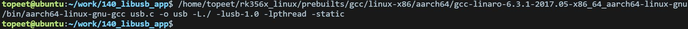
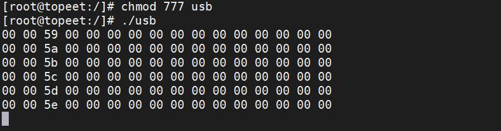
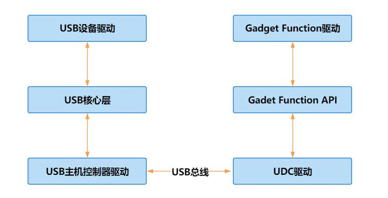

# 第253章 USB驱动开发框架

```c
}
```
### 252.4.2 编译应用程序
输入aarch64-linux-gnu-gcc usb.c -o usb -L./ -lusb-1.0 -lpthread -static 命令进行编译，编译完成以后会生成一个名为usb 的可执行程序，编译完成如图252.5 所示：

图252.5
### 252.4.3 运行测试
开发板启动之后，将USB 键盘插入iTOP-RK3568 开发板的usb 接口，然后运行上节课编译得到的测试应用程序，点击数字键盘1-6，运行结果如图252.6 所示：

图252.6根据打印信息可以看到检测并读取到了USB 键盘，每次按键时会在终端打印16 进制的键盘数据。
在Linux 内核中，USB 驱动开发主要分为两类：主机（Host）端驱动程序与设备（Device）端驱动程序。主机端的驱动程序负责管控插入主机的USB 设备；设备端的驱动程序负责该设备作为USB 设备与主机通信的方式。在硬件层面，主机侧和设备侧的USB 控制器，分别被称作主机控制器（Host Controller）与USB 设备控制器（UDC），USB 驱动框架如图253.1 所示：


图253.1在Linux 系统中，USB 驱动可以从主机侧和设备侧两个角度进行观察。从主机侧来看，USB主机控制器驱动位于USB 驱动最底层，负责控制硬件。在其上运行的是USB 核心层，再上层为USB 设备驱动。从设备侧来看，USB 设备侧驱动程序有3 层，分别是UDC 驱动，Gadget FunctionAPI 和Gadget Function 驱动。然后打开瑞芯微提供的USB 开发文档——Rockchip_Developer_Guide_USB_CN.pdf，它的第5.1 小节为Linux USB 驱动架构，USB 驱动架构如图253.2 所示：

