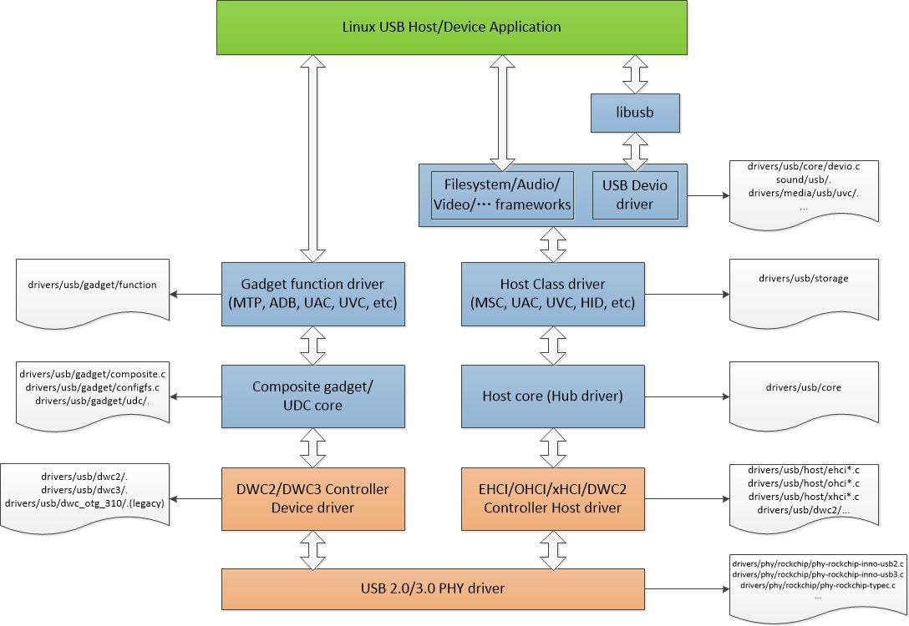
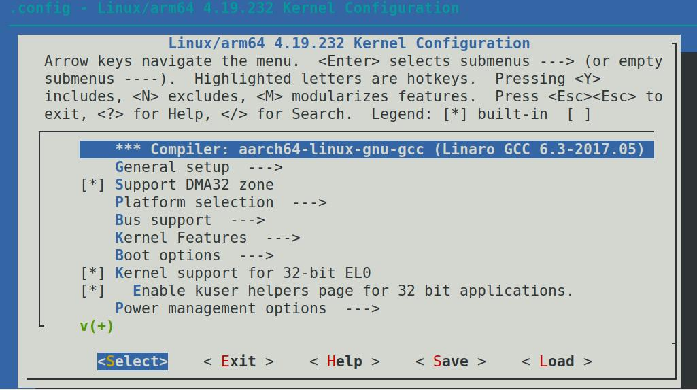
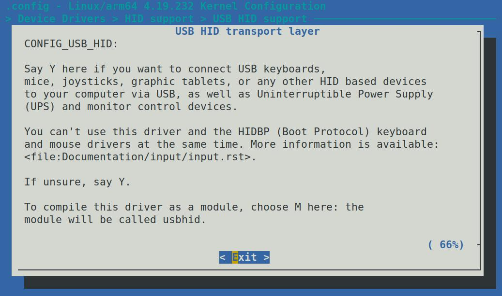

# 第254章USB键盘驱动程序开发实验（一）


图253.2
从上图我们可以看出，Linux USB 协议栈是一个分层的架构，左边是USB Device 驱动，右边是USB Host 驱动，最上层是应用层，最底层是Rockchip 系列芯片不同USB 控制器和PHY 的驱动，中间是USB 核心层。作为普通嵌入式软件工程师，核心层的驱动程序实现不需要关心，如果大家感兴趣，可以自行阅读代码。
本章节将开展USB HOST 驱动实验，即让iTOP - RK3568 开发板充当USB 主机，外接如USB键盘之类的USB 设备。Linux 内核已集成众多USB 设备驱动，像常见的USB 鼠标、键盘驱动便包含其中。接下来，学习如何启用Linux 内核中常见的USB 设备驱动。

## 254.1 USB Host 介绍
在Rockchip 官方的内核源码里，USB 键盘和鼠标驱动默认处于使能状态。若要进行后续的USB 键盘驱动程序开发实验，就需取消这一默认驱动设置。由于USB 鼠标和键盘属于HID 设备，我们可通过输入以下命令打开内核配置界面，进而开启或者关闭HID 驱动。
```c
export ARCH=arm64
make menuconfig
```
内核配置界面如图254.1 所示

图254.1然后按照指定路径进入相应的配置项目界面。-> Device Drivers-> HID support->USB HID support--->-><*> USB HID transport layer界面内容如图254.2 所示，将USB HID transport layer 取消使能，保存界面配置，重新编译内核源码即可。如果想了解该配置项的作用也可以按下“？”键打开对应的帮助信息，帮助信息如下图所示：


图254.2上图的意思是：若您希望通过USB 将USB 键盘、鼠标、游戏手柄、数位绘图板或任何其他基于HID 的设备，以及不间断电源（UPS）和显示器控制设备连接到计算机，请在此处选择Y。
## 254.2 相关API 函数
要编写一个USB 键盘驱动程序，需要用到一系列的API 函数，本小节将对部分API 函数进行讲解。usb_register()函数介绍如下所示：（1）函数原型:
```c
int usb_register(struct usb_driver *driver);
```
（2）函数作用:usb_register()函数将USB 驱动绑定到内核USB 子系统，使驱动能够响应匹配的USB 设备的插拔事件。（3）函数参数:struct usb_driver *driver：是驱动程序的描述结构体，其核心成员定义如代码清单254.1所示：代码清单254.1
```c
struct usb_driver {
```

```c
const char *name;// 驱动名称
int (*probe)(struct usb_interface *intf, const struct usb_device_id *id);
void (*disconnect)(struct usb_interface *intf);
const struct usb_device_id *id_table;// 设备ID 匹配表
// 其他可选字段（如电源管理、suspend/resume 回调等）
};
```
其关键成员讲解如下：name:驱动名称probe:当检测到匹配的USB 设备时，内核调用此函数disconnect：设备断开或驱动卸载时调用。id_table：指向usb_device_id 结构体数组，定义驱动支持的设备列表。（4）返回值:成功时返回0，失败时返回错误码。usb_deregister()函数介绍如下所示：（1）函数原型:
```c
void usb_deregister(struct usb_driver *driver);
```
（2）函数作用:用于将已注册的USB 驱动程序从内核中注销的核心函数。（3）函数参数:struct usb_driver *driver：指向已通过usb_register 注册的usb_driver 结构体指针，需与注册时使用的指针一致。（4）返回值:无返回值。
## 254.3 驱动框架程序编写
本章先来编写USB 驱动框架。本实验驱动对应的网盘路径为：iTOP-RK3568 开发板\07_学习教程配套资料\03_Linux 驱动配套资料\04_Linux 驱动程序\141_usbkbd。编写完成的USB 驱动框架程序如下所示：代码清单254.2
```c
#include <linux/init.h>
#include <linux/module.h>
#include <linux/usb.h>
/* USB 设备ID 匹配表（当前为空，需填充支持的设备）*/
const struct usb_device_id my_kbd_id_table[] = {
```

```c
};
int my_kbd_probe(struct usb_interface *intf, const struct usb_device_id *id)
{
    return 0;
}
void my_kbd_disconnect(struct usb_interface *intf)
{
}
/* USB 驱动结构体定义*/
struct usb_driver my_kbd_driver = {
    .name = "my_kbd",// 驱动名称
    .probe = my_kbd_probe,// 设备匹配时的回调
    .disconnect = my_kbd_disconnect, // 设备断开时的回调
    .id_table = my_kbd_id_table, // 设备匹配表（需填充）
};
static int my_kdb_init(void)
{
    // 注册USB 驱动到内核子系统
    int ret = usb_register(&my_kbd_driver);
    if (ret < 0) {
        printk(KERN_ERR "USB 驱动注册失败: %d\n", ret);
        return ret;
    }
    printk(KERN_INFO "USB 键盘驱动已加载\n");
    return 0;
}
static void my_kdb_exit(void)
{
    usb_deregister(&my_kbd_driver);
    printk(KERN_INFO "USB 键盘驱动已卸载\n");
}
module_init(my_kdb_init);
module_exit(my_kdb_exit);
MODULE_LICENSE("GPL");
```
## 254.4 编译驱动
在上一小节中的usbkbd 文件的同一目录下创建Makefile 文件，文件内容如下所示：

