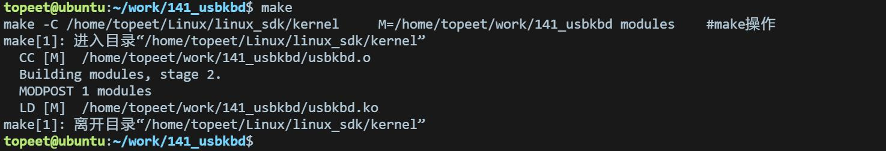
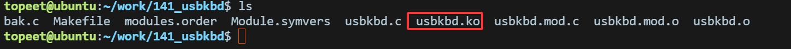

# 第255章 USB键盘驱动程序开发实验（二）

代码清单254.3
```c
export ARCH=arm64#设置平台架构
export CROSS_COMPILE=aarch64-linux-gnu-#交叉编译器前缀
obj-m += usbkbd.o#此处要和你的驱动源文件同名
KDIR :=/home/topeet/Linux/linux_sdk/kernel#这里是你的内核目录
PWD ?= $(shell pwd)
all:
    make -C $(KDIR) M=$(PWD) modules#make 操作
clean:
    make -C $(KDIR) M=$(PWD) clean#make clean 操作
```
保存退出之后，来到存放usbkbd.c 和Makefile 文件目录下，使用make 命令进行驱动的编译，编译完成如图254.3 所示：

图254.3编译完会生成usbkbd.ko 目标文件，如图254.4 所示：

图254.4
本章节将在前面USB 驱动基础代码上添加USB 驱动和设备匹配的代码。
## 255.1 驱动分析
USB 驱动的核心结构体为usb_driver，通过.id_table 字段将设备表与驱动绑定，usb_driver结构体的具体代码如代码清单255.1 所示：代码清单255.1
```c
/* USB 驱动结构体定义*/
struct usb_driver my_kbd_driver = {
    .name = "my_kbd",
    .probe = my_kbd_probe,
    .disconnect = my_kbd_disconnect,
```

```c
.id_table = my_kbd_id_table,
};
```
驱动代码中声明了一个usb_device_id 类型的结构体数组，用于描述驱动支持的所有设备，该结构体定义如代码清单255.2 所示：代码清单255.2
```c
struct usb_device_id {
    __u16 match_flags;// 匹配标志（指定哪些字段参与匹配）
    __u16 idVendor;// 厂商ID（VID）
    __u16 idProduct;// 产品ID（PID）
    __u16 bcdDevice_lo;
    __u16 bcdDevice_hi;
    __u8bDeviceClass;
    __u8bDeviceSubClass;
    __u8bDeviceProtocol;
    __u8bInterfaceClass;
    __u8bInterfaceSubClass;
    __u8bInterfaceProtocol;
    kernel_ulong_t driver_info;
};
```
在usb_register()函数中，其底层调用usb_register_driver()函数，将驱动结构体usb_driver注册到内核USB 子系统。调用usb_register_driver()函数后，将usb_driver 结构体挂载到USB 总线（usb_bus_type）的驱动列表中，具体内容如代码清单255.3 所示：代码清单255.3
```c
int usb_register_driver(struct usb_driver *new_driver, struct module *owner,const char *mod_name){
int retval = 0;
if (usb_disabled())
    return -ENODEV;
new_driver->drvwrap.for_devices = 0;
new_driver->drvwrap.driver.name = new_driver->name;
new_driver->drvwrap.driver.bus = &usb_bus_type;
new_driver->drvwrap.driver.probe = usb_probe_interface;
...}
```
usb_bus_type 结构体中的match 成员负责匹配逻辑，usb_bus_type 结构体内容如代码清单255.4 所示：代码清单255.4
```c
struct bus_type usb_bus_type = {
.name ="usb",
.match = usb_device_match,
.uevent = usb_uevent,
.need_parent_lock =true,
```

```c
};
```
usb_device_match 函数实现如代码清单255.5 所示;代码清单255.5
```c
static int usb_device_match(struct device *dev, struct device_driver *drv)
{
    if (is_usb_device(dev)) { // 判断是否为USB 设备对象
        if (!is_usb_device_driver(drv))
            return 0;
        return 1;
    } else if (is_usb_interface(dev)) {
        struct usb_interface *intf;
        struct usb_driver *usb_drv;
        const struct usb_device_id *id;
        if (is_usb_device_driver(drv))
            return 0;
        intf = to_usb_interface(dev);
        usb_drv = to_usb_driver(drv);
        id = usb_match_id(intf, usb_drv->id_table);
        if (id)
            return 1; // 静态ID 匹配成功
        id = usb_match_dynamic_id(intf, usb_drv);
        if (id)
            return 1; // 动态ID 匹配成功
    }
return 0;
```
上述函数中使用usb_match_id()函数匹配静态设备ID 表，usb_match_id 函数实现如代码清单255.6 所示：代码清单255.6
```c
const struct usb_device_id *usb_match_id(struct usb_interface *interface,const struct usb_device_id *id)
{
    if (id == NULL)
        return NULL;
    for (; id->idVendor || id->idProduct || id->bDeviceClass ||
           id->bInterfaceClass || id->driver_info; id++) {
        if (usb_match_one_id(interface, id))
            return id;
    }
    return NULL;
}
```
上述代码中的usb_match_one_id()函数用来判断USB 接口是否与usb_device_id 匹配，函数

实现如代码清单255.7 所示：代码清单255.7
```c
int usb_match_one_id(struct usb_interface *interface, const struct usb_device_id *id) {
    if (id == NULL)
        return 0;
    struct usb_host_interface *intf = interface->cur_altsetting;
    struct usb_device *dev = interface_to_usbdev(interface);
    if (!usb_match_device(dev, id))
        return 0; // 设备不匹配，直接返回
    return usb_match_one_id_intf(dev, intf, id);
}
```
根据usb_device_id 中的match_flag 字段，决定需要匹配的字段（如VID、PID、接口类等），示例匹配表如代码清单255.8 所示：代码清单255.8
```c
// 定义设备匹配表
static const struct usb_device_id my_kbd_id_table[] = {
 {USB_INTERFACE_INFO(USB_INTERFACE_CLASS_HID, USB_INTERFACE_SUBCLASS_BOOT,
USB_INTERFACE_PROTOCOL_KEYBOARD)},
  {}, // 终止符（必须保留空条目）
    { }
};
```
至此，USB 驱动设备匹配表的实现逻辑就学习完成了，接下来继续编写键盘驱动程序的probe 函数。
## 255.2 驱动程序编写
本小节将在上个实验的基础上，完善probe 函数，由于键盘属于输入设备，所以要在probe函数中为输入子系统开辟空间，并填充信息，然后设置键盘的按键事件和键值，最后注册输入子系统到驱动中。本实验驱动对应的网盘路径为iTOP-RK3568 开发板\07_学习教程配套资料\03_Linux 驱动配套资料\04_Linux 驱动程序\142_usbkbd，编写完成的USB 键盘驱动程序如代码清单255.9 所示：代码清单255.9
```c
#include <linux/init.h>
#include <linux/module.h>
#include <linux/usb.h>
#include <linux/usb/input.h>
#include <linux/hid.h>
```

```c
//输入设备
struct input_dev *mykbd_inputdev = NULL;
//按键键值表
static const unsigned char usb_kbd_keycode[256] = {
    0, 0, 0, 0, 30, 48, 46, 32, 18, 33, 34, 35, 23, 36, 37, 38,
    50, 49, 24, 25, 16, 19, 31, 20, 22, 47, 17, 45, 21, 44, 2, 3,
    4, 5, 6, 7, 8, 9, 10, 11, 28, 1, 14, 15, 57, 12, 13, 26,
    27, 43, 43, 39, 40, 41, 58, 52, 53, 58, 59, 60, 61, 62, 63, 64,
        65, 66, 67, 68, 87, 88, 99, 70, 119, 110, 102, 104, 111, 107, 109, 106,
        105, 108, 103, 69, 98, 55, 74, 78, 96, 79, 80, 81, 75, 76, 77, 71,
        72, 73, 82, 83, 86, 127, 116, 117, 183, 184, 185, 186, 187, 188, 189, 190,
        191, 192, 193, 194, 134, 138, 130, 132, 128, 129, 131, 137, 133, 135, 136, 113,
        115, 114, 0, 0, 0, 121, 0, 89, 93, 124, 92, 94, 95, 0, 0, 0,
        122, 123, 90, 91, 85, 0, 0, 0, 0, 0, 0, 0, 0, 0, 0, 0,
        0, 0, 0, 0, 0, 0, 0, 0, 0, 0, 0, 0, 0, 0, 0, 0,
        0, 0, 0, 0, 0, 0, 0, 0, 0, 0, 0, 0, 0, 0, 0, 0,
        0, 0, 0, 0, 0, 0, 0, 0, 0, 0, 0, 0, 0, 0, 0, 0,
        0, 0, 0, 0, 0, 0, 0, 0, 0, 0, 0, 0, 0, 0, 0, 0,
        29, 42, 56, 125, 97, 54, 100, 126, 164, 166, 165, 163, 161, 115, 114, 113,
        150, 158, 159, 128, 136, 177, 178, 176, 142, 152, 173, 140};
    /* USB 设备ID 匹配表（当前为空，需填充支持的设备）*/
    const struct usb_device_id my_kbd_id_table[] = {
        {USB_INTERFACE_INFO(USB_INTERFACE_CLASS_HID, USB_INTERFACE_SUBCLASS_BOOT,
USB_INTERFACE_PROTOCOL_KEYBOARD)},
        {},
    };
    /* 探测函数：当匹配到设备时调用*/
    int my_kbd_probe(struct usb_interface *intf, const struct usb_device_id *id)
    {
        int i;
        int ret;
    //1 为输入设备分配内存
        mykbd_inputdev = input_allocate_device();
    //2 设置设备名称
        mykbd_inputdev->name = "mykbd_inputdev";
    //3 设置事件类型：按键事件和重复事件
        __set_bit(EV_KEY, mykbd_inputdev->evbit);
        __set_bit(EV_REP, mykbd_inputdev->evbit);
        for (i = 0; i < 255; i++)//设置按键位图
        {
            __set_bit(usb_kbd_keycode[i], mykbd_inputdev->keybit);
        }
        clear_bit(0, mykbd_inputdev->keybit);
        ret = input_register_device(mykbd_inputdev);
```

```c
return 0;
}
void my_kbd_disconnect(struct usb_interface *intf)
{
input_unregister_device(mykbd_inputdev);
input_free_device(mykbd_inputdev);
}
/* USB 驱动结构体定义*/
struct usb_driver my_kbd_driver = {
.name = "my_kbd",
.probe = my_kbd_probe,
.disconnect = my_kbd_disconnect,
.id_table = my_kbd_id_table,
};
/* 模块初始化函数*/
static int my_kdb_init(void)
{
// 注册USB 驱动到内核子系统
int ret = usb_register(&my_kbd_driver);
if (ret < 0) {
    printk(KERN_ERR "USB 驱动注册失败: %d\n", ret);
    return ret;
}
printk(KERN_INFO "USB 键盘驱动已加载\n");
return 0;
}
/* 模块退出函数*/
static void my_kdb_exit(void)
{
usb_deregister(&my_kbd_driver);
printk(KERN_INFO "USB 键盘驱动已卸载\n");
}
module_init(my_kdb_init);
module_exit(my_kdb_exit);
MODULE_LICENSE("GPL");
```
## 255.3 编译驱动
在上一小节中的usbkbd 文件的同一目录下创建Makefile 文件，文件内容如代码清单255.10 所示：

