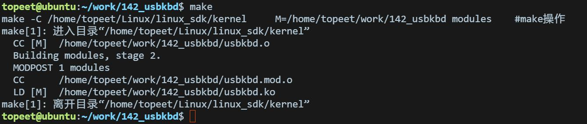

# 第256章 USB键盘驱动程序开发实验（三）

代码清单255.10
```c
export ARCH=arm64#设置平台架构
export CROSS_COMPILE=aarch64-linux-gnu-#交叉编译器前缀
obj-m += usbkbd.o#此处要和你的驱动源文件同名
KDIR :=/home/topeet/Linux/linux_sdk/kernel#这里是你的内核目录
PWD ?= $(shell pwd)
all:
    make -C $(KDIR) M=$(PWD) modules#make 操作
clean:
    make -C $(KDIR) M=$(PWD) clean#make clean 操作
```
对于Makefile 的内容注释已在上图添加，保存退出之后，来到存放usbkbd.c 和Makefile文件目录下然后使用make 命令进行驱动的编译，编译完成如图255.1 所示：

图255.1编译完生成usbkbd.ko 目标文件，如图255.2 所示：

图255.2

在前面的俩个实验中，先是编写了USB 键盘驱动程序，然后注册了输入设备，但此时驱动还无法接收按键数据。那么输入设备的数据从何而来呢？键盘如何将按键事件通知给驱动呢？实际上USB 键盘通常使用中断传输方式实时上报按键事件。驱动需要周期性地向设备发送数据请求，当有按键按下时，设备通过中断传输返回数据。而管理这种数据传输的载体，就是URB。
## 256.1 URB 请求块简介
URB 即USB Request Block，中文名为USB 请求块，是USB 设备驱动里描述与USB 设备进行通信时所使用的基本载体，也是核心数据结构，与网络设备驱动中的sk_buff 结构体极为相似。URB 结构体具体内容如代码清单256.1 所示：代码清单256.1
```c
struct urb {
struct kref kref;
void *hcpriv;
atomic_t use_count;
atomic_t reject;
int unlinked;
struct list_head urb_list;
struct list_head anchor_list;
struct usb_anchor *anchor;
struct usb_device *dev;
struct usb_host_endpoint *ep;
unsigned int pipe;
unsigned int stream_id;
int status;
unsigned int transfer_flags;
void *transfer_buffer;
dma_addr_t transfer_dma;
struct scatterlist *sg;
int num_mapped_sgs;
int num_sgs;
u32 transfer_buffer_length;
```

```c
u32 actual_length;
unsigned char *setup_packet;
dma_addr_t setup_dma;
int start_frame;
int number_of_packets;
int interval;
int error_count;
void *context;
usb_complete_t complete;
struct usb_iso_packet_descriptor iso_frame_desc[0];
ANDROID_KABI_RESERVE(1);
ANDROID_KABI_RESERVE(2);
ANDROID_KABI_RESERVE(3);
ANDROID_KABI_RESERVE(4);
};
```
USB 设备中每一个端点都处理一个URB 队列。USB 通讯步骤如下所述：第一步使用usb_alloc_urb()函数创建URB 结构体，usb_alloc_urb 函数介绍如下所示：（1）函数原型:
```c
struct urb *usb_alloc_urb(int iso_packets, gfp_t mem_flags);
```
（2）函数作用:usb_alloc_urb()函数用于创建一个USB 请求块（URB），用于管理USB 设备的数据传输请求。URB 是USB 驱动开发中数据传输的核心结构体，支持以下传输类型：控制传输（Control Transfer）：设备初始化、配置。中断传输（Interrupt Transfer）：实时性要求高的设备（如键盘、鼠标）。批量传输（Bulk Transfer）：大容量数据传输（如U 盘）。等时传输（Isochronous Transfer）：实时流数据（如摄像头、音频设备）。（3）函数参数:int iso_packets:等时传输的包数量（仅用于等时传输，其他传输类型设为0）gfp_t mem_flags：内存分配标志，指定内存分配方式（如GFP_KERNEL、GFP_ATOMIC）（4）返回值:成功时返回分配的URB 指针，失败返回NULL。
第二步URB 初始化，被指定用于特定USB 设备的特定端点。对于中断URB，使用usb_fill_int_urb()函数来初始化URB，usb_fill_int_urb()函数介绍如下所示：（1）函数原型:

```c
void usb_fill_int_urb(struct urb *urb, struct usb_device *dev,unsigned int pipe,void *transfer_buffer,int
buffer_length,usb_complete_t complete_fn,void *context,int interval);
```
（2）函数作用:usb_fill_int_urb()函数用于初始化一个中断传输URB。（3）函数参数:struct urb *urb:要初始化的URB 的指针struct usb_device *dev：指向这个URB 要被发送到的USB 设备unsigned int pipe：是这个URB 要被发送到的USB 设备的特定端点void *transfer_buffer：指向发送数据或接收数据的缓冲区的指针int buffer_length：是transfer_buffer 指针所指向缓冲区的大小usb_complete_t complete_fn：传输完成回调函数void *context：完成处理函数的“上下文”int interval：传递给回调函数的上下文数据（通常为驱动私有结构体指针）pipe 参数可以使用代码清单256.2 中的函数来创建：代码清单256.2
```c
/* Create various pipes... */
#define usb_sndctrlpipe(dev, endpoint)\
    ((PIPE_CONTROL << 30) | __create_pipe(dev, endpoint))
#define usb_rcvctrlpipe(dev, endpoint)\
    ((PIPE_CONTROL << 30) | __create_pipe(dev, endpoint) | USB_DIR_IN)
#define usb_sndisocpipe(dev, endpoint) \
    ((PIPE_ISOCHRONOUS << 30) | __create_pipe(dev, endpoint))
#define usb_rcvisocpipe(dev, endpoint)\
    ((PIPE_ISOCHRONOUS << 30) | __create_pipe(dev, endpoint) | USB_DIR_IN)
#define usb_sndbulkpipe(dev, endpoint) \
    ((PIPE_BULK << 30) | __create_pipe(dev, endpoint))
#define usb_rcvbulkpipe(dev, endpoint) \
    ((PIPE_BULK << 30) | __create_pipe(dev, endpoint) | USB_DIR_IN)
#define usb_sndintpipe(dev, endpoint)\
    ((PIPE_INTERRUPT << 30) | __create_pipe(dev, endpoint))
#define usb_rcvintpipe(dev, endpoint)\
    ((PIPE_INTERRUPT << 30) | __create_pipe(dev, endpoint) | USB_DIR_IN)
```
（4）返回值:无返回值对于批量URB，使用usb_fill_bulk_urb()函数来初始化。对于控制URB，使用usb_fill_control_urb()函数来初始化。

在完成第一步和第二步创建和初始化URB 之后，URB 便可以提交给USB 核心了，使用usb_submit_urb()函数来完成，关于该函数的介绍如下所示（1）函数原型:
```c
int usb_submit_urb(struct urb *urb, gfp_t mem_flags);
```
（2）函数作用:将初始化好的USB 请求块（URB）提交给内核的USB 子系统，启动数据传输。传输完成后，会触发URB 中指定的回调函数。（3）函数参数:struct urb *urb：指向urb 的指针gfp_t mem_flags：内存分配标志，指定内存分配方式（如GFP_KERNEL、GFP_ATOMIC）其中，GFP_ATOMIC:在中断、软中断等原子上下文里面，应使用此标志。GFP_NOIO: 在存储设备的块I/O 和错误处理路径中，应使用此标志。GFP_KERNEL: 如果没有任何理由使用GFP_ATOMIC 和GFP_NOIO，就使用GFP_KERNEL。（4）返回值:成功时返回0，提交失败，返回负的错误码。
第四步，提交由USB 核心指定的USB 主机控制器驱动第五步，被USB 主机控制器处理，进行一次到USB 设备的传送。第四步和第五步由USB核心和主机控制器完成，不受USB 设备驱动的控制。第六步，当URB 处理完成，USB 主机控制器驱动通知USB 设备驱动
## 256.2 驱动程序编写
本节按照上节讲解的USB 通讯步骤继续USB 键盘驱动程序，并添加设置键盘的按键事件和键值相关的代码，最后注册输入子系统到内核中。本实验驱动对应的网盘路径为iTOP-RK3568 开发板\07_学习教程配套资料\03_Linux 驱动配套资料\04_Linux 驱动程序\143_usbkbd，具体内容如代码清单256.3 所示：代码清单256.3
```c
#include <linux/init.h>
#include <linux/module.h>
```

```c
#include <linux/usb.h>
#include <linux/usb/input.h>
#include <linux/hid.h>
#include <linux/slab.h>
struct input_dev *mykbd_inputdev = NULL;
struct urb *mykbd_urb;
unsigned char *mykbd_buf;
unsigned char mykbd_bufold[8];
int mykbd_size;
dma_addr_t mykbd_dma;
//键盘的键码表，包含标准键盘的按键映射
static const unsigned char usb_kbd_keycode[256] = {
        0, 0, 0, 0, 30, 48, 46, 32, 18, 33, 34, 35, 23, 36, 37, 38,
        50, 49, 24, 25, 16, 19, 31, 20, 22, 47, 17, 45, 21, 44, 2, 3,
        4, 5, 6, 7, 8, 9, 10, 11, 28, 1, 14, 15, 57, 12, 13, 26,
        27, 43, 43, 39, 40, 41, 58, 52, 53, 58, 59, 60, 61, 62, 63, 64,
        65, 66, 67, 68, 87, 88, 99, 70, 119, 110, 102, 104, 111, 107, 109, 106,
        105, 108, 103, 69, 98, 55, 74, 78, 96, 79, 80, 81, 75, 76, 77, 71,
        72, 73, 82, 83, 86, 127, 116, 117, 183, 184, 185, 186, 187, 188, 189, 190,
        191, 192, 193, 194, 134, 138, 130, 132, 128, 129, 131, 137, 133, 135, 136, 113,
        115, 114, 0, 0, 0, 121, 0, 89, 93, 124, 92, 94, 95, 0, 0, 0,
        122, 123, 90, 91, 85, 0, 0, 0, 0, 0, 0, 0, 0, 0, 0, 0,
        0, 0, 0, 0, 0, 0, 0, 0, 0, 0, 0, 0, 0, 0, 0, 0,
        0, 0, 0, 0, 0, 0, 0, 0, 0, 0, 0, 0, 0, 0, 0, 0,
        0, 0, 0, 0, 0, 0, 0, 0, 0, 0, 0, 0, 0, 0, 0, 0,
        0, 0, 0, 0, 0, 0, 0, 0, 0, 0, 0, 0, 0, 0, 0, 0,
        29, 42, 56, 125, 97, 54, 100, 126, 164, 166, 165, 163, 161, 115, 114, 113,
        150, 158, 159, 128, 136, 177, 178, 176, 142, 152, 173, 140};
    /* USB 设备ID 匹配表（当前为空，需填充支持的设备）*/
    const struct usb_device_id my_kbd_id_table[] = {
        {USB_INTERFACE_INFO(USB_INTERFACE_CLASS_HID, USB_INTERFACE_SUBCLASS_BOOT,
USB_INTERFACE_PROTOCOL_KEYBOARD)},
        {},
    };
void mykbd_func(struct urb *urb){
}
int my_kbd_probe(struct usb_interface *intf, const struct usb_device_id *id)
{
    int i;
    int ret;
        int pipe;
```

```c
struct usb_host_interface *interface;
struct usb_endpoint_descriptor *endpoint;
//获取USB 设备指针
struct usb_device *mykbd_dev = interface_to_usbdev(intf);
interface = intf->cur_altsetting;
//1 为输入设备分配内存
mykbd_inputdev = input_allocate_device();
//2 设置设备名称
mykbd_inputdev->name = "mykbd_inputdev";
//3 设置事件类型：按键事件和重复事件
__set_bit(EV_KEY, mykbd_inputdev->evbit);
__set_bit(EV_REP, mykbd_inputdev->evbit);
for (i = 0; i < 255; i++)//设置按键位图
{
    __set_bit(usb_kbd_keycode[i], mykbd_inputdev-> keybit);
}
clear_bit(0, mykbd_inputdev->keybit);
ret = input_register_device(mykbd_inputdev);
//4 分配一个URB
mykbd_urb = usb_alloc_urb(0, GFP_KERNEL);
endpoint = &interface->endpoint[0].desc;
mykbd_size = endpoint->wMaxPacketSize;
mykbd_buf = usb_alloc_coherent(mykbd_dev, mykbd_size, GFP_ATOMIC, &mykbd_dma);
pipe = usb_rcvintpipe(mykbd_dev, endpoint->bEndpointAddress);
usb_fill_int_urb(mykbd_urb, mykbd_dev, pipe, mykbd_buf, mykbd_size, mykbd_func, 0,
endpoint->bInterval);
mykbd_urb->transfer_dma = mykbd_dma;
mykbd_urb->transfer_flags |= URB_NO_TRANSFER_DMA_MAP;
usb_submit_urb(mykbd_urb, GFP_KERNEL);
return 0;
}
void my_kbd_disconnect(struct usb_interface *intf)
{
struct usb_device *mykbd_dev = interface_to_usbdev(intf);
usb_kill_urb(mykbd_urb);
usb_free_urb(mykbd_urb);
usb_free_coherent(mykbd_dev, mykbd_size, mykbd_buf, mykbd_dma);
input_unregister_device(mykbd_inputdev);
input_free_device(mykbd_inputdev);
}
/* USB 驱动结构体定义*/
struct usb_driver my_kbd_driver = {
.name = "my_kbd",
```

```c
.probe = my_kbd_probe,
.disconnect = my_kbd_disconnect,
.id_table = my_kbd_id_table,
};
static int my_kdb_init(void)
{
int ret = usb_register(&my_kbd_driver);
if (ret < 0) {
    printk(KERN_ERR "USB 驱动注册失败: %d\n", ret);
    return ret;
}
printk(KERN_INFO "USB 键盘驱动已加载\n");
return 0;
}
static void my_kdb_exit(void)
{
usb_deregister(&my_kbd_driver);
printk(KERN_INFO "USB 键盘驱动已卸载\n");
}
module_init(my_kdb_init);
module_exit(my_kdb_exit);
MODULE_LICENSE("GPL");
```
## 256.3 编译驱动
在上一小节中的usbkbd 文件的同一目录下创建Makefile 文件，文件内容如下所示：代码清单256.4
```c
export ARCH=arm64#设置平台架构
export CROSS_COMPILE=aarch64-linux-gnu-#交叉编译器前缀
obj-m += usbkbd.o#此处要和你的驱动源文件同名
KDIR :=/home/topeet/Linux/linux_sdk/kernel#这里是你的内核目录
PWD ?= $(shell pwd)
all:
    make -C $(KDIR) M=$(PWD) modules#make 操作
clean:
    make -C $(KDIR) M=$(PWD) clean#make clean 操作
```
对于Makefile 的内容注释已在上图添加，保存退出之后使用make 命令进行驱动的编译，

