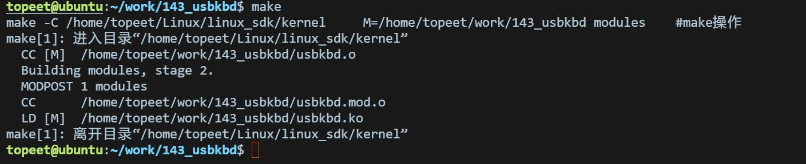
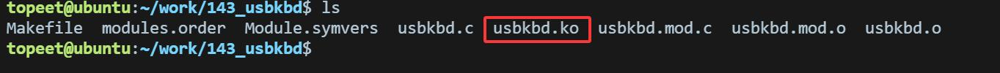
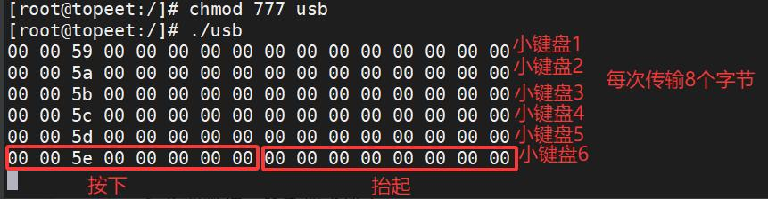
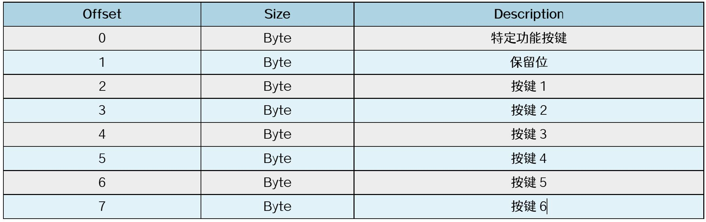
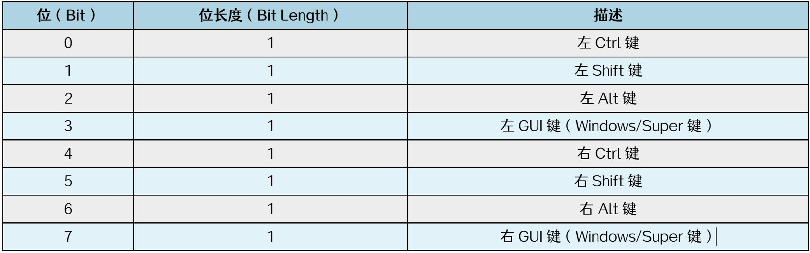
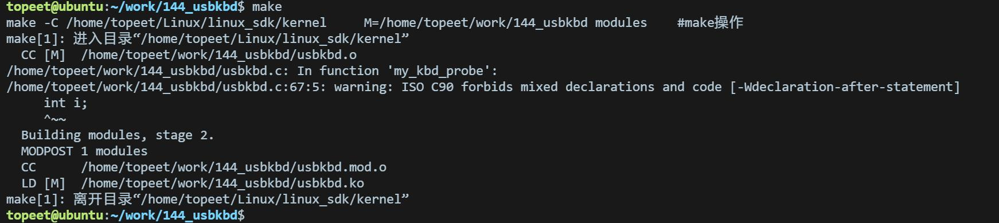

# 第257章 USB键盘驱动程序开发实验（四）

编译完成如图256.1 所示：

图256.1编译完生成usbkbd.ko 目标文件，如图256.2 所示：

图256.2
本章继续完善USB 键盘驱动程序，完成mykbd_func 回调函数的填充，在mykbd_func 回调函数中使用input_report_key()函数来报告按键事件，通过input_sync()函数报告同步事件。
## 257.1 USB 键盘上报简介
在USB 应用编程章节中，通过应用程序读取到了键盘上报的数据，运行结果如图257.1 所示：

图257.1由上图可以看出USB 键盘上报的数据为8 个字节，这8 个字节的数据是USB 按键按下又抬起的数据，匹配格式如表257.1 所示：表257.1


表257.1 中第0 个字节（offset 为0）是一个位域，每个位对应一个特殊按键的功能，当其中一位被设置为1 时，表示按键被按下。位域结构如表257.2 所示：表257.2

## 257.2 驱动程序编写
本实验继续编写USB 键盘驱动程序，在上一章驱动程序的基础上，添加USB 键盘设备驱动的中断URB 完成函数，编写完成的驱动程序对应的网盘路径为iTOP-RK3568 开发板\07_学习教程配套资料\03_Linux 驱动配套资料\04_Linux 驱动程序\144_usbkbd，中断URB 完成函数的具体内容如代码清单257.1 所示：代码清单257.1
```c
void mykbd_func(struct urb *urb)
{
    int i;
    // 处理功能键（F1-F8 等）：字节0 的每个bit 代表一个功能键状态
    for(i=0; i<8; i++){
        input_report_key(mykbd_inputdev,
                         usb_kbd_keycode[i + 224],// 功能键键码偏移224
                         (mykbd_buf[0] >> i) & 1);// 按bit 解析按键状态
```

```c
}
// 处理普通按键（字节2-7 为按键扫描码）
for (i = 2; i < 8; i++) {
    if (mykbd_buf_old[i] > 3 &&
        memscan(mykbd_buf + 2, mykbd_buf_old[i], 6) == mykbd_buf + 8) {
        if(usb_kbd_keycode[mykbd_buf_old[i]])
            input_report_key(mykbd_inputdev,
                             usb_kbd_keycode[mykbd_buf_old[i]],
                             0);
    }
    // 新按键按下检测：新数据存在且未出现在旧数据中
    if (mykbd_buf[i] > 3 &&
        memscan(mykbd_buf_old + 2, mykbd_buf[i], 6) == mykbd_buf_old + 8) {
        if(usb_kbd_keycode[mykbd_buf[i]])
            input_report_key(mykbd_inputdev,
                             usb_kbd_keycode[mykbd_buf[i]],
                             );
    }
}
input_sync(mykbd_inputdev);
memcpy(mykbd_buf_old, mykbd_buf, 8);
usb_submit_urb(mykbd_urb, GFP_ATOMIC);
}
```
代码第5-9 行用于处理功能键，通过input_report_key()函数上报键值。usb_kbd_keycode数组用来将键盘上报的键值转化为输入子系统能够识别的键值。由于变量i 的取值范围为0-7，所以i+224 的范围是224-231，对应键盘上的特殊按键。代码第11-29 行用于处理普通按键的按下和释放事件。其核心逻辑是通过对比当前数据（mykbd_buf）与上一次数据（mykbd_buf_old）的差异来判定按键状态变化。其中按键释放的处理逻辑位于第14 行-19 行：条件1"mykbd_buf_old[i] > 3"用于过滤无效扫描码，0-3 通常为保留值或特殊功能按键。条件2"memscan(mykbd_buf + 2, mykbd_buf_old[i], 6) == mykbd_buf + 8，mykbd_buf + 2"中，“mykbd_buf+2”指向当前数据中普通按键的起始位置（字节2），mykbd_buf_old[i]表示上一次的按键扫描码。6 表示搜索范围（字节2-7，共6 字节）。当条件成立，表明当前数据中未找到上一次的按键扫描码，即判定为按键已释放，随后上报按键释放事件。而22 行-29 行则用来处理按键按下事件，同理，当上一次数据（mykbd_buf_old）中未找到当前数据（mykbd_buf）中的按键扫描码时，判定为新增按键按下，进而上报按键按下事件。

## 257.3 编译驱动
在上一小节中的usbkbd 文件的同一目录下创建Makefile 文件，文件内容如下所示：代码清单257.2
```c
export ARCH=arm64#设置平台架构
export CROSS_COMPILE=aarch64-linux-gnu-#交叉编译器前缀
obj-m += usbkbd.o#此处要和你的驱动源文件同名
KDIR :=/home/topeet/Linux/linux_sdk/kernel#这里是你的内核目录
PWD ?= $(shell pwd)
all:
    make -C $(KDIR) M=$(PWD) modules#make 操作
clean:
    make -C $(KDIR) M=$(PWD) clean#make clean 操作
```
对于Makefile 的内容注释已在上图添加，保存退出之后，使用make 命令进行驱动的编译，编译完成如图257.2 所示：

图257.2编译完生成usbkbd.ko 目标文件，如图257.3 所示：

图257.3
## 257.4 运行测试
在进行实验之前，需要先确保USB Host 小节中介绍的USB HID transport layer 已经取消勾选了，并且烧写了相应的内核镜像。然后将键盘连接到iTOP-RK3568 开发板的J6 USB 接口上，启动开发板，开发板启动之后，将上个小节编译完的驱动程序usbkbd.ko 和应用程序usb 拷贝到开发板上。输入echo0</dev/tty1 命令，按下按键如果没有反应，则证明此时没有键盘驱动了。由于按键现在无法使用，所以重新启动开发板即可。接下来使用insmod usbkbd.ko 命令加载驱动模块。然后输入exec 0</dev/tty1 命令，按下按

