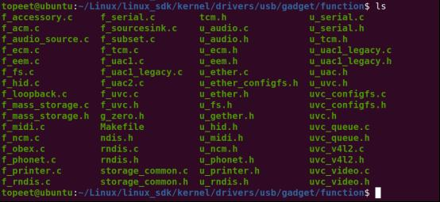
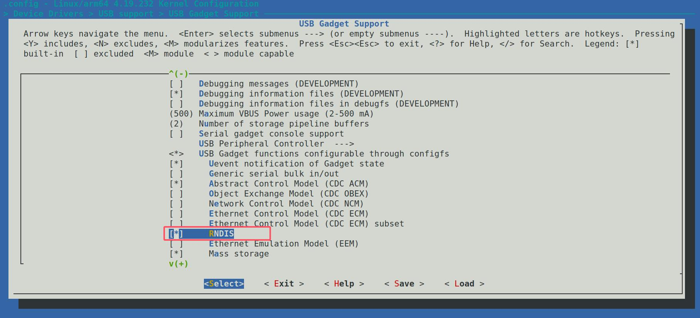
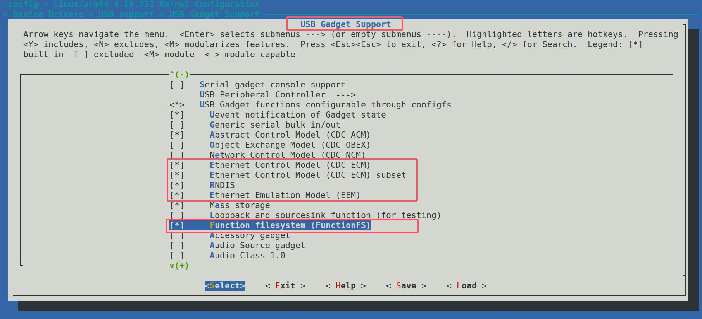
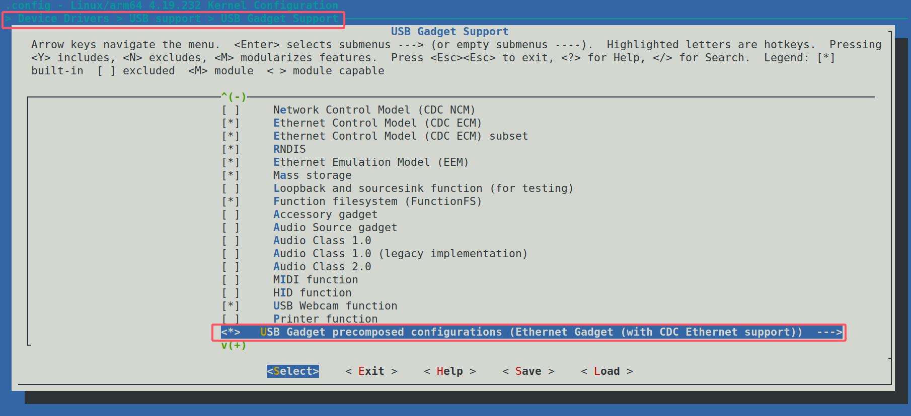
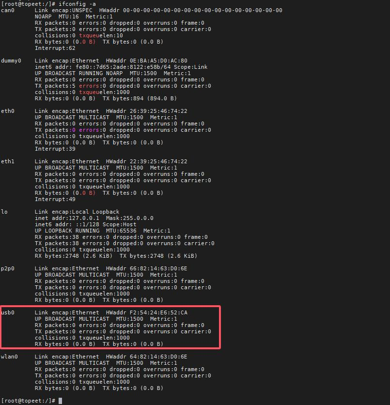
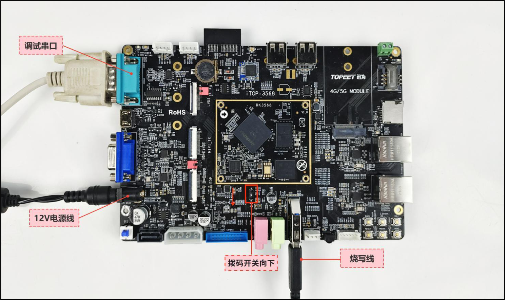
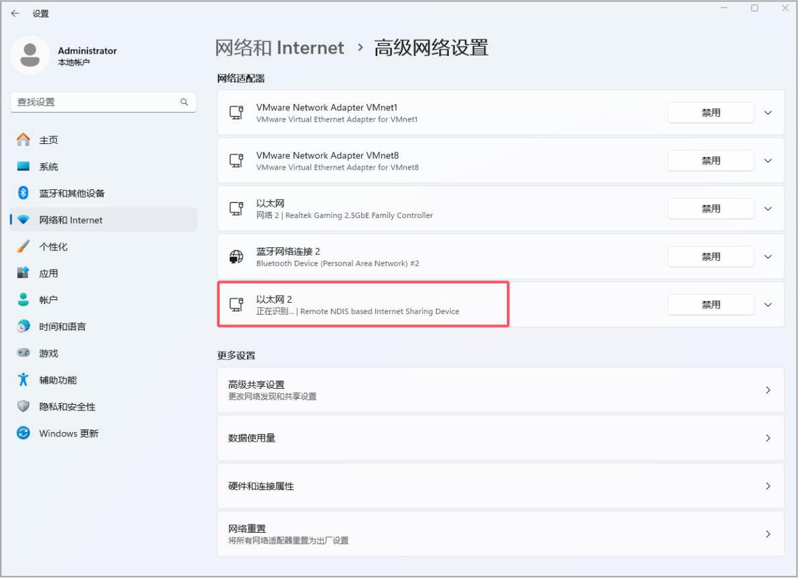
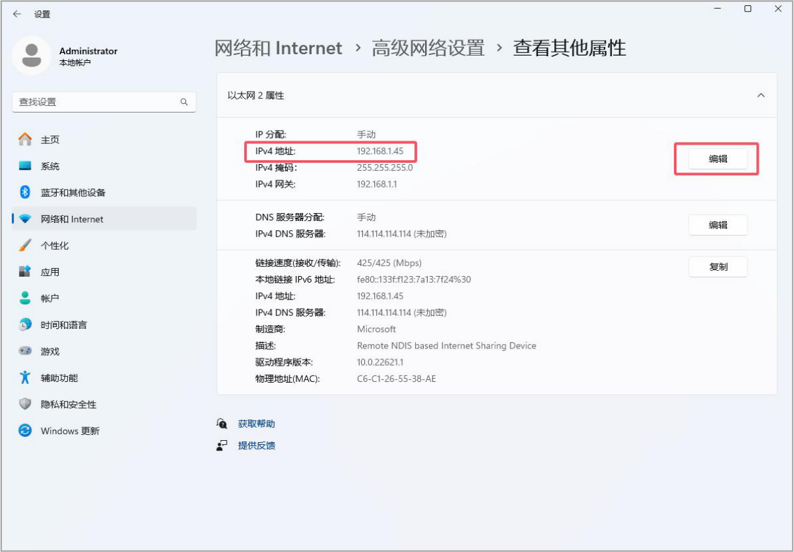
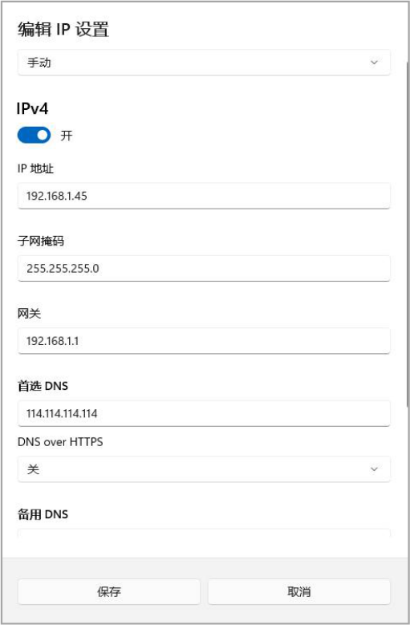

# 第258章 UDC与Gadget驱动实验

键如果有反应，则证明键盘驱动生效了。
在前面的章节我们编写了USB 键盘驱动程序，然而大部分的USB 驱动是不需要工程师进行编写的，只需要学习USB 驱动的加载和使用即可。
## 258.1 USB gadget 简介
设备端上的驱动开发叫做USB 设备控制器驱动（UDC）开发，与主机端上的USB 主机控制器驱动开发相对应。USB UDC(设备控制器)驱动主要管理USB 设备控制器硬件，并且按照USB协议与主机侧控制器进行通信。打个比方，当运行LInux 系统的开发板模拟成电脑的U 盘时，开发板的底层USB 控制器开始发挥USB 设备控制器的功能，这时在底层运行的就是UDC 驱动。不过，只有UDC 驱动，开发板还没办法完全实现U 盘的功能。在UDC 驱动之上，还需要Function驱动。它会调用通用的Gadget Function API，从而让开发板成功模拟出U 盘功能。UDC 驱动在Linux 内核源码kernel/drivers/usb/gadget/udc 目录下。在此目录下，支持了各种主流SOC 的UDC 驱动，例如s3c2410_udc.c，fusb300_udc.c 等是对应Soc 平台的UDC 驱动。在Linux内核kernel/drivers/usb/gadget/function/目录下包含了常用的Gadget Function 驱动，如图258.1 所示。

图258.1如图258.1 中，f_serial.c 驱动实现了USB 串口功能，f_mass_storage.c 驱动文件实现了U

盘功能，f_rndis.c 驱动实现了USB 网络功能，所以一般情况下无需工程师编写Gadget Function驱动。如果要使用这些驱动，可以在内核源码顶层目录下打开menuconfig 图形化配置界面，进入device->....->usb Gadget Function 目录中，把需要的驱动编译进内核即可，如代码清单258.1所示。代码清单258.1
```c
DeviceDrivers--->
  [*]USB support--->
      [*] USB Gadget Support--->
        ...
        USBGadget Drivers (USB functions configurable through configfs)
        [ ] Generic serial bulk in/out
        [*] Abstract Control Model (CDC ACM)#模拟串口设备（如USB 转TTL 模块）
        [ ] Object Exchange Model (CDC OBEX)
        [ ] Network Control Model (CDC NCM)
        [ ] Ethernet Control Model (CDC ECM)
        [ ] Ethernet Control Model (CDC ECM) subset
        [*] RNDIS #模拟USB 网卡
        [ ] Ethernet Emulation Model (EEM)
        [*] Mass storage #模拟U 盘或移动硬盘
        [ ] Loopback and sourcesink function (for testing)
        [*] Function filesystem (FunctionFS)#允许用户空间程序实现自定义USB 功能
        [*] MTP gadget#支持媒体传输协议，如手机连接电脑传输文件
        [*]PTP gadget#支持照片传输协议，用于相机连接。
        [*] Accessory gadget#Android 外设模式（如连接车载系统）
        [*]Audio Source gadget#模拟MIDI 音乐设备（如电子琴）
        [*] Uevent notification of Gadget state
        [ ] Audio Class 1.0
        [ ] Audio Class 2.0
        [*] MIDI function
        [ ] HID function
        [ ] USB Webcam function
        [ ] Printer function
```
## 258.2 Ethernet Gadget 实验
本实验的目标是将iTOP-RK3568 开发板配置为USB 从机，即将Linux 板卡虚拟为USB 网卡设备（Ethernet Gadget）。要实现USB NET 模式，需要借助RNDIS 驱动，该驱动已经内置于Linux 内核，无需从头

编写。只需在内核配置中启用RNDIS 驱动的相关选项并将其编译进内核，即可完成USBNET模式的驱动准备。首先进入Linux 源码kernel 目录，打开menuconfig 图形配置界面,勾选RNDIS 后的配置界面如图258.2 所示：

图258.2接下来选中一些网络协议配置，勾选完成如图258.3 所示：

图258.3接下来找到USB Gadget precomposed configurations，选中with CDC Ethernet support,选中之后如图258.4 所示：


图258.4
配置完成之后重新编译内核源码，然后单独烧写内核镜像即可。
## 258.3 运行测试
在开发板完成重启流程后，执行ifconfig -a 命令打印全部的网络接口，可以发现会多出usb0网络接口，网络接口列表如图258.5 所示：


图258.5使用双公头USB 线，一端连接到开发板的USB3.0 接口上，另一端连接到电脑USB 口上，然后将拨码开关向下拨，将USB 设置为device 模式，拨码开关修改完成如图258.6 所示：


图258.6如果实验成果，在设备管理器网络适配器中就可以看到这个设备，然后配置一个IP 地址，配置过程如图258.7、图258.8、图258.9 所示。

图258.7


图258.8

图258.9使用iTOP-RK3568 开发板去ping 刚才电脑配置的IP，，如图258.10 所示：

