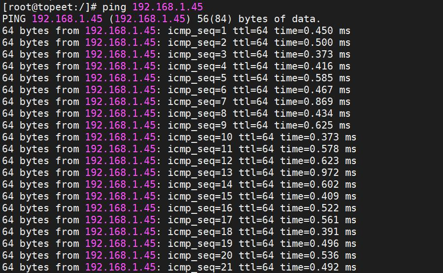
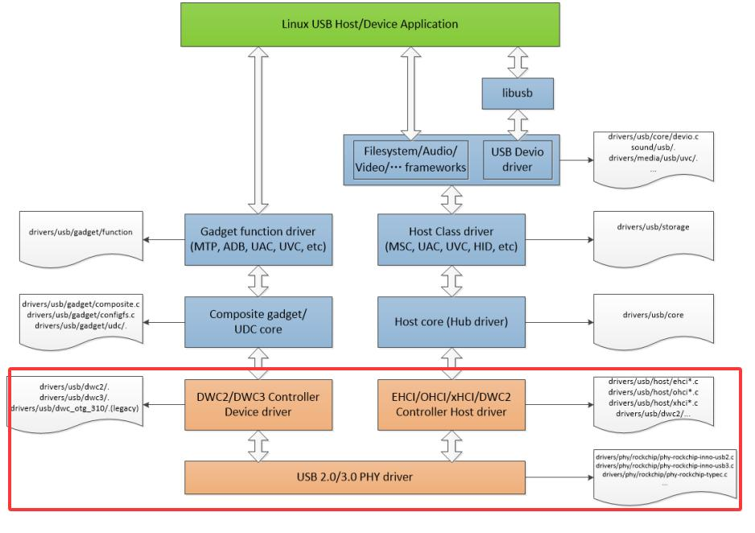
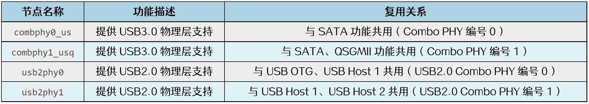
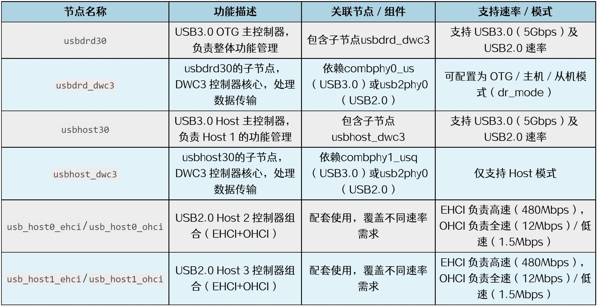

# 第259章 host和phy驱动


图258.10如果可以ping 通，说明开发板已实现USBNET 功能，则实验完成。
在前面的章节中，我们已完成USB 键盘驱动的编写以及Gadget 驱动的配置实践。结合图259.1 所示的USB 驱动框架可知，USB 核心层代码无需我们过多关注。在此基础上，剩余需要学习的部分便是host 和phy 驱动，本章节将围绕这部分内容展开讲解。


图259.1
## 259.1 内核配置
在Linux 内核源码中，USB host 和PHY 驱动是默认加载的，USB PHY 模块配置项位于内核menuconfig 图形化界面中的路径如代码清单259.1 所示路径。代码清单259.1
```c
Device Drivers--->
    PHY Subsystem--->
        ...
        <*> Rockchip INNO USB2PHY Driver
        ...
        <*> Rockchip TYPEC PHY Driver
        ...
        <*> Rockchip INNO USB 3.0 PHY Driver
```
其中：USB 2.0 PHY 使用的是Innosilicon IP，对应配置项为“Rockchip INNO USB2PHY Driver”。

USB 3.0 PHY 使用的是Type-C，对应配置项为“Rockchip TYPEC PHY Driver”。USB 3.0 PHY 使用的是Innosilicon USB 3.0 PHY，对应配置项为“Rockchip INNO USB 3.0 PHYDriver”USB Host 配置项位于内核menuconfig 图形化界面中的路径如代码清单259.2 中的路径下：代码清单259.2
```c
Device Drivers--->
    -*- Support for Host-side USB
    [*] USB support--->
        ...
        <*> xHCI HCD (USB 3.0) support
        -*- Generic xHCI driver for a platform device
        ...
        <*> EHCI HCD (USB 2.0) support
        [ ] Root Hub Transaction Translators
        [*] Improved Transaction Translator scheduling
        <*> Generic EHCI driver for a platform device
        ...
        <*> OHCI HCD (USB 1.1) support
        < > OHCI support for PCI-bus USB controllers
        <*> Generic OHCI driver for a platform device
```
其中，必须选上代码清单259.2 中USB Support 配置项后才能支持USB 模块并进行下一步配置。如果需要支持USB Host，首先需要选上<*>Supportfor Host-side USB 配置项，然后会现如代码清单263.2 中的Host 相关配置，其中，USB Host 1.1 选择OHCI Driver 配置项，USB Host2.0 选择EHCI Driver 配置项，USB Host 3.0 选择xHCI Driver 配置项。上述模块确认选中之后（源码中默认已全部选中），接下来学习如何配置设备树。
## 259.2 设备树配置
RK3568 支持1 路USB3.0 OTG、1 路USB3.0 HOST 和2 路2.0 HOST，其功能配置通过设备树节点使能及参数设置实现。USB PHY 节点匹配信息如表259.1 所示：表259.1


USB 控制器节点匹配信息如表259.2 所示：表259.2

配置USB3.0 OTG 功能的设备树内容如代码清单259.3 如下：代码清单259.3
```c
&usbdrd_dwc3 {
    dr_mode = "otg";
    status = "okay";
};
&usbdrd30 {
    status = "okay";
};
//usb 与sata0 共用combphy0_us 这个phy 节点
&combphy0_us {
    status = "okay";
};
```
配置USB 3.0 Host 功能的设备树内容如代码清单259.4 所示：代码清单259.4
```c
&usbhost30 {
    status = "okay";
};
```

