# 第260章 4G模块移植

```c
&usbhost_dwc3 {
    status = "okay";
};
    &combphy1_usq {
    status = "okay";
};
```
配置USB2.0 Host 功能的设备树内容如代码清单259.5 所示：代码清单259.5
```c
&usbhost30 {
    status = "okay";
};
&usbhost_dwc3 {
    phys = <&u2phy0_host>;
    phy-names = "usb2-phy";
    maximum-speed = "high-speed";
    status = "okay";
};
&combphy1_usq {
    rockchip,dis-u3otg1-port;
    /*HOST1、SATA1 和QSGMII 都没有使用combphy1_usq，则此处disabled */
    status = "okay";
};
&usb2phy0 {
    status = "okay";
};
&u2phy0_host {
    phy-supply = <&vcc5v0_host>;
    status = "okay";
};
```
从上述配置我们可以看出，只需要在设备树使能对应的节点即可，更多详细资料可以查阅瑞芯微官方资料rk356x_linux/doc/Common/USB/Rockchip_Developer_Guide_USB_CN.pdf。
本章节以4G 模块的移植为例，学习USB 设备的移植。
## 260.1 原理图分析
首先打开迅为开发板iTOP-RK3568 底板的原理图，4G 模块接口原理图部分如图260.1 所示：

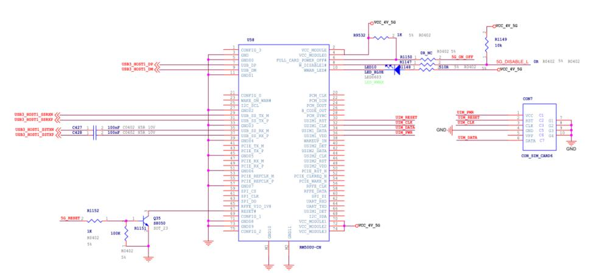
图260.1上图中的U58 接口兼容4G 和5G 模块。以4G 模块为例，其作用是使CPU 能通过USB 接口将EM05-CE(4G)模块挂载到系统上，挂载后，EM05-CE 会被模拟成一个网络设备和4 个USB 串口设备，串口设备的作用是对模块进行一些初始化操作、错误检测、读取定位信息等，网络设备的作用是将EM05-CE 作为一个通用的网卡设备，供上层sock 调用。
## 260.2 内核驱动移植
首先修改驱动支持EM05-CE 模块的PID 和VID，打开kernel/drivers/usb/serial/option.c 文件，找到struct usb_device_id option_ids[]数组并添加代码清单260.1 中的内容，添加完成如图260.1所示：代码清单260.1
```c
{ USB_DEVICE(0x2C7C, 0x0125) },
```
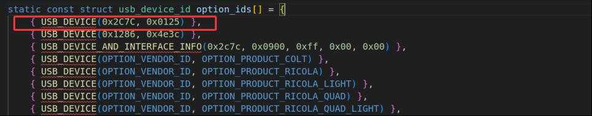
图260.1

然后修改drivers/usb/serial/usb_wwan.c 文件，找到*usb_wwan_setup_urb()函数，然后添加零包机制,添加内容如代码清单260.2 所示。代码清单260.2
```c
#if 1 //Added by Quectel for zero packet
  if (dir == USB_DIR_OUT) {
          struct usb_device_descriptor *desc = &serial->dev->descriptor;
          if (desc->idVendor == cpu_to_le16(0x2C7C))
                   urb->transfer_flags |= URB_ZERO_PACKET;
  }
#endif
```
添加完成之后如图260.2 所示。
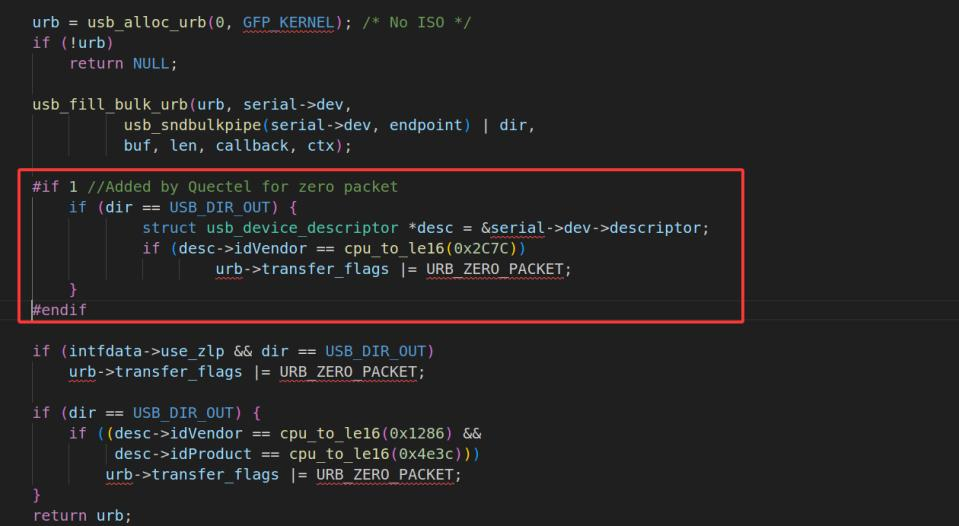
图260.2然后打开kernel/drivers/usb/serial/option.c 文件，找到option_1port_device 结构体，添加代码清单260.3 中重启休眠机制相关的内容。代码清单260.3
```c
#if 1 //Added by Quectel
    .reset_resume = usb_wwan_resume,
#endif
```
添加完成之后如图260.3 所示。

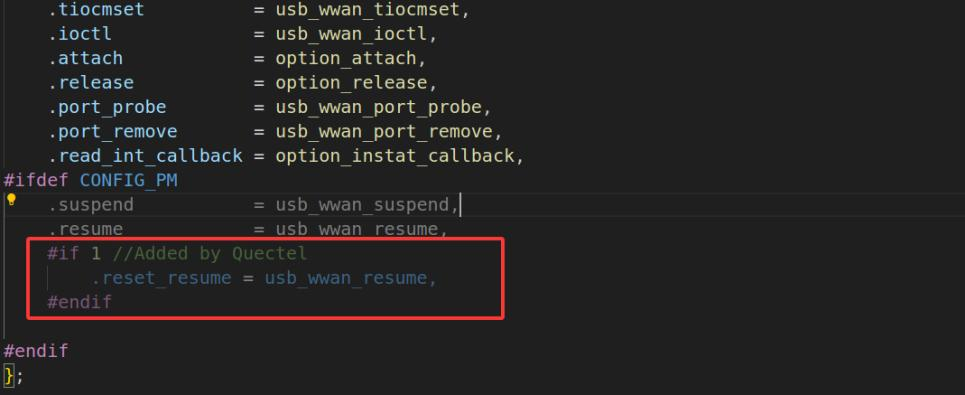
图260.3配置内核并选中支持GSM 和CDMA 模块的USB 转串口驱动，内核menuconfig 图形化配置界面对应配置项如图260.4 所示。
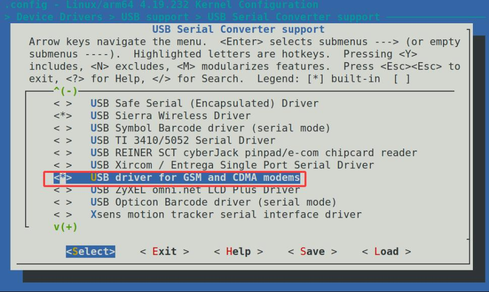
图260.4然后保存配置，编译内核镜像，单独烧写即可。
## 260.3 拨号脚本移植
首先配置内核支持ppp 拨号，需要在内核menuconfig 中按代码清单260.4 所示进行勾选配置项。代码清单260.4

```c
-> Device Drivers
    -> Network device support
        <*>PPP (point-to-point protocol) support
        <*>PPP BSD-Compress compression
        <*>PPP Deflate compression
        <*>PPP filtering
        <*>PPP MPPE compression (encryption)
        <*>PPP multilink support
        <*>PPP over Ethernet
        <*>PPP on L2TP Access Concentrator
        <*>PPP on PPTP Network Server
        <*>PPP support for async serial ports
        <*>PPP support for sync tty ports
```
添加完成之后如图260.5 所示。
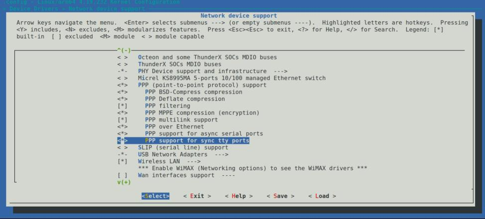
图260.5然后保存配置，重新编译内核镜像，在开发板上烧写内核镜像。接下来准备一个EM05-CE模块连接到iTOP-3568 开发板的对应接口上，然后将4G天线接到EM05-CE模块的天线座，插入一张能联网的SIM卡，连接完成如图260.6 所示：

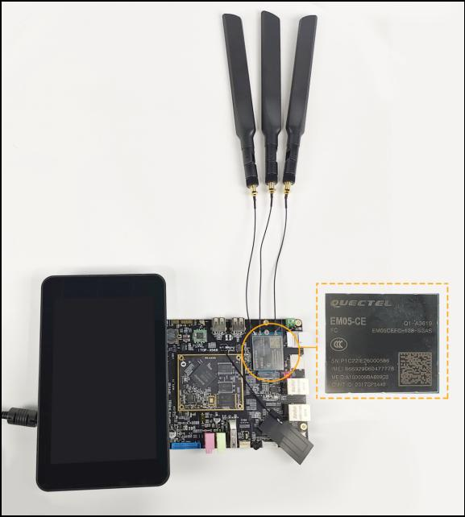
图260.6硬件连接好之后，将开发板上电启动。切换成ECM 拨号，输入cat /dev/ttyUSB2 & echo -e “AT+QCFG=\”usbnet\”,1\r\n” >/dev/ttyUSB2 命令，命令运行之后如图260.7 所示：
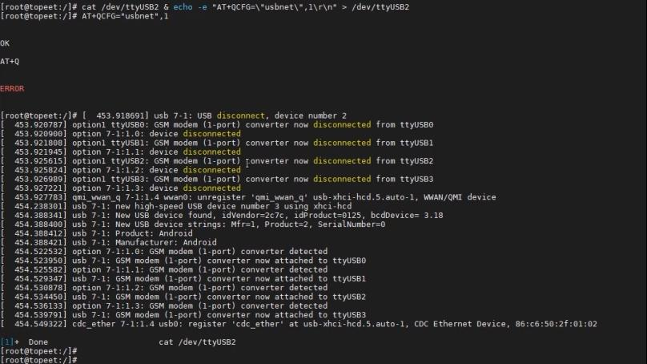
图260.7然后启动开发板，重启之后会进行自动拨号，接着在调试串口终端输入ifconfig 命令，查

看全部的网络设备，如图260.8 所示。如果可以看到有usb0 节点，然后输入ping www.baidu.com命令查看是否可以ping 通网络。如果实验成功，则可以ping 通网络。
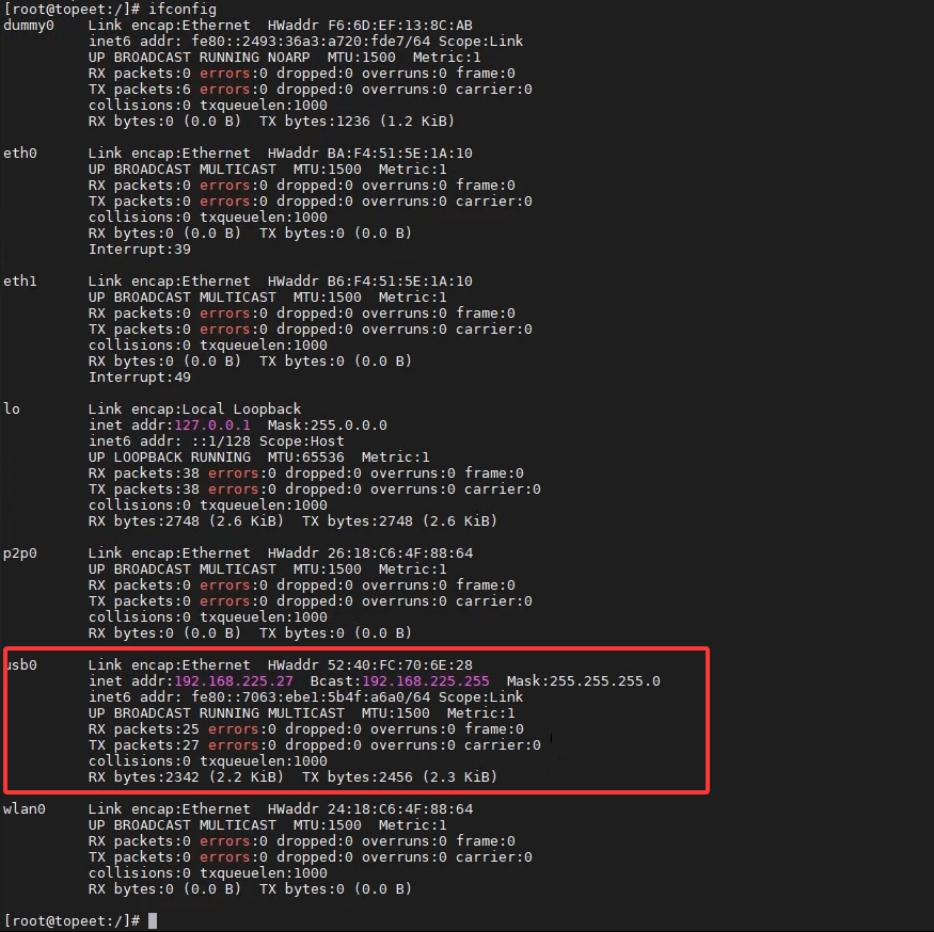
图260.8
除了上述所讲的ECM 拨号，也可以使用quectel-CM 工具进行拨号，此工具在网盘资料
下载quectel-CM 工具后，将压缩包quectel-CM.zip 拷贝到虚拟机Ubuntu 上进行解压，接着进入到解压好的目录下，输入以下命令编译拨号脚本。（注意交叉编译器路径需要按照自己交叉编译器所在的实际路径进行编写）make CROSS_COMPILE=/home/topeet/rk356x_linux/prebuilts/gcc/linux-x86/aarch64/gcc-linaro-6.

3.1-2017.05-x86_64_aarch64-linux-gnu/bin/aarch64-linux-gnu-编译完成之后，会生成quectel-CM可执行程序。然后将它拷贝到开发板上进行测试。因为在之前操作中使用了ECM拨号，因此在使用quectel-CM拨号之前，需要先输入cat /dev/ttyUSB2 & echo -e “AT+QCFG=\”usbnet\”,0\r\n” > /dev/ttyUSB2 命令切换成RmNET拨号。然后运行quectel-CM可执行程序，运行结果如图260.9 所示：
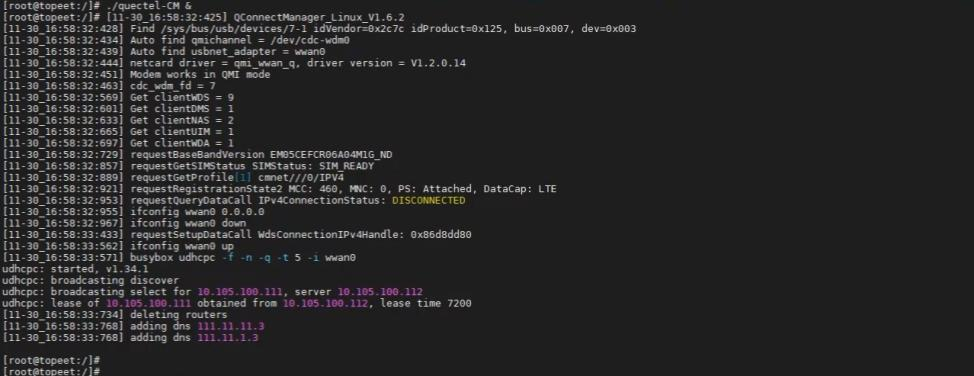
图260.9拨号脚本执行之后，在串口终端输入ifconfig 命令可以看到会多出wwan0 节点，节点信息如图260.10 所示：

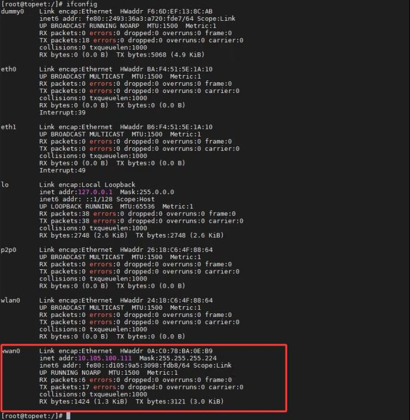
图260.10最后输入ping www.baidu.com 命令查看是否可以上网，运行结果如图260.11 所示：
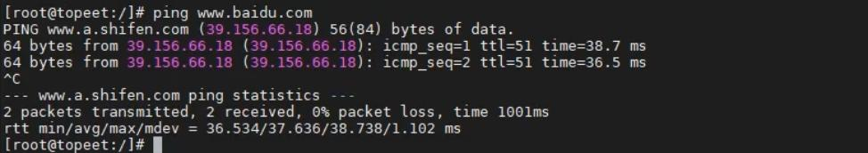
图260.11如果4G 模块可以成功联网，则说明使用quectel-CM 工具拨号成功。

