# 第261章 LCD介绍

## 261.1 LCD 概述
LCD 全称是Liquid Crystal Display，即液晶显示器。液晶是一种介于固体和液体之间的特殊物质，在电场的作用下，液晶分子的排列会产生变化。从而影响到它的光学性质。LCD 也是常用的外设之一，通过LCD 可以显示图像、界面，搭配触摸、鼠标也可以实现人机交互。比如日常生活中常见的电脑屏幕，手机屏幕基都有LCD 的身影。LCD 屏幕示例如图261.1 所示。
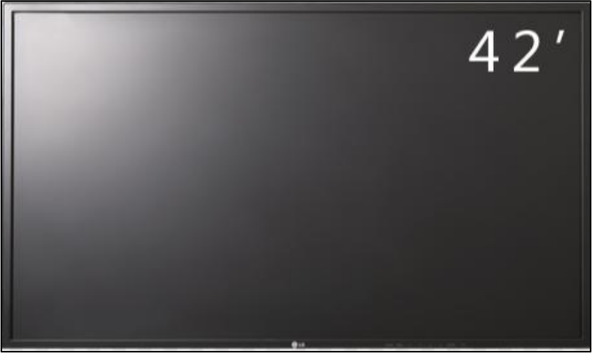
图261.1在LCD 显示器普及之前，CRT 显示器是主流的显示设备，也就是我们俗称的“大头”显示器，CRT 显示器如图265.2 所示。这种显示器如今已经很少见了。CRT 显示器的全称是“阴极射线显像管”，它采用阴极射线管（Cathode Ray Tube）技术实现图像显示。CRT 显示器主要由五个关键部分组成：用于发射电子束的电子枪（Electron Gun）、控制电子束方向的偏转线圈（Deflection Coils）、用于精确聚焦电子束的荫罩（Shadow Mask）、提供高压支持的石墨电极、以及涂覆在屏幕内壁上的荧光粉层（Phosphor）和玻璃外壳。这些组件共同协作，将电子信号转化为可见的图像。

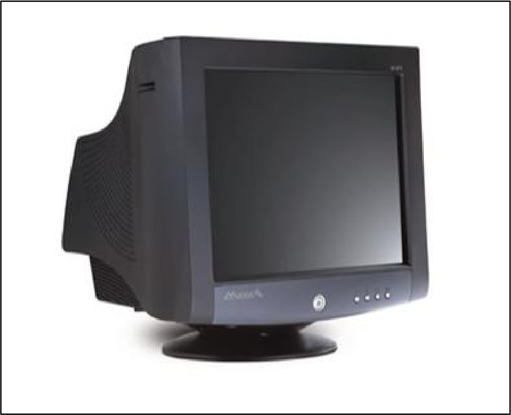
图261.2显示技术在不断进步，除了LCD 之外，如今还出现了更为高端的OLED 屏幕。例如，目前许多旗舰手机都采用了OLED 屏幕。OLED 的全称是Organic Light-Emitting Diode（有机发光二极管），其显示原理与传统LCD不同：OLED 无需背光灯，而是使用非常薄的有机材料涂层和玻璃基板（或柔性基板），当电流通过时，这些有机材料会自行发光。不过，在本章节中，我们仅聚焦于LCD 技术，暂不涉及CRT 和OLED 屏幕的相关内容，接下来对一些LCD 相关知识进行讲解。
1.LCD 面板LCD 可以细分为TFT、TN、IPS、VA 和SLCD，它们分别代表不同的液晶面板技术，这些技术各自具有独特的特点和应用场景，每个技术的具体描述如图261.3 所示。

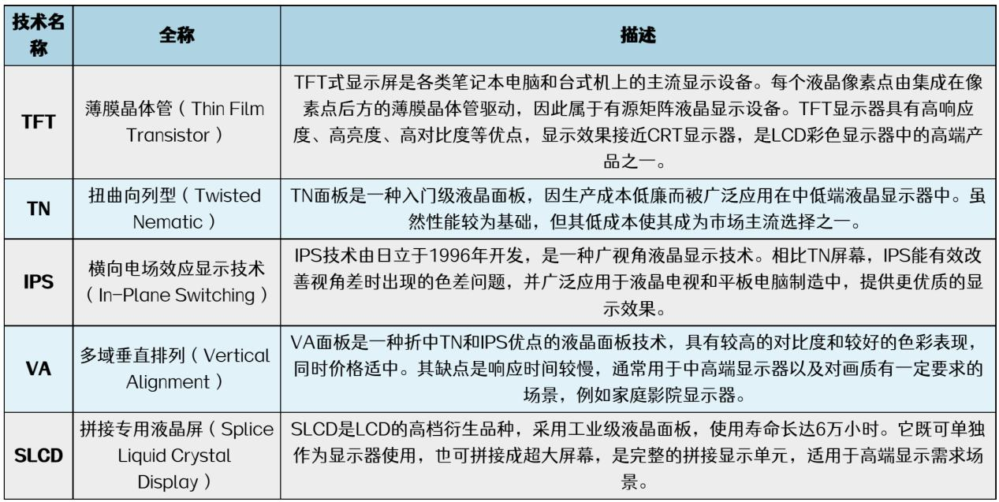
图261.3IPS、VA 和TN 面板各有优劣。从色彩和色准表现来看，IPS 最优，其次是VA，最后是TN；在响应时间方面，TN 面板最快，IPS 次之，VA 最慢；可视角度上，IPS 表现最好，VA 次之，TN最差；至于对比度，VA 面板最强，IPS 居中，TN 最弱。综合来看，不同面板类型在各项指标上各有特点，可以根据需求选择适合的面板。2.像素利用液晶的控制原理，可以设计出能够调节红、绿、蓝三种颜色输出强度的显示结构。将这三种颜色显示结构组合成一个显示单位，通过精确控制每种颜色的亮度，就可以让该单位呈现出不同的颜色，这样的一个显示单位被称为“像素”。因此，一个像素点可以类比为一个小的RGB 灯，利用光的三原色混合原理，实现全彩图像的显示。例如，图261.4 中的每一个小方格就是一个像素点。通过调整每个像素点的颜色（即红、绿、蓝的亮度比例），LCD 屏幕就能够显示出图像、界面等内容。这种基于像素点的色彩控制方式，是LCD 屏幕实现多彩显示的基础。

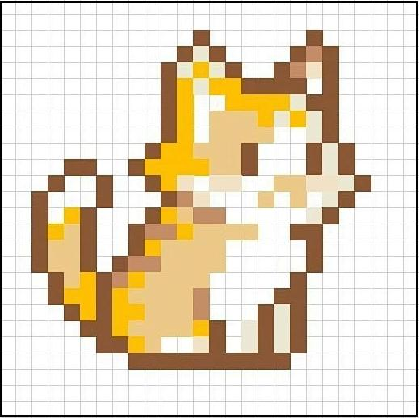
图261.43.分辨率假如一个屏幕的分辨率是1920x1080，那一共就有1920x1080=2073600 个像素点。所以分辨率就是构成屏幕的像素数。如图261.5 中横轴是X，竖轴是Y，如果表示的是1920x1080 分辨率屏幕，则X 轴方向有1920 个像素点，Y 轴上有1080 个像素点。由此可见，分辨率越高屏幕显示效果越好。是衡量屏幕显示效果的一个重要参数。但是分辨率并不是唯一标准，像屏幕亮度、色彩色准、可视角度也是影响屏幕显示效果的重要参数。
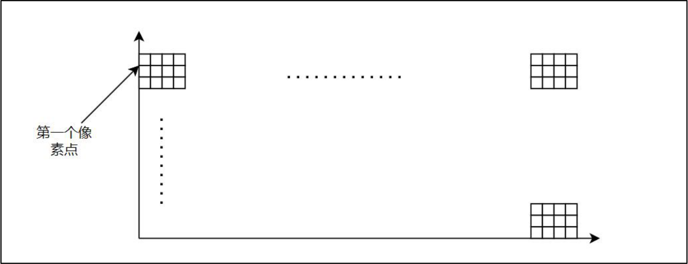
图261.5
4.像素格式一个像素点可以类比为一个小的RGB 灯，RGB 是光的三原色，过调节红、绿、蓝三种颜色

的亮度组合，就能显示出各种颜色。那么，如何控制RGB 这三种颜色的亮度呢？通常，RGB 三种颜色一般分别使用8bit 数据表示亮度，即每个颜色通道的取值范围为0~255。这样一个像素点就是8bitx3=24bit 的数据空间，这种像素格式被称为RGB888，它可以显示2⁸×2⁸×2⁸= 1677 万种颜色。除了RGB888，常见的像素格式还包括：RGB565：R-5bit，G-6bit，B-5bit，可以显示2⁵×2⁶×2⁵= 65536 种颜色。RGB555：R-5bit，G-5bit，B-5bit，可以显示2⁵×2⁵×2⁵= 32768 种颜色。那是不是选择像素格式越高的屏幕，显示效果就越好呢？在一定程度上是的，像素格式越高，颜色显示越细腻，但它也会带来更高的数据带宽需求。假如现在有一个1920x1080 分辨率的屏幕，如果采用24bit 的像素格式，需要的带宽为1920x1080x24，但是如果采用16bit 的像素格式，需要的带宽为1920x1080x16，可见像素格式越高，需要的带宽就越大。因此在实际设计中，像素格式的选择不仅取决于显示效果的需求，还要综合考虑接口带宽、处理器性能等因素做出权衡。
5.PPIPPI 即像素密度，全称为Pixels Per Inch，表示每英寸所包含的像素数量。PPI 计算公式如图261.6 所示。
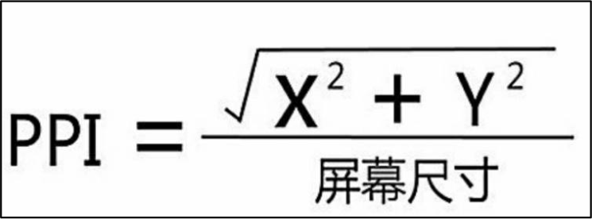
图261.6通过计算公式可以见，在计算屏幕PPI 时，使用的是屏幕对角线的英寸长度作为度量标准。那PPI 有什么作用呢？举个例子：一块10 英寸、分辨率为2400 x1080 分的屏幕，其PPI 约为263；而如果同样分辨率用于一块8 英寸的屏幕，PPI 则提升至约329。显而易见，在相同分辨率下，屏幕尺寸越小，PPI 越高，画面就越细腻，显示效果也更好。
7.LCD 接口种类LCD 接口种类有很多，嵌入式设备上常见的有RGB、MIPI、LVDS、EDP 接口，显示器上常见的有DP、HDMI、VGA 等接口，对于每个接口的简单介绍如图261.7 所示。

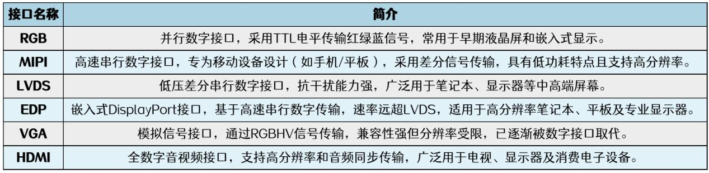
图261.7
的LCD 屏幕接口（有复用），十分强大，开发板上的显示接口标注如图261.8 所示。
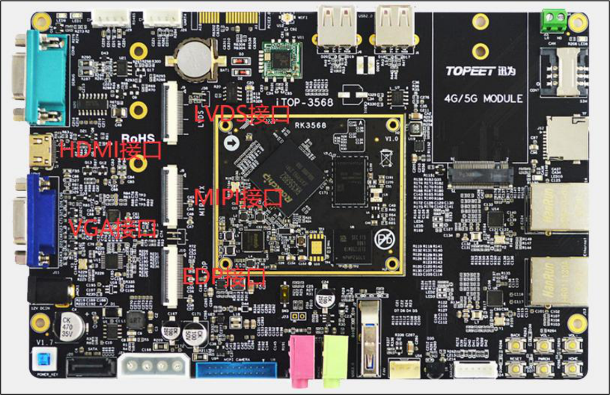
图261.8注：迅为RK3568 核心板上均有引出RGB 接口，但RGB 接口对应的引脚在底板被复用成了其他功能。
8.DBI、DPI 和DSI 接口DBI、DPI 和DSI 接口是由MIPI 联盟的显示工作组（DWG，Display Working Group）对屏幕接口进行的分类，这与上面提到的RGB，MIPI，LVDS，EDP 等接口并不冲突。DBI 全称为Display Bus Interface，又叫做MCU 接口和8080 接口。可以通过并行接口传输控制命令和数据，并通过向液晶模组自带的GRAM 写入数据实现屏幕的刷新。DPI 全称为Display Pixel Interface，即显示像素接口，是并行接口，比如前面提到的RGB 接

口就可以归类成DPI 接口。DSI 全称为Display serial interface，即显示串行接口，是MIPI 联盟定义的一种图象输出接口。
## 261.2 LCD 触摸屏组成
在嵌入式开发中，常用的LCD 屏幕大多带有触摸功能，通过触摸操作实现人机交互。需要注意的是，LCD 和触摸屏是两个独立的组件，分别承担不同的功能。LCD 屏幕主要负责图像和内容的显示，而触摸部分则专注于检测用户的触摸输入并实现交互控制。LCD 屏幕部分如图261.9 所示。
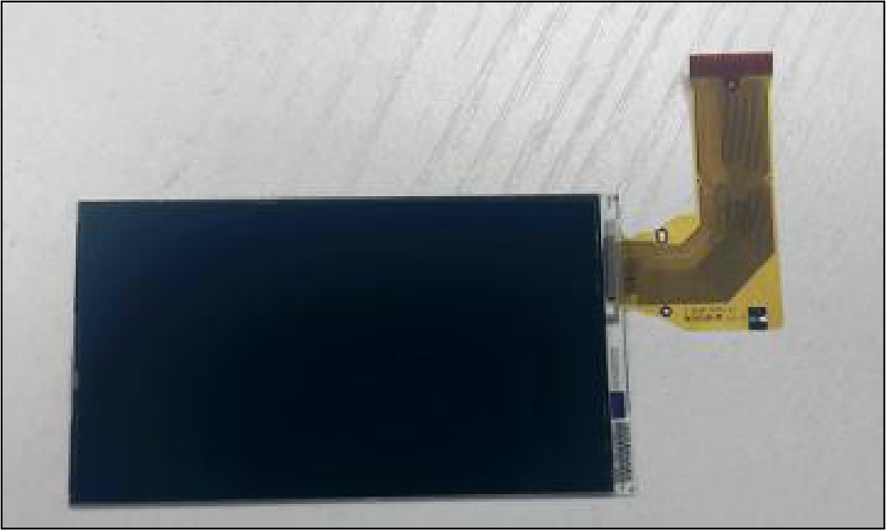
图261.9LCD 触摸组件如图261.10 所示。
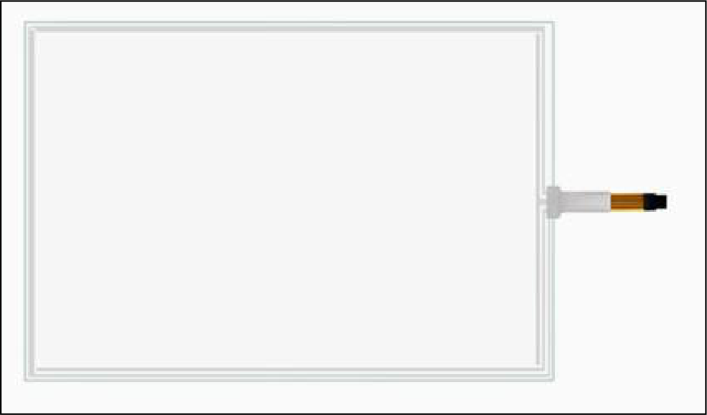
图261.10

但是如果有同学购买了iTOP-RK3568 开发板配套的LCD 屏幕会发现，LCD 是一整块，并非是像上面所讲解的由俩个部分组成，具体如图261.11 所示。
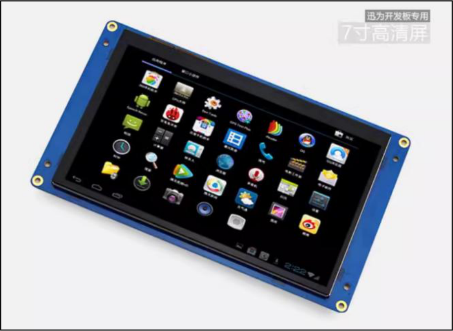
图261.11这是由于LCD 和触摸两者贴合在一起，形成一个既可以显示内容又支持触摸操作的模块。根据贴合方式的不同，常见的工艺分为全贴合和框贴两种。全贴合工艺通常应用于消费类产品，其优点是模组更薄；而框贴工艺则多用于工业场景，具有更高的可靠性和耐用性。此外，LCD 屏幕通常需要搭配一块屏幕转接板，用于与开发板进行连接。需要注意的是，在嵌入式领域，LCD 屏幕的接口并没有统一的标准，不同厂家的线序可能存在差异。因此，在连接屏幕时务必仔细核对线序，避免因线序不一致而导致屏幕、开发板或核心板损坏的风险。
## 261.3 显示控制器
### 261.3.1 显示控制器的基本概念
显示控制器，又称LCDC（全称为LCD Controller），主要负责将内存中的图像数据传输到显示设备上。随着技术的不断发展，显示控制器的功能也得到了增强，能够处理一些简单的图像操作，例如缩放、旋转和图像合成等。显示控制器在处理器中的作用类似于计算机中的显卡。当处理器集成了显示控制器时，相当于内置了显卡模块，可以直接驱动显示屏输出图像信号。例如，像RK3399、RK3588 和RK3568这样的高性能SoC 均内置了显示控制器，无需额外硬件即可实现视频输出功能。集成了显示控制器的处理器框架图如图261.12 所示。

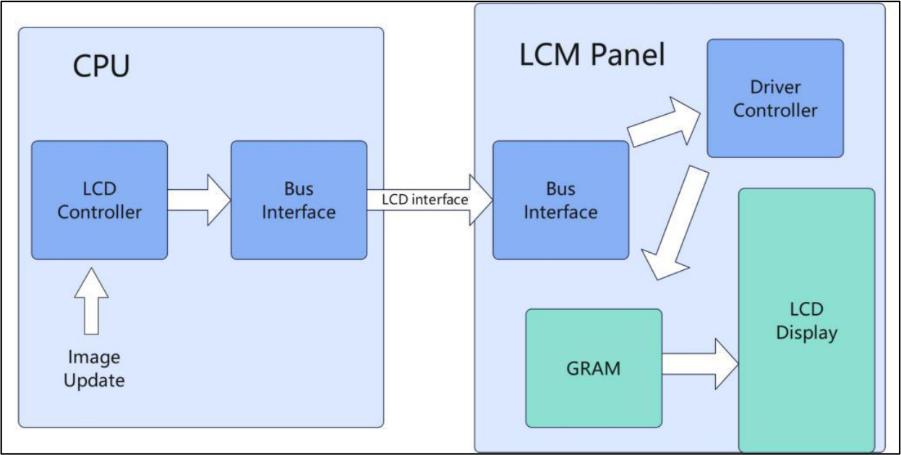
图261.12而在嵌入式领域，一些低功耗微控制器（如STM32 系列）通常不集成显示控制器。这类处理器如果需要实现图像输出，则必须外接带有GRAM 的显示模块以完成图形处理和显示功能。未集成显示控制器的处理器框架图如图261.13 所示。
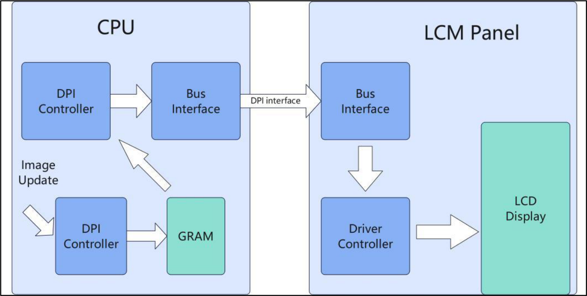
图261.13未集成显示控制器的处理器架构通常具备以下特点：（1）图形处理能力有限，需依赖外置显示模块提供的运算资源。（2）系统功耗和硬件成本相对较低，适合对能效和经济性要求较高的场景。（3）主要应用于工业控制、传感器面板等基础显示需求的领域。这两种架构的差异也体现了处理器在性能定位、功能集成度以及目标应用场景上的不同侧重，高性能处理器通过集成显示控制器实现强大的视频输出能力，而专用微控制器则采用模块

化设计，在保证系统灵活性的同时满足特定需求。
### 261.3.2 VOP 简介
在瑞芯微的系列SoC 中，显示控制器被称为VOP（Video Output Processor）。以RK3568处理器为例，其技术参考手册（TRM）中对VOP2 的描述如图261.14 所示。
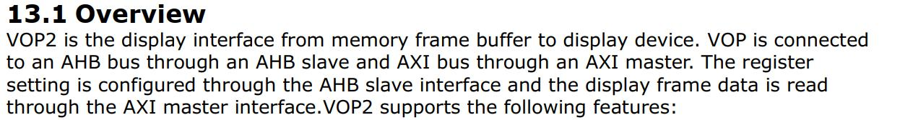
图261.14VOP2 是连接内存帧缓冲区与显示设备的显示接口模块。它通过AHB 从接口（AHB Slave）与AHB 总线相连，用于寄存器配置；同时通过AXI 主接口（AXI Master）与AXI 总线相连，用于读取显示帧数据。目前，瑞芯微处理器中存在两种VOP 架构：VOP1 和VOP2。两者的区别主要体现在对多屏显示的支持方式上。通常情况下，一个VOP 在同一时刻只能驱动一个屏幕独立显示。如果需要实现多屏显示，则需要多个VOP 协同工作。VOP1 正是采用这种传统方式来支持多屏显示，VOP1 架构的功能示意图如图261.15 所示。
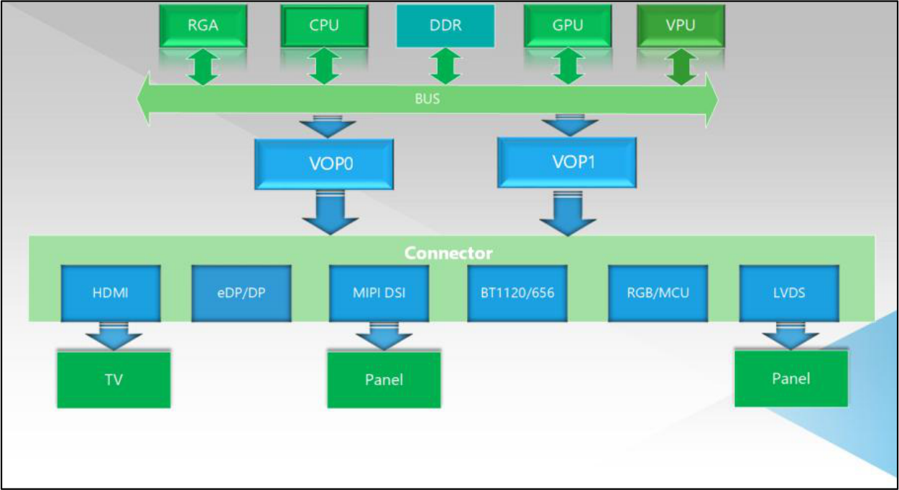
图261.15例如在RK3399 处理器中内置的显示控制器类型为VOP1。在RK3399 处理器的TRM 手册中关于VOP 的描述如图261.16 所示。

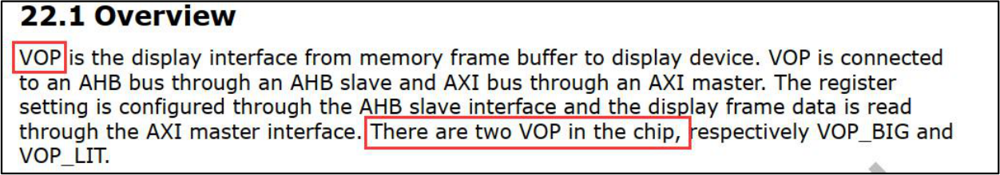
图261.16在RK3399 处理器中，集成了两个VOP 模块，分别称为VOP_BIG 和VOP_LIT。因此，RK3399最多可以支持两个屏幕同时显示。相比之下，VOP2 架构在处理器中仅包含一个VOP 模块，但在其后端设计了多个独立的VP（Video Port）输出接口。这些VP 接口能够同时独立工作，从而实现多路显示输出。也就是说，VOP2 的显示能力取决于VP 的数量，有几个VP 就可以支持几路同时显示（同显或异显），VOP2架构的功能示意图如图261.17 所示。
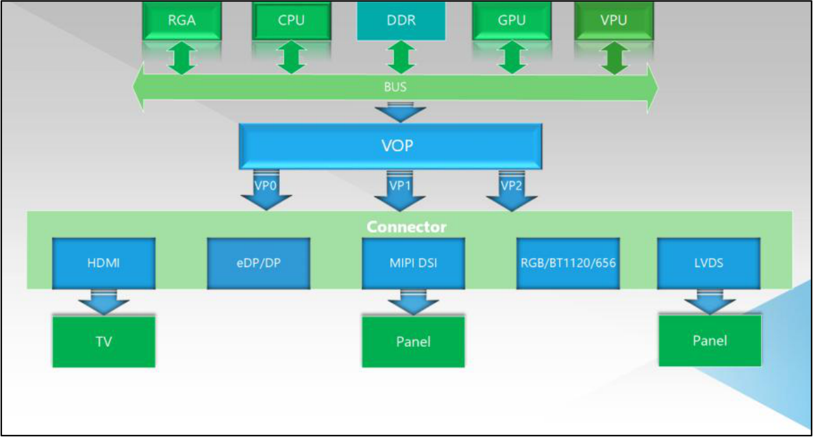
图261.17在RK3568 处理器中内置的显示控制器类型为VOP2。通过RK3568 的TRM 手册可知，RK3568有3 路VP，具体如图261.18、图261.19 所示。

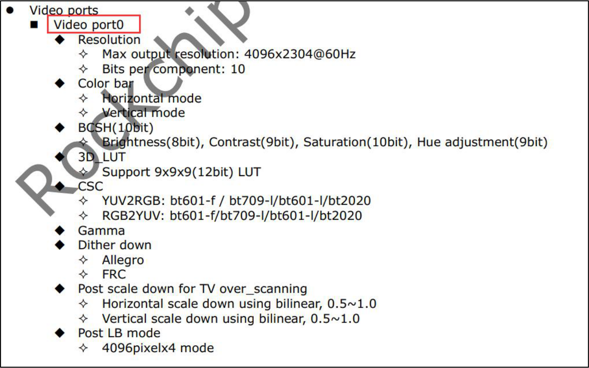
图261.18
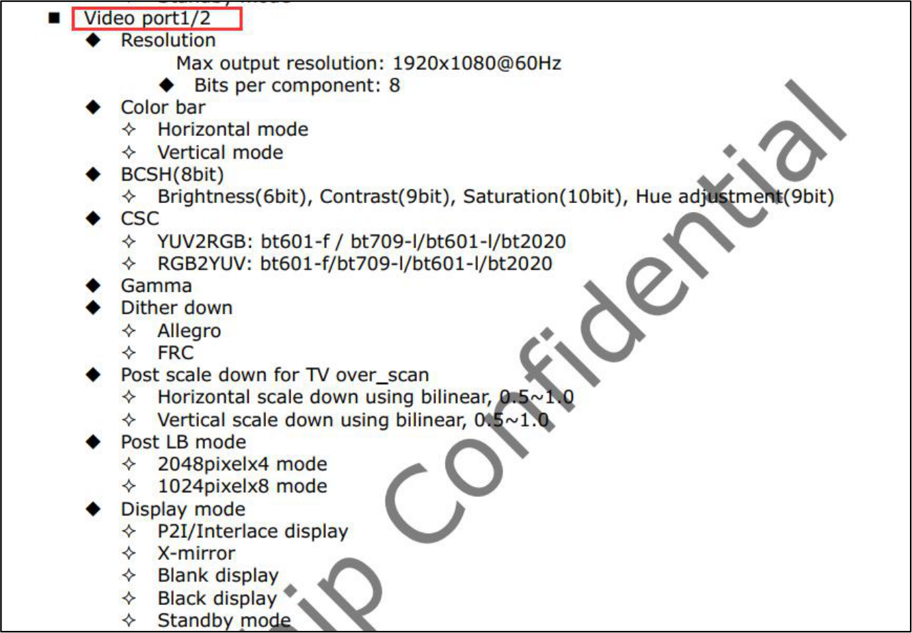
图261.19所以对于RK3568 处理器来说，最多支持3 屏同/异显。RK3568 处理器每路VP 又支持不同接口的LCD 屏幕。如图261.20 所示。

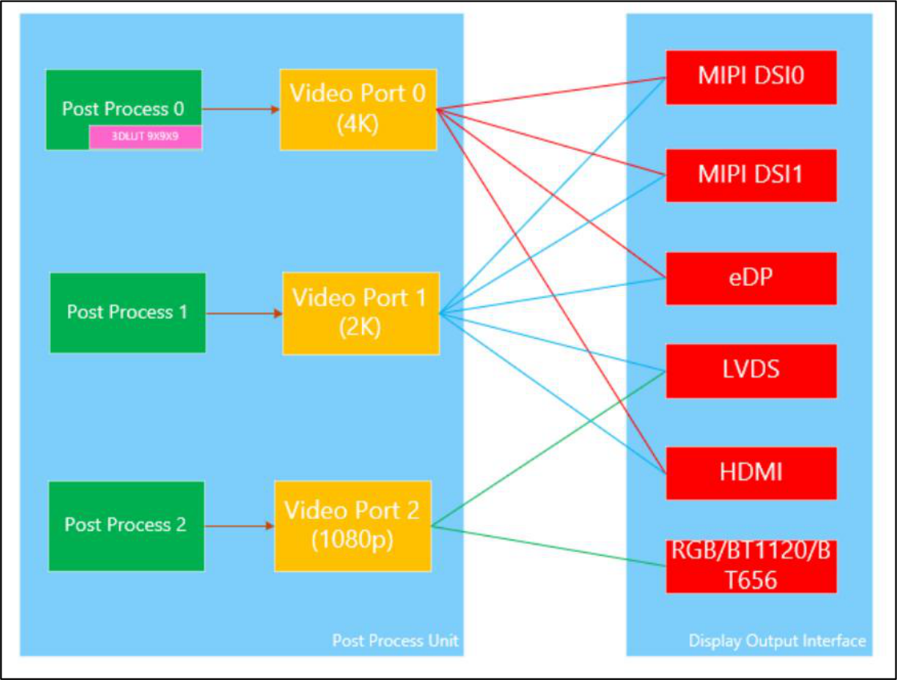
图261.20RK3568 处理器的VP 接口设计展现了极高的灵活性。其中，VP0 和VP1 均支持MIPI0、MIPI1、eDP 以及HDMI 接口的输出，而VP2 则支持LVDS 和RGB 接口的输出。这种多样化的接口配置使得RK3568 能够适配多种显示设备，充分体现了其在LCD 接口设计上的灵活性。需要注意的是，每路VP 在同一时间只能支持一种显示接口的输出。例如，若VP1 被配置为LVDS 输出，则无法同时用于HDMI 输出。此外，不同VP 接口的最大分辨率能力也有所差异。关于各VP 接口的最大分辨率支持情况，作者已将其整理为导图以便参考，具体如图261.21 所示。

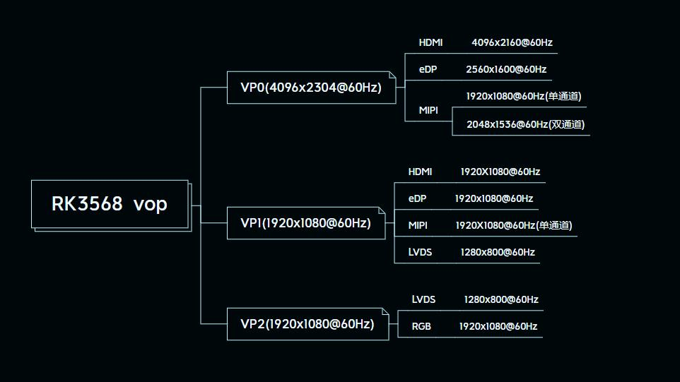
图261.211.connector-mirror 技术在RK3568 芯片中，具备三路独立的视频处理单元（VP），因此在最基本的条件下，RK3568支持三路显示输出。如果需要同时输出更多的画面，可以通过connector-mirror 技术进行扩展。例如，RK3588 在四路VOP 的基础上，结合connector-mirror 技术，可以实现同时输出七路显示信号的应用场景，示意图如图261.22 所示。
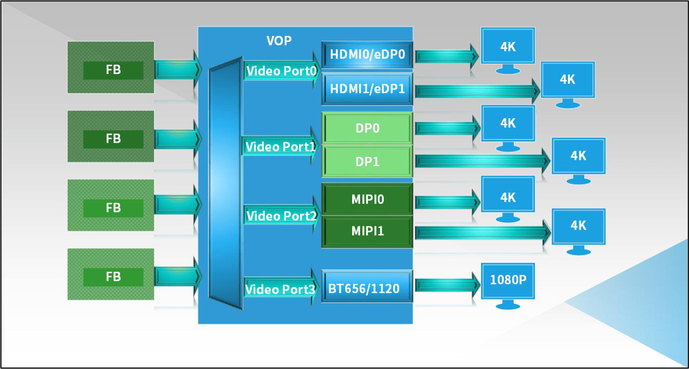
图261.22在图261.22 中使用connector-mirror 技术把两路HDMI/eDP 连接在VP0 上，把两路DP 连接

在VP1 上，把两路MIPI DSI 连接在VP2 上，VP3 通过BT656，BT1120 输出，这样就实现了同时输出7 路。通过上述配置，系统最多可以同时输出7 路显示信号，但这些信号实际上是通过4 组独立的显示通路实现的。需要注意的是，每一组（即同一个Video Port 上的两个显示接口）输出的显示时序和内容是完全相同的。在这种应用模式下，每组显示通路的最大分辨率受限于对应的Video Port 和所连接的显示接口的最大分辨率支持能力。此功能可以通过DTS（Device Tree Source）配置来开启。在DTS文件中，只需将两个显示接口挂载到同一个Video Port 下即可完成配置。目前，该特性仅在NVR SDK 中支持，而Android 暂不支持此功能，因此这里不再展开详细介绍。2.VOP-Split 技术VOP-Split 功能是一种类似于MIPI 双通道模式的技术，能够将一路Video Port 的输出在水平方向上分割为左右两部分，从而同时驱动两个显示接口。在这种模式下，两个显示接口的显示时序保持一致，但可以分别输出内容独立的画面。需要注意的是，该功能目前仅支持基于VOP2 架构的硬件平台。通过使用VOP-Split 功能，可以实现更高效的显示扩展能力。使用VOP-Split 功能进行扩展的应用框图如图261.23 所示。
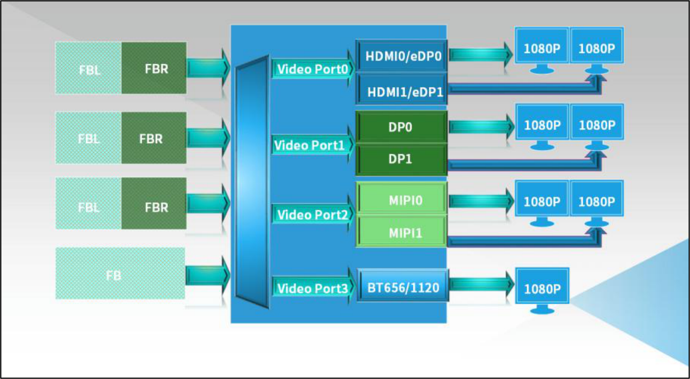
图261.23在VP0 上启用Split 模式后，VP0 的输出可以同时驱动两个显示接口（例如HDMI0/1、eDP0/1或其他与VP0 相连的显示接口）。这两个显示接口所呈现的内容是将VP0 输出的画面在水平方向上左右平分后的结果。例如，如果VP0 以3840x1080 的分辨率输出，则每个显示接口会

分别显示1920x1080 的画面。需要注意的是，在Split 模式下，同一个VP 上参与输出的两个显示接口必须保持相同的显示时序和帧率。目前，该功能仅在RK3588 平台上支持。
3.名词解释在开发或者阅读显示控制器其他相关资料时，可能会遇到一些专有名字。这里笔者给大家做了整理，如图261.24 所示。
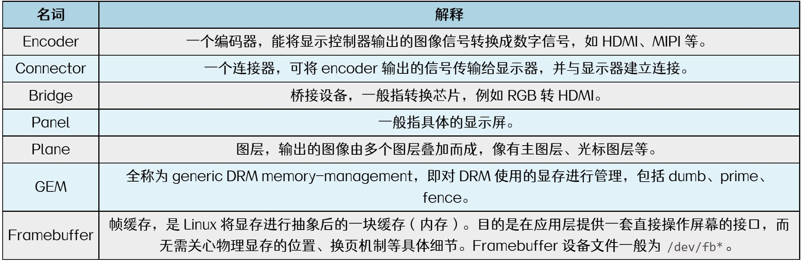
图261.24
## 261.4 LCD 时序介绍
屏幕时序相关专有名词解释如图261.25 所示。

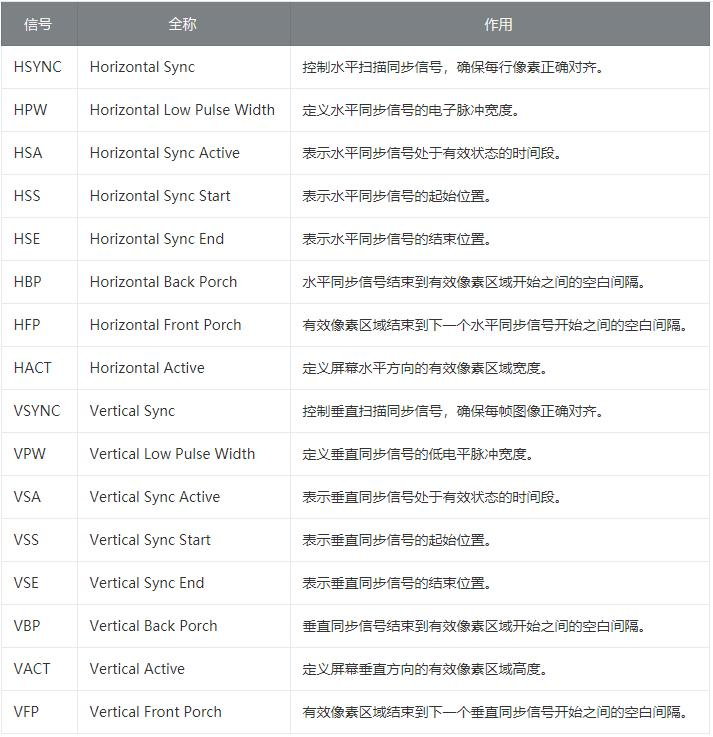
图261.25在有的资料中一些名词又有其他名称如图261.26 所示。
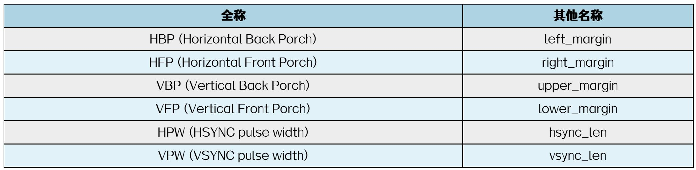

图261.26需要注意是，同一个名词可能有多种叫法，我们只要理解该名词的表示含义就可以在多种叫法中做到游刃有余，不必死记硬背。LCD 屏幕时序指LCD 显示模块进行读写时电路的时序要求和状态。在内核源码kernel/Documentation/fb/framebuffer.txt 文件中可以找到Linux 对LCD 时序的抽象图，如图261.27 所示。
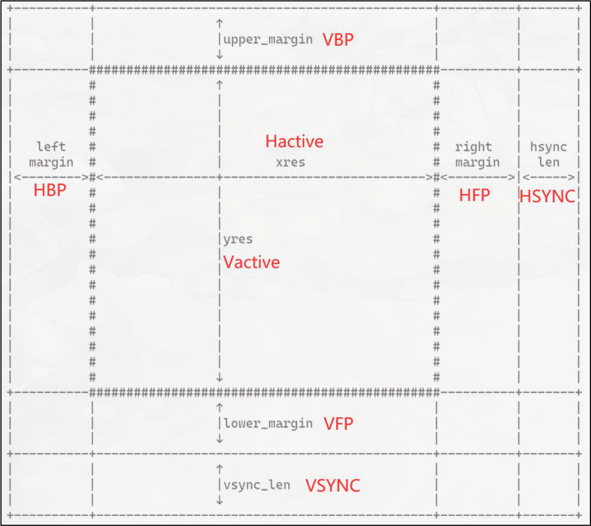
图261.27LCD 显示一帧画面并非直接呈现，显示一帧画面可想象成在屏幕背面有个“电子枪”（实际LCD 并无此装置），“电子枪” 按照从左到右、从上到下的顺序绘制每一个像素点，直至最后一个像素点绘制完成，一帧画面便显示出来，此过程如图261.28 所示。

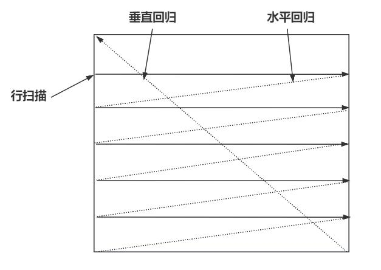
图261.28结合图261.28 中“电子枪” 绘制一帧画面的过程可知，一帧画面是逐行绘制的，呈Z 字形运动。前面提到的HSYNC 是水平扫描同步信号，产生HSYNC 信号意味着开始用“电子枪”绘制新的一行，所以在抽象图22.5 中HSYNC 信号位于最右边。VSYNC 信号是垂直扫描同步信号，产生VSYNC 信号表示要开始新的一帧画面，因此VSYNC 信号在一帧画面的最下方。在抽象图261.27 中，Hactive 和Vactive 表示一帧画面的时间显示范围。在一帧画面的实际显示范围之外，还有由HBP、HFP、VBP、VFP 组成的“相框”。“电子枪”从左到右扫描完一行后会关闭，然后等待HSYNC 信号产生，从关闭“电子枪”到等待HSYNC 信号产生的这段时间即为HFP。HSYNC 信号产生后，“电子枪”回到下一行行首，HSYNC 信号结束后会打开“电子枪” 开始扫描新的一行，但“电子枪”并非立刻开启，HSYNC 信号结束后到等待打开“电子枪” 的这段时间就是HBP。当“电子枪”扫描完一帧画面后会关闭，等待VSYNC 信号产生，从关闭“电子枪”到等待VSYNC 信号产生的这段时间就是VFP。VSYNC 信号产生后，“电子枪”回到左上角，VSYNC 信号结束后会打开“电子枪”开始新的一帧画面扫描，但“电子枪”并非立刻开启，VSYNC 信号结束后到等待打开“电子枪”的这段时间就是VBP。抽象图表示如图261.29 所示。

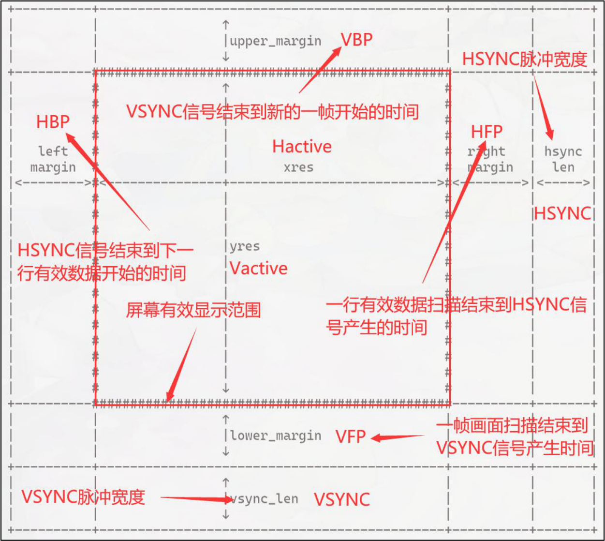
图261.29“电子枪”在CRT 显示器中比较普遍，但是现在CRT 显示器已经被淘汰。LCD 中并没有“电子枪”的存在，而是使用芯片代替“电子枪”来控制LCD 的时序。
LCD 时序实例这里以4412 处理器数据手册中的LCD 时序图为例进行参数的分析（因为4412 数据手册中这个图比较直观），如图261.30 所示。

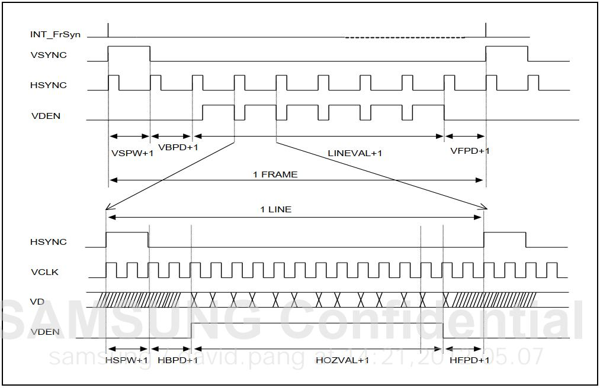
图261.30HSYNC：水平扫描同步信号，也叫行同步信号。此信号产生表示开始扫描新的一行。图261.30中HSYNC 信号是高电平有效。HSPW：HSYNC 信号宽度。有些LCD 数据手册中也叫做thp。HBP/HBPD：HSYNC 信号结束到下一个有效数据开始的时间。有些LCD 数据手册也叫thb，有些工程师也把他叫做行同步信号后肩或行同步信号后摇。HFP/HFPD：一行有效数据结束到HSYNC 信号产生的等待的时间。有些LCD 数据手册也叫thf，有些工程师也把他叫做行同步信号前肩或行同步信号前摇。VCLK：像素时钟，也叫做PCLK，素时钟信号的频率与LCD 的分辨率有关，分辨率越高，像素时钟信号的频率也越高。VDEN：数据使能信号，也叫做DE 信号，表示有效数据，图261.30 中是高电平有效。HOZVAL：表示扫描一行需要的时间，有些LCD 数据手册也叫thd。VSYNC：垂直扫描同步信号，也叫做帧同步信号。此信号产生表示开始显示新的一帧画面。图265.30 中HSYNC 信号是高电平有效。VSPW：VSYNC 信号宽度，有些LCD 数据手册中也叫做tvp。VBP/VBPD：VSYNC 信号结束到新的一帧开始的时间。有些LCD 数据手册也叫tvb，有些工

程师也把他叫做帧/垂直同步信号后肩或帧/垂直同步信号后摇。VFP/VFPD：一帧画面扫描结束到VSYNC 信号产生的时间。有些LCD 数据手册也叫tvf，有些工程师也把他叫做帧/垂直同步信号前肩或帧/垂直同步信号前摇。FRAME：显示一帧画面需要的时间。在点亮屏幕的时候我们需要确定这些参数的大小。那这些参数是如何确定的呢？第一种方法是看屏幕的数据手册。下图261.31 就是一款LCD 屏幕数据手册中对这些参数的描述。
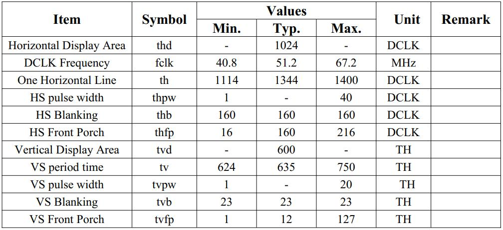
图261.31第二种方法可以通过屏幕供应商的FAE 人员来确定。因此在选择屏幕供应商时一定要选择有技术支持，靠谱的供应商。不然有可能就会遇到数据手册写的不全还找不到FAE 的情况。

