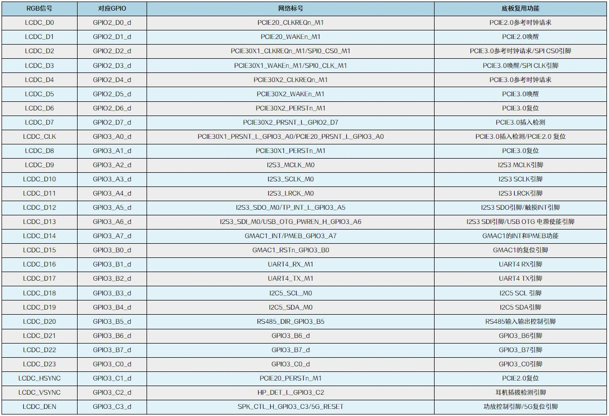
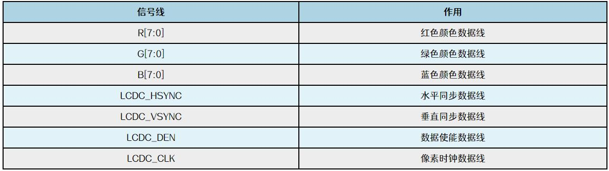
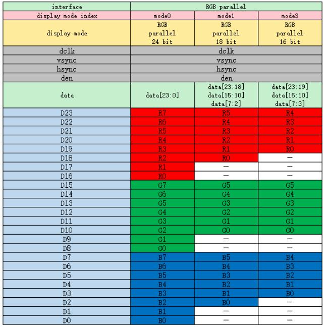
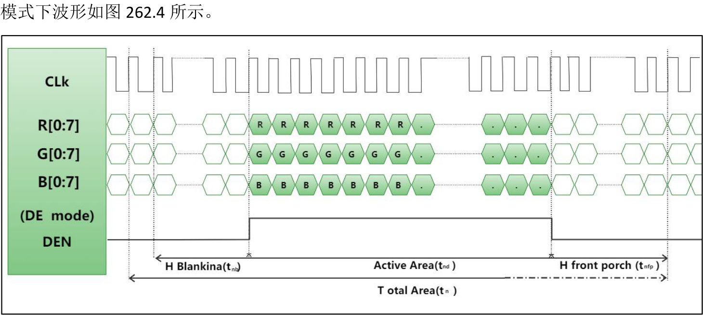
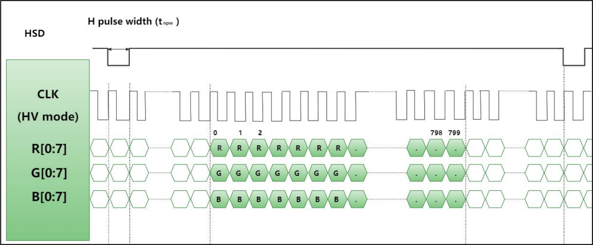
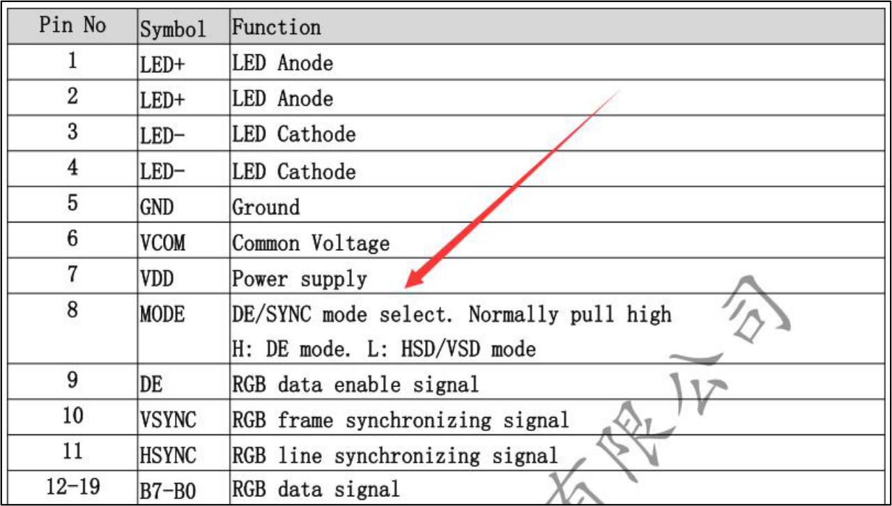
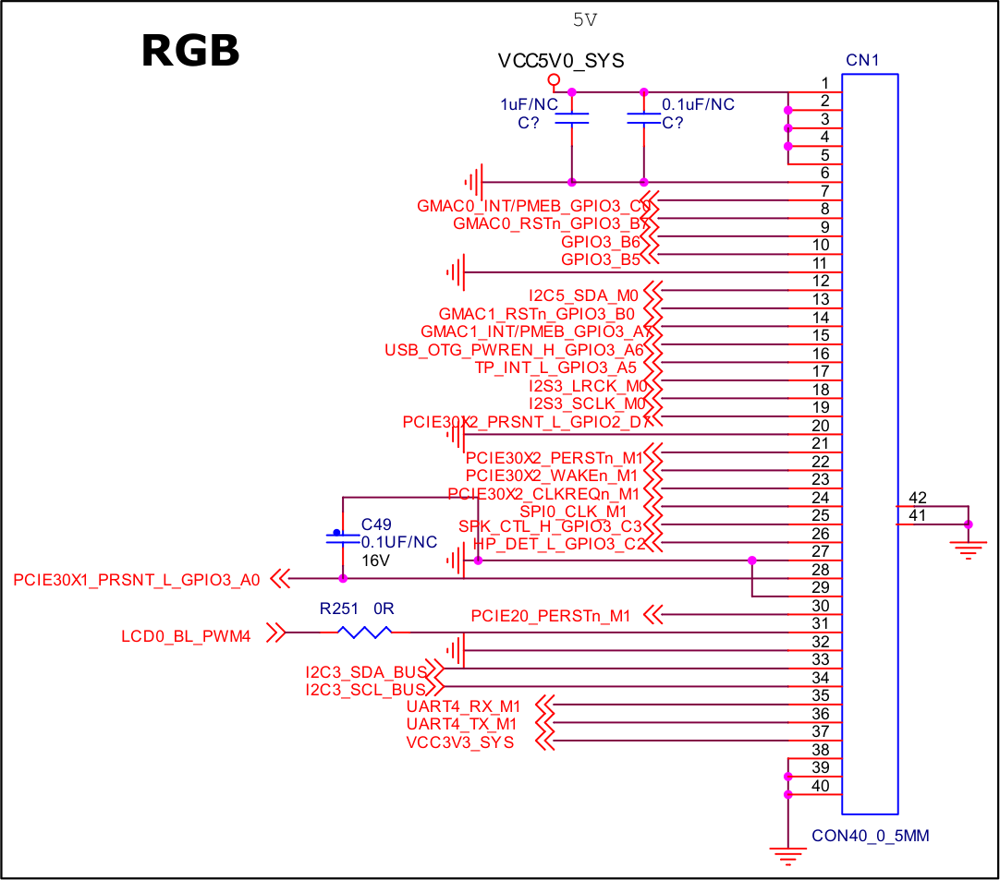
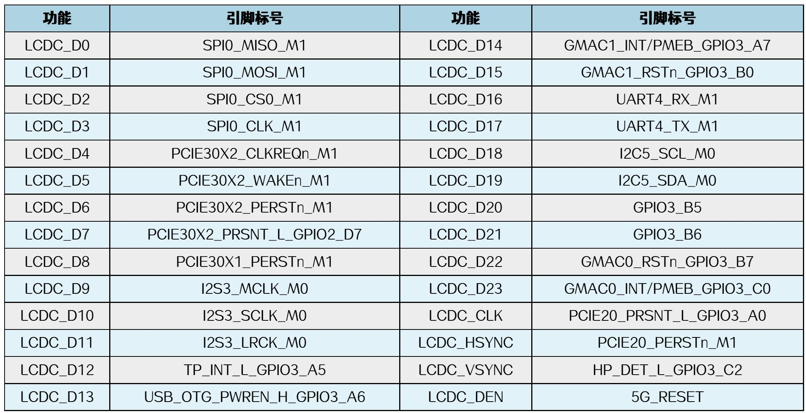

# 第262章 RGB屏幕移植

## 262.1 RGB 接口介绍
RGB 接口复用成了其他功能。

图262.1RGB 接口通常需要28 根信号线，这也解释了为什么在底板设计中，RGB 信号的引脚经常被复用为其他功能。原因是RGB 接口一旦全部引出，会占用28 个引脚，导致资源消耗过多。在这28 根信号线中，有24 根用于传输颜色数据，分别对应红（R）、绿（G）、蓝（B）三种颜色信号，具体信号线为LCD_D0 ~ LCD_D23。另外4 根是控制信号线，包括水平同步信号（LCDC_HSYNC）、垂直同步信号（LCDC_VSYNC）、数据使能信号（LCDC_DEN）和像素时钟信

号（LCDC_CLK）。28 根信号线具体分配如图262.2 所示。

图262.2在RGB 接口中24 根颜色引脚分别对应R、G、R 三种颜色，对应信号线为LCD_D0~LCDD23,那在这24 根颜色引脚中哪8 根引脚对应的是R，哪8 根引脚对应的是G，哪8 根引脚对应的是R 呢？还是以iTOP-RK3568 核心板为例，瑞芯微官方资料介绍如图262.3 所示。


图262.3在RGB 接口中，信号线的连接方式取决于所使用颜色格式。对于RGB888 格式，核心板的`D0 ~ D7`对应蓝色通道`B0 ~ B7`，`D8 ~ D15`对应绿色通道`G0 ~ G7`，`D16 ~ D23`对应红色通道`R0 ~ R7`。而在RGB666 格式中，蓝色、绿色和红色通道的低两位（`B0 ~ B1`、`G0 ~ G1`、`R0 ~R1`）不连接，其余信号线仍按RGB888 的映射规则连接。对于RGB565 格式，蓝色、绿色和红色通道的低位（`B0 ~ B2`、`G0 ~ G1`、`R0 ~ R2`）不连接，其余信号线同样按照RGB888 的映射规则进行连接。这种灵活的连接方式能够适应不同的颜色格式需求，同时优化引脚资源的使用。
## 262.2 同步模式
通过前面的LCD 时序分析可知，在行时序中包含HFP（水平前肩）、HBP（水平后肩）和HSYNC（水平同步信号），而在列时序中则包含VFP（垂直前肩）、VBP（垂直后肩）和VSYNC（垂直同步信号）。这些时序部分并不包含可显示的数据，因此LCD 和处理器之间需要一种机制来实现同步。那么，什么是同步呢？同步的核心作用是让LCD 能够识别当前处理器发送的信号状态，例如在发送HFP 等非显示时序时，LCD 不会将其作为有效数据进行显示；或者通知LCD从某个时间点开始，后续传输的数据为有效显示数据，可以用于屏幕显示。为了实现这一同步目的，目前主要有两种方式：DE 模式和HV 模式。DE 模式使用DE 数据线来表示有效数据的开始和结束，例如上一章节中的LCDC_DEN 信号线。DE

图262.4当DE 信号变为高电平时，表示有效数据开始，当DE 信号变为低电平时，表示有效数据结

束。所以在DE 模式下不需要HSYNC、VSYNC 等信号线。使用起来比较简单。
HV 模式在HV 模式下，需要通过HSYNC（水平同步信号）和VSYNC（垂直同步信号）来确定LCD的时序，而无需使用DE（数据使能）信号线，同步工作完全依赖HSYNC 和VSYNC 信号完成。HV 模式下波形如图262.5 所示。

图262.5目前，大多数LCD 屏幕同时支持HV 模式和DE 模式。例如，如图262.6 所示这款屏幕就兼容这两种模式，并通过其第8 引脚来选择具体的工作模式：当第8 引脚为高电平时，屏幕工作在DE 模式；当第8 引脚为低电平时，则切换为HV 模式。这种设计为开发者提供了更大的灵活性，可以根据实际需求选择合适的同步方式。


图262.6
## 262.3 硬件原理图分析
因此，如果需要使用RGB 显示功能，需要自行设计并制作适配的底板。本文以“iTOP-RK3568 核心板+迅为电子5 寸RGB 屏幕”为例进行说明。在底板设计时，可参考如图262.7 所示原理图进行绘制与连接。


图262.7这里直接以表格的形式给出上面原理图中的引脚说明，如图262.8 所示。

图262.8通过引脚说明可知，如果使用RGB 接口涉及到了非常多的引脚复用冲突问题，关于如何配置引脚复用这里不在赘述，具体原理请参考pinctrl 章节。

## 262.4 适配步骤
### 262.4.1 设置RGB 显示通路
通过前面的章节可以了解到，要使用RGB 接口需要在设备树中把VP2 打开。而VP2 的前端是VOP，所以需要先打开VOP，然后打开VP2 设置RGB 显示通路，具体设置步骤如下所示：首先打开arch/arm64/boot/dts/rockchip/rk3568.dtsi 设备树文件，找到VOP 对应的设备节点，该节点表示的就是一个显示控制器，具体内容如代码清单262.1 所示。
```c
vop: vop@fe040000 {代码清单262.1
    compatible = "rockchip,rk3568-vop";
    //匹配Rockchip RK3568 视频输出处理器驱动
    reg = <0x0 0xfe040000 0x0 0x3000>,
              <0x0 0xfe044000 0x0 0x1000>;
    reg-names = "regs", "gamma_lut";
    rockchip,grf = <&grf>;
    //关联的通用寄存器文件（GRF）配置节点
    interrupts = <GIC_SPI 148 IRQ_TYPE_LEVEL_HIGH>;
    //使用GIC SPI 中断148，高电平触发
    clocks = <&cru ACLK_VOP>,//VOP AXI 总线时钟
                 <&cru HCLK_VOP>,//VOP AHB 总线时钟
                 <&cru DCLK_VOP0>,//VP0 显示像素时钟
                 <&cru DCLK_VOP1>,//VP1 显示像素时钟
                 <&cru DCLK_VOP2>;//VP2 显示像素时钟
    clock-names = "aclk_vop",//时钟名称定义（与clocks 顺序对应）
                     "hclk_vop",
                     "dclk_vp0",
                     "dclk_vp1",
                     "dclk_vp2";
    iommus = <&vop_mmu>;//关联的IOMMU 设备，用于内存地址转换
    power-domains = <&power RK3568_PD_VO>; //所属电源域（显示输出）
    status = "disabled";//默认禁用，需在板级配置中启用
    vop_out: ports {//显示输出端口定义
            #address-cells = <1>;//子节点使用1 个地址单元
            #size-cells = <0>;//子节点无大小单元
            /* VP0，支持DSI0/DSI1/eDP/HDMI 输出*/
            vp0: port@0 {
                reg = <0>;//端口编号0
                #address-cells = <1>;//端点使用1 个地址单元
```

```c
#size-cells = <0>;//端点无大小单元
vp0_out_dsi0: endpoint@0 { //到DSI0 的端点
    reg = <0>;
    remote-endpoint = <&dsi0_in_vp0>;
vp0_out_dsi1: endpoint@1 { //到DSI1 的端点
};
    reg = <1>;
    remote-endpoint = <&dsi1_in_vp0>;
vp0_out_edp: endpoint@2 { //到eDP 的端点
};
    reg = <2>;
    remote-endpoint = <&edp_in_vp0>;
vp0_out_hdmi: endpoint@3 { //到HDMI 的端点
};
    reg = <3>;
    remote-endpoint = <&hdmi_in_vp0>;
};
};
/* VP1，支持DSI0/DSI1/eDP/HDMI/LVDS 输出*/
vp1: port@1 {
#address-cells = <1>;//端点使用1 个地址单元
#size-cells = <0>;//端点无大小单元
reg = <1>;//端口编号1
vp1_out_dsi0: endpoint@0 {//到DSI0 的端点
     reg = <0>;
     remote-endpoint = <&dsi0_in_vp1>;
};
vp1_out_dsi1: endpoint@1 { //到DSI1 的端点
     reg = <1>;
     remote-endpoint = <&dsi1_in_vp1>;
};
vp1_out_edp: endpoint@2 { //到eDP 的端点
     reg = <2>;
     remote-endpoint = <&edp_in_vp1>;
};
vp1_out_hdmi: endpoint@3 { //到HDMI 的端点
     reg = <3>;
     remote-endpoint = <&hdmi_in_vp1>;
};
```

```c
vp1_out_lvds: endpoint@4 {//到LVDS 的端点
    reg = <4>;
    remote-endpoint = <&lvds_in_vp1>;
};
};
/* VP2，支持LVDS/RGB 输出*/
vp2: port@2 {
reg = <2>;//端口编号2
vp2_out_lvds: endpoint@0 { //到LVDS 的端点
   reg = <0>;
   remote-endpoint = <&lvds_in_vp2>;
vp2_out_rgb: endpoint@1 { //到RGB 接口的端点
};
   reg = <1>;
   remote-endpoint = <&rgb_in_vp2>;
};
};
};
};
```
代码清单262.1 中第2 行compatible 属性值为rockchip,rk3568-vop，表示会使用gpu/drm/rockchip/rockchip_vop2_reg.c 这个驱动程序。第23 行status 属性值为disabled，表示此节点被禁用，所以需要使能此节点。第30 到51 行表示VP0，VP0 可以支持DSI0，DSI1，eDP，HDMI接口。第54 到82 行表示VP1，VP1 可以支持DSI0，DSI1，eDP，HDMI，LVDS 接口。第85 到97 行表示VP2，VP2 可以支持LVDS，RGB 接口。然后在arch/arm64/boot/dts/rockchip/rk3568-evb.dtsi 设备树中，使用追加的方式将VOP 节点使能，具体代码如代码清单262.2 所示。
```c
&vop {代码清单262.2
    status = "okay";
    assigned-clocks = <&cru DCLK_VOP0>, <&cru DCLK_VOP1>, <&cru DCLK_VOP2>;
    assigned-clock-parents = <&pmucru PLL_HPLL>, <&cru PLL_VPLL>,
                               <&cru PLL_VPLL>;
};
```
代码清单262.2 第2 行status 属性值为okay，表示VOP 节点被使能。第3 到4 行表示VP0、VP1、VP2 的时钟以及父时钟，拓扑结构如图262.9 所示。


图262.9迅为RK3568 开发板源码VOP 节点已经默认打开，后面在介绍其他接口屏幕移植时不再赘述。打开VOP 以后，接下来设置RGB 接口使用VP2 输出的显示通路。打开rk3568.dtsi 设备树文件，找到RGB 节点，具体内容如代码清单262.3 所示。
```c
rgb: rgb {代码清单262.3
    compatible = "rockchip,rk3568-rgb";
    pinctrl-names = "default";
    pinctrl-0 = <&lcdc_ctl>;
    status = "disabled";
    ports {
        #address-cells = <1>;
        #size-cells = <0>;
        port@0 {
             reg = <0>;
             #address-cells = <1>;
             #size-cells = <0>;
             rgb_in_vp2: endpoint@2 {
                 reg = <2>;
                 remote-endpoint = <&vp2_out_rgb>;
                 status = "disabled";
             };
        };
    };
};
```
代码清单262.3 第2 行compatibl 属性值为rockchip,rk3568-rgb，表示会使用gpu/drm/rockchip/rockchip_rgb.c 这个驱动程序。第3 和4 行使用pinctrl 子系统设置RGB 引脚复用。其中lcdc_ctl 节点在rk3568-pinctrl.dtsi 设备树文件中。具体内容如代码清单262.4 所示。代码清单262.4

```c
lcdc {
    lcdc_ctl: lcdc-ctl {
    /omit-if-no-ref/
        rockchip,pins =
             /* lcdc_clk */
             <3 RK_PA0 1 &pcfg_pull_none>,
             /* lcdc_d0 */
             <2 RK_PD0 1 &pcfg_pull_none>,
             /* lcdc_d1 */
             <2 RK_PD1 1 &pcfg_pull_none>,
             /* lcdc_d2 */
             <2 RK_PD2 1 &pcfg_pull_none>,
             /* lcdc_d3 */
             <2 RK_PD3 1 &pcfg_pull_none>,
             /* lcdc_d4 */
             <2 RK_PD4 1 &pcfg_pull_none>,
             /* lcdc_d5 */
             <2 RK_PD5 1 &pcfg_pull_none>,
             /* lcdc_d6 */
             <2 RK_PD6 1 &pcfg_pull_none>,
             /* lcdc_d7 */
             <2 RK_PD7 1 &pcfg_pull_none>,
             /* lcdc_d8 */
             <3 RK_PA1 1 &pcfg_pull_none>,
             /* lcdc_d9 */
             <3 RK_PA2 1 &pcfg_pull_none>,
             /* lcdc_d10 */
             <3 RK_PA3 1 &pcfg_pull_none>,
             /* lcdc_d11 */
             <3 RK_PA4 1 &pcfg_pull_none>,
             /* lcdc_d12 */
             <3 RK_PA5 1 &pcfg_pull_none>,
             /* lcdc_d13 */
             <3 RK_PA6 1 &pcfg_pull_none>,
             /* lcdc_d14 */
             <3 RK_PA7 1 &pcfg_pull_none>,
             /* lcdc_d15 */
             <3 RK_PB0 1 &pcfg_pull_none>,
             /* lcdc_d16 */
             <3 RK_PB1 1 &pcfg_pull_none>,
             /* lcdc_d17 */
             <3 RK_PB2 1 &pcfg_pull_none>,
             /* lcdc_d18 */
             <3 RK_PB3 1 &pcfg_pull_none>,
```

```c
/* lcdc_d19 */
<3 RK_PB4 1 &pcfg_pull_none>,
/* lcdc_d20 */
<3 RK_PB5 1 &pcfg_pull_none>,
/* lcdc_d21 */
<3 RK_PB6 1 &pcfg_pull_none>,
/* lcdc_d22 */
<3 RK_PB7 1 &pcfg_pull_none>,
/* lcdc_d23 */
<3 RK_PC0 1 &pcfg_pull_none>,
/* lcdc_den */
<3 RK_PC3 1 &pcfg_pull_none>,
/* lcdc_hsync */
<3 RK_PC1 1 &pcfg_pull_none>,
/* lcdc_vsync */
<3 RK_PC2 1 &pcfg_pull_none>;
};
};
```
代码清单262.3 第5 行status 属性值为disabled，表示RGB 节点被禁用，所以我们需要使能RGB 节点。第11 到20 行表示RGB 接口所对应的VP 端口，对于RK3568 的RGB 接口来说需要使用VP2 进行输出。rgb_in_vp2 表示RGB 接口连接到VP2，status 属性值为disabled 表示使用VP2 输出RGB 被禁止。可以在topeet_rk3568_lcds.dtsi 设备树文件中添加如代码清单262.5 所示代码来设置RGB显示通路。
```c
&rgb {代码清单262.5
        status = "okay";
        ports {
            rgb_out: port@1 {
                reg = <1>;
                #address-cells = <1>;
                #size-cells = <0>;
                rgb_out_panel: endpoint@0 {
                    reg = <0>;
                    remote-endpoint = <&panel_in_rgb>;
                };
            };
        };
```

```c
};
&rgb_in_vp2 {
        status = "okay";
};
```
代码清单262.5 中第2 行将rgb 节点的status 属性值改为okay，表示使能rgb 节点。第4到14 行添加rgb_out 节点设置RGB 屏幕信息，通过rgb_out_panel 节点指向RGB 屏幕。第19行将rgb_in_vp2 节点的status 属性值改为okay，表示使能rgb_in_vp2 节点。这样从VOP 到VP2，再到RGB 屏幕的显示通路就设置好了。
### 262.4.2 设置屏幕信息
首先打开topeet_rk3568_lcds.dtsi 设备树文件，然后添加如代码清单262.6 所示代码。
```c
rgb_panel: panel {代码清单262.6
        compatible = "simple-panel";
        status = "disabled";
        backlight = <&backlight>;
        power-supply = <&vcc3v3_lcd0_n>;
        enable-delay-ms = <10>;
        prepare-delay-ms = <20>;
        unprepare-delay-ms = <20>;
        disable-delay-ms = <20>;
        bus-format = <MEDIA_BUS_FMT_RGB565_1X16>;
        width-mm = <43>;
        height-mm = <73>;
        display-timings {
            native-mode = <&rgb_timing0>;
            rgb_timing0: rgb-timing0 {
                clock-frequency = <20000000>;
                hactive = <800>;
                vactive = <480>;
                hback-porch = <24>;//<100>;
                hfront-porch = <72>;//<1580>;
                vback-porch = <10>;//<25>;
                vfront-porch = <12>;//<10>;
                hsync-len = <24>;//<10>;
                vsync-len = <2>;//<4>;
                hsync-active = <0>;
                vsync-active = <0>;
                de-active = <0>;
```

```c
pixelclk-active = <0>;
};
};
ports {
#address-cells = <1>;
#size-cells = <0>;
port@0 {
     reg = <0>;
     dual-lvds-even-pixels;
     panel_in_rgb: endpoint {
         remote-endpoint = <&rgb_out_panel>;
     };
  };
};
};
```
代码清单262.6 中第2 行compatible 属性值为simple-panel，表示会使用gpu/drm/panel/panel-simple.c 驱动程序，也就是通用屏幕驱动程序。第3 行status 属性值为disabled，表示禁止使用该节点所表示的RGB 屏幕。需要将此属性设置成okay。第4 行backlight 属性表示使用&backlight 背光控制节点。第5 到9 行、11 到12 行是可选属性，其中power-supply 属性表示屏幕所使用的供电电源；enable-delay-ms 表示电源使能到面板启动的延迟；prepare-delay-ms表示面板接收图像数据前的延迟；unprepare-delay-ms 表示关闭面板前的等待时间；disable-delay-ms 表示面板断电前的延迟；width-mm 表示屏幕的物理宽度；height-mm 表示屏幕的物理高度。第10 行bus-format 属性用来配置像素格式，属性值MEDIA_BUS_FMT_RGB565_1X16 表示使用RGB565 格式；属性值MEDIA_BUS_FMT_RGB666_1X18 表示使用RGB666 格式；属性值MEDIA_BUS_FMT_RGB888_1X24 表示使用RGB888 格式。第13 到28 行是LCD 时序参数，具体说明请参考LCD 时序章节。第33 到44 行是屏幕的ports 节点，其中第40 行设置了屏幕的远端端点是rgb_out_panel。这样RK3568 的RGB 接口就和屏幕关联了起来。因为rgb_panel 节点默认是禁止的，所以还需将rgb_panel 节点打开，在topeet_rk3568_lcds.dtsi 设备树文件中添加如代码清单262.7 所示代码。
```c
&rgb_panel{代码清单262.7
        status = "okay";
};
```

### 262.4.3 设置背光和触摸
在rgb_panel 节点中使用backlight 属性引用backlight 背光控制节点，设备树如代码清单262.8 所示。
```c
rgb_panel: panel {代码清单262.8
    ......
        backlight = <&backlight>;
    ......
}
```
backlight 背光控制节点是在哪里设置的呢？我们打开rk3568-evb.dtsi 设备树文件，找到backlight 背光节点如代码清单262.9 所示。
```c
backlight: backlight {代码清单262.9
    compatible = "pwm-backlight";
    pwms = <&pwm4 0 25000 0>;
    brightness-levels = <
                     99 100 101 102 103
        104 105 106 107 108 109 110 111
        112 113 114 115 116 117 118 119
        120 121 122 123 124 125 126 127
        128 129 130 131 132 133 134 135
        136 137 138 139 140 141 142 143
        144 145 146 147 148 149 150 151
        152 153 154 155 156 157 158 159
        160 161 162 163 164 165 166 167
        168 169 170 171 172 173 174 175
        176 177 178 179 180 181 182 183
        184 185 186 187 188 189 190 191
```

```c
192 193 194 195 196 197 198 199
200 201 202 203 204 205 206 207
208 209 210 211 212 213 214 215
216 217 218 219 220 221 222 223
224 225 226 227 228 229 230 231
232 233 234 235 236 237 238 239
240 241 242 243 244 245 246 247
248 249 250 251 252 253 254 255
default-brightness-level = <220>;
>;
};
```
代码清单262.9 中第2 行compatible 属性值为pwm-backlight，表示使用video/backlight/pwm_bl.c 这个驱动程序。第3 行pwms 属性表示使用的pwm 通道和pwm 的频率。如pwms =<&pwm4 0 25000 0>表示使用pwm4 第0 个通道，频率为40KHZ（25000 是周期，单位是ns，换算成频率为40KHZ），最后一个0 表示极性，0 对应pwm_POLARITY_NORMAL 正常极性，1对应pwm_POLARITY_INVERTED 表示反转极性（更多关于pwm 的内容请参考pwm 章节）。第4 到37 行通过brightness-levels 表示亮度等级，范围是0 到255，其中0 表示pwm 占空比为0%，255 表示pwm 占空比为100%。第38 行default-brightness-level 属性表示默认亮度等级，该节点中默认亮度等级是220。如果要控制pwm 背光节点的打开和关闭以及pwm 频率等信息。可以在topeet_rk3568_lcds.dtsi 设备树文件中添加如代码清单262.10 所示代码，通过追加的方式去修改。
```c
&backlight {代码清单262.10
        status = "okay";
        pwms = <&pwm4 0 25000 0>;
};
```
本实验是以迅为RGB 接口5 寸屏幕为例，该屏幕使用FT5X 触摸芯片，使用i2c5 进行通信。打开topeet_rk3568_lcds.dtsi 设备树文件，添加如代码清单262.11 所示代码。
```c
&i2c5{代码清单262.11
    status = "okay";
            ft5x063:ft5x06@38 {
                 status = "disabled";
                 compatible = "edt,edt-ft5306";
                 reg = <0x38>;
                 touch-gpio = <&gpio3 RK_PB1 IRQ_TYPE_EDGE_RISING>;
                 interrupt-parent = <&gpio3>;
```

```c
interrupts = <RK_PB1 IRQ_TYPE_LEVEL_LOW>;
reset-gpio = <&gpio3 RK_PB2 GPIO_ACTIVE_LOW>;
touchscreen-size-x = <800>;
touchscreen-size-y = <480>;
touch_type = <1>;
};
};
```
代码清单262.11 中第1 到2 行表示使用i2c5，并且使能i2c5 节点。第3 到15 行是FT5X对应的设备节点。第4 行status 属性值为disabled，表示禁用该节点，如果需要使用触摸，则需要通过该属性使能该节点。第5 行compatible 属性值为edt,edt-ft5306，表示使用input/touchscreen/edt-ft5x06.c 驱动程序。第6 行reg 属性值为0x38，表示从机地址是0x38。第7 行touch-gpio 属性表示使用GPIO3_B1 引脚作为触摸中断引脚，IRQ_TYPE_EDGE_RISING 表示上升沿触发。第8 行interrupt-parent 属性中断父节点是gpio3。第9 行interrupts 属性表示使用GPIO 中的B1 引脚，触发方式改为低电平触发。第10 行reset-gpio 属性表示使用GPIO3_B2 引脚作为复位引脚。第11 到12 行touchscreen-size-x 表示在x 轴上的分辨率，touchscreen-size-y 表示在y 轴上的分辨率。第13 行touch_type 属性表示触摸类型。如果需要使用触摸，可以在topeet_rk3568_lcds.dtsi 设备树文件中添加如代码清单262.12所示代码，通过追加的方式去控制触摸节点的打开和关闭。
```c
&ft5x063代码清单262.12
        status = "okay";
    {
};
```
### 262.4.4 设置屏幕LOGO
如果需要显示uboot 和内核阶段logo，需要打开route_rgb 节点，需要注意的是uboot 阶段logo 如果没有开启，内核阶段也无法显示logo。打开rk3568.dtsi 设备树文件，找到route_rgb 节点如代码清单262.13 所示。
```c
route_rgb: route-rgb {代码清单262.13
    status = "disabled";
    logo,uboot = "logo.bmp";
    logo,kernel = "logo_kernel.bmp";
    logo,mode = "center";
    charge_logo,mode = "center";
```

```c
connect = <&vp2_out_rgb>;
};
```
代码清单262.13 中第2 行status 属性为disabled，表示禁止logo 显示，如果需要显示logo，则需要将此状态的属性值改成okay。第3 和4 行分别对应uboot 和内核logo，logo 图片的格式为bmp 格式，当属性留空或者指定的图片找不到时，logo 将不会显示。第5 和6 行logo,mode 和charge_logo,mode 表示logo 模式，有两种模式支持，center 表示居中，fullscreen 表示全屏。第7 行connect 属性用来指定具体的显示通路，connect = <&vp2_out_rgb>表示rgb 使用vp2 输出。如果需要使用logo，可以在topeet_rk3568_lcds.dtsi 添加如代码清单262.14 所示代码，通过追加的方式打开route_rgb 节点。
```c
&route_rgb {代码清单262.14
        status = "okay";
};
```
### 262.4.5 设置宏开关
点亮屏幕的工作都集中在对设备树的配置上，所以可以把要操作的节点放在条件编译所控制的代码块中来控制对某一个屏幕的打开和关闭。我们可以对前面章节中通过追加的方式修改的节点进行整理，也就解释了为什么没有直接在原来的设备树基础上进行修改，而是通过追加的方式。在topeet_rk3568_lcds.dtsi 设备树文件中，整理完如代码清单262.15 所示。
```c
# if defined(LCD_TYPE_RGB_5_0)代码清单262.15
&rgb {
        status = "okay";
        ports {
            rgb_out: port@1 {
                reg = <1>;
                #address-cells = <1>;
                #size-cells = <0>;
                rgb_out_panel: endpoint@0 {
                    reg = <0>;
                    remote-endpoint = <&panel_in_rgb>;
                };
            };
        };
```

```c
};
&rgb_in_vp2 {
        status = "okay";
&backlight {
};
        status = "okay";
        pwms = <&pwm4 0 25000 0>;
};
&rgb_panel{
        status = "okay";
&route_rgb {
};
        status = "okay";
};
&ft5x063
        status = "okay";
{
};
#endif
# if defined(LCD_TYPE_RGB_5_0)
       rgb_panel: panel {
                    compatible = "simple-panel";
                    status = "disabled";
                    backlight = <&backlight>;
                    power-supply = <&vcc3v3_lcd0_n>;
                    enable-delay-ms = <10>;
                    prepare-delay-ms = <20>;
                    unprepare-delay-ms = <20>;
                    disable-delay-ms = <20>;
                    bus-format = <MEDIA_BUS_FMT_RGB565_1X16>;
                    width-mm = <43>;
                    height-mm = <73>;
                    display-timings {
                    native-mode = <&rgb_timing0>;
                       rgb_timing0: rgb-timing0 {
                            clock-frequency = <20000000>;
                            hactive = <800>;
                            vactive = <480>;
                            hback-porch = <24>;//<100>;
                            hfront-porch = <72>;//<1580>;
```

```c
vback-porch = <10>;//<25>;
vfront-porch = <12>;//<10>;
hsync-len = <24>;//<10>;
vsync-len = <2>;//<4>;
hsync-active = <0>;
vsync-active = <0>;
de-active = <0>;
pixelclk-active = <0>;
};
};
ports {
#address-cells = <1>;
#size-cells = <0>;
 port@0 {
         reg = <0>;
         dual-lvds-even-pixels;
         panel_in_rgb: endpoint {
                 remote-endpoint = <&rgb_out_panel>;
         };
 };
};
#endif
};
```
代码清单262.15 中第1 和38 行使用条件编译控制对RGB 屏幕相关设备树节点的修改，如果要使用RGB 屏幕，只需要定义宏LCD_TYPE_RGB_5_0 即可。是否设置宏开关可根据具体需求选择，并不是必须选项。宏开关本质是条件编译，原理很简单，所以后面章节其他屏幕移植也不再介绍宏开关设置。

