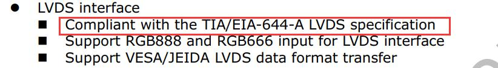
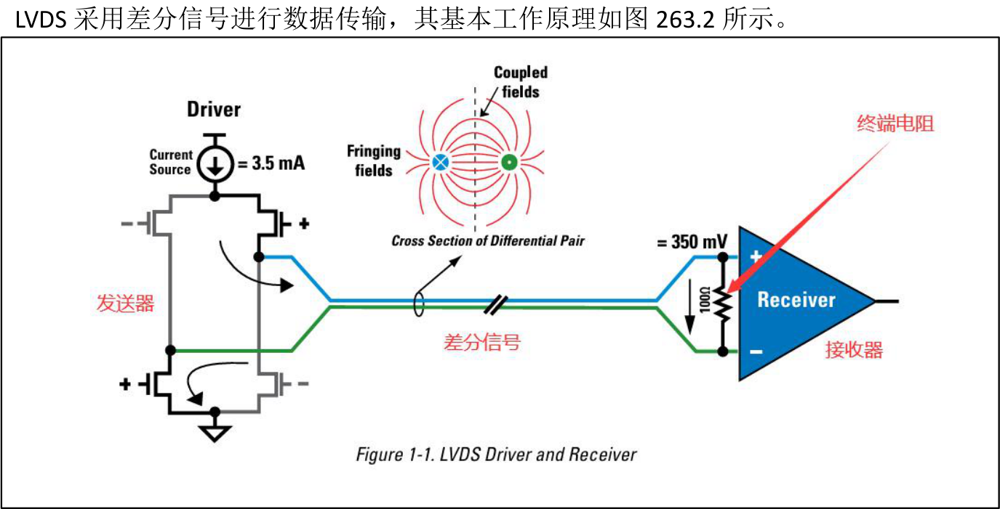
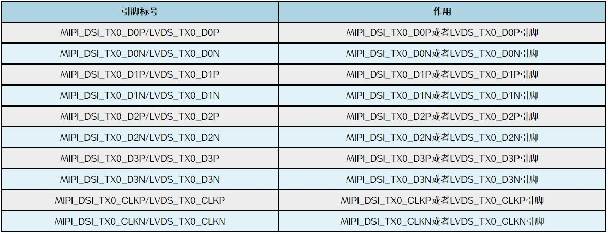
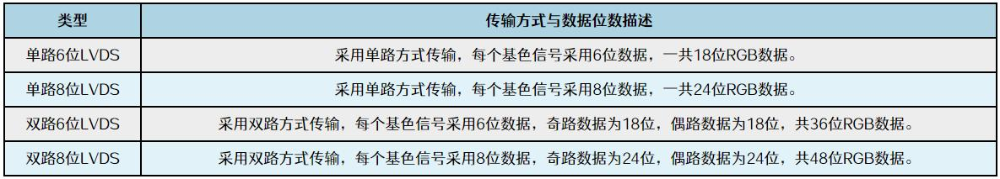
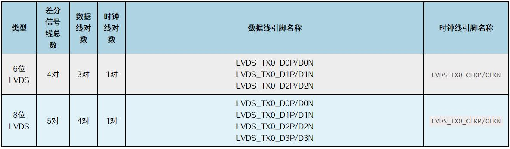
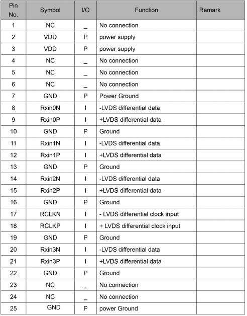
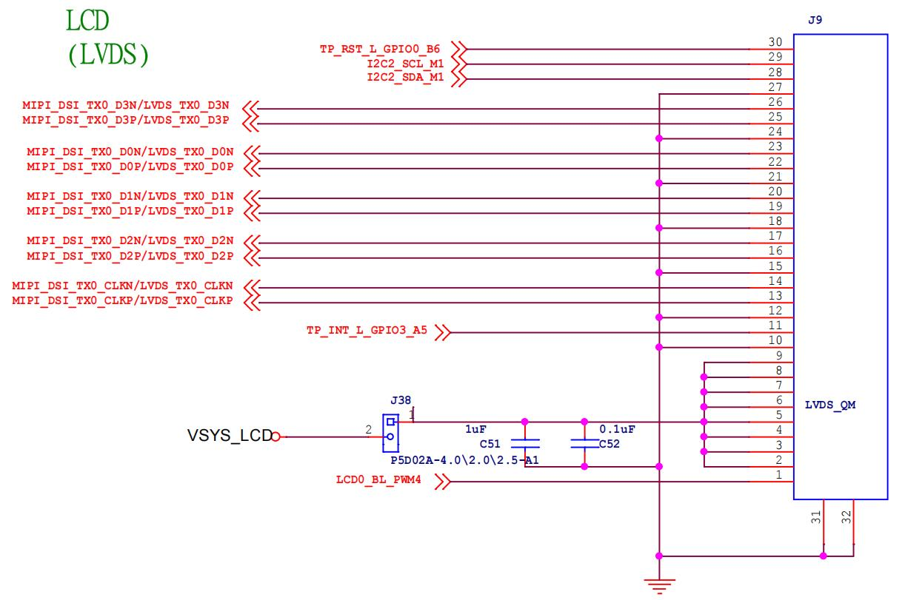
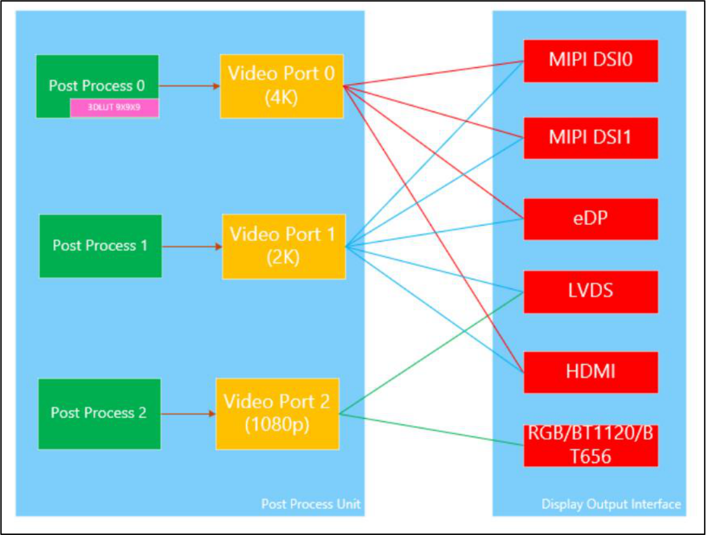

# 第263章 LVDS屏幕移植

## 263.1 LVDS 接口介绍
LVDS 全称是Low-Voltage Differential Signaling，即低电压差分信号。LVDS 具有低功耗，低误码率，低串扰，低抖动，低辐射和良好的信号完整性等特点。在显示器应用中非常广泛，比如笔记本电脑屏幕，医学设备显示器等。1994 年，以美国国家半导体（National Semiconductor, NS，现TI）为主推出了ANS/TIA/EIA-644 标准。在1996 年又推出了IEEE 1596.3 标准。不过现在IEEE 1596.3 很少使用了，主要流行的是ANS/TIA/EIA-644 标准，RK3568 处理器的LVDS 接口也是采用的此标准，数据手册相关内容如图263.1 所示。

图263.1

图263.2发送器一端有一个电流源，可以提供3.5mA 的电流。在接收器的输入端有一个100 欧姆的电阻，因为接收器内部的阻值很高，电流会通过100 欧姆的电阻回到发送器，所以在终端电阻

的俩端会有一个350mV 的电压。通过改变电流方向接收器就可以通过正负350mV 来判断输入的信号是正还是负。所以如果想了解关于LVDS 更多的内容，可以阅读TI 的LVDS Owner’s Manual 文档。RK3568 这颗处理器有1 路LVDS 接口，最大支持1280x800@60Hz 分辨率。LVDS 引脚如图263.3 所示。

图263.3LVDS 引脚也可以复用成一路MIPI DSI，在开发板上是被复用成了LVDS 引脚。
## 263.2 LVDS 屏幕介绍
在选型LVDS 屏幕时，常常遇到单6、单8、双6、双8 这些名词，这些名词代表什么意思呢？单6、单8、双6、双8 表示LVDS 屏幕接口方式不同。这里作者给大家做了整理，如图263.4 所示。

图263.4如何区分LVDS 屏幕接口是哪种方式呢？6 位与8 位LVDS 接口对比（以单路为例）：如图267.5 所示，其中6 位采用的是4 对差分信号线，其中3 对是数据线，1 对时钟线；8位采用的是5 对差分信号线，其中4 对是数据线，1 对时钟线。通过差分信号线的数量很好区

分是6 位还是8 位。区分完6 位和8 位以后，就要区分是单路还是双路。

图263.5单路与双路LVDS 对比:单路可以理解成是只有1 路LVDS 接口，双路就是有两路LVDS 接口。所以在区分是6 位还是8 位的时候是以单路为例，因为双路只需要在原来的基础上x2 就可以了。使用双路LVDS 有什么优势呢？随着屏幕的分辨率的增加，像素时钟也越来越高。但是像素时钟不能无限制的增加，所以就把要输出的像素按照顺序分为奇像素和偶像素，奇像素使用一路LVDS 进行传输，偶像素使用一路LVDS 进行传输。所以理论上双路LVDS 支持的分辨率更高。
实例分析:迅为10.1 寸LVDS 屏幕是哪种接口方式呢？我们直接看10.1 寸LVDS 屏幕接口定义，具体如图263.6 所示。


图263.6一共有Rxin0N/Rxin0P、Rxin1N/Rxin1P、Rxin2N/Rxin2P、Rxin3N/Rxin3P 和RCLKN/RCLKP 五对差分线，其中四对是数据线，一对是时钟线，并且只有1 路LVDS 接口，所以是单8 接口方式。除了路数和位数不同，LVDS 显示屏还有两种信号格式，分别是VESA 标准和JEIDA 标准，其中：VESA：全称为Video Electronics Standards Association，即视频电子标准协会。该组织制定了许多视频、显示器周边功能的相关标准。JEIDA：全称为Japan Electronic Industry Development Association，即日本电子工业发展协会。所以在调试屏幕时要注意LVDS 屏幕默认数据格式是采用VESA 标准还是JEIDA 标准，从而确定驱动是使用VESA 标准还是JEIDA 标准进行输出。

## 263.3 硬件原理图分析

图263.71.TP_RST_L_GPIO0_B6 是触摸复位引脚。2. I2C2_SCL_M1 是I2C2 SCL 引脚。用于和触摸芯片进行I2C 通信。I2C2_SDA_M1 是I2C2SDA 引脚。用于和触摸芯片进行I2C 通信。3. TP_INT_L_GPIO3_A5 是触摸中断引脚。4. LCD0_BL_PWM4 是PWM 引脚，用于调整屏幕背光。5. MIPI_DSI_TX0_D3N/LVDS_TX0_D3N、MIPI_DSI_TX0_D3P/LVDS_TX0_D3P、MIPI_DSI_TX0_D0N/LVDS_TX0_D0N、MIPI_DSI_TX0_D0P/LVDS_TX0_D0P、MIPI_DSI_TX0_D1N/LVDS_TX0_D1N、MIPI_DSI_TX0_D1P/LVDS_TX0_D1P、MIPI_DSI_TX0_D2N/LVDS_TX0_D2N、MIPI_DSI_TX0_D2P/LVDS_TX0_D2P、MIPI_DSI_TX0_CLKN/LVDS_TX0_CLKN、MIPI_DSI_TX0_CLKP/LVDS_TX0_CLKP 是LVDS 接口引脚。直接一一对应连接到处理器的LVDS 接口上。6.J38 是跳线帽插座，防止接错屏幕导致烧坏屏幕和CPU 使用，检查好硬件连接以后，需使用跳线帽连接电源。

## 263.4 适配步骤
### 263.4.1 设置LVDS 显示通路
使用LVDS 接口可以选择VP1 或者VP2，VP1 除了支持LVDS 输出，还支持MIPI，eDP，HDMI 输出。VP2 仅支持LVDS 和RGB 输出，如果使用VP1 输出LVDS 信号，其他信号如MIPI，eDP，HDMI 就不能使用。所以开发板上选择支持信号较少的VP2 作为LVDS 输出，留下支持信号更多的VP1 做其他选择。RK3568 VP 和各显示接口连接关系如图263.8 所示。

图263.8设置VP2 作为LVDS 显示通路之前需要先打开VOP 节点。因为迅为RK3568 开发板源码已默认开启VOP 节点，所以具体操作不在赘述，如想了解更多可参考设置RGB 显示通路章节中打开VOP 节点操作。打开VOP 以后，接下来设置LVDS 接口使用VP2 输出的显示通路。打开rk3568.dtsi 设备树文件，找到LVDS 节点如代码清单263.1 所示。代码清单263.1

```c
lvds: lvds {
    compatible = "rockchip,rk3568-lvds";
    phys = <&video_phy0>;
    phy-names = "phy";
    status = "disabled";
        ports {
             #address-cells = <1>;
             #size-cells = <0>;
             port@0 {
                 reg = <0>;
                 #address-cells = <1>;
                 #size-cells = <0>;
                 lvds_in_vp1: endpoint@1 {
                     reg = <1>;
                     remote-endpoint = <&vp1_out_lvds>;
                     status = "disabled";
                 lvds_in_vp2: endpoint@2 {
                 };
                     reg = <2>;
                     remote-endpoint = <&vp2_out_lvds>;
                     status = "disabled";
                 };
             };
        };
};
```
代码清单263.1 中第2 行compatible 属性值为rockchip,rk3568-lvds，表示会使用gpu/drm/rockchip/rockchip_lvds.c 这个驱动程序。第3 到4 行使用了video_phy0，所以我们需要使能video_phy0 节点。第5 行status 属性值为disabled，表示LVDS 节点被禁用，所以我们需要使能LVDS 节点。第6 到24 行表示LVDS 接口所对应的VP 端口，对于RK3568 的LVDS 接口来说需要使用VP2 进行输出，lvds_in_vp2 表示LVDS 接口连接到VP2，status 属性值为disabled 表示使用VP2 输出LVDS 被禁止。可以在topeet_rk3568_lcds.dtsi 设备树文件中添加如代码清单263.2 所示代码来设置LVDS显示通路。
```c
&lvds {代码清单263.2
    ports {
        port@1 {
             reg = <1>;
             lvds_out_panel: endpoint {
```

```c
remote-endpoint = <&panel_in_lvds>;
};
};
};
};
&lvds {
status = "okay";
};
&lvds_in_vp1{
status = "disabled";
&lvds_in_vp2 {
};
status = "okay";
&video_phy0{
};
status="okay";
};
```
代码清单263.2 中第2 到9 行通过port1 节点中的lvds_out_panel 节点设置LVDS 屏幕信息。LVDS 屏幕信息remote-endpoint 属性指向panel_in_lvds。第12 到14 行把LVDS 节点的status改成okay 使能LVDS。第16 到21 行关闭VP1，打开VP2 来输出LVDS。第22 到24 行打开video_phy0 节点。video_phy0 节点在rk3568.dtsi 设备树文件中，如代码清单263.3 所示。
```c
video_phy0: video-phy@fe850000 {代码清单263.3
    // 指定兼容的驱动程序，用于设备与驱动匹配
    compatible = "rockchip,rk3568-video-phy";
    //寄存器地址映射：定义两个物理地址段
    reg = <0x0 0xfe8500000x0 0x10000>,
          <0x0 0xfe060000 0x0 0x10000>;
    // 时钟信号配置：引用三个时钟源
        // ref: PHY 参考时钟（如MIPI DSI 高速时钟）
        // pclk_phy: PHY 模块的APB 总线时钟
        // pclk_host: 主机控制器（如DSI TX）的APB 总线时钟
    clocks = <&pmucru CLK_MIPIDSIPHY0_REF>,
             <&cru PCLK_MIPIDSIPHY0>, <&cru PCLK_DSITX_0>;
    clock-names = "ref", "pclk_phy", "pclk_host";
    #clock-cells = <0>;
    // 复位控制：关联PHY 模块的软复位信号
    resets = <&cru SRST_P_MIPIDSIPHY0>;
```

```c
reset-names = "rst";
//电源域管理：绑定到显示子系统电源域
power-domains = <&power RK3568_PD_VO>;
#phy-cells = <0>;
//初始状态：默认不启用
status = "disabled";
};
```
### 263.4.2 设置屏幕信息
在topeet_rk3568_lcds.dtsi 设备树文件中添加如代码清单263.4 所示代码。
```c
lvds_panel: panel {代码清单263.4
        compatible = "simple-panel";
        status = "disabled";
        backlight = <&backlight>;
        power-supply = <&vcc3v3_lcd0_n>;
        enable-delay-ms = <20>;
        prepare-delay-ms = <20>;
        unprepare-delay-ms = <20>;
        disable-delay-ms = <20>;
        bus-format = <MEDIA_BUS_FMT_RGB666_1X7X3_SPWG>;
        width-mm = <217>;
        height-mm = <136>;
              display-timings {
             native-mode = <&lvds_timing0>;
             lvds_timing0: lvds-timing0 {
                 clock-frequency = <53000000>;
                 hactive = <1024>;
                 vactive = <600>;
                 hback-porch = <160>;
                 hfront-porch = <24>;
                 vback-porch = <24>;
                 vfront-porch = <2>;
                 hsync-len = <116>;
                    vsync-len = <3>;
                    hsync-active = <0>;
                 vsync-active = <0>;
                 de-active = <0>;
                 pixelclk-active = <0>;
                 };
        };
```

```c
ports {
#address-cells = <1>;
#size-cells = <0>;
port@0 {
     reg = <0>;
     dual-lvds-even-pixels;
     panel_in_lvds: endpoint {
         remote-endpoint = <&lvds_out_panel>;
     };
};
};
};
```
代码清单263.4 中第1 到30 行描述了LVDS 屏幕信息，这些属性作用在RGB 章节已经解释过了，这里就不在赘述，其中bus-format 属性用来配置输出格式，输出格式要和LVDS 屏幕所支持的格式对应，其中属性值MEDIA_BUS_FMT_RGB666_1X7X3_SPWG 表示采用JEIDA_6BIT，属性值MEDIA_BUS_FMT_RGB888_1X7X4_SPWG 表示采用VESA_8BIT，属性值MEDIA_BUS_FMT_RGB888_1X7X4_JEIDA 表示采用JEIDA_8BIT。第32 到42 行是屏幕的ports 节点，其中第39 行设置了屏幕的远端端点是lvds_out_panel。这样RK3568 的LVDS 接口就和屏幕关联了起来。因为lvds_panel 节点默认是禁止的，所以还需将lvds_panel 节点打开，在topeet_rk3568_lcds.dtsi 设备树文件中添加如代码清单263.5 所示代码。
```c
&lvds_panel{代码清单263.5
        status = "okay";
};
```
### 263.4.3 设置背光和触摸
topeet_rk3568_lcds.dtsi 设备树文件中添加如代码清单263.6 所示代码。
```c
&backlight {代码清单263.6
        status = "okay";
        pwms = <&pwm4 0 25000 0>;
&gt9271
};
        status = "okay";
{
};
```

背光和触摸节点对应的属性已在RGB 章节解释过了，这里不在赘述。
### 263.4.4 设置屏幕LOGO
如果需要使用logo，可以在topeet_rk3568_lcds.dtsi 添加以下代码，通过追加的方式打开route_lvds 节点，追加代码如代码清单263.7 所示。
```c
&route_lvds{代码清单263.7
    status = "okay";
    connect = <&vp2_out_lvds>;
};
```
设置屏幕LOGO 对应的属性已在RGB 章节解释过了，这里不在赘述。

