# 第264章 MIPI屏幕移植

## 264.1 MIPI 接口介绍
在一些资料中，可能会看到“MIPI Alliance”（MIPI 联盟）这样的字眼。MIPI 联盟成立于2003 年，由ARM、Nokia、ST（意法半导体）、TI（德州仪器）等公司共同发起。那么，这个组织的主要职责是什么呢？本章将要介绍的MIPI 接口，全称为**Mobile Industry Processor Interface**（移动产业处理器接口），是由MIPI 联盟制定的一系列开放标准和规范。这些标准旨在为移动应用处理器提供统一的接口处理方法，将手机内部的各种接口（如摄像头、显示屏、射频/基带接口等）进行标准化，从而降低手机设计的复杂性。需要注意的是，MIPI 并不是指单一的接口或协议，而是一个包含了多种接口标准的体系。例如：MIPI DSI：用于串行显示接口（Display Serial Interface）。MIPI CSI：用于摄像头串行接口（Camera Serial Interface）。MIPI I3C：用于串行通信接口（改进版I2C）。MIPI RFFE：用于射频前端控制接口（RF Front-End Control Interface）。MIPI SPMI：用于系统电源管理接口（System Power Management Interface）。在本章中，我们将重点讨论MIPI DSI，其他接口暂不涉及。移动设备中mipi 相关接口使用示意图如图264.1 所示。

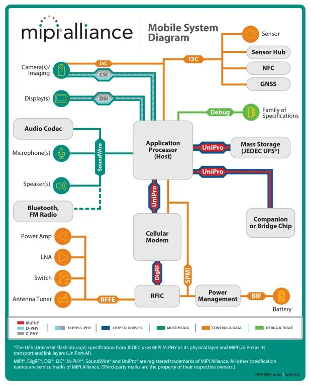
图264.1现在MIPI 联盟的成员日益增多，几乎包括了市面上所有主流处理器厂商，在MIPI 的官方网址中：https://www.mipi.org/可以看到MIPI 联盟的成员。MIPI Alliance 董事会成员公司如图264.2 所示。


图264.2
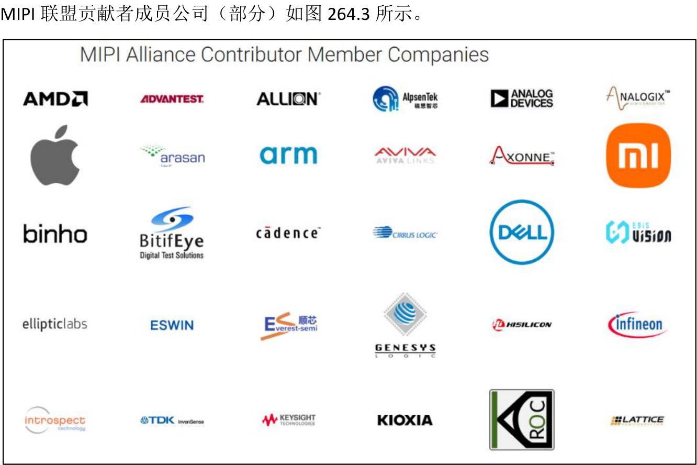
图264.3
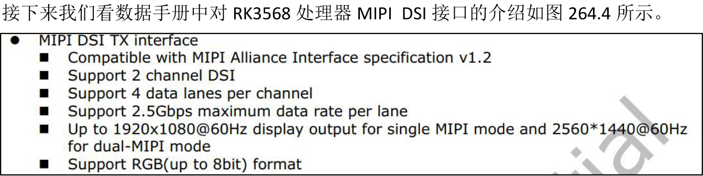
图264.4翻译：（1）支持MIPI v1.2 版本（2）支持俩通道DSI（3）每个通道支持4 data lanes（4）支持每条通道的最大数据速率为2.5Gbps（5）单mipi 模式最高可达1920x1080@60Hz 的显示输出，双MIPI 模式最高可达2560x1440@60Hz 的显示输出。（6）每个颜色通道最多支持8 位深度第5 条提到的单通道和双通道是什么意思呢？

对于单通道MIPI 屏幕来说，使用一路MIPI 接口即可，连接框图如图264.5 所示。
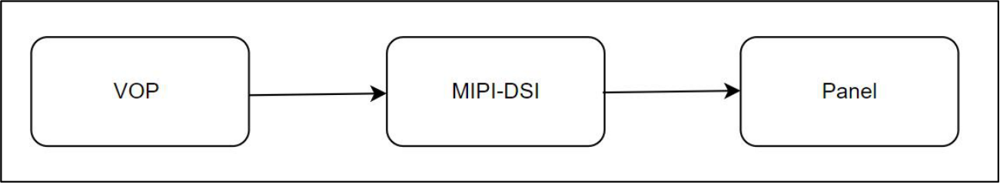
图264.5
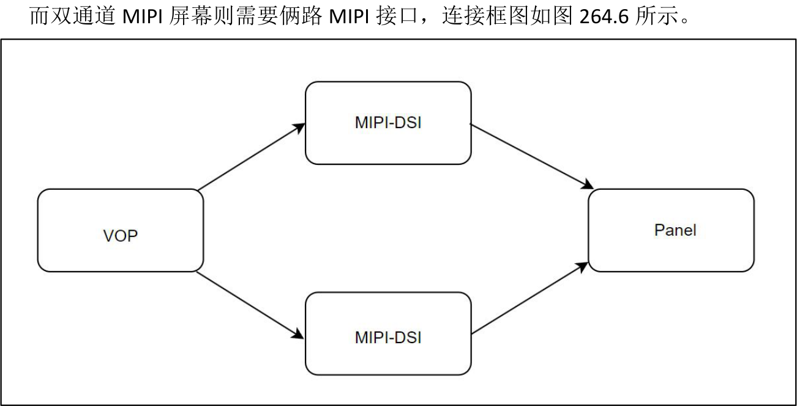
图264.61.RK3568 核心板MIPI DSI 接口引脚MIPI DSI0 接口引脚如图264.7 所示。
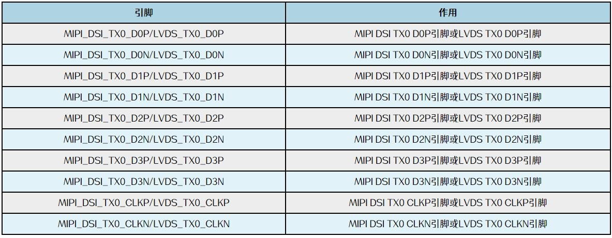
图264.7MIPI DSI0 接口与LVDS0 接口存在复用关系，在iTOP-RK3568 开发板上该接口是复用成了LVDS 接口。MIPI DSI1 接口引脚如图264.8 所示。

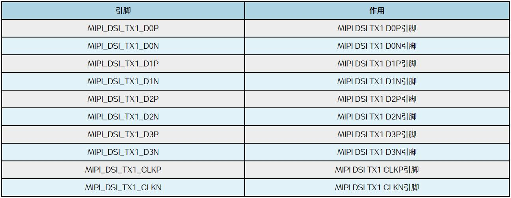
图264.8
## 264.2 MIPI 协议介绍
### 264.2.1 什么是lane？
在MIPI 硬件连接框图（图264.9）中提到了Lane 这个词，Lane 可以理解成通道，如2Lanes 就可以理解成2 通道，每个通道有2 条差分数据线。如MIPI_DSI_TX1_D0P 和MIPI_DSI_TX1_D0N 一对数据引脚就可以看作是1 个Lane，也就是1 个通道。在MIPI 章节中Lane 和通道不做区分，表示相同意思。
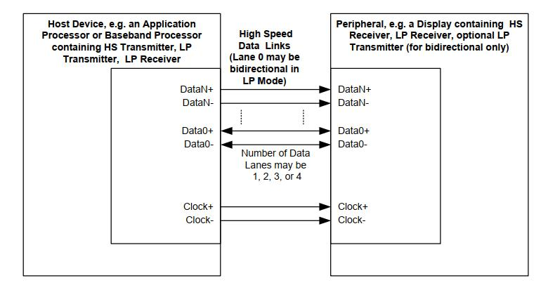
图264.9在图264.9 所示框图中告诉我们可以使用1/2/3/4Lanes 和一对时钟线进行数据传输，对于RK3568 核心板的MIPI 接口来说，是使用4Lanes 进行数据传输。在图264.9 中还告诉我们，在LP（Low-Power）模式下，只用Lane0 进行传输，并且可以

进行双向传输，在HS（High-Speed）模式下只能单向传输。我们来看单个Lane 的框架图如图264.10 所示。
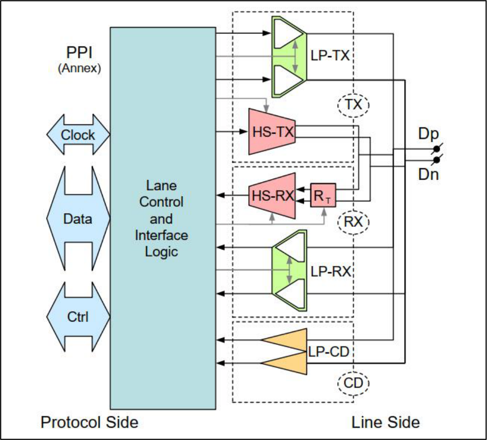
图264.10一个通道可能包含一个HS-TX、一个HS-RX，或者两者都有。在单个通道中，HS-TX 和HS-RX 在正常操作期间不会同时启用，所以对于HS（High-Speed）模式来说是单向传输。如果通道中高速功能（High-Speed function）未启用，则该功能应被置于高阻抗状态。低功耗竞争检测器（LP-CD）功能仅用于双向操作。低功耗竞争检测器功能在低功耗发射机驱动低功耗状态时启用，以检测竞争情况。1.信号电平在LP（Low-Power）模式下只用Lane0 进行传输，采用单端信号，信号电平在0 到1.2v。在HS（High-Speed）模式下采用差分信号进行传输，当P 比N 高时定义为1，P 比N 低时定义为0，差分线上典型电压为差分200mV，如图264.11 所示。

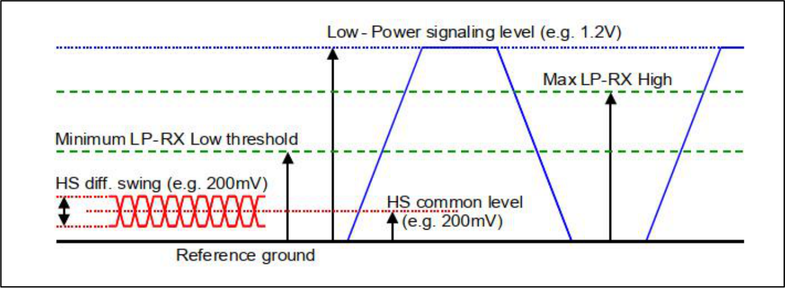
图264.11图264.11 中蓝色实线是LP（Low-Power）模式下信号波形图，红色实线是HS（High-Speed）模式下信号波形图。
2.通道状态在HS（High-Speed）模式下采用差分信号，当P 比N 高时定义为1，称之为HS-1，P 比N低时定义为0，称之为HS-0。所以在HS（High-Speed）模式下有HS-1，HS-0 俩种状态。在LP（Low-Power）模式下采用单端信号，一共有00，01，10，11 四种状态，分别称之为LP-00，LP-01，LP-10，LP-11。HS 模式和LP 模式下通道状态如图264.12 所示。
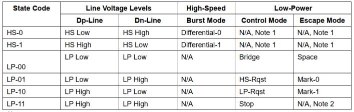
图264.123.三种工作模式通道(Lane)有控制模式、高速模式和Escape 模式三种工作模式，其中高速模式工作在HS（High-Speed）模式下，控制模式和Escape 模式工作在LP（Low-Power）模式下。这三种工作模式之间可以互相切换，控制模式工作在LP（Low-Power）模式下，所以有LP-00，LP-01，LP-10，LP-11 四种状态。在MIPI 协议中，将控制模式的四种不同状态组成的不同时序用来代表将要进入或者退出某种模式。比如LP11-LP01-LP00 表示进入高速模式。这里作者根据MIPI 协议规范整理了进入不同模式和退出模式的过程：

1.每个模式都必须从Stop State（LP-11）开始。2.高速模式和Escape 模式之间不可以直接来回切换，必须通过控制模式进行中转，即高速模式↔控制模式↔Escape 模式。3.进入Escape 模式和退出Escape 模式过程如下：Request：LP-11→LP-10→LP-00→LP-01→LP-00Exit：LP-10→LP-114.进入高速模式和退出高速模式过程如下：Request：LP-11→LP-01→LP-00Exit：EOT →LP-115.进入控制模式和退出控制模式过程如下：Request：LP-11→LP-10→LP-00→LP-10→LP-00Exit：LP-00→LP-10→LP-11Escape 模式是数据Lane 在LP（Low-Power）状态下的一种特殊模式，在这个模式下有LPDT（低功耗数据传输模式）、ULPS（超低功耗模式）、Trigger 等功能，一旦进入Escape 模式，发送端必须发送一个8bit 的命令来响应请求的动作，命令如图264.13 所示。
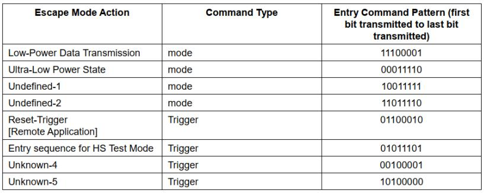
图264.13如果不在高速模式或Escape 模式，数据通道应保持在控制模式。
### 264.2.2 MIPI D-PHY 介绍
MIPI 除了有D-PHY，还有C-PHY，M-PHY。PHY 指的是物理层，那D，C，M 指的是什么呢？有的同学可能会认为D 是display，C 是camera，M 是memory 的缩写，然后就会认为D-PHY物理层用于屏幕外设，C-PHY 物理层用作摄像头外设，M-PHY 物理层存储外设。但是实际并不

是这样的，如图264.14 所示。
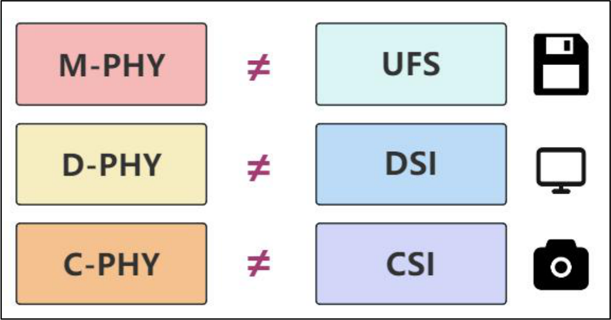
图264.14PHY 是物理层，如D-PHY 可以用于摄像头和屏幕外设，C-PHY 也可以用于摄像头和屏幕外设，M-PHY 可以用于摄像头和存储外设，如图264.15 所示。
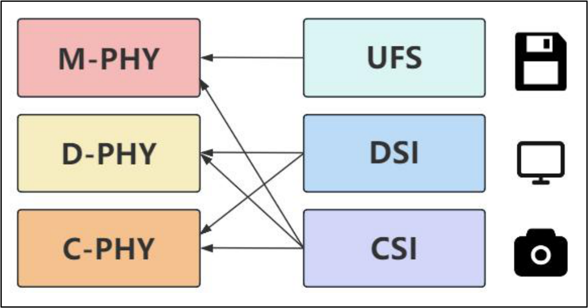
图264.15那D,C,M 表示的是什么呢？如D-PHY 中的D 指的是罗马数字500（最初的设计目标是500Mbits/s），不是Display，C 和M 分别表示罗马数字中的100 和1000。
### 264.2.3 MIPI DSI 介绍
MIPI DSI 采用分层结构，结构图如图264.16 所示，从下到上分为四层：PHY 层、通道管理层、协议层和应用层。

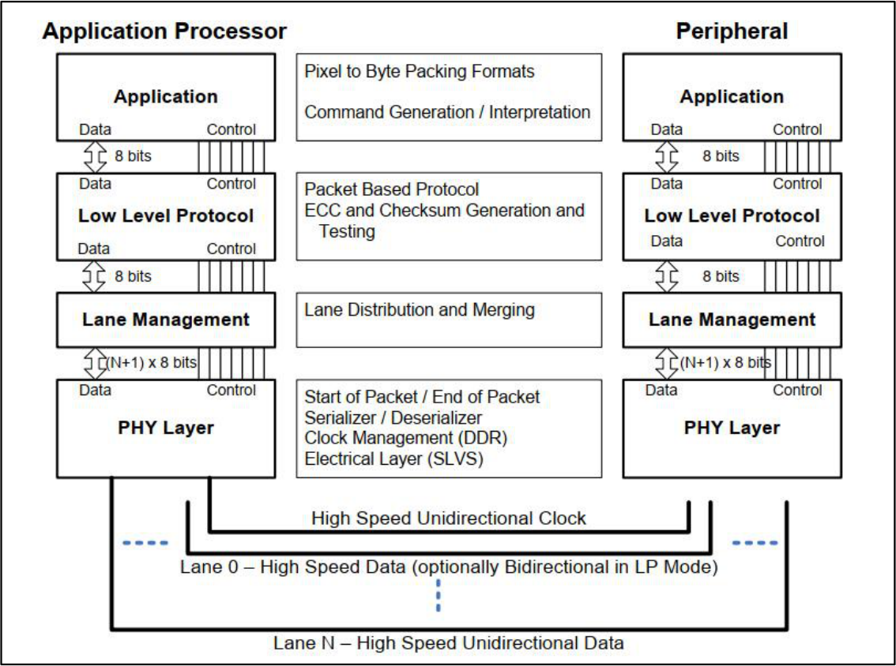
图264.161.PHY 层（物理层）物理层位于整个分层结构的最底层，在物理层规定了相关的电气属性，如传输介质、电气特性、IO 电路、和同步机制等。物理层还规定了信号传输开始（Start of Transmission，SoT）和信号传输结束（End of Transmission，EoT）的机制，以及可以在发送和接收物理层之间传递的其他“带外”信息。物理层支持HS（High-Speed）模式和LP（Low-Power）模式，其中HS 模式可以用来传输高速数据，如屏幕数据。LP 模式一般用于控制，如配置指令等。2.通道管理层数据信号的数量可能是1、2、3 或4 对，具体取决于应用所需的带宽要求。在接口的发射端，数据流被分配到一个或多个通道上，具有“分配器”功能。在接收端，接口从通道上收集字节，并将它们合并成一个重新组合的数据流，以恢复原始的流序列，具有“合并器”功能。“分配器”功能和“合并器”功能指的是什么呢？发送端如图264.17 所示：

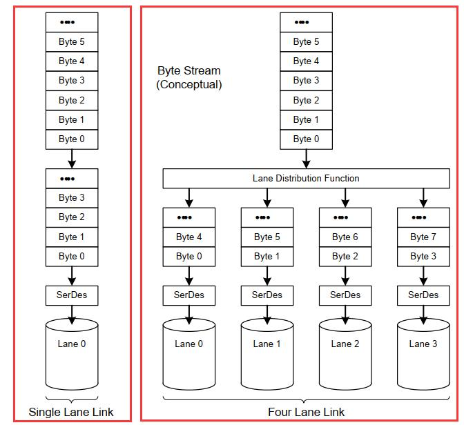
图264.17图264.17 左侧是使用1 对数据线的发送方式。只使用1 对数据线时发送只能按照串行顺序发送。图264.17 右侧是使用4 对数据线的发送方式。发送端会把串行数据平均分给4 对数据线并行传输。这个就是“分配器”功能。接收端如图264.18 所示：

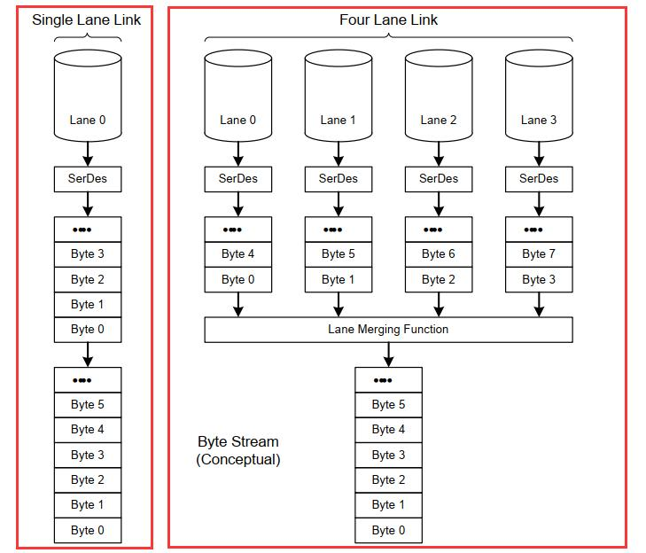
图264.18图264.18 左侧是使用1 对数据线的接收方式。只使用1 对数据线时接收只能按照串行顺序接收。图264.18 右侧是使用4 对数据线的接收方式。接收端会把并行的数据合并成串行数据。这个就是“合并器”功能当发送端使用4 对数据线时，可以按照Byte0 分配给Lane0，Byte1 分配给Lane1，Byte2分配给Lane2，Byte3 分配给Lane3 这样平均分配，但是如果采用3 对数据线时就不能平均分配了。在MIPI 协议规范中是这样解释的，对于非整数倍传输（2 对数据线的整数倍）采用如图264.19 所示模式。

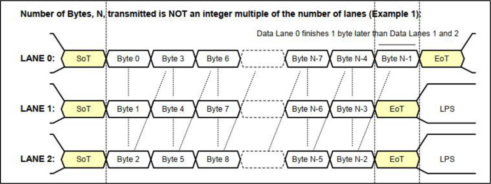
图264.19从图264.19 可以看出，当Lane 数量不是2 的整数倍时，可能出现各Lane 传输完成的时间不同。在这种情况下，先完成的Lane 会提前进入EoT 模式。
3.协议层协议层主要是将字节组织成预定义的单元，这些单元被称为包，即打包操作。数据会被打包成长包和短包俩种格式。4.短包（short packet）格式
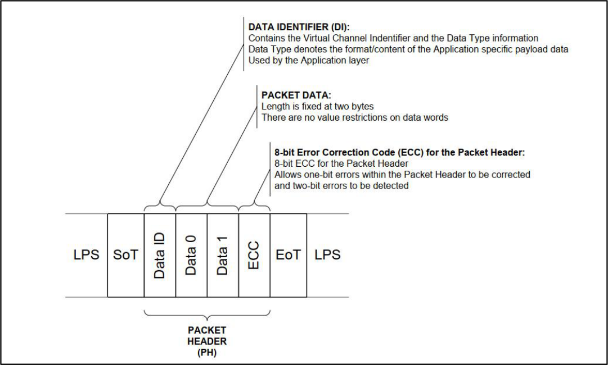
图264.20由图264.20 可知，短包一共占用4 个字节，其中：1.数据标识符（DI）：占1 字节，包含虚拟通道标识符和数据类型信息。数据类型表示应用程序特定负载数据的格式/内容，由应用层使用。2.数据字段：长度固定为两个字节，数据没有取值限制。3.ECC：占1 字节，用于单比特错误纠正和双比特错误检测。

这里重点介绍一下DI 部分，DI 部分由虚拟通道和负载数据类型两部分组成，如图264.21所示。
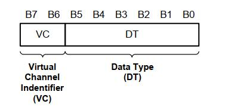
图264.21其中bit6 到bit7 表示虚拟通道。DSI 协议允许最多四个虚拟通道，使多个外设可以共享同一DSI 链路。bit0 到bit5 表示要发送的负载数据类型，负载数据类型如图264.22 所示：
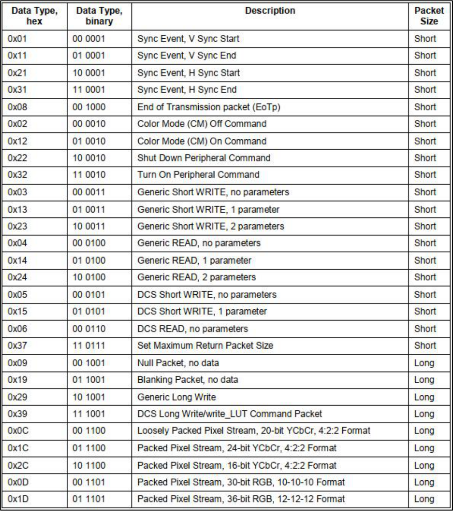
图264.225.长包（short packet）格式

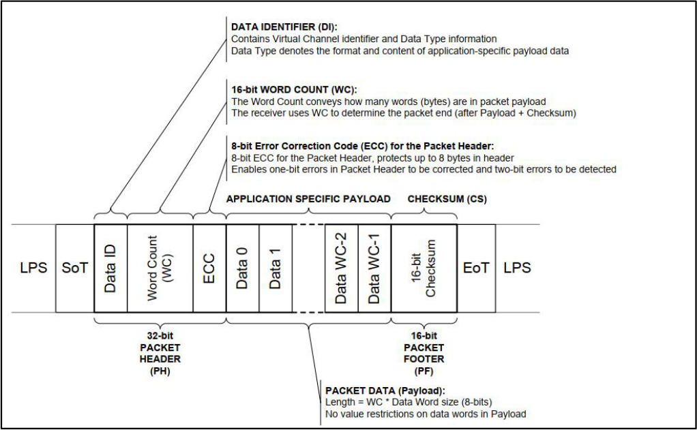
图264.23由图264.23 可知，长包由三个部分组成：一个32 位的包头（PH）、一个具有可变字节数的应用特定数据载荷以及一个16 位的包尾（PF）。包头（PH）进一步由三个部分组成：一个8 位的数据标识符（DI）、一个16 位的字数计数，和一个8 位的错误校正码（ECC）。6.包传输方式在MIPI DSI 数据传输中是通过数据Lane 将打包好的数据包发送出去。最简单的情况下，一次传输只包含一个数据包。如果需要传输多个数据包，数据包是单独传输，就需要频繁地在LPS（Low Power State）和HS（High-Speed）模式之间切换，所产生的开销将严重限制带宽。传输过程如图264.24 所示。
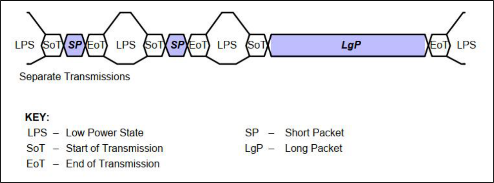
图264.24为什么需要频繁地在LPS（Low Power State）和HS（High-Speed）模式之间切换呢？在图264.24 中可以看出，当SP（Short Packet）传输完成以后会产生EoT（End of Transmission）信号退出HS（High-Speed）模式。而如果不在HS（High-Speed）模式或Escape 模式，

数据通道应保持在控制模式。而控制模式工作在LP（Low-Power）模式下，也就是处于LPS（Low Power State）中。下一次传输时候需要再次进入HS（High-Speed）模式下进行传输。所以需要频繁切换。所以在MIPI DSI 协议中允许将多个数据包连接在一起进行传输，长包和短包可以任意顺序出现，这样可以显著提高有效带宽。这种方式对于诸如外围设备初始化等事件非常有用，因为在系统启动时，可能需要使用单独的写入命令加载许多寄存器。传输过程如图264.25 所示：
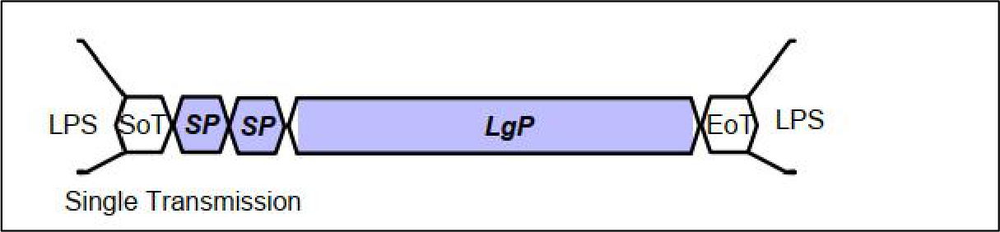
图264.25在物理层（PHY 层）上，存在两种数据传输模式：HS（High-Speed）传输模式和LP（Low-Power）传输模式。在HS（High-Speed）传输开始之前，发射器的物理层会向接收器发出一个SoT（开始传输）序列。之后，可以在高速模式下传输数据或命令数据包。单个HS（High-Speed）传输中可能存在多个数据包，并且传输的结束总是在物理层上使用专用的EoT（传输结束）序列进行信号通知。为了增强系统的整体鲁棒性，DSI 在协议层上定义了一个专用的EoT 数据包（EoTp）来指示HS（High-Speed）传输的结束。为了与早期的DSI 向后兼容，可以启用或禁用EoTp 的功能。启用或禁用此功能的方法不在本文档的讨论范围内。如图264.26 中是使用EoTp 情况下的HS（High-Speed）传输过程。
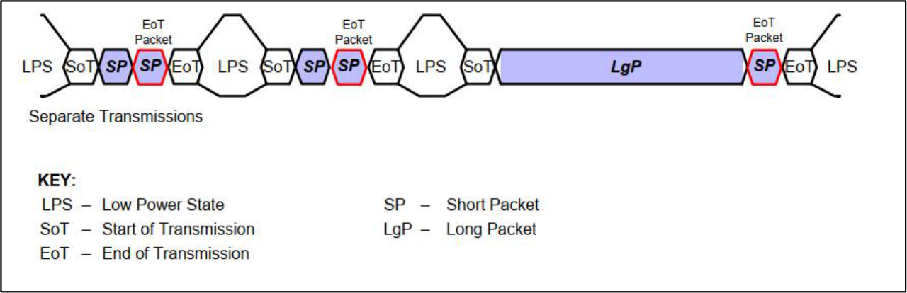
图264.26图264.26 中EoT 短包被红色高亮显示。传输过程表示主机打算使用两次单独的传输来各发送一个短包，随后在发送一个长包。在这个传输过程中，每次传输结束前都会产生一个额外的

EoT 短包来通知此次传输结束。当然，使用EoT 短包也可以将多个数据包连接在一起进行传输，传输过程如图264.27 所示。
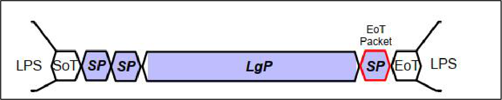
图264.277.包传输策略在MIPI 规范中规定，如果传输多个字节，低字节先传输，高字节后传输。每个字节中的位按照低位在前，高位在后的顺序传输。传输顺序如图264.28 所示。
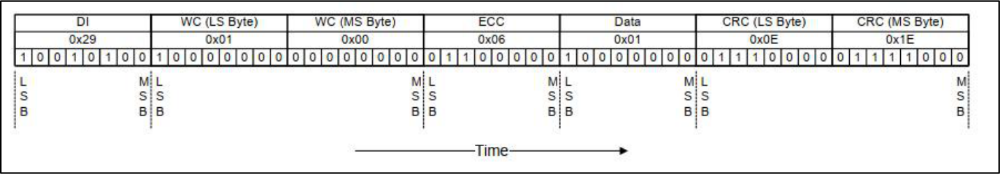
图264.288.应用层高层编码和解析数据流。
### 264.2.4 视频和命令模式
MIPI DSI 有视频模式（video mode）和命令模式（command mode）俩种。使用哪种模式取决于外设的架构和能力。一般情况下，外设只需要支持其中任意一种模式即可。但是也有部分支持视频模式的设备同时也支持一些基本的命令模式的功能。1.视频模式视频模式主要针对没有frambuffer 的LCD 屏进行操作，无论当前显示是否有数据更新，DSI host 端会一直发送数据给屏幕（需要不停的刷数据）。

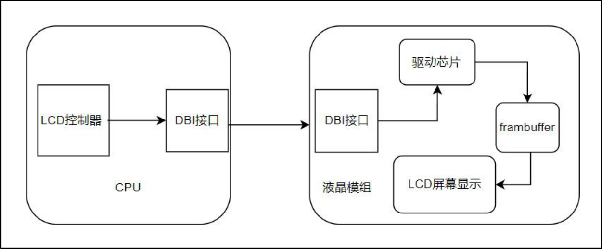
图264.29
```c
视频模式三种传输方式
```
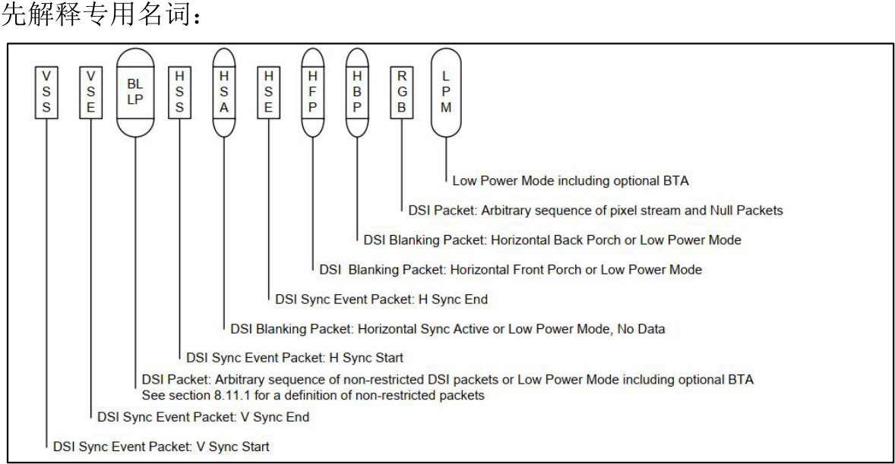
图264.30
Non-Burst Mode with Sync Pulses 方式：使外设能够准确重建原始视频时序，包括同步脉冲宽度。精确的重建时序就是通过DSI传输后的数据，在对端可以精确的还原成DPI 的时序。该模式时序图如下：

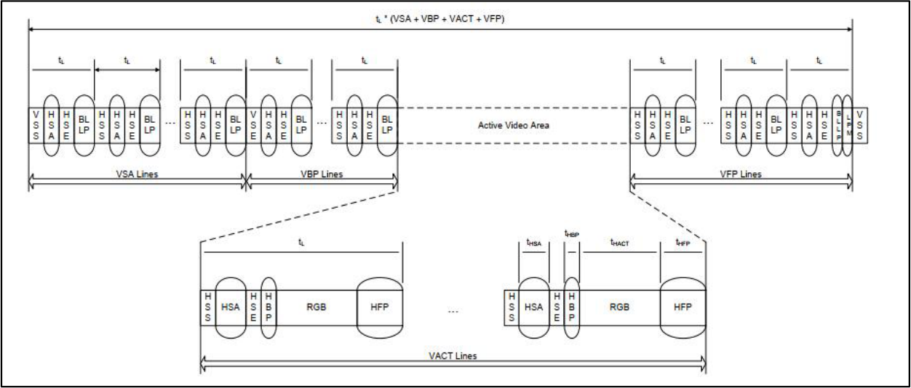
图264.31
Non-Burst Mode with Sync Pulses 方式要准确重建原始视频时序，所以在时序图中可以看到VSYNC,HSYNC，HBP,HFP 等信号。
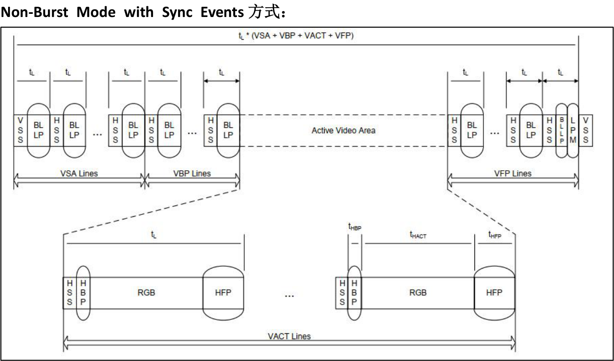
图264.32
与Non-Burst Mode with Sync Pulses 方式类似，但不支持准确重建同步脉冲宽度。所以在该时序中并未见到VSE，HSE 等信号。Burst Mode 方式：

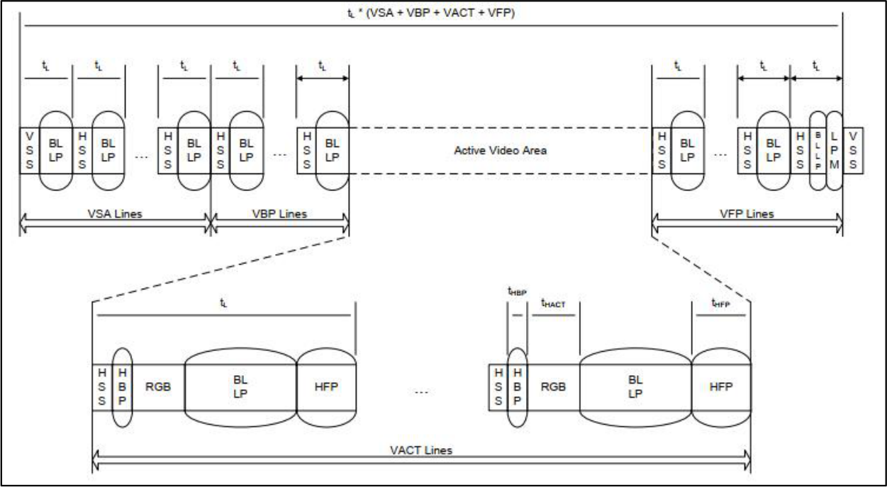
图264.33
该方式RGB 像素时间会被压缩，从而可以在行扫描期间留下更多的时间用于低功耗模式或者将其他传输复用到DSI 链路上。从时序图中可以看出，RGB 像素数据会尽快传输完成，然后进入BLLP 模式节省功耗。
2.命令模式命令模式主要针对有frambuffer 的LCD 屏进行操作的，只有在画面需要变化时，DSI host端才发送数据给屏幕。
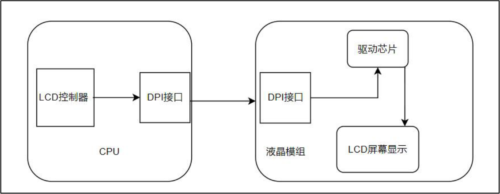
图264.34
在命令模式中有一个重要的TE 控制信号，TE 控制信号的作用是什么呢？如LCD 拥有自己的timing 控制器和GRAM，为了防止Tearing Effect，必须主动通知Host，在MIPI DSI 定义一个标准的TE trigger 消息，一旦收到这个消息，自动发送像素数据。

## 264.3 硬件原理图分析
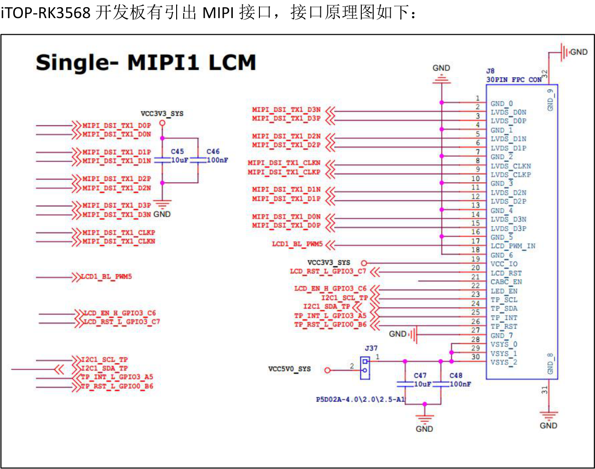
图264.35
1.TP_RST_L_GPIO0_B6 是触摸复位引脚。2.TP_INT_L_GPIO3_A5 是触摸中断引脚。3.i2c1_SCL_TP 是i2c1 SCL_TP 引脚。用于和触摸芯片进行i2c 通信。i2c1_SDA_TP 是i2c1 SDA 引脚。用于和触摸芯片进行i2c 通信。4.LCD_EN_H_GPIO3_C6 是屏幕使能引脚5.LCD_RST_L_GPIO3_C7 是屏幕复位引脚6.LCD1_BL_pwm5 是pwm 引脚，用于调整屏幕背光。7.MIPI_DSI_TX1_D3N、MIPI_DSI_TX1_D3P、MIPI_DSI_TX1_D2N、MIPI_DSI_TX1_D2P、MIPI_DSI_TX1_CLKN、MIPI_DSI_TX1_CLKP、MIPI_DSI_TX1_D1N、MIPI_DSI_TX1_D1P、

MIPI_DSI_TX1_D0N、MIPI_DSI_TX1_D0P 是MIPI1 接口引脚。直接一一对应连接到处理器的MIPI1 接口上，MIPI 接口为4lanes 接口。J37 是跳线帽插座，防止接错屏幕导致烧坏屏幕和CPU 使用，检查好硬件连接以后，需使用跳线帽连接电源。
## 264.4 适配步骤
### 264.4.1 设置MIPI 显示通路
使用MIPI 接口可以选择VP0 或者VP1，VP0 和VP1 均支持MIPI0 和MIPI1，由于在开发板上MIPI0 和LVDS 接口复用并被用于LVDS 接口，所以开发板上MIPI 接口使用MIPI1。开发板选择VP1 输出MIPI 信号，因为VP0 可以支持的最大分辨率可达4K，可以预留HDMI 使用。RK3568 VP 和各显示接口连接关系：
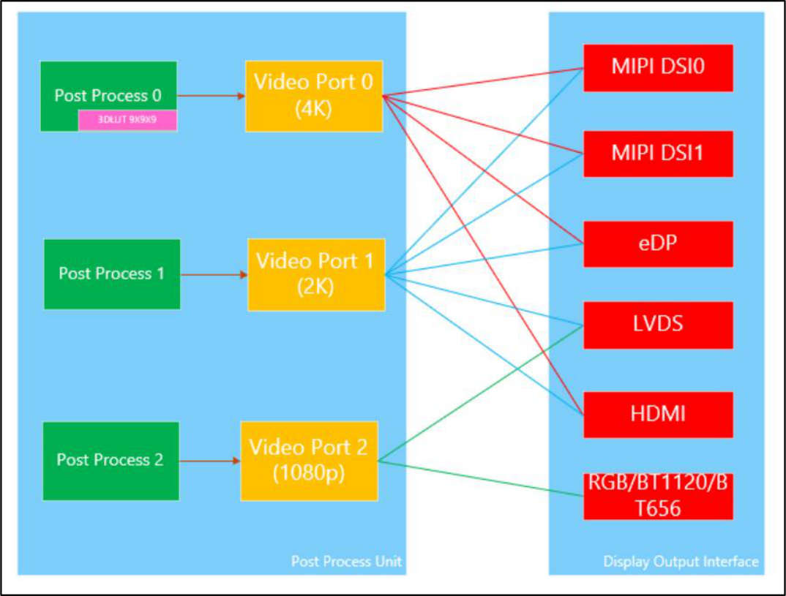
图264.36
设置VP1 作为MIPI 显示通路之前需要先打开VOP 节点。因为迅为RK3568 开发板源码已默认开始VOP 节点，所以具体操作不在赘述，如想了解更多可参考设置RGB 显示通路章节中打开VOP 节点操作。打开VOP 以后，接下来设置MIPI1 接口使用VP1 输出的显示通路。打开rk3568.dtsi 设备树文件，找到MIPI1 节点。

```c
dsi1: dsi@fe070000 {代码清单264.1
compatible = "rockchip,rk3568-mipi-dsi";
reg = <0x0 0xfe070000 0x0 0x10000>;
interrupts = <GIC_SPI 69 IRQ_TYPE_LEVEL_HIGH>;
clocks = <&cru PCLK_DSITX_1>, <&cru HCLK_VO>, <&video_phy1>;
clock-names = "pclk", "hclk", "hs_clk";
resets = <&cru SRST_P_DSITX_1>;
reset-names = "apb";
phys = <&video_phy1>;
phy-names = "mipi_dphy";
power-domains = <&power RK3568_PD_VO>;
rockchip,grf = <&grf>;
#address-cells = <1>;
#size-cells = <0>;
status = "disabled";
ports {
    #address-cells = <1>;
    #size-cells = <0>;
    dsi1_in: port@0 {
        reg = <0>;
        #address-cells = <1>;
        #size-cells = <0>;
        dsi1_in_vp0: endpoint@0 {
             reg = <0>;
             remote-endpoint = <&vp0_out_dsi1>;
             status = "disabled";
        };
        dsi1_in_vp1: endpoint@1 {
             reg = <1>;
             remote-endpoint = <&vp1_out_dsi1>;
             status = "disabled";
        };
    };
};
};
```
第2 行compatible 属性值为rockchip,rk3568-mipi-dsi，表示会使用gpu/drm/rockchip/dw-mipi-dsi.c 这个驱动程序。

第3 行设置寄存器地址范围：起始地址0xfe070000，大小0x10000。第4 行配置中断：GIC SPI 中断号69，高电平触发。第5 到6 行配置pclk, hclk, hs_clk 时钟。第7 到8 行配置abp 复位信号。第9 到10 行配置使用video_phy1。第11 到12 行配置PD_VO 电源域。第15 行status 属性值为disabled，表示禁用此节点，因为要使用MIPI1 所以后面需要使能该节点。第17 到38 行表示MIPI 接口所对应的VP 端口，dsi1_in_vp0 表示MIPI1 接口连接到VP0，dsi1_in_vp1 表示MIPI1 接口连接到VP1。status 属性值为disabled 表示使用VP0/1 输出MIPI 被禁止。可以在topeet_rk3568_lcds.dtsi 设备树文件中添加以下代码来设置MIPI 显示通路。
```c
&dsi1{代码清单264.2
    status = "okay";
&dsi1_in_vp0 {
};
    status = "disabled";
&dsi1_in_vp1 {
};
status = "okay";
&video_phy1{
};
    status = "okay";
};
```
第1 行将dsi1 节点中的status 属性设置成okay，表示使能dsi1 节点。第4 到9 行表示关闭VP0，打开VP1，表示使用VP1 输出MIPI。第11 行将video_phy1 节点中的status 属性设置成okay，表示使能video_phy1 节点。video_phy1 节点在rk3568.dtsi 设备树文件中。
```c
video_phy1: video-phy@fe860000 {代码清单264.3
    // 兼容性定义，标识硬件平台及驱动
    compatible = "rockchip,rk3568-video-phy";
    // 寄存器区域定义：
```

```c
// - PHY1 物理层寄存器：0xfe860000-0xfe86ffff
// - DSI_TX_PHY1 主控制器寄存器：0xfe070000-0xfe07ffff
reg = <0x0 0xfe860000 0x0 0x10000>,
      <0x0 0xfe070000 0x0 0x10000>;
// 时钟源定义：
// - ref: PHY 参考时钟（MIPI DSIPHY1 参考时钟）
// - pclk_phy: PHY 外设总线时钟
// - pclk_host: DSI 主机控制器时钟
clocks = <&pmucru CLK_MIPIDSIPHY1_REF>,
         <&cru PCLK_MIPIDSIPHY1>,
         <&cru PCLK_DSITX_1>;
clock-names = "ref", "pclk_phy", "pclk_host";
#clock-cells = <0>;
// 复位控制信号
resets = <&cru SRST_P_MIPIDSIPHY1>;
reset-names = "rst";
// 电源域配置
power-domains = <&power RK3568_PD_VO>;
#phy-cells = <0>;
//默认不启用，需在具体板级配置中开启
status = "disabled";
};
```
### 264.4.2 设置屏幕信息
在topeet_rk3568_lcds.dtsi 设备树文件中添加以下代码。
```c
&dsi1 {代码清单264.4
        status = "disabled";
        //rockchip,lane-rate = <1000>;
        dsi1_panel: panel@0 {
                status = "disabled";
                compatible = "simple-panel-dsi";
                reg = <0>;
                backlight = <&backlight>;
```

```c
reset-delay-ms = <60>;
enable-delay-ms = <60>;
prepare-delay-ms = <60>;
unprepare-delay-ms = <60>;
disable-delay-ms = <60>;
dsi,flags = <(MIPI_DSI_MODE_VIDEO | MIPI_DSI_MODE_VIDEO_BURST |
        MIPI_DSI_MODE_LPM | MIPI_DSI_MODE_EOT_PACKET)>;
dsi,format = <MIPI_DSI_FMT_RGB888>;
dsi,lanes= <4>;
panel-init-sequence = [
        29 00 03 E0 AB BA
        29 00 03 E1 BA AB
        15 00 02 B0 00
        29 00 05 B1 10 01 47 FF
        29 00 07 B2 0C 0E 04 14 14 14
        29 00 04 B3 56 D3 00
        29 00 04 B4 22 30 04
        15 00 02 B5 00
        29 00 08 B6 B0 00 00 10 00 10 00
        29 00 09 B7 0E 00 FF 08 08 FF FF 00
        29 00 08 B8 05 12 29 49 48 00 00
        29 00 27 B9 4D 42 38 31 33 27 2F 1B 36 35 35 53 41 49 3D 3D 33 29 26
4C 42 39 31 33 27 2F 1B 36 35 35 53 41 49 3D 3D 33 29 26
        29 00 09 BA 00 00 00 44 24 00 00 00
        29 00 04 BB 76 00 00
        29 00 03 BC 00 00
        29 00 06 BD FF 00 00 00 00
        15 00 02 BE 00
        29 00 11 C0 98 76 12 34 33 33 44 44 06 04 8A 04 0F 00 00 00
        29 00 0B C1 53 94 02 85 06 04 8A 04 54 00
        29 00 0D C2 37 09 08 89 08 10 22 21 44 BB 18 00
        29 00 17 C3 9C 1D 1E 1F 10 12 0C 0E 05 24 24 24 24 24 24 07 24 24 24
24 24 24
        29 00 17 C4 1C 1D 1E 1F 11 13 0D 0F 04 24 24 24 24 24 24 06 24 24 24
24 24 24
        29 00 04 C5 E8 85 76
        29 00 03 C6 20 20
        29 00 17 C7 41 01 0D 11 09 15 19 4F 10 D7 CF 19 1B 1D 03 02 25 30 00
03 FF 00
        29 00 07 C8 61 00 31 42 54 16
        29 00 06 C9 A1 22 FF Cd 23
        29 00 03 CA 4B 43
        29 00 05 CC 2E 02 04 08
        29 00 09 CD 0E 64 64 20 1E 6B 06 83
```

```c
29 00 04 D0 27 10 80
29 00 05 D1 00 0D FF 0F
29 00 05 D2 E3 2B 38 00
29 00 0C D4 00 01 00 0E 04 44 08 10 00 07 00
15 00 02 D5 00
29 00 03 D6 00 00
29 00 05 D7 00 00 00 00
29 00 04 E4 08 55 03
29 00 09 E6 00 01 FF FF FF FF FF FF
29 00 04 E7 00 00 00
29 00 08 E8 D5 FF FF FF 00 00 00
15 00 02 E9 FF
29 00 06 F0 12 03 20 00 FF
29 00 1B F1 A6 C8 EA E6 E4 CC E4 BE F0 B2 AA C7 FF 66 98 E3 87 C8 99
C8 8C BE 96 91 8F FF
15 00 02 F3 03
29 00 1B F4 FF FE FC FA F8 F4 F0 E8 E0 D0 C0 A0 80 7F 5F 3F 2F 1F 17 0F
0B 07 05 03 01 00
29 00 1B F5 FF FE FC FA F8 F4 F0 E8 E0 D0 C0 A0 80 7F 5F 3F 2F 1F 17 0F
0B 07 05 03 01 00
29 00 1B F6 FF FE FC FA F8 F4 F0 E8 E0 D0 C0 A0 80 7F 5F 3F 2F 1F 17 0F
0B 07 05 03 01 00
29 00 08 F7 00 00 00 00 00 00 00
29 00 08 F8 00 00 00 00 00 00 00
29 00 08 F9 00 00 00 00 00 00 00
29 00 1A FA 00 84 12 21 48 48 21 12 84 69 69 5A A5 96 96 A5 5A B7 DE
ED 7B 7B ED DE B7
29 00 18 FB 00 12 0F FF FF FF 00 38 40 08 70 0B 40 19 50 21 C0 27 60
2D 00 00 0F
29 00 03 E3 20 21
05 C8 01 11
05 14 01 29
];
panel-exit-sequence = [
05 05 01 28
05 78 01 10
disp_timings1: display-timings {
];
native-mode = <&dsi1_timing0>;
dsi1_timing0: timing0 {
        clock-frequency = <60000000>;
        hactive = <800>;
        vactive = <1280>;
```

```c
hfront-porch = <80>;
hsync-len = <20>;
hback-porch = <80>;
vfront-porch = <20>;
vsync-len = <4>;
vback-porch = <12>;
hsync-active = <0>;
vsync-active = <0>;
de-active = <0>;
pixelclk-active = <0>;
};
};
ports {
#address-cells = <1>;
#size-cells = <0>;
port@0 {
reg = <0>;
panel_in_dsi1: endpoint {
        remote-endpoint = <&dsi1_out_panel>;
};
};
};
};
ports {
#address-cells = <1>;
#size-cells = <0>;
port@1 {
reg = <1>;
dsi1_out_panel: endpoint {
remote-endpoint = <&panel_in_dsi1>;
};
};
};
};
```
第2 行status 属性值为disabled，表示dsi1 节点默认为关闭状态。在设置MIPI 显示通路章节中已经将dsi1 节点打开。第3 行rockchip,lane-rate 属性只有在使用Dual-link 模式时才会涉及。用于指定数据lane 的

速率，单位为mbps/lane。第4 到109 行用于设置MIPI 屏幕信息，其中：第5 行status 属性值为disabled，表示dsi1_panel 节点默认为关闭状态。第7 行reg 属性值为0，表示virtual channel 通道0。一般情况下不会涉及virtual channel，保持默认值0 即可。第8 到13 行属性在RGB 屏幕移植已经解释过，这里不在赘述。第14 行dsi,flags 属性表示模式。其中：属性值为MIPI_DSI_MODE_VIDEO，MIPI_DSI_MODE_VIDEO_BURST 表示Video Burst Mode。属性值为MIPI_DSI_MODE_LPM 表示默认在LP 模式下发送初始化序列。属性值为MIPI_DSI_MODE_EOT_PACKET 表示关闭EOTP 特性。第16 行dsi,format 属性表示像素格式。属性值MIPI_DSI_FMT_RGB888 表示使用RGB88 像素格式。第17 行dsi,lanes 属性表示通道数。属性值范围为1 到8，大于4 表示为Dual-channel MIPI-DSI 屏幕。这里使用迅为4lanes 的MIPI 屏幕，所以属性值为4。第18 到86 行panel-init-sequence 属性表示MIPI 屏的上电初始化序列。第88 到91 行panel-exit-sequence 属性表示MIPI 屏的下电初始化序列。上电和下电初始序列填写比较重要，单独使用一个篇幅讲解，请参考MIPI 初始化序列章节。第92 到108 行这些属性作用在RGB 章节已经解释过了，这里就不在赘述。第111 到134 行设置屏幕的ports 节点。因为dsi1_panel 节点默认是禁止的，所以还需将dsi1_panel 节点打开，在topeet_rk3568_lcds.dtsi 设备树文件中添加以下代码。
```c
&dsi1_panel代码清单264.5
    status = "okay";
{
};
```
### 264.4.3 MIPI 初始化序列
当我们拿到一款MIPI 屏幕时，厂家会给这样的一串参数，以迅为7 寸MIPI 屏幕为例：代码清单264.6

```c
SSD_SEND(0x01,0xE0,0xAB,0xBA);
SSD_SEND(0x01,0xE1,0xBA,0xAB);
SSD_SEND(0x01,0xB1,0x10,0x01,0x47,0xFF);
SSD_SEND(0x01,0xB2,0x0C,0x14,0x04,0x50,0x50,0x14);SSD_SEND(0x01,0xB3,0x56,0xD3,0x00);
SSD_SEND(0x01,0xB4,0x33,0x30,0x04);
SSD_SEND(0x01,0xB6,0x0B,0x00,0x00,0x10,0x00,0x10,0x00);
SSD_SEND(0x01,0xB8,0x05,0x12,0x29,0x49,0x48,0x00,0x00);
SSD_SEND(0x01,0xB9,0x4C,0x44,0x3C,0x33,0x33,0x26,0x2F,0x1B,0x35,0x35,0x35,0x53,0x41,0x48,0x3D,0
x38,0x2B,0x19,0x06,0x4C,0x44,0x3C,0x33,0x33,0x26,0x2F,0x1B,0x35,0x35,0x35,0x53,0x41,0x48,0x3D,0x
38,0x2B,0x19,0x06);
SSD_SEND(0x01,0xC0,0x98,0x76,0x12,0x34,0x33,0x33,0x44,0x44,0x06,0x04,0x8A,0x04,0x0F,0x00,0x
00,0x00);
SSD_SEND(0x01,0xC1,0x53,0x94,0x02,0x85,0x06,0x04,0x8A,0x04,0x54,0x00);
SSD_SEND(0x01,0xC2,0x37,0x09,0x08,0x89,0x08,0x10,0x22,0x21,0x44,0xBB,0x18,0x00);
SSD_SEND(0x01,0xC3,0x9C,0x1D,0x1E,0x1F,0x10,0x12,0x0C,0x0E,0x05,0x24,0x24,0x24,0x24,0x24,0x
24,0x07,0x24,0x24,0x24,0x24,0x24,0x24);
SSD_SEND(0x01,0xC4,0x1C,0x1D,0x1E,0x1F,0x11,0x13,0x0D,0x0F,0x04,0x24,0x24,0x24,0x24,0x24,0x
24,0x06,0x24,0x24,0x24,0x24,0x24,0x24);
SSD_SEND(0x01,0xC5,0xE8,0x85,0x77);
SSD_SEND(0x01,0xC6,0x28,0x28);
SSD_SEND(0x01,0xC8,0x21,0x00,0x31,0x42,0x54,0x16);
SSD_SEND(0x01,0xCA,0x4B,0x43);
SSD_SEND(0x01,0xCD,0x0E,0x64,0x64,0x20,0x1E,0x6B,0x06,0x83);
SSD_SEND(0x01,0xD2,0xE3,0x2B,0x38,0x00);
SSD_SEND(0x01,0xD4,0x00,0x01,0x00,0x0E,0x04,0x44,0x08,0x10,0x00,0x00,0x00);
SSD_SEND(0x01,0xE6,0x80,0x09,0xFF,0xFF,0xFF,0xFF,0xFF,0xFF);
SSD_SEND(0x01,0xF0,0x12,0x03,0x20,0x00,0xFF);
SSD_SEND(0x01,0xF3,0x00);
DCS_Short_Write_NP(0x11);
Delay(600);//delay 120ms
DCS_Short_Write_NP(0x29);
Delay(100);//delay 20ms
```
有的同学可能会说，老师为啥我做项目的时候供应商没给呢，所以还是前面说的如何选择屏幕供应商的问题。一定要选择靠谱，有技术支持的供应商，不要为了便宜选择那种卖完屏幕就消失找不到人的供应商。上面供应商给的这一段代码是做什么呢？我们可以想象在MIPI 屏幕中有一个”单片机”（实际并没有）。让这个”单片机”工作起来就需要给他一段初始化代码，这个就是供应商给的这一段代码的作用。

但是供应商给的这段代码驱动并不认识，我们得转换成驱动认识的代码格式，这个驱动认识的代码格式就是MIPI 初始化序列，也就是panel-init-sequence 和panel-exit-sequence 属性对应的属性值。如何转换呢？直接看例子。panel-init-sequence 属性中第一行，也就是设备树第19 行数据29 00 03 E0 AB BA。我们对29 00 03 E0 AB BA 数据进行解析。
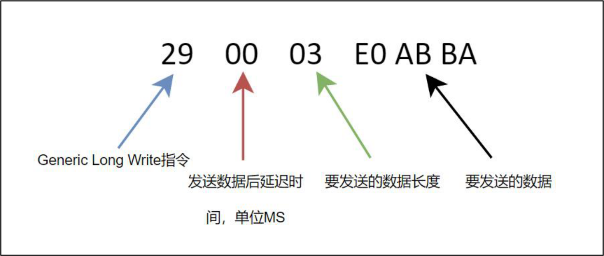
图264.37从解析中可以看出，数据E0 AB BA 是给MIPI 发送的初始化序列。对应屏幕供应商给的SSD_SEND(0x01,0xE0,0xAB,0xBA)这句代码。
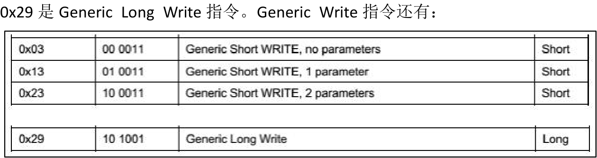
图264.38如何选择这几个指令？如果n < 3，将以Short Packet 的形式对Payload 进行打包。n 为参数数量。其中：n = 0，表示没有参数，指令选择0x03。n = 1，表示1 个参数，指令选择0x13。n =2，表示2 个参数，指令选择0x23。n >= 3，将以Long Packet 的形式进行对Payload 打包，表示n 个parameters，指令选择0x29。

除了Generic Write 指令，还有DCS Write 指令。
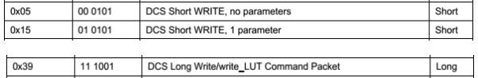
图264.38如果n < 2，n 为参数数量。将以Short Packet 的形式对要发送的数据进行打包。n = 0，表示不带参数，指令选择0x05。n = 1，表示带一个参数，指令选择0x15。n >= 2，将以Long Packet 的形式对要发送的数据进行打包。此时发送dcs 指令，带n个参数，指令选择0x39。panel-init-sequence 和panel-exit-sequence 属性对应的其他初始化序列分析方法与本例一致，大家可自行分析。
### 264.4.4 设置背光和触摸
topeet_rk3568_lcds.dtsi 设备树文件中添加以下代码。
```c
&backlight{代码清单264.7
    pwms = <&pwm5 0 25000 0>;
    status = "okay";
&ft5x061
};
    status = "okay";
{
};
```
背光和触摸节点对应的属性已在RGB 章节解释过了，这里不在赘述。
### 264.4.5 设置屏幕LOGO
如果需要使用logo，可以在topeet_rk3568_lcds.dtsi 添加以下代码，通过追加的方式打开route_lvds 节点。
```c
&route_dsi1{代码清单264.8
    status = "okay";
connect = <&vp1_out_dsi1>;
};
```

