# 第265章HDMI屏幕移植

设置屏幕LOGO 对应的属性已在RGB 章节解释过了，这里不在赘述。
## 265.1 HDMI 接口介绍
1.诞生背景1998 年，英特尔、IBM、惠普、富士通、康柏等计算机行业巨头联合推出DVI（Digital Visual Interface）接口，DVI 接口基于TMDS(Transition Minimized Differential Signaling，最小化传输差分信号)技术来传输数字信号。通过编码算法把8bit 数据(R、G、B 中的每路基色信号)编码为10bit 数据(包含行场同步信息、时钟信息、数据DE、纠错等)，采用差分信号传输数据。DVI 接口就先讨论这些。DVI 接口在PC、DVD、高清晰电视(HDTV)、高清晰投影仪等设备上有广泛的应用。最高可以支持2K@60Hz 和1080P@120Hz 分辨率。然而，随着21 世纪初高清电视（HDTV）的普及，消费者对影音一体化的需求激增。电视厂商（如索尼、松下、日立等）认为DVI 无法满足以下需求：1.电视与家庭影院设备趋向轻薄，需更紧凑的接口从而实现设备小型化，而DVI 接口体积大，插拔不便，难以适配轻薄化设备。2.数字音频与视频需通过单一接口传输实现影音一体化，而DVI 接口功能单一，仅支持视频传输，需额外线缆传输音频。3.高清内容盗版问题严重加密技术需求日益增多，而DVI 接口未集成内容加密技术（如HDCP）。4.需支持更高带宽以支持4K、8K 等新兴分辨率，DVI 接口带宽有限，难以满足日益增长的分辨率需求。2002 年，索尼、松下、日立、东芝、飞利浦等电视厂商联合成立HDMI 联盟，目标是设计一种取代DVI 的下一代接口，即HDMI 接口，HDMI 接口全称为High Definition Multimedia Interface，也就是高清多媒体接口。2003 年，HDMI 1.0 标准正式发布，核心特性包括：（1）高带宽：5Gbps 传输速率，支持1080P@60Hz 和无压缩8 声道音频。（2）接口小型化：体积比DVI 减少约50%，插拔更便捷。（3）影音融合：单线传输数字视频与音频信号。

（4）兼容性：通过转接器向下兼容DVI 接口。（5）内容保护：集成HDCP 加密技术，防止非法复制。
2.HDMI 的发展历程HDMI 1.2（2005）：支持显示器色深扩展（8/10/12bit），兼容SACD 音频。HDMI 1.3（2006）：带宽提升至10.2Gbps，引入深色技术（Deep Color）、xvYCC 广色域。HDMI 1.4（2009）：带宽10.2Gbps，新增功能：支持4K@30Hz、1080P@144Hz、3D 视频。增加以太网通道（HEC）和音频回传通道（ARC）。HDMI 2.0a/b（2013-2016）：带宽18Gbps，支持4K@60Hz、1080P@240Hz，引入静态HDR（高动态范围）。HDMI 2.1（2017）：带宽跃升至48Gbps，核心升级：分辨率与刷新率：8K@60Hz、4K@120Hz（无压缩），支持动态HDR（Dolby Vision）；游戏优化：可变刷新率（VRR）、自动低延迟模式（ALLM）；增强音频：eARC（增强音频回传通道）。
3.HDMI 接口引脚定义
HDMI 接口有A 到E 五种接口。1.HDMI-A 接口又叫做标准接口，也是使用最广泛的接口。
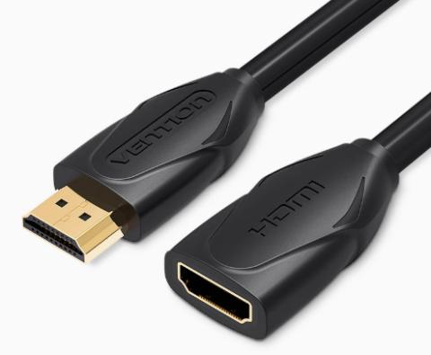
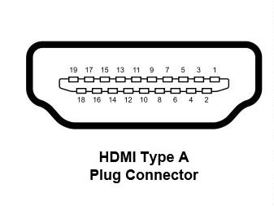
图265.1引脚定义：表265.1

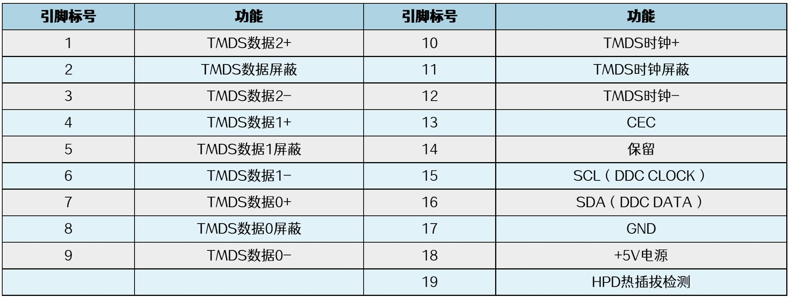
2.HDMI-B 接口在日常使用中基本看不到。HDMI-B 接口的数据传输能力比HDMI-A 快近2倍，一般用在比较专业的场景。
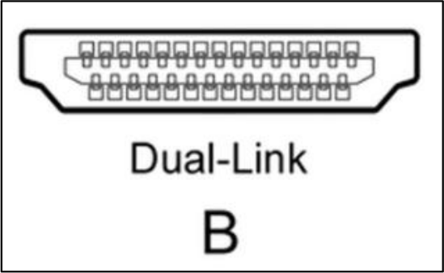
图265.23.HDMI-C 又叫做Mini HDMI、迷你HDMI 接口，尺寸比HDMI-A 小了近三分之一，主要用在小型设备中，比如游戏机，数码相机等。
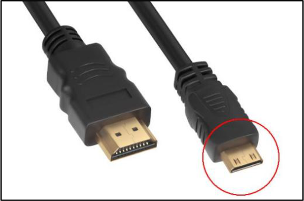
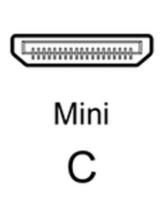
图265.3引脚定义：表265.2

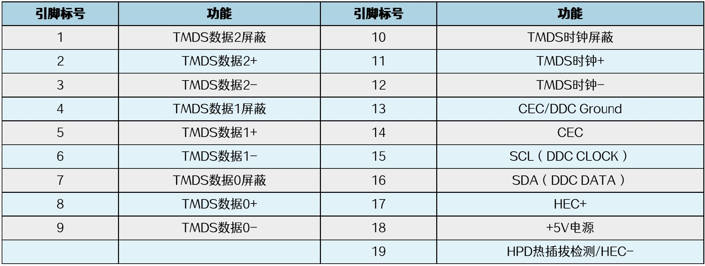
4.HDMI-D 接口又叫做Micro HDMI、微型HDMI 接口。Micro HDMI 也比较小，主要应用在小型移动设备上，比如平板电脑，便携车载设备等。
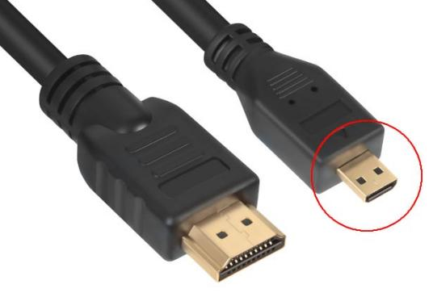
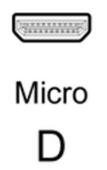
图265.4引脚定义：表265.3
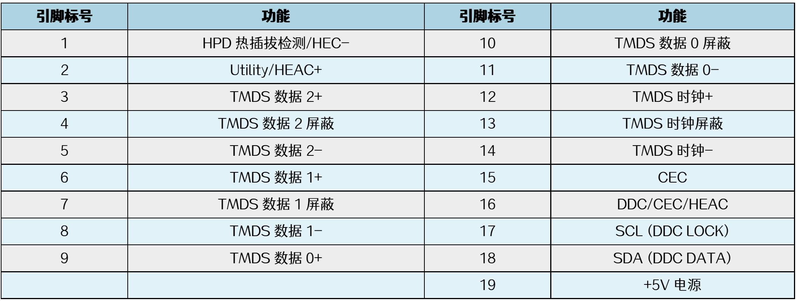
5.HDMI-E 接口主要用于车载系统，由于车内环境不稳定，HDMI-E 接口在物理接口上采用机械式锁定设计，保证接触的可靠性。

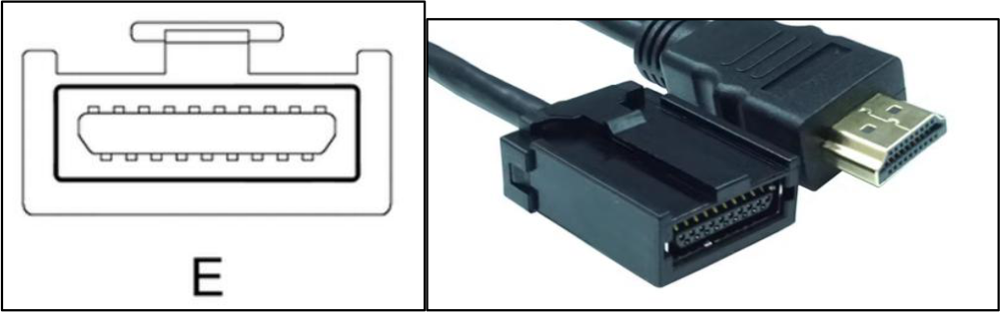
图265.54.RK3568 HDMI 接口RK3568 处理器支持1 路HDMI 接口，可以支持1.4a 和2.0a 俩个版本。最高可支持4K@60Hz 分辨率。
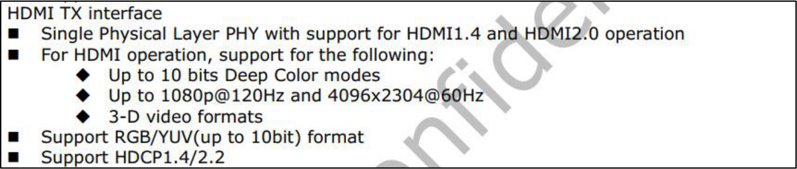
图265.65.带宽计算在选择HDMI 屏幕时，如何确定处理器是不是能支持该分辨率的屏幕呢？这里就涉及到了HDMI 带宽计算。以RK3568 处理器为例。RK3568 处理器最高支持HDMI2.0，在HDMI2.0 中TMDS 时钟为600Mhz，所以在HDMI2.0下带宽为：600000000x10x3=18Gbps。有效带宽为18x（10/8）=14.4Gbps。为什么有效带宽要乘以10/8 呢，因为在HDMI 传输中会将8bit 转换成10bit。下一章节会介绍该知识点。然后我们在计算HDMI 屏幕所需要的带宽，如果HDMI 屏幕所需要的带宽小于处理器的HDMI 带宽，则该屏幕就可以支持。HDMI 屏幕带宽计算公式：Htotal x Vtotal x 刷新率x 编码方式x 位深度其中，Htotal 的值等于Hsync + Hfront + Hactive + Hback，Vtotal 的值等于Vsync + Vfront + Vactive + Vback。Htotal x Vtotal 表示每张画面的像素点。每张画面的像素点乘以显示器的刷新率就是显示器一秒内要处理的像素量，即Htotal x Vtotal x 刷新率。编码方式如果是yuv444，则编码方式值为1，编码方式如果是yuv422，则编码方式值为2/3，编码方式如果是yuv420，则编码方式值为1/2。

举例：一款3920（Htotal）x2222（Vtotal）@60hz，采用yuv444 编码，位深度为8 的屏幕需要的带宽为3920x2222x60x1x8x3 约等于12.543Gbps。如果不想计算，也可以通过查表来判断，通过下面的表格可知，如HDMI2.0 版本最大支持4K@120Hz 分辨率。
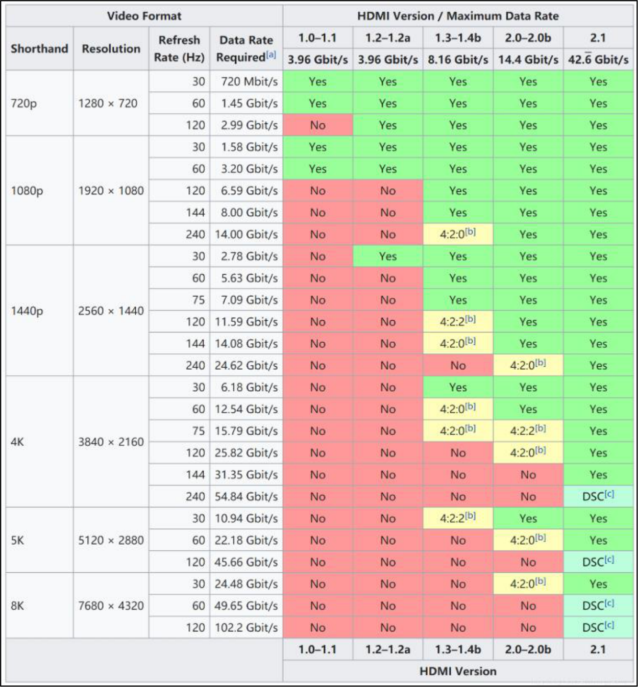
图265.7图片来源：百度百科

## 265.2 TMDS 差分信号介绍
前面我们说DVI 接口使用的是TMDS 差分信号，而HDMI 接口是为了取代DVI 接口而开发的。实际上HDMI 源于DVI 接口技术，HDMI 接口也是以美国晶像公司的TMDS 信号传输技术为核心。HDMI 在引脚上和DVI 兼容，只是采用了不同的封装。所以HDMI 接口和DVI 接口能够通过转接头相互转换。从原理上讲，HDMI 向下兼容DVI。所以本章节重点介绍一下TMDS 差分信号。我们从HDMI 规范中的连接框架图入手。
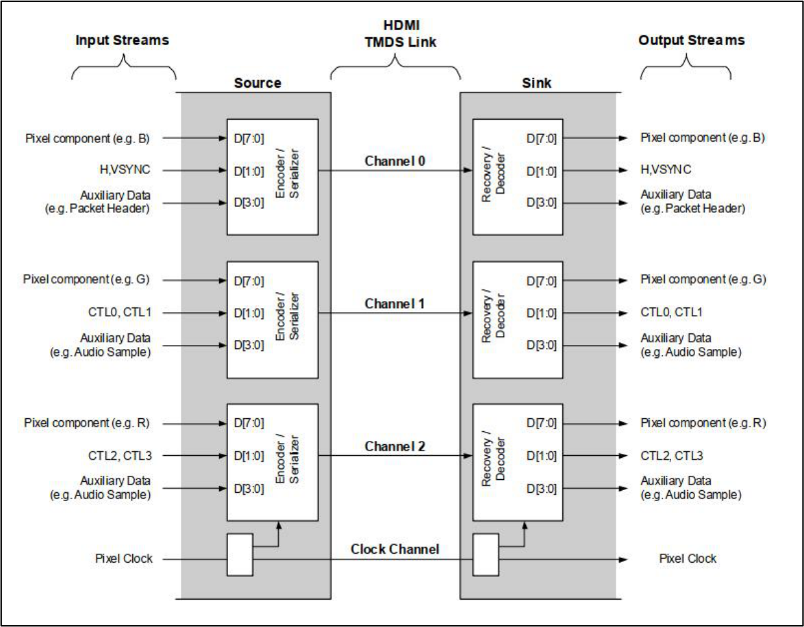
图265.8从图中可以看出，TMDS 传输分为发送端source 和接收端sink 俩部分。TMDS 链路包括3个传输数据的通道（Channel0,1,2）和1 个传输时钟信号的通道（Clock Channel）。以左侧发送端source 为例，一共有3 个数据通道，每个数据通道采用并行传输，宽度为8bit。其中：D[7:0]：表示8bit 的实际图像数据。D[1:0]：在通道0 中表示HSYNC 和VSYNC 信号，在通道1 和通道2 中表示CTL0~CTL3 这4个控制信号。D[3:0]：用来表示额外的一些辅助数据，比如音频数据等。

TMDS 传输我们就看完了，接下来解释俩个问题。问题1.这里有的同学可能会有这样的疑问，为什么这8bit 的数据D[7:0]已经传输了图像数据，怎么D[1:0]又传输了其他信号呢？要回答这个问题，需要从HDMI 传输阶段入手，我们来看HDMI 规范中的这张数据传输周期概览图。
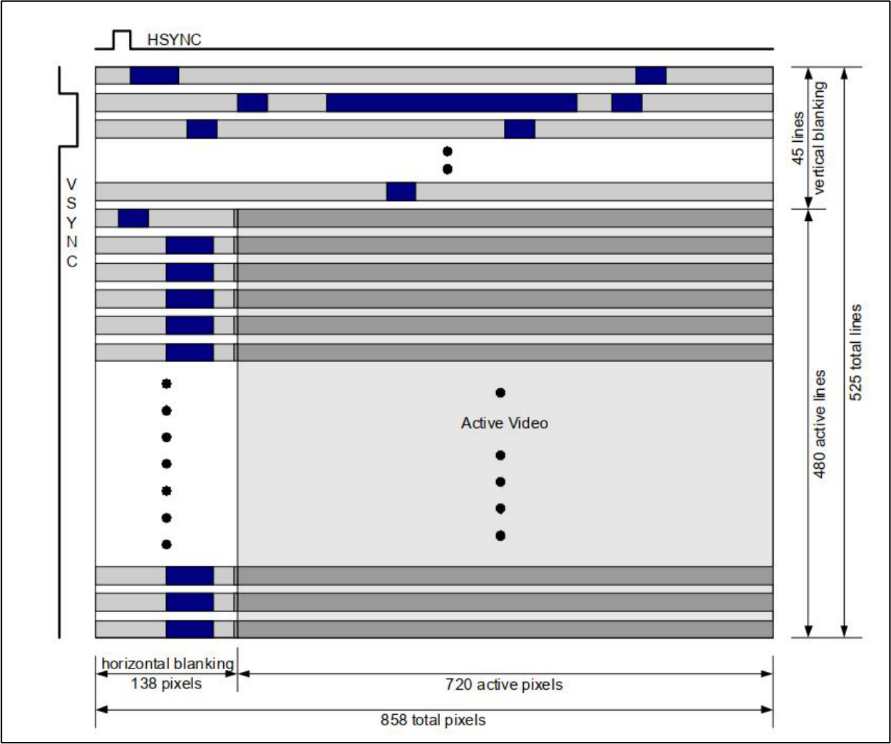
图265.9在HDMI 传输概览图中传输分成了3 个阶段，这三个传输阶段分别是：深灰色为视频数据周期，深蓝色为数据岛周期，浅灰色为控制周期。
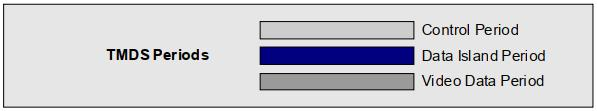
图265.10接下来分别解释一下不同的传输阶段。<1>Control Period（控制周期）

当不需要传输视频、音频或辅助数据时，使用控制周期。任何两个非控制周期之间必须有一个控制周期，采用CTL encoding 编码，将2bits 数据转换成10bits 数据。在每个视频数据周期（Video Data Period）或数据岛周期（Data Island Period）之前，会通过控制周期发送前导码（Preamble）。前导码是由八个相同的控制字符组成的序列，用于指示接下来的数据周期是视频数据周期还是数据岛周期。
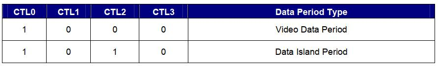
图265.11CTL0、CTL1、CTL2 和CTL3 的值指示了后续数据周期的类型，其余的控制信号（HSYNC 和VSYNC）也可能会有所变化。
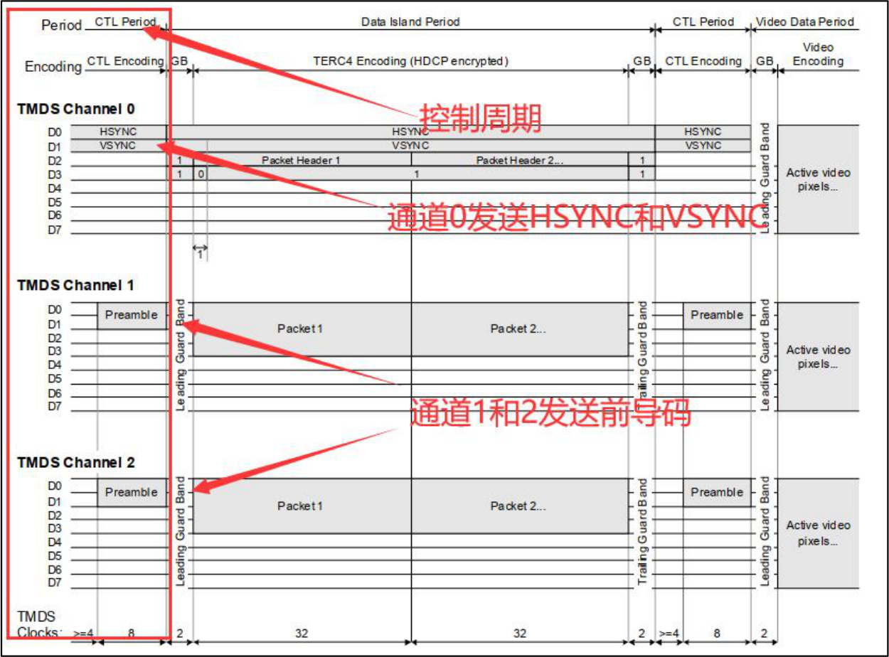
图265.12<2>Data Island Period（数据岛周期）在此阶段传输音频和其他额外数据，采用TERC4 encoding 编码，将4bits 数据转换成10bits 数据。数据岛周期包括三个部分：前保护边界、数据头和数据包以及后保护边界。

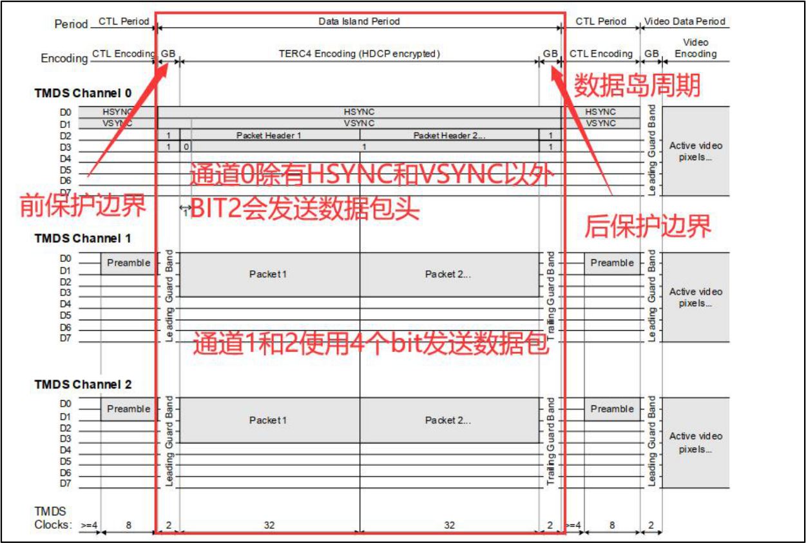
图265.13<2>Video Data Period（视频数据周期）在此阶段传输实际的图像数据,采用video data encoding 编码，将8bits 数据转换成10bits数据。视频数据周期有前保护边界，没有后保护边界。
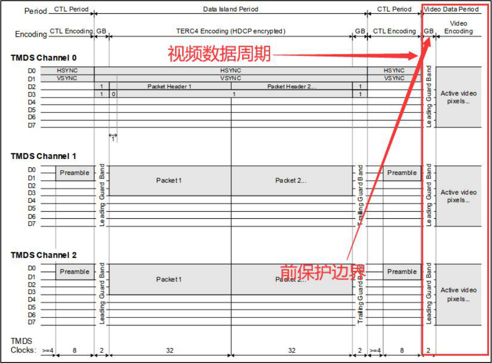

图265.14由此可见，D[7:0]并不是同时传输这些数据，而是分阶段进行传输。
问题2.TMDS 是差分信号，LVDS 也是差分信号，他们有什么区别呢？LVDS 差分信号工作原理见LVDS 接口介绍章节，这里不在重复。TMDS 差分信号使用2 根差分线来传输信号，信号0 和1 由两个引脚的电压差来决定，当TMDS 差分线+为高电平，差分线-为低电平的时候表示1；差分线+为低电平，差分线-为高电平的时候为0。TMDS 接收端通过判断+和-的电压差来确定发送过来的是1 还是0。所以从实现原理上看LVDS 和TMDS 差分信号有本质区别。
## 265.3 EDID 介绍
不同种类，不同品牌的显示器分辨率和时序都不同，HDMI 接口又要做到兼容，如果处理器输出一个固定的分辨率和时序参数就不能很好的驱动所有显示器。EDID 全称是Extended Display Identification Data，即外部显示设备标识数据。在EDID 中包含显示器相关参数，如分辨率，时序信息。还有厂商信息，产品ID，生产日期等信息。如下图EDID 结构图中的08h 地址，占2 个字节大小，用来表示生产厂家名字，采用ISA 3 字符ID 码。其他地址同理，可以自行阅读EDID 结构图。HDMI 的EDID 的长度一般是256 字节，分成2 个Block，分别是Block0（对应下图EDID 结构图的00h-36h）和Block1（对应下图EDID 结构图的36h-7fh）。其中Block 0 是必须要有的，而Block 1 是可选的。EDID v1.4 版本结构图：

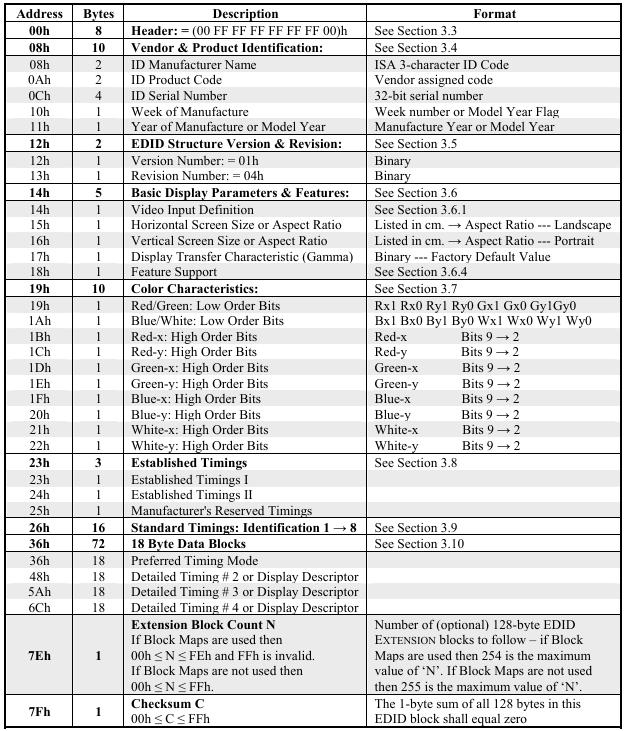
图265.15这样通过读取EDID 信息就可以输出合适的屏幕参数从而兼容不同厂家，不同品牌的HDMI屏幕。在有些资料中，可能还会见到E-EDID，即Enhanced Extended Display Identification Data，E-EDID 与EDID 只是该技术发展过程中的不同版本，E-EDID 向前兼容EDID，所以可以不做区分。目前DRM 驱动已经支持了绝大部分分辨率时序，但一些特殊场景下，可能存在一些特殊分辨率不支持。可以在kernel\drivers\gpu\drm\drm_edid.c 中的drm_dmt_modes 的末尾新增屏幕信息。

如：
```c
{ DRM_MODE("4096x2160", DRM_MODE_TYPE_DRIVER, 556188, 4096, 4104,代码清单265.1
4136, 4176, 0, 2160, 2208, 2216, 2222, 0,
DRM_MODE_FLAG_PHSYNC | DRM_MODE_FLAG_NVSYNC) },
```
说明：
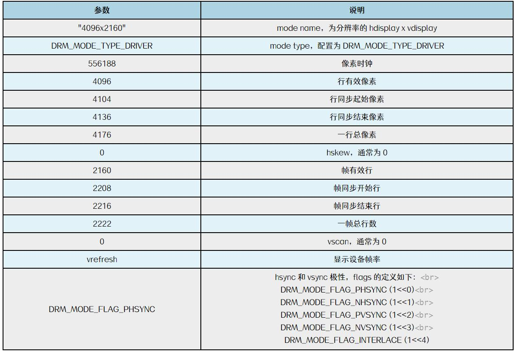
图265.16
## 265.4 硬件原理图分析

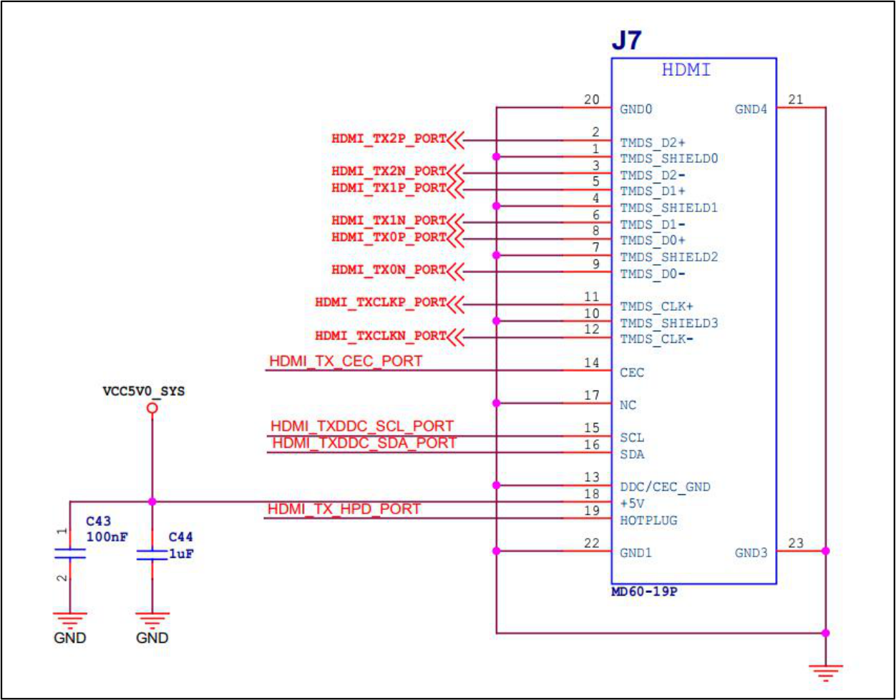
图265.17（1）HDMI_TX2P_PORT/HDMI_TX2N_PORT、HDMI_TX1P_PORT/HDMI_TX1N_PORT、（2）HDMI_TX0P_PORT/HDMI_TX0N_PORT、HDMI_TXCLKP_PORT/HDMI_TXCLKN_PORT 为3对数据引脚和1 对时钟引脚。（3）HDMI_TX_CEC_PORT，CEC 引脚。（4）HDMI_TXDDC_SCL_PORT/HDMI_TXDDC_SDA_PORT。DDC 通道引脚，使用i2c 进行通信，主要用于读取EDID 信息。（5）HDMI_TX_HPD_PORT 热插拔检测引脚。
## 265.5 适配步骤
前面我们提到HDMI 屏幕主要靠EDID 来进行识别，当屏幕接到开发板以后屏幕会向开发板发送自己的EDID 的信息。其中比较重要的信息就是基本显示参数，所以基于现有的SDK，HDMI 屏幕基本不用调试，只需要将显示通路设置好即可点亮HDMI 屏幕。使用HDMI 接口可以选择VP0 或者VP1，开发板选择VP0 输出HDMI 信号，VP0 可以支持的最大分辨率可达4K。

RK3568 VP 和各显示接口连接关系：
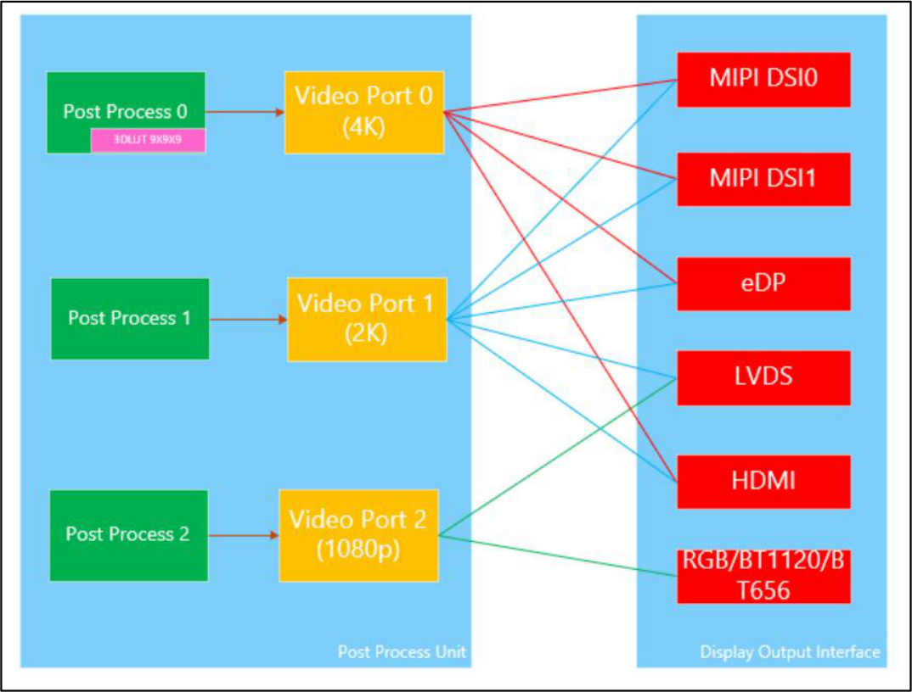
图265.18设置VP0 作为HDMI 显示通路之前需要先打开VOP 节点。因为迅为RK3568 开发板源码已默认开始VOP 节点，所以具体操作不在赘述，如想了解更多可参考设置RGB 显示通路章节中打开VOP 节点操作。打开VOP 以后，接下来设置HDMI 接口使用VP0 输出的显示通路。打开rk3568.dtsi 设备树文件，找到HDMI 节点。
```c
hdmi: hdmi@fe0a0000 {代码清单265.2
compatible = "rockchip,rk3568-dw-hdmi";
reg = <0x0 0xfe0a0000 0x0 0x20000>;
interrupts = <GIC_SPI 45 IRQ_TYPE_LEVEL_HIGH>;
clocks = <&cru PCLK_HDMI_HOST>,
        <&cru CLK_HDMI_SFR>,
        <&cru CLK_HDMI_CEC>,
        <&pmucru PLL_HPLL>,
        <&cru HCLK_VOP>;
clock-names = "iahb", "isfr", "cec", "ref", "hclk";
power-domains = <&power RK3568_PD_VO>;
reg-io-width = <4>;
rockchip,grf = <&grf>;
#sound-dai-cells = <0>;
```

```c
pinctrl-names = "default";
pinctrl-0 = <&hdmitx_scl &hdmitx_sda &hdmitxm0_cec>;
status = "disabled";
ports {
    #address-cells = <1>;
    #size-cells = <0>;
    hdmi_in: port {
        reg = <0>;
        #address-cells = <1>;
        #size-cells = <0>;
        hdmi_in_vp0: endpoint@0 {
             reg = <0>;
             remote-endpoint = <&vp0_out_hdmi>;
             status = "disabled";
        hdmi_in_vp1: endpoint@1 {
        };
             reg = <1>;
             remote-endpoint = <&vp1_out_hdmi>;
             status = "disabled";
        };
    };
};
};
```
第2 行：compatible 属性值为rockchip,rk3568-dw-hdmi，表示会使用gpu/drm/rockchip/dw_hdmi-rockchip.c 这个驱动程序。第15 到16 行：使用pinctrl 设置scl，sda，cec 引脚复用。第17 行：status 属性值为disabled，表示禁用此节点，因为要使用HDMI 所以后面需要使能该节点。第19 到38 行：表示HDMI 接口所对应的VP 端口，hdmi_in_vp0 表示HDMI 接口连接到VP0，hdmi_in_vp1 表示HDMI 接口连接到VP1。status 属性值为disabled 表示使用VP0/1 输出HDMI 被禁止。在topeet_rk3568_lcds.dtsi 设备树文件中添加以下代码来设置HDMI 显示通路。
```c
&hdmi{代码清单265.3
```

