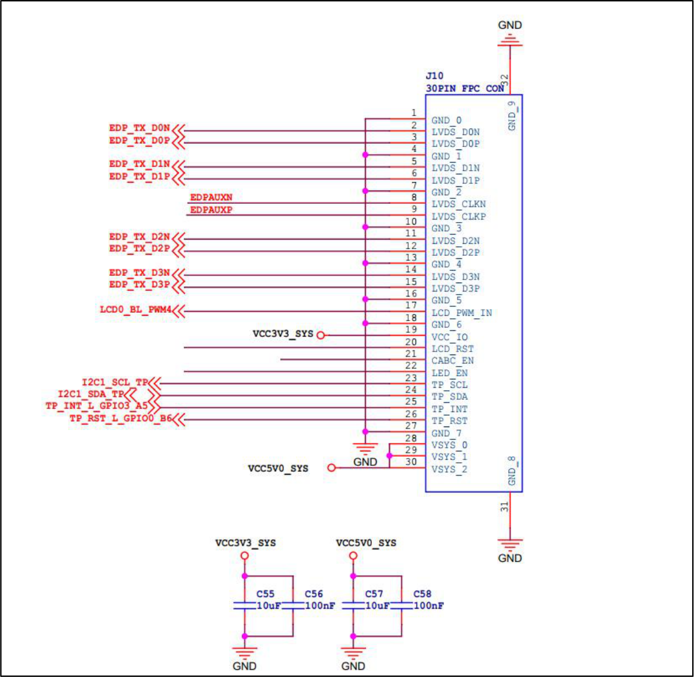
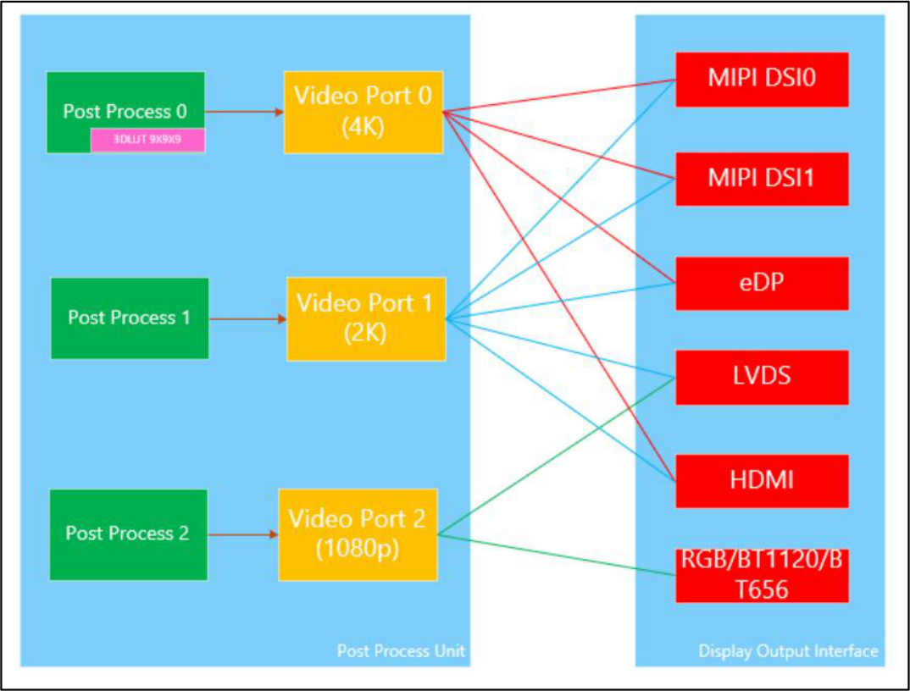

# 第266章 eDP屏幕移植

```c
status = "okay";
&hdmi_in_vp0 {
};
status = "okay";
&hdmi_in_vp1 {
};
status = "disabled";
&hdmi_sound {
};
status = "okay";
&route_hdmi{
};
status = "okay";
connect = <&vp0_out_hdmi>;
};
```
第1 行：将hdmi 节点中的status 属性设置成okay，表示使能hdmi 节点。第4 到9 行：表示打开VP0，关闭VP1，表示使用VP0 输出hdmi。第11 行：将hdmi_sound 节点中的status 属性设置成okay，表示使能hdmi 音频。第13 到15 行：设置显示uboot 和内核阶段LOGO。

## 266.1 eDP 接口介绍
eDP 全称是Embedded DisplayPort，即嵌入式显示接口，由视频电子标准协会（VESA）创始。eDP 协议是针对DP(Display Port)应用在嵌入式方向架构和协议的拓展，所以eDP 协议完全兼容DP 协议。已广泛应用于笔记本电脑、平板电脑等领域。RK3568 支持1 路eDP 接口。特性如下：（1）支持1 个eDP 1.3 接口（2）最多4 条物理通道，每条通道支持2.7 Gbps（3）支持面板自刷新（Panel Self Refresh, PSR）（4）最大支持2560x1600 @ 60Hz 分辨率（5）支持RGB 格式（最高10 位色深）


图266.1
1.EDP_TX_D0N/EDP_TX_D0P、EDP_TX_D1N/EDP_TX_D1P、EDP_TX_D2N/EDP_TX_D2P、EDP_TX_D3N/EDP_TX_D3P。由4 对差分线组成，用来传输音视频数据。需要注意的是，具体LCD 屏幕需要几对差分线就使用几对差分线，需要2 对就接2 对，需要4 对就接4 对。2.EDPAUXN/EDPAUXP 辅助通道。3.EDP_HPDIN_M1 热插拔引脚，原理图中没有使用。也就是说此引脚是可选的。4.i2c1_SCL_TP、i2c1_SDA_TP、TP_INT_L_GPIO3_A5、TP_RST_L_GPIO0_B6，触摸i2c 通信，中断，复位引脚。5.LCD0_BL_pwm4 屏幕背光引脚。

## 266.2 适配步骤
### 266.2.1 设置eDP 显示通路
使用eDP 接口可以选择VP0 或者VP1，这里选择VP0,RK3568 VP 和各显示接口连接关系：

图266.2设置VP0 作为eDP 显示通路之前需要先打开VOP 节点。因为迅为RK3568 开发板源码已默认开始VOP 节点，所以具体操作不在赘述，如想了解更多可参考设置RGB 显示通路章节中打开VOP 节点操作。打开VOP 以后，接下来设置eDP 接口使用VP0 输出的显示通路。打开rk3568.dtsi 设备树文件，找到eDP 节点。
```c
edp: edp@fe0c0000 {代码清单266.1
compatible = "rockchip,rk3568-edp";
reg = <0x0 0xfe0c0000 0x0 0x10000>;
interrupts = <GIC_SPI 18 IRQ_TYPE_LEVEL_HIGH>;
clocks = <&pmucru XIN_OSC0_EDPPHY_G>, <&cru PCLK_EDP_CTRL>,
         <&cru CLK_EDP_200M>, <&cru HCLK_VO>;
clock-names = "dp", "pclk", "spdif", "hclk";
resets = <&cru SRST_EDP_24M>, <&cru SRST_P_EDP_CTRL>;
reset-names = "dp", "apb";
phys = <&edp_phy>;
```

```c
phy-names = "dp";
power-domains = <&power RK3568_PD_VO>;
status = "disabled";
ports {
    #address-cells = <1>;
    #size-cells = <0>;
    edp_in: port@0 {
        reg = <0>;
        #address-cells = <1>;
        #size-cells = <0>;
        edp_in_vp0: endpoint@0 {
             reg = <0>;
             remote-endpoint = <&vp0_out_edp>;
             status = "disabled";
        };
        edp_in_vp1: endpoint@1 {
             reg = <1>;
             remote-endpoint = <&vp1_out_edp>;
             status = "disabled";
        };
    };
};
};
```
第2 行compatible 属性值为rockchip,rk3568-edp，表示会使用gpu/drm/rockchip/analogix_dp-rockchip.c 这个驱动程序。第10 到11 行使用了edp_phy，所以我们需要使能edp_phy 节点。第13 行status 属性值为disabled，表示eDP 节点被禁用，所以我们需要使能eDP 节点。第15 到36 行表示eDP 接口所对应的VP 端口。edp_in_vp0 表示eDP 接口连接到VP0，edp_in_vp1 表示eDP 接口连接到VP1，status 属性值为disabled 表示输出eDP 被禁止。可以在topeet_rk3568_lcds.dtsi 设备树文件中添加以下代码来设置eDP 显示通路。
```c
&edp {代码清单266.2
    force-hpd;
    status = "okay";
    connect = <&vp0_out_edp>;
    ports {
```

```c
port@1 {
    reg = <1>;
    edp_out_panel: endpoint {
        remote-endpoint = <&panel_in_edp>;
    };
};
};
};
&edp_phy {
status = "okay";
};
&edp_in_vp0 {
status = "okay";
};
&edp_in_vp1 {
status = "disabled";
};
```
第3 行将status 属性值设置成okay 打开eDP 节点。第6 到12 行通过port1 节点中的edp_out_panel 节点设置eDP 屏幕信息。eDP 屏幕信息remote-endpoint 属性指向panel_in_edp。第16 到18 行打开edp_phy 节点。edp_phy 节点内容如下：代码清单266.3
```c
edp_phy: edp-phy {
compatible = "rockchip,rk3568-edp-phy";
clocks = <&pmucru XIN_OSC0_EDPPHY_G>;
clock-names = "refclk";
#phy-cells = <0>;
status = "disabled";
};
```
第20 到26 行打开vp0，关闭vp1，通过vp0 输出eDP。
### 266.2.2 设置屏幕信息
在topeet_rk3568_lcds.dtsi 设备树文件中添加以下代码。
```c
panel-edp0 {代码清单266.4
```

```c
compatible = "simple-panel";
power-supply = <&vcc3v3_lcd0_n>;
backlight = <&backlight>;
prepare-delay-ms = <120>;
enable-delay-ms = <120>;
unprepare-delay-ms = <120>;
disable-delay-ms = <120>;
bus-format = <MEDIA_BUS_FMT_RGB888_1X24>;
bpc = <8>;
       display-timings {
            native-mode = <&edp_timing0>;
            edp_timing0: lvds-timing0 {
                    clock-frequency = <82421000>;
                    hactive = <1280>;
                    vactive = <800>;
                    hback-porch = <88>;//<100>;
                    hfront-porch = <132>;//<1580>;
                    vback-porch = <23>;//<25>;
                    vfront-porch = <49>;//<10>;
                    hsync-len = <40>;//<10>; DRM_PANEL_SIMPLE
                    vsync-len = <20>;
                    hsync-active = <0>;
                    vsync-active = <0>;
                    de-active = <0>;
                    pixelclk-active = <0>;
                 };
};
port {
    panel_in_edp: endpoint {
        remote-endpoint = <&edp_out_panel>;
    };
};
};
```
该节点主要描述eDP 屏幕信息，这些属性作用在之前章节已经解释过了，这里就不在赘述。
### 266.2.3 设置背光
topeet_rk3568_lcds.dtsi 设备树文件中添加以下代码。
```c
&pwm4{代码清单266.5
    status = "okay";
};
```

```c
&backlight {
    status = "okay";
    pwms = <&pwm4 0 25000 0>;
};
```
背光节点对应的属性已在RGB 章节解释过了，这里不在赘述。
### 266.2.4 设置屏幕LOGO
如果需要使用logo，可以在topeet_rk3568_lcds.dtsi 添加以下代码，通过追加的方式打开route_edp 节点。
```c
&route_edp {代码清单266.6
    status = "okay";
    connect = <&vp0_out_edp>;
};
```
设置屏幕LOGO 对应的属性已在RGB 章节解释过了，这里不在赘述。

