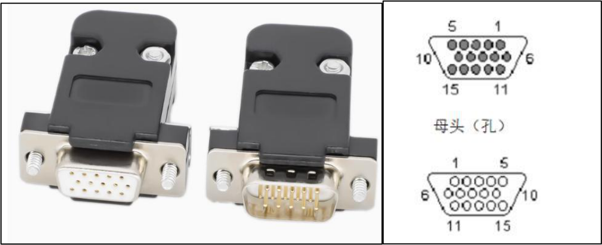
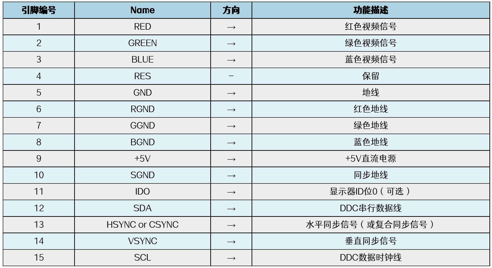
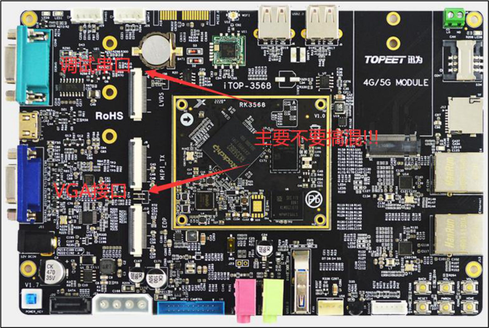
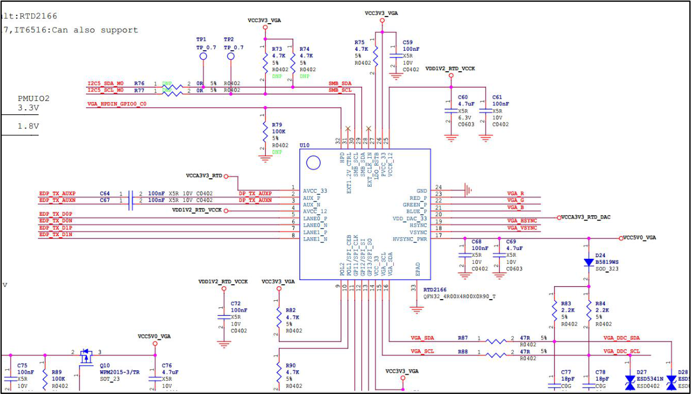

# 第267章 VGA屏幕移植

## 267.1 VGA 接口介绍
VGA 全称是Video Graphice Array，即视频图像阵列。VGA 是一种使用模拟信号进行视频传输的协议，于1987 年由IBM 公司推出。起初因分辨率高，显示速度快，颜色丰富在台式电脑应用中非常普遍。但是VGA 接口体积较大，现在便携笔记本电脑越来越普及，所以在追求轻薄笔记本领域已经逐渐被淘汰。VGA 接口有公头和母头之分，如下图267.1 所示，两者图像传输时，会使用的是VGA图像传输标准。

图267.1引脚说明如下图267.2 所示。


图267.2RK3568 处理器本身并没有VGA 接口，iTOP-RK3568 开发板的VGA 接口是使用eDP 接口转换得到的，iTOP-RK3568 开发板的VGA 接口如下图267.3 所示。

图267.3
## 267.2 硬件原理图分析
eDP 转VGA 接口原理图如下图241.4 所示，以下是部分截图，完整原理图请见iTOP-RK3568 开发板底板原理图第7 页。


图267.4eDP 转VGA 接口原理图非常简单，使用一颗RTD2166 转换芯片。转换芯片的输入是eDP信号。经过转换芯片以后输出VGA 信号。在图241.4 中有EDP_TX_D0P/EDP_TX_D0N、EDP_TX_D1P/EDP_TX_D1N、EDP_TX_AUXP/EDP_TX_AUXN 引脚。2 对差分线用来传输音视频数据。EDPAUXN/EDPAUXP 是辅助通道。VGA_HPDIN_GPIO0_C0 是热插拔引脚。I2C5_SDA_M0/I2C5_SCL_M0 是转换芯片控制引脚。VGA_R、VGA_G、VGA_B、VGA_HSYNC、VGA_VSYNC、VGA_DDC_SDA、VGA_DDC_SCL 是转换芯片输出引脚，也就是转换得到的VGA 信号，连接到VGA 座子即可。
## 267.3 适配步骤
由于VGA 接口是使用eDP 接口转出，所以在软件上配置eDP 显示即可。具体步骤参考eDP 屏幕移植。这里不在赘述。eDP 转VGA 芯片使用了热插拔引脚，热插拔引脚可以按照代码清单267.1 进行配置。代码清单267.1
```c
&edp {
    hpd-gpios = <&gpio0 RK_PC0 GPIO_ACTIVE_HIGH>;
    status = "okay";
};
```

