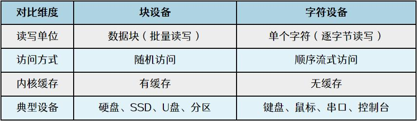
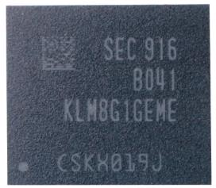
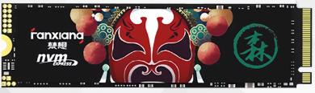
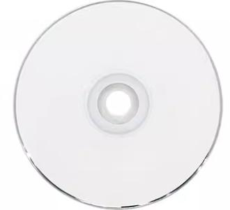
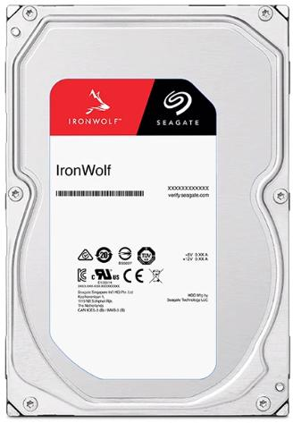
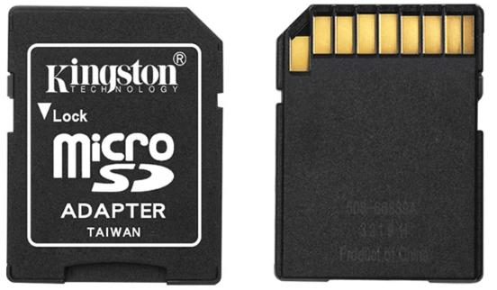
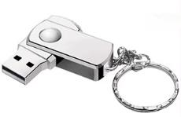

# 第268章  Linux设备分类与块设备概述

## 268.1 Linux 设备基本分类
Linux 遵循“万物皆文件”的核心设计思想，系统把各类硬件抽象为文件，绝大多数设备文件统一放置在/dev 目录下。在驱动框架中，设备常分为三类：1.字符设备：以字节流的形式串行访问，不支持随机寻址。典型代表：键盘、鼠标、串口、终端。2.块设备：以固定大小的数据块为访问单位，支持随机读写，是存储体系的核心。典型代表：机械硬盘、SSD、U 盘、SD 卡、磁盘分区。3.网络设备：负责收发网络报文，不在/dev 下提供传统设备节点，通过内核网络协议栈、Socket 接口完成通信。典型代表：网卡。
## 268.2 块设备与字符设备核心区别
块设备与字符设备核心区别如下表268.1 所示：表268.1

## 268.3 常见的块设备
eMMC（嵌入式多媒体卡）是一种将NAND 闪存晶粒、闪存控制器和标准接口协议集成在

一个小型BGA 封装内的嵌入式存储解决方案。其单颗芯片容量常见于16GB 到512GB 之间。它具有结构紧凑、设计简单的优点，由于核心的坏块管理、损耗均衡、ECC 校验等控制器功能被高度集成，从而为系统设计降低了开发难度。eMMC 是当前智能手机、平板电脑、智能电视和多数嵌入式设备的主流嵌入式存储方案。图268.1 所示为一款三星品牌的eMMC 芯片实物外观图。

图268.1NVMe SSD 是一种直接通过高速PCIe 总线与主机连接的固态硬盘，其使用专为闪存和高速接口设计的NVMe 协议，替代了传统的为机械硬盘优化的SATA/AHCI 协议。常见容量从128GB到数TB 不等。由于直接利用低延迟、高带宽的PCIe 通道，其访问延迟极低，顺序读写带宽可高达数GB/s，性能远超受限于SATA 接口带宽（通常为6 Gb/s）的固态硬盘。NVMe SSD 主要用于需要极致I/O 性能的场合，如高性能工作站、服务器、高端游戏PC 和数据中心。图268.2展示了一款典型的NVMe SSD 产品。

图268.2光盘是一种通过精密光学激光读写数据的非磁性存储介质，主要分为CD（Compact Disc）、DVD（Digital Versatile Disc）和Blu-ray Disc（蓝光光盘）三代，其利用盘片表面微小的凹坑（pit）与平面（land）对激光反射率的差异来记录二进制信息。存储容量随技术代际显著提升：CD标准容量约为700MB，DVD 单层为4.7GB（双层约8.5GB），而蓝光光盘单层可达25GB（多层型号最高可达100GB 以上）。在过去，光盘曾广泛用于软件分发、音乐专辑、电影发行和数据备份，如今在新介质分发领域正逐渐被高速网络传输所取代。图268.3 展示了一张典型的光盘。

图268.3机械硬盘是基于磁性记录原理的存储设备，通过高速旋转的盘片和在盘片上移动的磁头进行数据读写。容量通常从500GB 到数十TB 不等，广泛用于台式机、笔记本电脑、服务器等设备的大容量存储。虽然机械硬盘单位容量成本较低，但由于其内部是精密的机械结构，因此顺序读写速度远低于固态存储。尤其是在随机读写时，由于需要频繁移动磁头进行寻道，其性能（特别是IOPS）会显著下降。图268.4 展示了一款典型的机械硬盘。

图268.4SD 卡是一种基于NAND 闪存技术、遵循SD（Secure Digital）标准的小型可移动存储卡，广泛应用于数码相机、智能手机、平板电脑、行车记录仪等便携设备中。容量从早期的2GB 到目前的1TB 不等，按物理尺寸主要分为标准SD 卡、miniSD 卡和microSD 卡（常称TF 卡）。SD卡具有体积小、便于携带、低功耗、支持快速读写的特点。图268.5 展示了一款microSD（TF）卡。

图268.5U 盘是一种集成了USB 接口控制器和NAND 闪存芯片的、小型便携式外部存储设备，通过标准USB 接口与计算机、智能电视、车载系统等设备连接。其容量从早期的几MB 发展到现在的数GB 至1TB 不等。U 盘因其体积小巧、支持热插拔（即插即用）、价格低廉而成为最普遍的个人数据移动和临时交换工具。图268.6 展示了一款典型的U 盘。

图268.6

