# 第269章  块设备底层硬件与内核架构

## 269.1 磁盘结构
磁盘由多个盘片叠加而成。盘片的表面涂覆磁性材料，依靠磁介质磁化状态记录二进制数据；由于盘片正反两个面均可涂布磁性涂层，因此单张盘片最多拥有2 个独立可存储数据的盘面，每个盘面又都对应地有一个读/写磁头。如图269.7 所示。
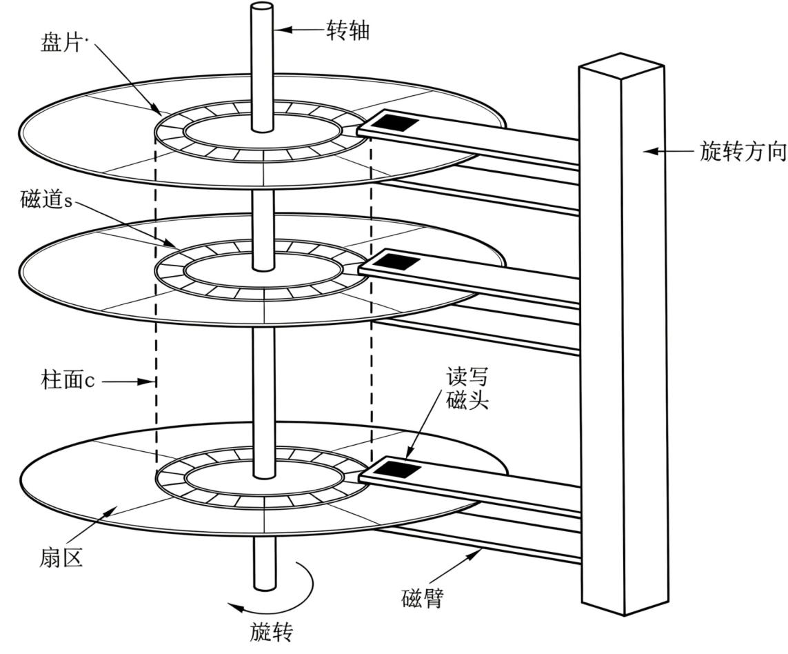
图269.7每一个盘面都划分了相同数量的磁道，磁道的0 号位置位于盘面最外侧，一个盘面上有多条环形同心圆磁道。以圆心为起点画出分割线，就可以把每一圈磁道分成若干圆弧片段，这一个个圆弧片段就是扇区。扇区是磁盘最小的硬件读写单位，传统扇区大小是512 字节；为适配大容量硬盘，现在很多硬盘使用4KB 大小的扇区。扇区如图269.8 所示。

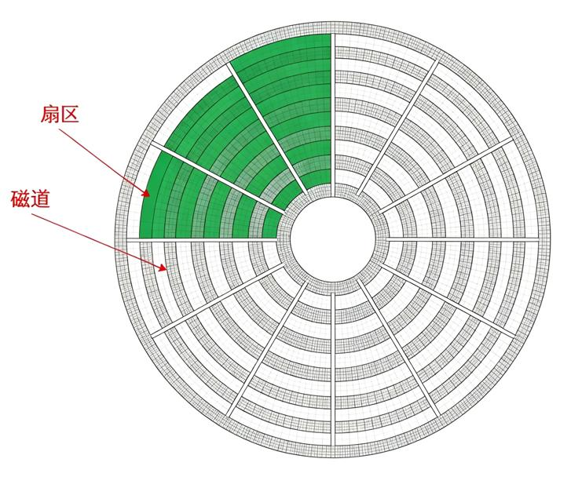
图269.8硬盘内部有多张上下叠放的盘片，不同盘面上半径位置完全相同、编号一样的磁道组合在一起，就形成了柱面，硬盘一共有多少条磁道，就有多少个柱面。磁头是绑在同一个磁臂上，磁臂一移动，全部磁头会同时移动到同一个半径位置（同一个柱面）。柱面的作用是减少寻道，提升机械硬盘读写速度（最本质作用），具体原理为：数据先写满一整个柱面，再写下一个柱面。比如磁臂已经停在当前柱面→切换磁头，读写上下任意一个盘面，磁臂不需要移动、不需要寻道，只有当前整个柱面全部写满之后，磁臂才需要移动到下一个柱面。这样便极大减少磁头来回移动次数。
## 269.2 块/簇
通俗来讲，在Windows 下NTFS 这类文件系统中将空间分配单元叫做簇；在Linux 下Ext4这类文件系统中将分配单元叫做块(block)。二者作用相同，只是不同操作系统下的命名不一样。每个簇或者块，可以包含2、4、8、16、32、64……2 的n 次方个物理扇区。底层硬盘读写最小单位是扇区，操作系统分配存储空间时，是以簇或块为最小单位进行分配，因此块或簇是操作系统读写的最小单位。不管文件实际多大，如果文件尺寸不能刚好被簇或块大小整除，文件最后被分配的那一个簇或块一定会剩下一部分空闲空间，这部分剩余空间不能再分配给其他文件使用。

## 269.3 块设备驱动架构
块设备驱动框架自上而下主要由通用块层、I/O 调度层和块设备驱动层组成，其层次关系如图269.9 所示。
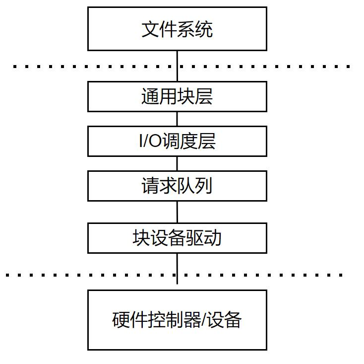
图269.9
### 269.3.1 文件系统的作用
图269.9 中通用块层之上是文件系统，文件系统是操作系统用于在存储设备（如硬盘、SSD、U 盘等）上组织、管理和访问数据的一套逻辑结构和方法（通俗来讲就是把块设备上“一堆无结构的扇区”组织成人类和程序可理解的“文件+目录”层级结构）。文件系统主要提供以下6 种基本功能。1.文件管理文件系统负责文件的整个生命周期管理。它定义了文件的逻辑结构、属性和操作方式，允许用户和应用程序执行文件的创建、读取、写入、删除、重命名和移动等基本操作。2.目录结构文件系统提供了树状的目录（在Windows 中也称为文件夹）结构来组织文件。这种树状结构允许用户通过唯一路径（如/home/user/document.txt 或C:\Users\User\Document.txt）来唯一标识和定位文件，使得海量文件能够被有效分类和管理。3.空间管理

文件系统需要高效地管理物理存储空间。它将物理存储介质划分为固定大小的逻辑块（在Linux 中常称“块”，在FAT/NTFS 中称“簇”），并为每个文件分配一个或多个这样的块。文件系统通过维护元数据（即描述数据的数据）来精确跟踪哪些存储块被占用、被哪个文件占用，以及哪些是空闲块，从而实现对存储空间的动态分配与回收。4.访问控制和安全性文件系统提供了数据访问的基本安全机制。通过设置文件权限（如读r、写w、执行x）和可选的访问控制列表（ACL），它可以控制不同的用户或用户组对文件或目录的访问级别，防止未授权的访问或篡改，确保数据安全。5.数据完整性文件系统采用多种技术来保障数据在发生意外（如系统崩溃、断电）时的逻辑一致性。其中，日志技术是一种广泛采用的技术，它在实际写入用户数据块前，先将本次写操作的元数据变更记录在专用的“日志”区域。若操作中途失败，系统可以在下次挂载时根据日志进行重做或撤销，避免文件系统结构出现错乱。6.支持多种存储介质文件系统的具体实现可以优化和适配不同存储介质的物理特性。无论是需要寻道优化的机械硬盘、需考虑写入磨损的固态硬盘、U 盘还是光盘，文件系统都能通过相应的驱动、参数调整和内部策略，在这些介质上建立统一的数据管理模型，为用户提供连贯的操作体验。
### 269.3.2 文件系统的种类
文件系统主要有FAT 系列、NTFS、ext2/ext3/ext4 系列、NFS 和虚拟文件系统。接下来分别介绍下这几种文件系统。1.FAT 系列FAT16 是早期MS-DOS 和Windows 95 操作系统使用的文件系统，采用16 位的文件分配表。它结构简单，开销小，是早期个人计算机和移动存储设备的主流格式。FAT32 是FAT16 的增强版本，采用32 位的文件分配表，主要解决了FAT16 的单个分区容量限制问题，曾长期作为U盘、SD 卡等移动存储设备的默认或通用交换格式。2.NTFSNTFS 是微软为Windows NT 内核系列操作系统（如Windows XP、7、10、11 等）设计的现代文件系统。它引入了日志、访问控制列表（ACL）、文件加密、磁盘配额等大量高级特性，

在性能、安全性和可靠性上远超FAT 系列。3.ext2/ext3/ext4 系列ext2 是Linux 操作系统早期使用的第二代扩展文件系统。它设计简洁高效，但不提供日志功能，属于非日志文件系统。在发生意外断电或系统崩溃时，非日志文件系统可能需要进行冗长的文件系统检查（fsck）来修复可能出现的错误，数据损坏风险相对较高。已被其继任者ext3取代，不再是主流Linux 发行版的默认选择。ext4 是ext3 的重要进化版，也是目前绝大多数Linux 发行版的默认文件系统。它在ext3 的基础上，通过引入Extents（区段）等特性显著提升了大文件性能，并支持更大的单文件和分区容量。作为成熟的日志文件系统，它在系统异常重启后通常能快速恢复，无需长时间的文件系统检查。4.NFSNFS（网络文件系统）与其他几种文件系统有本质区别。它是一种基于RPC 的网络文件系统，由Sun 公司开发，其核心目标不是管理本地磁盘，而是允许客户端计算机通过网络透明地访问服务器上的共享目录，就像访问本地文件系统一样。5.虚拟文件系统虚拟文件系统（也称为VFS）是Linux 内核提供的一个核心抽象层，它位于用户空间系统调用和具体文件系统（如ext4、NTFS）驱动之间。VFS 定义了一套标准的接口和数据结构，使上层的应用程序和系统调用能够以统一的方式访问和管理不同类型的具体文件系统，实现了“一切皆文件”的哲学。运行于VFS 之上的常见特殊文件系统包括以下类型。proc 文件系统提供内核与进程状态的运行时信息接口。sysfs 文件系统基于内核设备模型，提供统一的设备与驱动信息视图。tmpfs 文件系统是基于内存的临时文件系统。debugfs 文件系统为内核调试提供信息输出接口。configfs 文件系统用于用户空间配置内核对象。
## 269.4 通用块层
通用块层是Linux 块设备驱动框架中位于文件系统与具体设备驱动之间的中间软件层。它向上为文件系统提供统一接口，向下屏蔽各类块设备硬件差异。

### 269.4.1 关键数据结构bio
bio 是Linux 块设备上“最原始、最基本”的请求单元，由文件系统构造，通过submit_bio()函数提交给通用块层。可以理解为：bio 描述了“从/到哪里的哪些内存页，对哪个块设备做什么操作”，是文件系统与通用块层之间的“原生数据包”。在Linux 内核中是这样介绍bio 结构体的。如图269.10 所示。
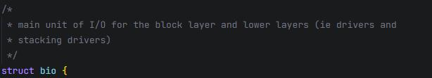
图269.10上层（如文件系统）要读写磁盘时，会把请求封装成一个或多个bio，然后提交给通用块层或更底层的驱动程序（如SCSI、NVMe、SATA 驱动）以及堆叠驱动（stacking drivers，如md软RAID、device-mapper、LVM 等，它们在设备之上再叠加一层虚拟设备）。bio 结构体原型如代码清单269.1 所示。代码清单269.1
```c
struct bio {
    //此处省略部分代码
    struct bio *bi_next; /*请求队列链表链接*/
    struct gendisk *bi_disk;
    unsigned short bi_vcnt; /*bio_vec 结构体的数量*/
    unsigned short bi_max_vecs; /*可容纳的最大bio_vec 数量*/
    struct bvec_iter bi_iter; /* bio_vec 迭代器*/
    struct bio_vec *bi_io_vec; /*指向bio_vec 数组的指针*/
    struct bio_set *bi_pool;
    struct bio_vec bi_inline_vecs[];
    //此处省略部分代码
};
```
下面重点分析bio 结构体中的两个核心成员：bi_io_vec（指向bio_vec 数组的指针）和bi_iter（bio_vec 迭代器）。bio_vec 定义了内存段与块设备数据段的映射关系。其中，bv_page 指定了用于I/O 缓冲的物理内存页；bv_len 表示该内存段的有效数据长度（字节）；bv_offset 表示数据在物理内存页内的起始偏移。bio_vec 结构体的定义如代码清单269.2 所示。代码清单269.2

```c
struct bio_vec {
        struct page *bv_page;//用于I/O 缓冲的物理内存页
        unsigned int bv_offset;//数据在物理内存页内的起始偏移
        unsigned int bv_len;//该内存段的有效数据长度（字节）
};
```
bvec_iter 用于在I/O 处理过程中，迭代遍历bi_io_vec 指向的数组，并记录当前要操作的设备逻辑扇区号（bi_sector）、剩余待处理字节数（bi_size）、当前正在处理的数组索引（bi_idx），以及bio_vec 中已处理完成的字节数（bi_bvec_done）等状态信息。这些成员共同构成了一个迭代器的状态快照，使内核可以分步、高效地处理一个可能跨越多个内存页的I/O 请求。其定义如清单269.3 所示。代码清单269.3
```c
struct bvec_iter {
        sector_tbi_sector;/* 设备逻辑扇区号（以512 字节为单位）*/
        unsigned intbi_size;/* 剩余待处理字节数*/
        unsigned intbi_idx;/* 当前迭代到的bio_vec 数组索引*/
        unsigned intbi_done;/* 已完成的字节总数*/
        unsigned intbi_bvec_done;/* 当前bio_vec 中已处理完成的字节数*/
};
```
每个bio_vec 描述一段内存区域：哪个页、从页内哪个偏移开始、长度多少。多个bio_vec组成一个数组，就描述了一整块“虚拟连续”的数据，背后可能散落在多个物理页上。如一个bio 下面有：bi_io_vec[0]: page0+0,4KB//page0 的前4KBbi_io_vec[1]: page1+4KB, 2KB//page1 从偏移4KB 开始的2KBbi_io_vec[2]: page5+0,8KB// page5 的前8KB三个段、三个不同的物理页，合起来描述14KB 的I/O 数据。对块设备来说，这是一次逻辑上连续的读/写（比如读磁盘的第100 扇区起、14KB 数据），但数据在内存里是散布的。如图269.11 所示。

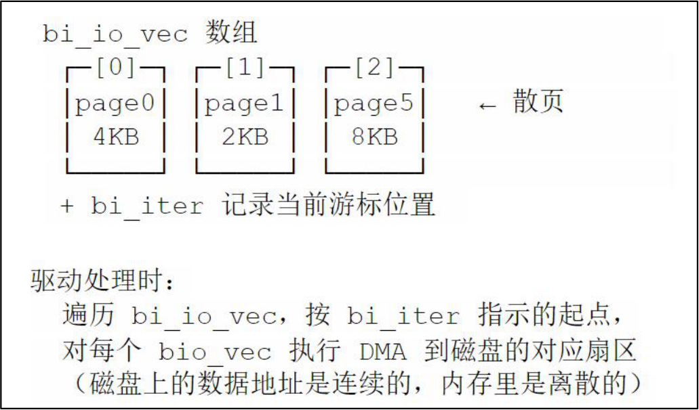
图269.11struct request_queue 是Linux 通用块层中最核心的数据结构，request_queue 是bio 从“上层提交”到“驱动执行”之间的桥梁和中转站。如图269.12 所示。
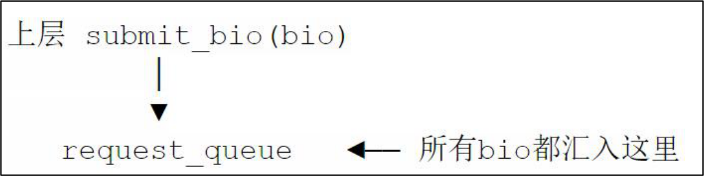
图269.12每个request 可以挂载多个bio，通过指针串联成一个链表。每个request 又都挂载在structrequest_queue 中。如代码清单269.4 所示代码清单269.4
```c
struct request {
        struct request_queue *q;// 所属队列
        struct blk_mq_ctx*mq_ctx;// 所属软件队列
        struct blk_mq_hw_ctx *mq_hctx;// 所属硬件队列
        struct bio*bio;// 链入的bio 链
        sector_t__sector;// 起始扇区
        inttag;// blk-mq 标签
        // ...
};
```
struct request_queue 如代码清单269.5 所示：代码清单269.5

```c
struct request_queue {
    struct list_head queue_head;// 请求队列头部
    struct request *last_merge;// 最后一个合并的请求
    struct elevator_queue *elevator;// 调度器队列
    request_fn_proc *request_fn;// 请求处理函数
    make_request_fn *make_request_fn; // 构建请求的函数
    struct blk_mq_ops *mq_ops;// 多队列操作函数集合
    unsigned int nr_requests;// 最大请求数量
    spinlock_t __queue_lock;// 队列锁
    struct kobject kobj;// 内核对象
};
```
这些结构体及其成员之间的关系（即一个bio 如何通过多个bio_vec 描述分散的内存缓冲区，并与连续的设备扇区进行映射）如图269.13 所示。
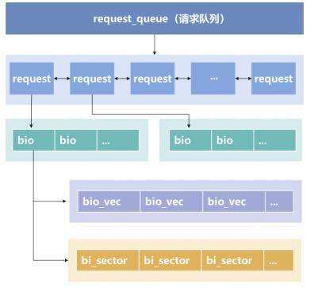
图269.13struct gendisk 是Linux 内核中代表一个通用硬盘（硬盘，分区、虚拟设备(LVM/md/dm) ）的内核对象，每个gendisk 都绑定一个request_queue，承载该设备I/O 的全部流程，如图269.14所示。

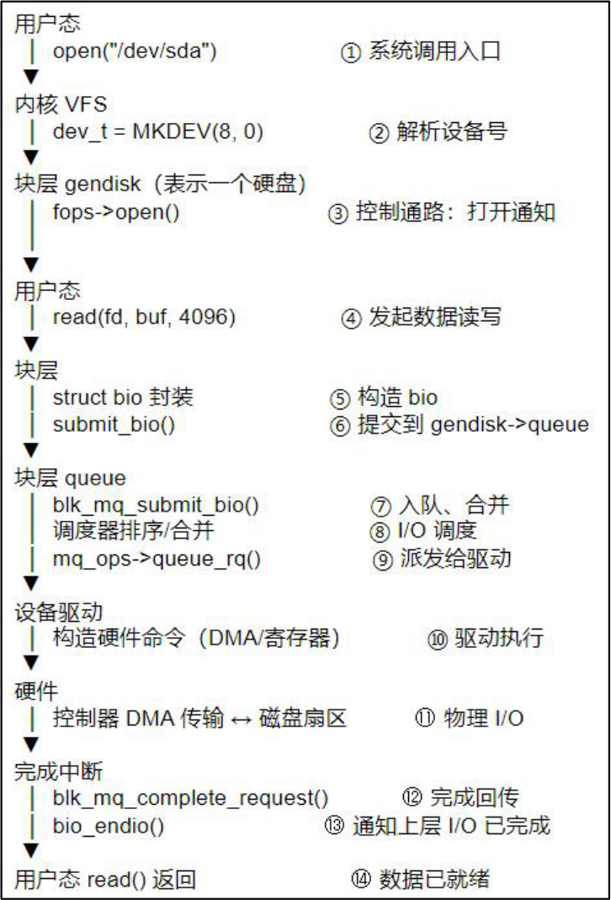
图269.14每注册一个块设备（无论是NVMe、SCSI 磁盘、SD 卡，还是md 软RAID、device-mapper），都会创建一个gendisk，通过add_disk()注册到系统后对用户可见。struct gendisk 结构体如代码清单269.6 所示。代码清单269.6
```c
struct gendisk {
        int major;// 主设备号
        int first_minor;
        const struct block_device_operations *fops;// 块设备操作集
        struct request_queue *queue; // 关联的请求队列
        struct blk_mq_tag_set tag_set;
        // ...
};
```
### 269.4.2 IO 调度层和请求队列
IO 调度器负责在软件IO 队列与硬件IO 队列之间做IO 调度，核心能力包含三项：IO 合并

（最重要）、IO 排序、IO 限流。IO 调度器是可选项，blk-mq 多队列框架下有两种工作模式：启用IO 调度器：bio 经过块层初步组装，生成request 进入软件调度队列→调度器执行合并、重排、限流→下发至硬件队列不启用IO 调度器（none）：bio 组装成request 后直接下发硬件队列，调度层不再做重排与调度队列合并1.合并合并的含义：将LBA 地址连续、读写方向相同的多个bio 合并到同一个struct request 中，减少向存储硬件下发命令的次数，降低命令开销、提升IO 性能。我们看几个示例，约定示例参数：单个扇区大小512 字节，1 个LBA 编号对应1 个512B扇区；4KB = 8 个连续LBA 扇区。示例1：向后合并（新IO 接在已有request 末尾，最常见）现有队列里已经存在一个requestA：bioA：写LBA 2000 ~ 2007（4KB，8 个扇区）新来bioB：bioB：写LBA 2008 ~ 2015（4KB）判断：bioB 的起始LBA (2008) = requestA 的结束LBA+1（2007+1=2008），磁盘地址连续，并同为写操作。因此执行向后合并，bioB 挂入requestA。合并后request：LBA2000-2015，总8KB。示例2：向前合并（新来IO 拼接在已有request 头部）队列已有requestX：bioX：写LBA 3008 ~ 3015（4KB）新来bioY：bioY：写LBA 3000 ~ 3007（4KB）判断：bioY 结束LBA (3007)+1 = requestX 起始LBA (3008)，地址连续，读写方向一致。执行向前合并，bioY 合并到requestX 头部。合并后request：LBA3000-3015，总8KB。示例3：多个bio 连环合并全部为写操作，LBA 地址连续：bio1：LBA 5000‑ 5007，4KBbio2：LBA 5008‑ 5015，4KB

bio3：LBA 5016‑ 5023，4KB合并流程：1. bio1 新建请求R：LBA 5000‑ 50072. bio2 到来：起始LBA 5008 = R 结束LBA+1，向后合并，R 范围更新为5000~5015（8KB）3. bio3 到来：起始LBA 5016 = R 结束LBA+1，继续向后合并，R 范围更新为5000~5023（12KB）最终仅向硬盘下发1 条IO 命令：起始LBA 5000，共24 个扇区（12KB）。2.排序按照LBA 扇区号对队列中的IO 请求排序，核心目的是减少机械硬盘磁头寻道移动距离，是HDD 时代的关键优化。SSD 无机械磁头，随机访问延迟均匀，排序优化收益很低；因此NVMe设备默认使用none 调度器，不做排序。示例：排序前:[扇区500] [扇区100] [扇区300] [扇区200]排序后:[扇区100] [扇区200] [扇区300] [扇区500]3.限流控制硬件侧在途（in-flight）IO 请求的数量，防止硬件队列过载；同时避免硬件队列空闲、资源利用率不足。在途请求：已经下发给硬件、但还未完成返回的IO 请求在途过多：硬件队列堆积、IO 时延抖动恶化，甚至硬件报错在途过少：硬件资源闲置，吞吐率上不去使用命令“cat /sys/block/mmcblk0boot0/queue/scheduler”可以查看当前系统支持的IO 调度器。如图269.15 所示。
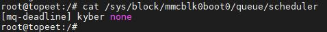
图269.15图269.15 中支持none(无调度器)，mq-deadline(截止时间调度)和Kyber 调度器，当前使用的是mq-deadline 调度器。1. none(无调度器)调度层不做IO 排序、不做调度队列合并，request 直接下发硬件队列。适用：NVMe SSD。特点：调度开销最低、并发能力强；注意：块层plug 机制依然可以做少量bio 合并，不是完全没有任何合并。

2. mq-deadline(截止时间调度)每个request 绑定一个超时截止时间；读写请求分为独立队列，队列内按扇区地址排序、同时维护超时时间。核心策略：正常情况下优先按扇区顺序下发，优化吞吐；临近截止时间的请求优先派发，避免IO 饿死。适用场景：HDD、SATA SSD 等通用存储设备。3. Kyber面向QoS 设计，动态自适应控制读写的在途请求深度；读写分离队列，分别设置软中断派发阈值，通过精细化管控在途IO 数量，平衡时延与吞吐，保障IO 服务质量。
## 269.5 通用块层的多队列引擎（blk-mq）
### 269.5.1 多队列引擎介绍
blk-mq 是Linux 通用块层的现代实现框架(3.13/3.16 引入，5.0 起成为唯一实现)，采用“软件队列+硬件队列”两级多队列设计，解决传统单队列块层在多核+高速存储设备下的扩展性瓶颈。传统块层(blk-sq)只有一个全局请求队列，如图269.16 所示。
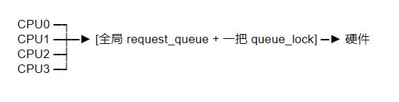
图269.16该架构使用一个全局请求队列和一把全局锁（queue_lock）来协调所有CPU 核心的I/O 请求。当使用SSD 等具备极高并行处理能力的高速设备时，多核CPU 高并发提交请求会导致严重的锁竞争，成为制约系统I/O 性能的瓶颈。而SSD 等物理设备具有多条硬件队列，在软件中创建多条软件队列并且各自有一把锁。并且软件队列与硬件队列相对应，从而组成软件队列+硬件队列”两级多队列设计，进而提高I/O 性能，因此blk-mq 架构如图269.17 所示。

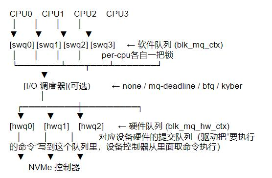
图269.17需要注意的是，软件队列→硬件队列的映射关系不是固定1:1。
### 269.5.2 关键数据结构
Linux 块设备架构中通用块层使用blk_mq_ctx 结构体表示一个软件队列，结构体原型如代码清单269.7 所示。代码清单269.7
```c
struct blk_mq_ctx {
    struct {
        spinlock_t lock;// 本CPU 独占锁
        struct list_head rq_list;// 本CPU 的request 链表
    } ____cacheline_aligned_in_smp;
    unsigned int cpu;// 所属CPU 编号
    unsigned int index_hw;// 在hctx->ctxs[]中的下标（多个软件队列可以挂载在
同一个硬件队列中，ctxs[]中是所关联的硬件队列）
    struct request_queue *queue;// 所属request_queue（指向块设备总请求队列
request_queue，每个块设备一个。把软件ctx 和块设备实例关联起来，可以拿到队列参数、队列限
制、调度器等。）
    // 统计从本ctx，派发到硬件hctx 的request 数量。
    unsigned int rq_dispatched[2];// [0]=async [1]=sync 派发数
unsigned int ____cacheline_aligned_in_smp rq_completed[2];
// 记录本ctx 发出的request 完成数量，[0]=async [1]=sync 完成数
```

```c
} ____cacheline_aligned_in_smp;
```
使用blk_mq_hw_ctx 结构体表示一个硬件队列的。如代码清单269.8 所示。代码清单269.8
```c
struct blk_mq_hw_ctx {
    struct {
        spinlock_t lock;// 硬件队列锁
        struct list_head dispatch;// 待派发给硬件的request 链表
    } ____cacheline_aligned_in_smp;
    unsigned long state;// 状态(STOPPED/ACTIVE 等)
    struct list_head run_work;// 运行工作队列
    struct blk_mq_ctx **ctxs;// 关联的软件队列数组
    unsigned int nr_ctx;// 关联的软件队列数
    struct sbitmap ctx_map;// 哪些软件队列有pending 请求
    struct blk_mq_tags *tags;// 本队列的tag 池
    struct blk_mq_tags *sched_tags;// 调度器专用tag 池
    struct request_queue *queue;// 所属request_queue
    unsigned int queue_num;// 队列编号
    unsigned int numa_node;// NUMA 节点
    unsigned int next_cpu;// 下次运行用哪个CPU
    unsigned int next_cpu_batch;// CPU 轮转批次
atomic_t nr_active;// 在途request 数
// ...
};
```
接下来我们看IO 队列，以Linux 内核中的pci ssd 控制器驱动为例讲解IO 队列，驱动源码路径：drivers/nvme/host/pci.c。在nvme_probe 函数中初始化了一个reset_work 工作队列，dev 是struct nvme_dev（NVMe控制器设备实例，ctrl 是struct nvme_ctrl *NVMe 控制器。处理函数是nvme_reset_work。nvme_probe 函数如代码清单269.9 所示。代码清单269.9
```c
static int nvme_probe(struct pci_dev *pdev, const struct pci_device_id *id)
{
//...
INIT_WORK(&dev->ctrl.reset_work, nvme_reset_work);
nvme_reset_ctrl(&dev->ctrl);
nvme_get_ctrl(&dev->ctrl);
async_schedule(nvme_async_probe, dev);//等待复位完成
//...
return result;
}
```

```c
时序：
nvme_probe
└─nvme_reset_ctrl () →提交reset_work，立刻返回（复位在后台跑）
└─async_schedule (nvme_async_probe, dev) →提交异步probe 工作，即把nvme_async_probe
函数交给后台线程去执行。
此时后台并行跑两个work：
. reset_work：执行控制器硬件复位，建立Admin 队列
. nvme_async_probe：等待复位完成。
为什么时序是这样的？
    在nvme_probe 返回的时候，工作队列处理函数可能还没跑完，也就是硬件状态还没准好，此时
就不能去创建SQ/CQ。所以使用nvme_async_probe 函数等待控制器重置完成，再往下做其他操作。
```
如果想执行处理函数需要调用如queue_work()代码提交给内核线程去执行。在处理函数中是创建软件和硬件队列的操作，那为什么没有把这些操作直接放在probe 函数中呢？这些操作比较耗时。会拖慢整个系统。所以只在probe 函数中做必要的操作，其余的放在工作队列中。在probe 函数的末尾调用nvme_reset_ctrl(&dev->ctrl)，该函数内部会调用queue_work()从而提交工作项。上面提到的SQ 和CQ 又是什么呢？SQ 和CQ 的全程为：SQ (Submission Queue) 提交队列；CQ (Completion Queue) 完成队列。SQ 和CQ 如图269.18 所示。关于SQ 和CQ 需要了解以下知识点。1. 主机往SQ 写入命令；SSD 完成命令后往CQ 写入命令执行结果。2. SQ/CQ 分为两种：- Admin SQ/CQ：承载Admin 管理命令，用于主机配置、管理SSD 控制器。- IO SQ/CQ：承载IO 读写命令，用于主机与SSD 之间业务数据传输。3. 关联规则：一个SQ 只能隶属于一个CQ；一个CQ 可以接收来自多个SQ 的完成项（多SQ 对单CQ）。Admin 固定一对一；IO 支持多对一，不强制两两成对。4. 一个NVMe 控制器只有一对Admin SQ/CQ，一对一，IO SQ 最多65535 个（64K-1），可以配置多组IO SQ/CQ。5. Admin SQ/CQ 控制器复位后由硬件生成。IO SQ/CQ 不会自动生成，必须发送Admin 命令创建。6. IO 队列CPU 亲和：- Admin：全局唯一一对，一对一。- IO：每个CPU 最多分配1 个IO CQ，一个CQ 可以挂载1 个或多个IO SQ，多个SQ 可

设置不同优先级。- IO SQ 数量根据系统配置、性能需求灵活配置，常见部署为一对一（1 SQ : 1 CQ）。7. 队列深度为队列最大可容纳数量：- Admin SQ/CQ 深度：2 ~ 4096。- IO SQ/CQ 深度：2 ~ 65536。队列数量、队列深度均可配置，是NVMe 重要调优参数。8. 大小：- SQ 命令：无论Admin/IO 命令，固定64 字节。- CQ 完成：固定16 字节。
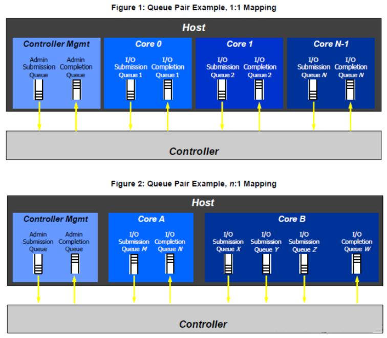
图269.18接下来继续看nvme_reset_ctrl 函数，作者对nvme_reset_ctrl 做了精简，如代码清单269.10所示。代码清单269.10

```c
static void nvme_reset_work(struct work_struct *work)
{
if (dev->ctrl.state != NVME_CTRL_RESETTING) {
    dev_warn(dev->ctrl.device, "ctrl state %d is not RESETTING\n",
         dev->ctrl.state);
    result = -ENODEV;
    goto out;
}
//...
//配置Admin Queu（CQ+SQ），这是与控制器通信的命令通道，必须最先就绪
result = nvme_pci_configure_admin_queue(dev);
//...
//分配Admin Queue（管理队列）的SQ/CQ 对应的tag 数组资源。
result = nvme_alloc_admin_tags(dev);
//...
if (!nvme_change_ctrl_state(&dev->ctrl, NVME_CTRL_CONNECTING)) {
    dev_warn(dev->ctrl.device,
        "failed to mark controller CONNECTING\n");
    result = -EBUSY;
    goto out;
}
//...
//通过Admin Queue 发送Identify Controller 命令获取Nvme 控制器的能力。
//所有identify、set‑ features、get‑ features、namespace 这类管理命令，全部走Admin SQ/CQ，
不走IO SQ/CQ。
result = nvme_init_identify(&dev->ctrl);
//...
//创建I/O 队列
result = nvme_setup_io_queues(dev);
//...
if (dev->online_queues < 2) {
    dev_warn(dev->ctrl.device, "IO queues not created\n");
//online_queues < 2 说明只有Admin Queue，没I/O 队列
}
```
该函数值得借鉴学习的地方：状态机驱动：RESETTIN→CONNECTING →LIVE/ADMIN_ONLY ，每次切换都通过nvme_change_ctrl_state 保证原子性。重点看nvme_setup_io_queues 函数。如代码清单269.11 所示。代码清单269.11

```c
static void nvme_reset_work(struct work_struct *work)
{
if (dev->ctrl.state != NVME_CTRL_RESETTING) {
    dev_warn(dev->ctrl.device, "ctrl state %d is not RESETTING\n",
         dev->ctrl.state);
    result = -ENODEV;
    goto out;
}
//...
//配置Admin Queu（CQ+SQ），这是与控制器通信的命令通道，必须最先就绪
result = nvme_pci_configure_admin_queue(dev);
//...
//分配Admin Queue（管理队列）的SQ/CQ 对应的tag 数组资源。
result = nvme_alloc_admin_tags(dev);
//...
if (!nvme_change_ctrl_state(&dev->ctrl, NVME_CTRL_CONNECTING)) {
    dev_warn(dev->ctrl.device,
        "failed to mark controller CONNECTING\n");
    result = -EBUSY;
    goto out;
}
//...
//通过Admin Queue 发送Identify Controller 命令获取Nvme 控制器的能力。
//所有identify、set‑ features、get‑ features、namespace 这类管理命令，全部走Admin SQ/CQ，
不走IO SQ/CQ。
result = nvme_init_identify(&dev->ctrl);
//...
//创建I/O 队列的
result = nvme_setup_io_queues(dev);
//...
if (dev->online_queues < 2) {
    dev_warn(dev->ctrl.device, "IO queues not created\n");
//online_queues < 2 说明只有Admin Queue，没I/O 队列
}
```
接下来看nvme_setup_io_queues 函数，nvme_setup_io_queues 函数如代码清单269.12 所示。代码清单269.12

```c
static int nvme_setup_io_queues(struct nvme_dev *dev)
{
struct nvme_queue *adminq = &dev->queues[0];
//...
//初始IO 队列数设置为系统最大可用CPU 数量，理想场景：1 个CPU 对应1 条IO 队列，实现无
锁提交IO。
nr_io_queues = num_possible_cpus();
//和NVMe 控制器硬件协商实际支持IO 队列数量。
result = nvme_set_queue_count(&dev->ctrl, &nr_io_queues);
//...
//max_qid，至少保证为1，max_qid 对应的是数组下标，所以要-1
dev->max_qid = max(result - 1, 1);
return nvme_create_io_queues(dev);
}
```
为什么理想情况是IO 队列数量等于最大CPU 数量呢？假设现在有一个8 核CPU，每个CPU绑定一个IO 队列，如下。- qid=0：Admin 队列，管理命令；- qid=1：IO 队列1，绑定CPU0；- qid=2：IO 队列2，绑定CPU1；- qid=3：IO 队列3，绑定CPU2；- ……- qid=8：IO 队列8，绑定CPU7；当IO 下发时，每个CPU 往自己专属qid 队列发IO，减少锁竞争，从而提高性能。代码清单269.10 中struct nvme_queue *adminq = &dev->queues[qid]中的queues[qid]数组标表示的admin 队列和IO 队列。如dev->queues[0]就是admin 队列，dev->queues[1]就是IO 队列1。qid 就是一对admin 队列或IO 队列分配的唯一16 位编号，主机和SSD 控制器都靠这个数字区分不同队列。因此一对SQ/CQ（admin 队列或IO 队列）在该驱动中使用nvme_queue 结构体表示，如代码清单269.13 所示。代码清单269.13

```c
struct nvme_queue {
struct device *q_dmadev;
struct nvme_dev *dev;
spinlock_t sq_lock;
struct nvme_command *sq_cmds;
struct nvme_command __iomem *sq_cmds_io;
spinlock_t cq_lock ____cacheline_aligned_in_smp;
volatile struct nvme_completion *cqes;
struct blk_mq_tags **tags;
dma_addr_t sq_dma_addr;
dma_addr_t cq_dma_addr;
u32 __iomem *q_db;
u16 q_depth;
s16 cq_vector;
u16 sq_tail;
u16 cq_head;
u16 last_cq_head;
u16 qid;
u8 cq_phase;
u32 *dbbuf_sq_db;
u32 *dbbuf_cq_db;
u32 *dbbuf_sq_ei;
u32 *dbbuf_cq_ei;
};
```
协商nvme_set_queue_count 函数如代码清单269.14 所示，其中nvme_set_features 函数发送NVME_FEAT_NUM_QUEUES 命令与NVMe SSD 协商IO 队列数量。协商成果返回IO 队列数。代码清单269.14
```c
int nvme_set_queue_count(struct nvme_ctrl *ctrl, int *count)
{
u32 q_count = (*count - 1) | ((*count - 1) << 16);
u32 result;
int status, nr_io_queues;
status = nvme_set_features(ctrl, NVME_FEAT_NUM_QUEUES, q_count, NULL, 0,
        &result);
if (status < 0)
    return status;
/*
 * Degraded controllers might return an error when setting the queue
 * count.We still want to be able to bring them online and offer
 * access to the admin queue, as that might be only way to fix them up.
 */
```

```c
if (status > 0) {
    dev_err(ctrl->device, "Could not set queue count (%d)\n", status);
    *count = 0;
} else {
    nr_io_queues = min(result & 0xffff, result >> 16) + 1;
    *count = min(*count, nr_io_queues);
}
return 0;
}
```
代码清单269.14 中nr_io_queues 即为具体硬件支持的IO 队列数量的上限，而且*count 表示主机希望创建多少个IO 队列(一般是CPU 的核心数)，两者之间取最小值。IO 队列数量的存储规则如下：- bit0-15：SSD 支持的IO 提交队列数num_sq −1- bit16-31：SSD 支持的IO 完成队列数num_cq −1因此代码清单269.12 中低21 和22 行代码可以这样理解，假设result = 0x00030009，此时低16 位等于0x0009 →SQ-1=9 ，因此SQ 真实值是10，高16 为等于0x0003 →CQ-1=3，因此CQ 真实值是4。此时min(9,3)=3，即nr_io_queues =3+1 =4。这里需要注意是，虽然能提供10 个提交队列，但完成队列只有4 个。代码中使用的是1对1 的模式，所以最多只能用4 个IO 队列。最后看nvme_create_io_queues 函数，如代码清单269.15 所示。代码清单269.15
```c
static int nvme_create_io_queues(struct nvme_dev *dev)
{
unsigned i, max;
int ret = 0;
//分配内存
for (i = dev->ctrl.queue_count; i <= dev->max_qid; i++) {
    if (nvme_alloc_queue(dev, i, dev->q_depth)) {
        ret = -ENOMEM;
        break;
    }
}
//max 是上一步成功分配完内存的队列数量
max = min(dev->max_qid, dev->ctrl.queue_count - 1);
//创建IO SQ/CQ
for (i = dev->online_queues; i <= max; i++) {
    ret = nvme_create_queue(&dev->queues[i], i);
```

```c
if (ret)
    break;
}
return ret >= 0 ? 0 : ret;
}
```
在代码清单269.15 中先分配内存，在创建IO 队列。创建IO 队列调用nvme_create_queue函数，该函数如代码清单269.16 所示。代码清单269.16
```c
static int nvme_create_io_queues(struct nvme_dev *dev)
{
unsigned i, max;
int ret = 0;
//分配内存
for (i = dev->ctrl.queue_count; i <= dev->max_qid; i++) {
    if (nvme_alloc_queue(dev, i, dev->q_depth)) {
        ret = -ENOMEM;
        break;
    }
}
//max 是上一步成功分配完内存的队列数量
max = min(dev->max_qid, dev->ctrl.queue_count - 1);
//创建IO SQ/CQ
for (i = dev->online_queues; i <= max; i++) {
    ret = nvme_create_queue(&dev->queues[i], i);
    if (ret)
        break;
}
return ret >= 0 ? 0 : ret;
}
```
nvme_create_queue 函数如代码清单269.17 所示。代码清单269.17
```c
static int nvme_create_queue(struct nvme_queue *nvmeq, int qid)
{
//必须先创建CQ，再创建SQ，因为SQ 要绑定到已经存在的CQ 编号
//...
result = adapter_alloc_cq(dev, qid, nvmeq, vector);
//...
result = adapter_alloc_sq(dev, qid, nvmeq);
//...
nvme_init_queue(nvmeq, qid);
```

```c
return result;
}
```
### 269.5.3 tag 机制
tag 机制是什么呢？在单队列中，每次IO 到来先动态分配request，用完在释放。在机械硬盘时代这样的设计足够使用，但是在多核CPU 高并发下成为了IO 性能瓶颈。在多队列框架中使用tag 机制用于高效管理和追踪IO 请求分配。其本质是一个与每个IO请求一一对应的整数标签，通过一种无锁或低锁的方式，实现请求从生成到完成的快速分配、映射与回收。它替代了传统单队列架构中效率低下的全局链表和全局锁，是解决多核CPU 高并发下I/O 性能瓶颈，并充分发挥现代高速存储设备（如NVMe SSD）高IOPS、低延迟能力的关键技术组件。tag 机制原理用通俗比喻来说：bio：一份份小的快递订单。request：快递打包箱，可以把多个连续、同方向的订单打包到同一个箱子。tag：临时箱子编号。tag 机制会提前预分配好一整批打包箱存放在仓库。有IO 请求过来时，直接从仓库取出空闲箱子，分配一个tag 编号，箱子装满订单后交给快递处理。快递处理完成，箱子清空，tag编号回收，箱子放回仓库循环复用，不会销毁。而单队列模式每来一批订单，现场临时现造一个新箱子，快递送达完成，直接把箱子销毁扔掉。高并发场景下，反复创建、销毁箱子会带来巨大CPU 开销，形成性能瓶颈。接下来我们看blk_mq_tag_set 结构体。结构体原型如代码清单269.18 所示。代码清单269.18
```c
struct blk_mq_tag_set {
    //这个数组值代表是各个CPU 下发IO 应该路由到哪一个硬件队列。从而实现IO 分散到不同
硬件队列，做到多核并发。
unsigned int*mq_map;
const struct blk_mq_ops *ops;//多队列函数操作集
unsigned intnr_hw_queues; //硬件队列数量
unsigned intqueue_depth;//每个硬件队列的最大tag 数量，即最多同时下发的IO 请求
数量。因此总最大并发request = nr_hw_queues * queue_depth unsigned intreserved_tags;//预
留的tag 数量，用来给紧急请求使用
```

```c
unsigned intcmd_size; /* per-request extra data */
intnuma_node;
unsigned inttimeout;//超时时间，如果超时IO 没有完成，会触发超时处理
unsigned intflags;/* BLK_MQ_F_* */
void*driver_data;
struct blk_mq_tags **tags;
struct mutextag_list_lock;
struct list_headtag_list;
};
```
该结构体由块设备驱动在初始化时设置，定义了整个设备的全局配置，包括硬件队列数量（nr_hw_queues）、每个硬件队列的深度（queue_depth，即最大tag 数）以及预留的tag 数量。初始化步骤如代码清单269.19 所示。代码清单269.19
```c
static int nvme_alloc_admin_tags(struct nvme_dev *dev)
{
if (!dev->ctrl.admin_q) {//判断Admin 队列是否还未创建
    dev->admin_tagset.ops = &nvme_mq_admin_ops;//设置Admin 队列专属函数操作集
    dev->admin_tagset.nr_hw_queues = 1; //硬件队列数量是1
    dev->admin_tagset.queue_depth = NVME_AQ_MQ_TAG_DEPTH;//队列深度
    dev->admin_tagset.timeout = ADMIN_TIMEOUT; //超时时间
    dev->admin_tagset.numa_node = dev_to_node(dev->dev);
    dev->admin_tagset.cmd_size = nvme_pci_cmd_size(dev, false);
    dev->admin_tagset.flags = BLK_MQ_F_NO_SCHED;//不使用IO 调度器
    dev->admin_tagset.driver_data = dev;
    if (blk_mq_alloc_tag_set(&dev->admin_tagset))//预分配request 和初始化tag
        return -ENOMEM;
    dev->ctrl.admin_tagset = &dev->admin_tagset;
    dev->ctrl.admin_q = blk_mq_init_queue(&dev->admin_tagset);// 创建Admin 队列
    if (IS_ERR(dev->ctrl.admin_q)) {
        blk_mq_free_tag_set(&dev->admin_tagset);
        return -ENOMEM;
    }
    if (!blk_get_queue(dev->ctrl.admin_q)) {
        nvme_dev_remove_admin(dev);
        dev->ctrl.admin_q = NULL;
        return -ENODEV;
    }
```

```c
} else
    blk_mq_unquiesce_queue(dev->ctrl.admin_q);
return 0;
}
```
接下来我们看struct blk_mq_tags 结构体，如代码清单269.20 所示，该结构体是tag 分配管理的核心数据结构。它内部包含两个sbitmap_queue（分别管理普通tag 和预留的tag）以及一个struct request **rqs 指针数组和struct request **static_rqs 指针数组，struct request **rqs 通过tag 值作为索引，通过rqs[tag]=rq 标记此刻这个tag 正在使用哪一个request；static_rqs 存放预先一次性分配好的全部request，作为资源池反复复用。代码清单269.20
```c
struct blk_mq_tags {
unsigned int nr_tags;
unsigned int nr_reserved_tags;
atomic_t active_queues;
struct sbitmap_queue bitmap_tags;
struct sbitmap_queue breserved_tags;
struct request **rqs;//正在使用的request 对应的数组
struct request **static_rqs;//预分配的request 对应的数组
struct list_head page_list;
};
```
### 269.5.4 硬件队列与处理器映射关系
打开内核block/blk-mq-cpumap.c 文件，找到blk_mq_map_queues 函数，该函数函数原型如代码清单269.21 所示。代码清单269.21
```c
int blk_mq_map_queues(struct blk_mq_tag_set *set)
{
unsigned int *map = set->mq_map;
unsigned int nr_queues = set->nr_hw_queues;
unsigned int cpu, first_sibling;
for_each_possible_cpu(cpu) {
    /*
     * First do sequential mapping between CPUs and queues.
     * In case we still have CPUs to map, and we have some number of
```

```c
* threads per cores then map sibling threads to the same queue for
* performace optimizations.
*/
if (cpu < nr_queues) {
   map[cpu] = cpu_to_queue_index(nr_queues, cpu);
} else {
   first_sibling = get_first_sibling(cpu);
   if (first_sibling == cpu)
       map[cpu] = cpu_to_queue_index(nr_queues, cpu);
   else
       map[cpu] = map[first_sibling];
}
}
return 0;
}
```
代码清单269.21 中第14~22 行中会将处理器与硬件队列进行映射，其中变量cpu 为cpu编号，变量nr_queues 为硬件队列数量。当处理器有超线程时会出现cpu 编号大于硬件队列的情况。如现在有一个8 个物理核，每个物理核2 个逻辑CPU 的处理器。因此逻辑CPU 一共16 个（cpu0 ~ cpu15），假设此时硬件队列数量为8。通过代码清单269.21 中14~22 行代码中的if 判断会出现如下结果：前8 个(cpu0~7, 都是各核第一个线程):CPU0→硬件队列0CPU1→硬件队列1 ... CPU7→硬件队列7后8 个(cpu8~15, 都是第二个超线程):CPU8:first_sibling=0 ≠8 →map[处理器8]=map[处理器0]=硬件队列0CPU9:first_sibling=1 ≠9 →map[处理器9]=map[处理器1]=硬件队列1...CPU15: first_sibling=7 →map[处理器15]=map[处理器7]=硬件队列7映射结果:物理核0: CPU0,CPU8→硬件队列0物理核1: CPU1,CPU9→硬件队列1...物理核7: CPU7,CPU15 →硬件队列7如果处理器没有超线程并且处理器数量大于硬件队列数量，则会触发代码清单269.21 中第18 的if 判断。此时get_first_sibling(cpu)函数的结果为当前处理器编号。也就说当处理器没有超

线程并且处理器数量大于硬件队列数量时，通过这个if 判断可以避免有CPU 没有对应的硬件的队列的情况。
### 269.5.5 硬件队列的创建流程
接着我们看nvme_reset_work 函数中的nvme_alloc_admin_tags 函数，如代码清单269.22所示。代码清单269.22
```c
static void nvme_reset_work(struct work_struct *work)
{
//...
result = nvme_alloc_admin_tags(dev);
//...
}
```
该函数会按照以下函数调用关系调用创建硬件队列。nvme_alloc_admin_tagsblk_mq_init_queueblk_mq_init_allocated_queueblk_mq_realloc_hw_ctxs//创建硬件队列。
blk_mq_realloc_hw_ctxs 函数如代码清单269.23 所示。代码清单269.23
```c
static void blk_mq_realloc_hw_ctxs(struct blk_mq_tag_set *set,
                                    struct request_queue *q)
{
    int i, j;
    struct blk_mq_hw_ctx **hctxs = q->queue_hw_ctx; // hw_ctx 指针数组，q->queue_hw_ctx 保存
所有硬件队列
    //......
    //第一阶段：循环创建需要新增的hw_ctx，i 记录成功创建的hw_ctx 计数
    for (i = 0; i < set->nr_hw_queues; i++) {
        int node;
        if (hctxs[i])
            continue; // hw_ctx 已经存在，跳过，不需要重复分配
        // 根据mq_map 映射表，获取这个hw_ctx 归属的NUMA 节点，做本地内存分配，提升
访问性能
        node = blk_mq_hw_queue_to_node(q->mq_map, i);
        // 按tag_set 配置大小分配hw_ctx 内存，kzalloc_node：指定NUMA 节点分配并清零
```

```c
hctxs[i] = kzalloc_node(blk_mq_hw_ctx_size(set),
        GFP_NOIO | __GFP_NOWARN | __GFP_NORETRY,
        node);
if (!hctxs[i])
    break; // 内存分配失败，终止创建新hw_ctx
// 为hw_ctx 分配cpumask 位图：保存该hw_ctx 可以调度到哪些CPU 上执行
if (!zalloc_cpumask_var_node(&hctxs[i]->cpumask,
        GFP_NOIO | __GFP_NOWARN | __GFP_NORETRY,
        node)) {
    kfree(hctxs[i]);
    hctxs[i] = NULL;
    break; // cpumask 位图分配失败，释放hw_ctx，退出循环
}
atomic_set(&hctxs[i]->nr_active, 0); // nr_active：该hw_ctx 上活跃请求计数，初始0
hctxs[i]->numa_node = node;// 记录归属NUMA 节点
hctxs[i]->queue_num = i;// hw_ctx 编号，对应set 中的hw queue index
// hw_ctx 底层初始化：初始化调度、ctx 映射、tag 相关资源
if (blk_mq_init_hctx(q, set, hctxs[i], i)) {
    free_cpumask_var(hctxs[i]->cpumask);
    kfree(hctxs[i]);
    hctxs[i] = NULL;
    break; // init 失败，回滚释放已经分配的资源
}
blk_mq_hctx_kobj_init(hctxs[i]); // 初始化hw_ctx 内嵌kobject 对象，用于sysfs 文件系统
}
// =====第二阶段：销毁多余hw_ctx，i 是有效hw_ctx 边界，j >= i 的hw_ctx 全部释放======
for (j = i; j < q->nr_hw_queues; j++) {
struct blk_mq_hw_ctx *hctx = hctxs[j];
if (hctx) {
    // 如果该hw_ctx 绑定tag，释放tag 映射和request 请求池
    if (hctx->tags)
        blk_mq_free_map_and_requests(set, j);
    blk_mq_exit_hctx(q, set, hctx, j); // hw_ctx 反初始化，释放内部子资源
    kobject_put(&hctx->kobj);// kobject 引用计数递减，触发hw_ctx 内存释
放
    hctxs[j] = NULL;// 指针置空，防止悬空
}
}
q->nr_hw_queues = i; // 更新request_queue 有效硬件队列数量，i 为实际成功创建hw_ctx 个
数
mutex_unlock(&q->sysfs_lock);
blk_mq_sysfs_register(q); // hw_ctx 调整完毕，重新注册sysfs 节点，暴露用户态可读属性
}
```

其中第18 行代码根据blk_mq_hw_ctx_size(set)计算出的总大小（blk_mq_hw_ctx 结构体加上驱动所需私有数据空间），在指定NUMA 节点node 上分配并清零内存，hctxs[i]是q->queue_hw_ctx 指针数组里的第i 项，用来保存第i 号硬件队列blk_mq_hw_ctx 的内存地址，这样request_queue 就建立起索引i 到硬件队列实例的映射。接着调用blk_mq_init_hctx 函数初始化硬件队列，blk_mq_init_hctx 函数如代码清单269.24 所示。代码清单269.24
```c
static int blk_mq_init_hctx(struct request_queue *q,
        struct blk_mq_tag_set *set,
        struct blk_mq_hw_ctx *hctx, unsigned hctx_idx)
{
//......
    hctx->queue = q;/* 回指上层request_queue */
//......
    /* 将当前hw_ctx 与对应的tag tags 绑定*/
    hctx->tags = set->tags[hctx_idx];
//......
    /* 调用底层驱动的init_hctx 回调，驱动做自身硬件队列初始化，失败则走错误回滚*/
    if (set->ops->init_hctx &&
        set->ops->init_hctx(hctx, set->driver_data, hctx_idx))
        goto free_bitmap;
//......
    return -1;
}
```
首先给硬件队列hctx 赋值回指所属请求队列q，建立双向引用关系；接着将当前硬件队列与tag_set 数组中下标为hctx_idx 的blk_mq_tags 绑定，由该tags 实例负责管理本硬件队列的I/O 请求与tag 资源；随后判断块驱动是否提供init_hctx 回调，若存在则调用该回调，完成驱动侧硬件队列的私有初始化；一旦回调执行失败，就跳转到错误分支执行资源释放与回滚操作。硬件队列驱动侧初始化回调如代码清单269.25 所示。代码清单269.25
```c
static int nvme_admin_init_hctx(struct blk_mq_hw_ctx *hctx, void *data,
             unsigned int hctx_idx)
{
struct nvme_dev *dev = data;
struct nvme_queue *nvmeq = &dev->queues[0];
WARN_ON(hctx_idx != 0);
WARN_ON(dev->admin_tagset.tags[0] != hctx->tags);
WARN_ON(nvmeq->tags);
```

```c
hctx->driver_data = nvmeq;
nvmeq->tags = &dev->admin_tagset.tags[0];
return 0;
}
```
该函数传入参数data 是nvme 设备实例dev，通过该函数参数拿到设备的admin 管理队列nvmeq，随后将nvmeq 挂载到hw_ctx 的driver_data，同时把admin tag 赋值给nvmeq->tags，这样就完成了管理队列和块层hw_ctx、tag 资源的绑定。对应关系如下所示。blk_mq_hw_ctx←—— blk-mq 的"硬件队列"（框架抽象）│driver_data▼nvme_queue←—— NVMe 驱动的I/O 队列（驱动抽象）│▼NVMe 控制器SQ/CQ←—— 真正的硬件队列（硬件实体）当多队列框架准备把一个request 下发硬件时，就会调用nvme_queue_rq 函数，该函数如代码清单269.26 所示。代码清单269.26
```c
static int nvme_admin_init_hctx(struct blk_mq_hw_ctx *hctx, void *data,
             unsigned int hctx_idx)
{
struct nvme_dev *dev = data;
struct nvme_queue *nvmeq = &dev->queues[0];
WARN_ON(hctx_idx != 0);
WARN_ON(dev->admin_tagset.tags[0] != hctx->tags);
WARN_ON(nvmeq->tags);
hctx->driver_data = nvmeq;
nvmeq->tags = &dev->admin_tagset.tags[0];
return 0;
}
```
### 269.5.6 软件队列的创建流程
在block/blk-mq.c 中的blk_mq_init_allocated_queue 函数中会通过alloc_percpu(structblk_mq_ctx)函数为每个CPU 分配一个软件队列。如代码清单269.27 所示。

代码清单269.27
```c
struct request_queue *blk_mq_init_allocated_queue(struct blk_mq_tag_set *set,
                        struct request_queue *q)
{
//...
q->queue_ctx = alloc_percpu(struct blk_mq_ctx);
//...
    blk_mq_map_swqueue(q);
}
```
接着会调用代码清单269.27 中blk_mq_map_swqueue()函数将硬件队列与软件队列进行关联，blk_mq_map_swqueue 函数如代码清单269.28 所示。代码清单269.28
```c
static void blk_mq_map_swqueue(struct request_queue *q)
{
unsigned int i, hctx_idx;
struct blk_mq_hw_ctx *hctx;
struct blk_mq_ctx *ctx;
struct blk_mq_tag_set *set = q->tag_set;
queue_for_each_hw_ctx(q, hctx, i) {
    cpumask_clear(hctx->cpumask);
    hctx->nr_ctx = 0;
    hctx->dispatch_from = NULL;
}
/*
 * Map software to hardware queues.
 *
 * If the cpu isn't present, the cpu is mapped to first hctx.
 */
for_each_possible_cpu(i) {
    hctx_idx = q->mq_map[i];
    /* unmapped hw queue can be remapped after CPU topo changed */
    if (!set->tags[hctx_idx] &&
        !__blk_mq_alloc_rq_map(set, hctx_idx)) {
        /*
         * If tags initialization fail for some hctx,
         * that hctx won't be brought online.In this
         * case, remap the current ctx to hctx[0] which
         * is guaranteed to always have tags allocated
         */
        q->mq_map[i] = 0;
```

```c
}
ctx = per_cpu_ptr(q->queue_ctx, i);
hctx = blk_mq_map_queue(q, i);
cpumask_set_cpu(i, hctx->cpumask);
ctx->index_hw = hctx->nr_ctx;
hctx->ctxs[hctx->nr_ctx++] = ctx;
}
queue_for_each_hw_ctx(q, hctx, i) {
/*
 * If no software queues are mapped to this hardware queue,
 * disable it and free the request entries.
 */
if (!hctx->nr_ctx) {
    /* Never unmap queue 0.We need it as a
     * fallback in case of a new remap fails
     * allocation
     */
    if (i && set->tags[i])
        blk_mq_free_map_and_requests(set, i);
    hctx->tags = NULL;
    continue;
}
hctx->tags = set->tags[i];
WARN_ON(!hctx->tags);
/*
 * Set the map size to the number of mapped software queues.
 * This is more accurate and more efficient than looping
 * over all possibly mapped software queues.
 */
sbitmap_resize(&hctx->ctx_map, hctx->nr_ctx);
/*
 * Initialize batch roundrobin counts
 */
hctx->next_cpu = blk_mq_first_mapped_cpu(hctx);
hctx->next_cpu_batch = BLK_MQ_CPU_WORK_BATCH;
}
}
```

在blk_mq_map_swqueue 函数中完成了软件队列ctx 与硬件队列hctx 的关联，首先遍历全部硬件队列，清空每个hctx 绑定的CPU 掩码，即清空硬件队列绑定的这个CPU 上的软件队列，接着清空软件队列计数与派发指针。随后遍历所有CPU，从q->mq_map 拿到该CPU 对应的硬件队列序号，然后判断对应tag是否分配失败，若失败则降级将该CPU 重映射到0 号硬件队列。如果分配成功则通过per_cpu_ptr 取出该CPU 专属的ctx，然通过blk_mq_map_queue 函数根据处理器编号拿到对应的硬件队列索引，在通过硬件队列索引从硬件队列数组中拿到对应的硬件队列。拿到软件队列ctx 和硬件队列hctx 后通过cpumask_set_cpu 函数将当前CPU 加入对应hctx的CPU 掩码，即这个硬件队列绑定了这个CPU 上的软件队列。然后把ctx 保存到hctx 的ctxs数组并递增计数。同时ctx 也通过index_hw 结构体成员记录自己在所关联的hctx 中ctxs 数组中的位置。最后再次遍历硬件队列，对没有任何软件队列挂载的hctx（非0 号）释放其tag 资源、置空tags 等操作。至此，软件队列ctx 与硬件队列hctx 关联完成。
## 269.6 单队列实验
### 269.6.1 API 函数介绍
1.register_blkdev 函数函数原型：int register_blkdev(unsigned int major, const char *name)1.函数参数：unsigned int major：- 想要申请的块设备主设备号- major == 0：让内核动态分配一个空闲主设备号- major > 0：静态指定主设备号，内核检查该主号是否空闲const char *name：- 驱动名称（字符串），名字需要保证唯一2.返回值当major = 0（动态分配）：成功返回分配到的主设备号，失败返回负数当major > 0（静态指定）：成功返回0；失败返回负数

3.头文件#include <linux/fs.h>4.函数作用注册一个新的块设备2.unregister_blkdev 函数函数原型：int unregister_blkdev(unsigned int major, const char *name)1.函数参数：unsigned int major：- 需要释放的块设备主设备号，就是register_blkdev`返回/传入的那个主号const char *name：- 注册时传入的设备名称字符串，必须完全匹配2.返回值- 0：注销成功。-EINVAL：注销失败3.头文件#include <linux/fs.h>4.函数作用注销一个块设备3.blk_init_queue 函数函数原型：struct request_queue *blk_init_queue(request_fn_proc *rfn, spinlock_t *lock)1.函数参数request_fn_proc *rfn：- 请求处理函数指针，俗称request_fn。- 当块层I/O 调度器把请求合并、排队完成之后，内核会调用这个函数，驱动在此函数中取出队列里的struct request，完成读写。- 该函数参数原型为void my_request_fn(struct request_queue *q)spinlock_t *lock：- 驱动自己预先初始化好的自旋锁，用来保护这个请求队列。块层在操作队列的request 链表时，会自动拿/释放这个锁。因为这个锁会在中断上下文使用，加锁时一般需要关中断（spin_lock_irq）。

2.返回值- 成功：返回struct request_queue *指针，指向分配并初始化完成的请求队列。- 失败：返回NULL。3.头文件#include <linux/blkdev.h>4.函数作用分配并初始化请求队列，绑定驱动的request_fn 处理函数，调用之后，块层的I/O 请求会进入这个队列，经过调度合并，然后回调rfn 交给驱动处理。4.blk_cleanup_queue 函数函数原型：void blk_cleanup_queue(struct request_queue *q)1.函数参数struct request_queue *q：待销毁的请求队列指针2.头文件#include <linux/blkdev.h>3.函数作用销毁块设备请求队列5.blk_queue_logical_block_size 函数函数原型：void blk_queue_logical_block_size(struct request_queue *q, unsigned int size)1.函数参数struct request_queue *q：- 块设备对应的请求队列指针（blk_init_queue/blk_alloc_queue 返回的队列）unsigned int size：- 逻辑块大小，单位：字节，必须是2 的整数次幂，常见取值：512、1024、2048、4096- 逻辑块是设备能够寻址的最小读写单位。2.函数作用为块设备请求队列设置逻辑块大小。也就是告诉内核块层，当前这块块设备最小可寻址的读写单元。3.头文件#include <linux/blkdev.h>6.blk_queue_max_hw_sectors 函数

函数原型：void blk_queue_max_hw_sectors(struct request_queue *q, unsigned int max_hw_sectors)1.函数参数：struct request_queue *q：- 块设备的请求队列指针，blk_init_queue() / blk_alloc_queue()返回的队列。unsigned int max_hw_sectors：- 硬件单次传输最大扇区数2.函数作用：硬件单次IO 传输能够处理的最大扇区数量，块层在合并bio、构造request 的时候，不会生成超过这个大小的IO 请求，保证送到你request_fn 里的request 长度不会超过硬件能力。7.alloc_disk 函数函数原型：struct gendisk *alloc_disk(int minors)1.函数参数：- int minors：次设备号数量，代表这块磁盘最多支持多少个次设备（分区数量）。如minors=16 表示整块盘最多15 个分区（/dev/sda ~ /dev/sda15），如minors=1 表示只能有整块盘设备，不支持分区。2.头文件#include <linux/genhd.h>3.函数作用分配并初始化一个gendisk 磁盘描述符，用来向内核块子系统注册一个磁盘8.del_gendisk 函数函数原型：void del_gendisk(struct gendisk *disk);函数参数：struct gendisk *disk：要注销的磁盘gendisk 指针函数作用：把这块磁盘从内核系统中注销下线头文件:#include <linux/genhd.h>9.set_capacity 函数函数原型:void set_capacity(struct gendisk *disk, sector_t size)1.函数参数：- struct gendisk *disk：要设置容量的gendisk 指针

-sector_t size：磁盘总扇区数量2.函数作用：设置块设备磁盘总扇区数3.头文件:#include <linux/genhd.h>10.add_disk 函数函数原型：void add_disk(struct gendisk *disk)函数参数：struct gendisk *disk：已经填充完毕的gendisk 指针函数作用：把填充完成的gendisk 磁盘注册进内核块子系统，内核便可以识别这块磁盘头文件:#include <linux/genhd.h>11.put_disk 函数函数原型：void put_disk(struct gendisk *disk)函数参数：struct gendisk *disk：gendisk 指针函数作用：减少gendisk 的引用计数；引用计数降到0 时，内核自动释放gendisk 结构体占用的内存。12.blk_fetch_request 函数函数原型：struct request *blk_fetch_request(struct request_queue *q)1.函数参数：-q：块设备请求队列request_queue2.返回值：非NULL：成功取出队列头部的struct request；NULL：队列为空，没有待处理IO 请求。3.函数作用：从请求队列头部取出一个IO 请求，把它从队列摘除，并且自动调用blk_start_request (rq)标记该请求开始处理。4.头文件：#include <linux/blkdev.h>13.blk_rq_is_passthrough 函数函数原型：static inline bool blk_rq_is_passthrough(const struct request *rq)函数参数：参数rq：struct request* IO 请求

返回值：- true：透传(passthrough) 请求- false：普通块读写IO（READ / WRITE）函数作用：判断这个request 是不是SCSI /硬件底层命令透传请。头文件：#include <linux/blkdev.h>14.__blk_end_request_all 函数函数原型：bool __blk_end_request_all(struct request *rq, int error)函数参数：- rq：要结束的IO 请求- error：提供本次IO 的结果（成功/失败），在结束的过程中把这个状态上报上去，0=IO成功；负数错误码=IO 失败函数作用：结束请求头文件：#include <linux/blkdev.h>15.blk_rq_pos 函数函数原型：static inline sector_t blk_rq_pos(const struct request *rq);函数参数：const struct request *rq ：请求结构体指针返回值：该请求的起始扇区号函数作用：获取请求的起始扇区（LBA）头文件：#include <linux/blkdev.h>16.rq_data_dir 宏宏原型：#define rq_data_dir(rq) (op_is_write(req_op(rq)) ? WRITE : READ)宏参数：const struct request *rq ：请求结构体指针返回值：1. READ（值0）：读操作→从设备读数据到内存2. WRITE（非0）：写操作→把内存数据写入设备作用：获取请求的数据传输方向17.rq_for_each_segment 宏宏原型：#define rq_for_each_segment(bvec, rq, iter) \for (req_iter_init(&(iter), (rq)); \req_iter_next(&(iter), &(bvec));)

宏参数：1. bvec：struct bio_vec 变量（输出）。2. rq：struct request *，要遍历的请求。3. iter：struct req_iterator，用来保存遍历状态（当前遍历到哪一个bio、当前bvec 索引等），用户只需要定义，不要手动修改。宏作用：遍历请求中所有的bio_vec
### 269.6.2 实验代码
本小结编写单队列ramdisk 驱动实验代码，具体思路为模块加载时先用vmalloc 申请一块内存作为虚拟磁盘存储介质，并动态注册块设备主设备号；然后调用blk_init_queue 函数创建请求队列并绑定自定义ramdisk_request_fn 作为请求处理函数，接着分配gendisk 磁盘对象，配置逻辑块大小、容量等参数和关联请求队列与块设备操作集，最后调用add_disk 向内核注册磁盘。当上层产生IO 请求时，内核会回调ramdisk_request_fn 函数循环通过blk_fetch_request 从队列取出request 并且跳过透传指令，符合要求的请求会解析扇区位置与长度从而算出内存偏移，再借助rq_for_each_segment 遍历biovec，从而实现在内存和bio 页面之间双向拷贝数据完成读写，处理完成后调用__blk_end_request_all 结束本次IO。模块卸载时依次销毁gendisk、清理请求队列、注销块设备号并释放vmalloc 分配的内存，完成资源回收。编写完成的驱动程序对应的网盘路径为iTOP-RK3568 开发板\07_学习教程配套资料\03_Linux 驱动配套资料\04_Linux 驱动程序\145_sq，实验代码如代码清单269.29 所示。代码清单269.29
```c
#include <linux/module.h>
#include <linux/vmalloc.h>
#include <linux/blkdev.h>
#include <linux/genhd.h>
#include <linux/hdreg.h>
#define SECTOR_SIZE 512// 扇区大小512 字节
#define TOTAL_SECTORS (2*1024*1024)// 总扇区数量
#define TOTAL_SIZE (SECTOR_SIZE*TOTAL_SECTORS) // 虚拟磁盘总字节大小
#define RAMDISK_NAME "ramdisk_sq"// 块设备名称
```

```c
u8 *ramdisk_buf;// 虚拟磁盘对应的内存缓冲区
int ramdisk_major;// 块设备主设备号
struct request_queue *ramdisk_queue; // legacy 传统单请求队列
struct gendisk *ramdisk_disk;// 内核gendisk 磁盘描述符
// 块设备open 回调
int ramdisk_open(struct block_device *bdev, fmode_t mode){
    return 0;
}
// 块设备release 回调
void ramdisk_release(struct gendisk *disk, fmode_t mode){
}
// 提供磁盘几何参数
int ramdisk_getgeo(struct block_device *bdev, struct hd_geometry *geo)
{
    geo->heads = 64;
    geo->sectors = 32;
    geo->start = 0;
    geo->cylinders = (TOTAL_SIZE/SECTOR_SIZE)/(64*32);
    return 0;
}
// 块设备操作函数集
const struct block_device_operations ramdisk_fops={
    .owner=THIS_MODULE,
    .open = ramdisk_open,
    .release = ramdisk_release,
    .getgeo = ramdisk_getgeo,
};
/**
 * @brief 将ramdisk 内存缓冲区数据拷贝到bio 页面（读盘：内存-> 用户页面）
 * @param rq 块IO 请求request
 * @param src ramdisk 缓冲区源地址
 * @param len 需要拷贝的总字节长度
 */
void ramdisk_copy_to_bio(struct request *rq,const u8 *src,unsigned int
len)
{
    struct bio_vec bvec;
    struct req_iterator iter;
    unsigned int done = 0;
```

```c
// 遍历request 内所有bio 段
rq_for_each_segment(bvec, rq, iter){
    unsigned int copy = min(bvec.bv_len,len - done);
    void *dst = kmap_atomic(bvec.bv_page); // 映射bio 页面到内核虚拟地址
    memcpy(dst + bvec.bv_offset,src + done,copy);
    kunmap_atomic(dst);// 解除页面映射
    done += copy;
    if(done >= len)
        break;
}
}
/**
* @brief 将bio 页面数据拷贝到ramdisk 内存缓冲区（写盘：用户页面-> 内存）
* @param rq 块IO 请求request
* @param dst ramdisk 缓冲区目的地址
* @param len 需要拷贝的总字节长度
*/
void ramdisk_copy_from_bio(struct request *rq,u8 *dst,unsigned int len)
{
struct bio_vec bvec;
struct req_iterator iter;
unsigned int done = 0;
rq_for_each_segment(bvec, rq, iter){
    unsigned int copy = min(bvec.bv_len,len - done);
    void *src = kmap_atomic(bvec.bv_page);
    memcpy(dst + done,src+bvec.bv_offset,copy);
    kunmap_atomic(src);
    done += copy;
    if(done >= len)
        break;
}
}
/**
* @brief 处理单个块IO 请求，完成读写逻辑
* @param rq 块请求
* @return 0 成功，-EIO 表示IO 错误
*/
int ramdisk_handle_rq(struct request *rq)
{
sector_t lba = blk_rq_pos(rq);// 获取请求的起始扇区号
unsigned int len = blk_rq_bytes(rq);// 获取请求的总字节数
unsigned int offset = lba*SECTOR_SIZE;// 换算ramdisk_buf 的字节
```

```c
偏移
        // 地址越界检查，防止访问缓冲区以外内存
        if(offset + len > TOTAL_SIZE){
            printk("out of range\n");
            return -EIO;
        }
        if( rq_data_dir(rq) == READ){
            ramdisk_copy_to_bio(rq,ramdisk_buf+offset,len);// 读操作
        }else{
            ramdisk_copy_from_bio(rq,ramdisk_buf+offset,len);// 写操作
        }
        return 0;
    }
    /**
     * @brief 传统单队列请求处理入口，内核IO 回调函数
     * @param q 请求队列
     */
    void ramdisk_request_fn(struct request_queue *q){
        struct request *rq;
        int ret;
        // 循环不断从队列取出IO 请求
        while ((rq=blk_fetch_request(q))!=NULL)
        {
            // 过滤不需要处理的请求
            if(blk_rq_is_passthrough(rq)){
                __blk_end_request_all(rq,-EIO);
                continue;
            }
            // 处理当前请求，执行读写拷贝
            ret = ramdisk_handle_rq(rq);
            // 结束本次IO 请求，通知内核IO 完成
            __blk_end_request_all(rq,ret);
        }
    }
    // 模块初始化入口
    int __init ramdisk_sq_init(void)
    {
        //1.分配内存区域作为ramdisk 存储介质
        ramdisk_buf=vmalloc(TOTAL_SIZE);
        if(!ramdisk_buf)
            return -ENOMEM;
```

```c
memset(ramdisk_buf,0,TOTAL_SIZE);
//2.使用动态分配方式获取主设备号
ramdisk_major=register_blkdev(0,RAMDISK_NAME);
if(ramdisk_major<0){
    printk("register_blkdev error\n");
    vfree(ramdisk_buf);
    return ramdisk_major;
}
//3.创建单请求队列，绑定IO 请求处理函数ramdisk_request_fn
ramdisk_queue=blk_init_queue(ramdisk_request_fn,NULL);
if(!ramdisk_queue){
    printk("blk_init_queue error\n");
    goto err_queue;
}
//4.配置队列属性：逻辑块大小、最大一次IO 扇区数
 blk_queue_logical_block_size(ramdisk_queue,SECTOR_SIZE);
 blk_queue_max_hw_sectors(ramdisk_queue,1024);
//5.分配gendisk 磁盘描述结构体，1 个分区
ramdisk_disk=alloc_disk(1);
if(!ramdisk_disk){
    printk("alloc_disk error\n");
    goto err_disk;
}
//填充gendisk 信息
ramdisk_disk->major=ramdisk_major;
ramdisk_disk->first_minor=0;
ramdisk_disk->queue=ramdisk_queue;
ramdisk_disk->fops=&ramdisk_fops;
snprintf(ramdisk_disk->disk_name,DISK_NAME_LEN,RAMDISK_NAME);
set_capacity(ramdisk_disk,TOTAL_SECTORS); // 设置磁盘总容量（扇区）
//6.把磁盘注册到内核块子系统，用户态就能识别该块设备
add_disk(ramdisk_disk);
printk("ramdisk_sq_init ok\n");
return 0;
// 错误回滚，按逆序释放资源
err_disk:
blk_cleanup_queue(ramdisk_queue);
err_queue:
unregister_blkdev(ramdisk_major,RAMDISK_NAME);
vfree(ramdisk_buf);
return -ENOMEM;
}
```

```c
// 模块卸载函数，资源回收
void __exit ramdisk_sq_exit(void)
{
    del_gendisk(ramdisk_disk);// 从内核删除gendisk
    put_disk(ramdisk_disk);// 释放gendisk 引用计数
    blk_cleanup_queue(ramdisk_queue); // 销毁请求队列
    unregister_blkdev(ramdisk_major,RAMDISK_NAME); //注销块设备号
    vfree(ramdisk_buf);//释放ramdisk 内存缓冲区
    printk("ramdisk_sq_exit ok\n");
}
module_init(ramdisk_sq_init);
module_exit(ramdisk_sq_exit);
MODULE_LICENSE("GPL");
```
### 269.6.3 实验验证
1.编译上一小节驱动文件并传到开发板，加载成功如图269.19 所示。
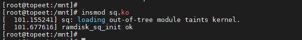
图269.192.使用命令cat /proc/partitions 确认块设备是否生成，成功如图269.20 所示。
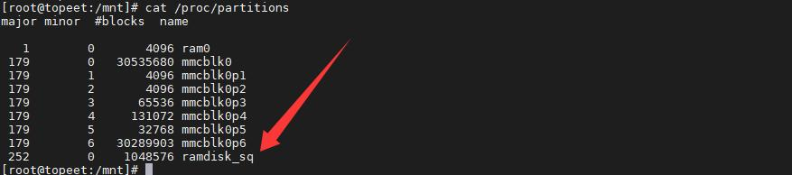
图269.203.创建文件系统，mount 挂载测试# 创建ext4 文件系统mkfs.ext4 /dev/ramdisk_sq# 挂载mkdir -p /mnt/ramtestmount /dev/ramdisk_sq /mnt/ramtest# 写文件测试

echo "hello ramdisk sq" > /mnt/ramtest/test.txtcat /mnt/ramtest/test.txt# umountumount /mnt/ramtest
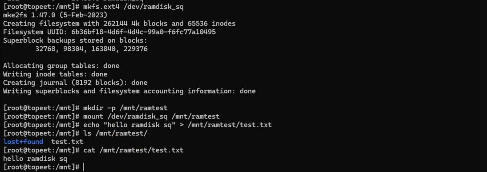
## 269.7 多队列实验
### 269.7.1 API 函数介绍
1.blk_mq_init_queue 函数函数原型：struct request_queue *blk_mq_init_queue(struct blk_mq_tag_set *set)函数参数：set：struct blk_mq_tag_set *，标签机制的全局结构体blk_mq_tag_set。返回值：- 成功：返回struct request_queue *- 失败：返回ERR_PTR(-ENOMEM)等，必须用IS_ERR()判断。函数作用：创建并初始化一个多队列版本的request_queue。头文件：#include <linux/blk-mq.h>2.blk_mq_alloc_tag_set 函数函数原型：int blk_mq_alloc_tag_set(struct blk_mq_tag_set *set)函数参数：set：struct blk_mq_tag_set 结构体返回值：成功返回0，失败返回错误码函数作用：为多队列分配并初始化tag、request 与硬件队列配置。头文件：#include <linux/blk-mq.h>

3.blk_cleanup_queue 函数函数原型：void blk_cleanup_queue(struct request_queue *q)函数参数：q：待关闭清理的struct request_queue *函数作用：停止并清除请求队列。头文件：#include <linux/blkdev.h>4.blk_mq_free_tag_set 函数函数原型：void blk_mq_free_tag_set(struct blk_mq_tag_set *set)函数参数：set：指向要释放的struct blk_mq_tag_set函数作用：释放tag_set 内部分配的资源头文件：#include <linux/blk-mq.h>
### 269.7.2 实验代码
本小节是基于多队列块框架实现虚拟盘（ramdisk），驱动加载时先用vmalloc 函数分配一块内存作为磁盘存储介质，并动态申请块设备主设备号，初始化blk_mq_tag_set 配置硬件队列数量、队列深度和IO 回调函数，调用blk_mq_alloc_tag_set 预分配tag 与request 资源池，接着分配gendisk 磁盘对象，通过blk_mq_init_queue 创建多队列请求队列并挂载到gendisk，设置逻辑块大小、最大硬件扇区数、磁盘容量与块设备操作方法集，最后调用add_disk 函数把磁盘注册到内核。当上层下发读写请求时，块层会触发queue_rq 回调，在回调中解析请求的起始扇区、数据长度与方向，并根据读写方向在ramdisk 缓冲区bio 页之间完成数据拷贝，处理完成后调用blk_mq_end_request 函数上报状态。模块卸载时依次执行del_gendisk 函数、put_disk 函数、释放tag_set 函数、注销块设备号函数、释放vmalloc 内存函数完成资源回收。编写完成的驱动程序对应的网盘路径为iTOP-RK3568 开发板\07_学习教程配套资料\03_Linux 驱动配套资料\04_Linux 驱动程序\146_mq，实验代码如代码清单269.30 所示。代码清单269.30

```c
#include <linux/module.h>
#include <linux/vmalloc.h>
#include <linux/blkdev.h>
#include <linux/genhd.h>
#include <linux/hdreg.h>
#include <linux/blk-mq.h>
//#define SECTOR_SIZE 512
#define TOTAL_SECTORS (2*1024*1024)
#define TOTAL_SIZE (SECTOR_SIZE*TOTAL_SECTORS)
#define RAMDISK_NAME "ramdisk_mq"
u8 *ramdisk_buf;
int ramdisk_major;
struct request_queue *ramdisk_queue;
struct gendisk *ramdisk_disk;
struct blk_mq_tag_set ramdisk_tag_set;
int ramdisk_open(struct block_device *bdev, fmode_t mode){
    return 0;
}
void ramdisk_release(struct gendisk *disk, fmode_t mode){
}
int ramdisk_getgeo(struct block_device *bdev, struct hd_geometry *geo)
{
    geo->heads = 64;
    geo->sectors = 32;
    geo->start = 0;
    geo->cylinders = (TOTAL_SIZE/SECTOR_SIZE)/(64*32);
    return 0;
}
const struct block_device_operations ramdisk_fops={
    .owner=THIS_MODULE,
    .open = ramdisk_open,
    .release = ramdisk_release,
    .getgeo = ramdisk_getgeo,
};
```

```c
//从ramdisk_buf 拷贝到bio
void ramdisk_copy_to_bio(struct request *rq,const u8 *src,unsigned int len)
{
    struct bio_vec bvec;
    struct req_iterator iter;
    unsigned int done = 0;
    rq_for_each_segment(bvec, rq, iter){
        unsigned int copy = min(bvec.bv_len,len - done);
        void *dst = kmap_atomic(bvec.bv_page);
        memcpy(dst + bvec.bv_offset,src + done,copy);
        kunmap_atomic(dst);
        done += copy;
        if(done >= len)
            break;
    }
}
//从bio 拷贝数据到ramdisk_buf
void ramdisk_copy_from_bio(struct request *rq,u8 *dst,unsigned int len)
{
    struct bio_vec bvec;
    struct req_iterator iter;
    unsigned int done = 0;
    rq_for_each_segment(bvec, rq, iter){
        unsigned int copy = min(bvec.bv_len,len - done);
        void *src = kmap_atomic(bvec.bv_page);
        memcpy(dst + done,src+bvec.bv_offset,copy);
        kunmap_atomic(dst);
        done += copy;
        if(done >= len)
            break;
    }
}
int ramdisk_handle_rq(struct request *rq)
{
    sector_t lba = blk_rq_pos(rq); //获取请求的起始扇区号
    unsigned int len = blk_rq_bytes(rq);//获取请求的总字节数
```

```c
unsigned int offset = lba*SECTOR_SIZE;//获取ramdisk_buf 的字节偏移
//地址越界检查
if(offset + len > TOTAL_SIZE){
    printk("out of range\n");
    return -EIO;
}
if( rq_data_dir(rq) == READ){
    ramdisk_copy_to_bio(rq,ramdisk_buf+offset,len);
}else{
    ramdisk_copy_from_bio(rq,ramdisk_buf+offset,len);
}
return 0;
}
blk_status_t ramdisk_quene_rq(struct blk_mq_hw_ctx *hctx,const struct blk_mq_queue_data *bd)
{
 struct request *rq=bd->rq;
 int ret;
 blk_mq_start_request(rq);
 if(blk_rq_is_passthrough(rq)){
        blk_mq_end_request(rq,BLK_STS_IOERR);
        return BLK_STS_OK;
 }
 ret = ramdisk_handle_rq(rq);
 if(ret==0){
    blk_mq_end_request(rq,BLK_STS_OK);
 }else{
    blk_mq_end_request(rq,BLK_STS_IOERR);
 }
 return BLK_STS_OK;
}
struct blk_mq_ops ramdisk_mq_ops={
.queue_rq=ramdisk_quene_rq,
};
int __init ramdisk_mq_init(void)
{
int ret;
//1.分配内存区域
ramdisk_buf=vmalloc(TOTAL_SIZE);
if(!ramdisk_buf)
```

```c
return -ENOMEM;
memset(ramdisk_buf,0,TOTAL_SIZE);
//2.使用动态分配方式获取主设备号
ramdisk_major=register_blkdev(0,RAMDISK_NAME);
if(ramdisk_major<0){
printk("register_blkdev error\n");
vfree(ramdisk_buf);
return ramdisk_major;
}
//3.初始化blk_mq_tag_set 结构体
memset(&ramdisk_tag_set,0,sizeof(ramdisk_tag_set));
ramdisk_tag_set.ops=&ramdisk_mq_ops;
ramdisk_tag_set.nr_hw_queues=4;
ramdisk_tag_set.queue_depth=128;
ramdisk_tag_set.numa_node=NUMA_NO_NODE;
ramdisk_tag_set.flags=BLK_MQ_F_SHOULD_MERGE;
ret=blk_mq_alloc_tag_set(&ramdisk_tag_set);
if(ret){
printk("blk_mq_alloc_tag_set error\n");
goto err_tag;
}
//4.创建了请求队列（多队列）
ramdisk_queue=blk_mq_init_queue(&ramdisk_tag_set);
if(!ramdisk_queue){
printk("blk_init_queue error\n");
goto err_queue;
}
//5.配置队列属性
blk_queue_logical_block_size(ramdisk_queue,SECTOR_SIZE);
blk_queue_max_hw_sectors(ramdisk_queue,1024);
//6.分配一个gendisk
ramdisk_disk=alloc_disk(1);
if(!ramdisk_disk){
printk("alloc_disk error\n");
goto err_disk;
}
ramdisk_disk->major=ramdisk_major;
ramdisk_disk->first_minor=0;
ramdisk_disk->queue=ramdisk_queue;
ramdisk_disk->fops=&ramdisk_fops;
```

```c
snprintf(ramdisk_disk->disk_name,DISK_NAME_LEN,RAMDISK_NAME);
set_capacity(ramdisk_disk,TOTAL_SECTORS);
//7.把磁盘注册到系统
add_disk(ramdisk_disk);
printk("ramdisk_mq_init ok\n");
return 0;
err_disk:
put_disk(ramdisk_disk);
blk_cleanup_queue(ramdisk_queue);
err_queue:
blk_mq_free_tag_set(&ramdisk_tag_set);
err_tag:
unregister_blkdev(ramdisk_major,RAMDISK_NAME);
vfree(ramdisk_buf);
return -ENOMEM;
}
void __exit ramdisk_mq_exit(void)
{
del_gendisk(ramdisk_disk);
put_disk(ramdisk_disk);
blk_cleanup_queue(ramdisk_queue);
blk_mq_free_tag_set(&ramdisk_tag_set);
unregister_blkdev(ramdisk_major,RAMDISK_NAME);
vfree(ramdisk_buf);
printk("ramdisk_mq_exit ok\n");
}
module_init(ramdisk_mq_init);
module_exit(ramdisk_mq_exit);
MODULE_LICENSE("GPL");
```
### 269.7.3 实验验证
1.加载驱动，加载成功如图269.21 所示。
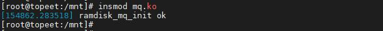
图269.212.使用命令cat /proc/partitions 确认块设备是否生成，成功如图269.22 所示。

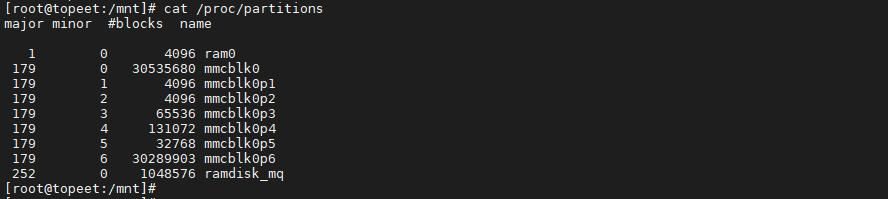
图269.223.创建文件系统，mount 挂载测试# 创建ext4 文件系统mkfs.ext4 /dev/ramdisk_mq# 挂载mkdir -p /mnt/ramtestmount /dev/ramdisk_mq /mnt/ramtest# 写文件测试echo "hello ramdisk mq" > /mnt/ramtest/test.txtcat /mnt/ramtest/test.txt# umountumount /mnt/ramtest
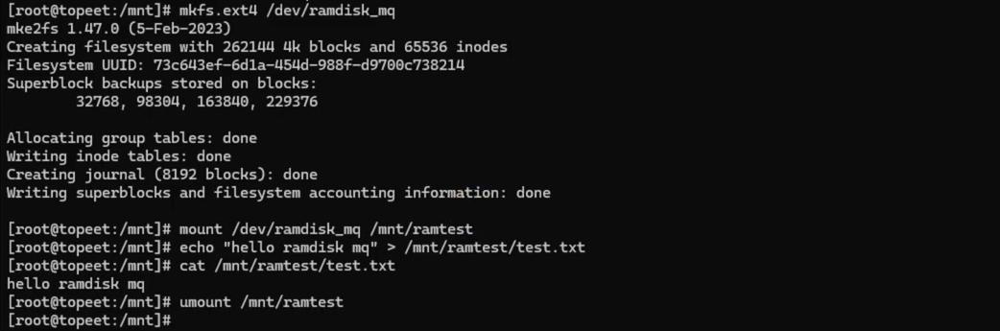
## 269.8 多队列与单队列对比
### 269.8.1 如何区分是单队列还是多队列
多队列中调度器往往有mq 关键字，如图269.23 所示。

图269.23

单队列中往往没有mq 关键字，如图269.24 所示。
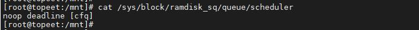
图269.24
### 269.8.2 性能对比
创建一个sq.fio 文件和mq.fio 文件，分别写入代码清单269.31 和269.32 代码。sq.fio 文件如代码清单269.31 所示。代码清单269.31
```c
[global]
direct=1
ioengine=psync
bs=4k
size=256M
runtime=20
iodepth=8
[seq-write]
rw=write
filename=/dev/ramdisk_sq
[seq-read]
rw=read
filename=/dev/ramdisk_sq
[rand-write]
rw=randwrite
filename=/dev/ramdisk_sq
[rand-read]
rw=randread
filename=/dev/ramdisk_sq
```
mq.fio 文件如代码清单269.32 所示。代码清单269.32
```c
[global]
direct=1
ioengine=psync
bs=4k
size=256M
runtime=20
```

```c
iodepth=8
[seq-write]
rw=write
filename=/dev/ramdisk_mq
[seq-read]
rw=read
filename=/dev/ramdisk_mq
[rand-write]
rw=randwrite
filename=/dev/ramdisk_mq
[rand-read]
rw=randread
filename=/dev/ramdisk_mq
```
代码清单269.31 和代码清单269.32 中fio 配置对单队列块设备和多队列块设备进行性能测试，全局开启direct 直写模式绕过页缓存、采用psync 同步、设置单次IO 块大小4KB、每个测试任务的数据上限256MB、最长运行时长20 秒，配置队列深度iodepth=8，随后依次执行顺序写、顺序读、随机写、随机读四项测试。代码清单269.31 和代码清单269.32 执行结果如图269.25 和269.26 所示。

图269.25
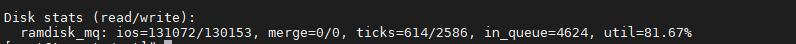
图269.26对比之后发现，多队列在ticks（设备处理IO 花费的总时间）和in_queue（IO 排队总累积时间）更少。因为单队列大量IO 在队列上排队抢全局queue_lock，多硬件队列并行，排队极少。从而多队列的设备占有率更低。如表269.2 所示。表269.2

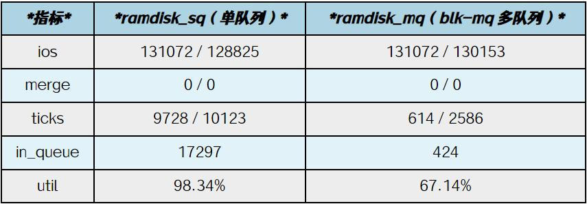

